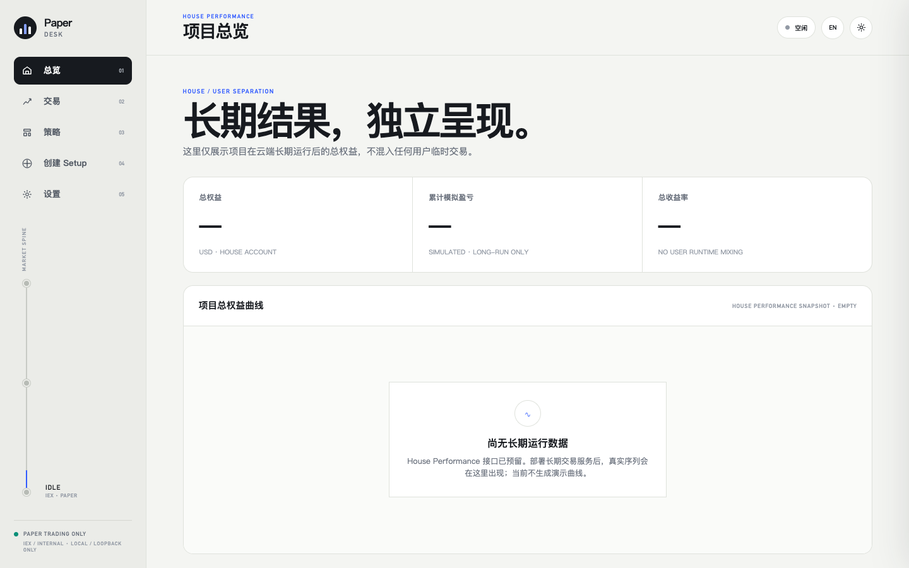
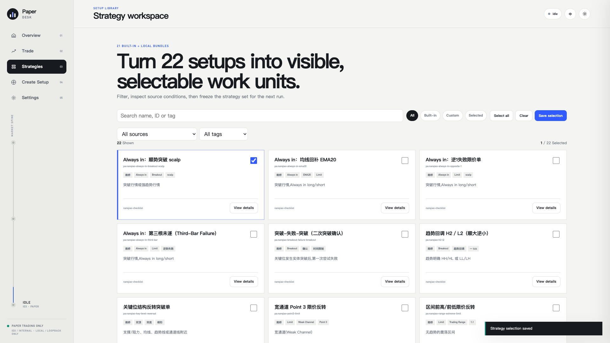
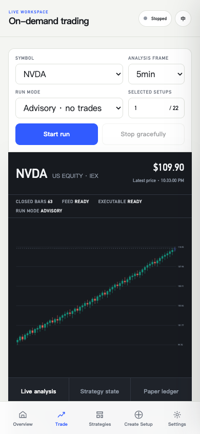

# Pa-Agent · Price Action Paper Desk

[中文](#中文) · [English](#english)



## 中文

Pa-Agent 是一个面向美股价格行为（Price Action）的模拟交易与分析工作区。仓库包含两个互相独立的产品实现：

- **本地 Paper Desk**：Python 单进程、五页面浏览器工作区，支持 DeepSeek/OpenAI BYOK、Alpaca Basic IEX 行情、策略分析、advisory 模式与自动 paper trading。
- **Paper Desk Cloud**：基于 Sites、Cloudflare D1/R2 的 owner-only 云端切片，提供加密 BYOK、策略管理和页面驱动的闭合 K 线分析。

这两个版本都只支持模拟交易，不包含真实券商订单或真实资金路径。

### 产品能力

- 21 个带来源页码和哈希谱系的可执行 PA setup
- 共享行情视图、闭合 K 线证据、每策略独立状态机
- 精确 Decimal 账户、挂单、止损止盈、重启恢复与幂等 SQLite 事件
- DeepSeek thinking 开关与 OpenAI reasoning/service-tier 选择
- 五个可深链页面：表现、交易、策略、创建 Setup、设置
- 本地 `.pa-setup.zip` 自定义策略导入
- 中英文响应式界面



### 本地版快速开始

已验证环境为 macOS、Python 3.14.3。Poppler/Tesseract 只在重新构建 PDF 知识库时需要。

```bash
git clone https://github.com/TonyLiuYX/Pa-Agent.git
cd Pa-Agent
bash scripts/bootstrap_env.sh
.venv/bin/python -m playwright install chromium
.venv/bin/python -m pa_engine.web
```

打开 `http://127.0.0.1:8765/`。在 Settings 中输入 Alpaca 和所选模型的凭据；本地凭据只保存在当前服务进程内，不写入 SQLite、浏览器存储或日志。

默认运行模式是 `advisory`。只有明确选择 `paper` 才会进入模拟成交与账户状态机。

### 云端版

云端源码位于 `paper-desk-cloud/`，需要 Node.js 22.13+、Sites 项目、D1 数据库、R2 bucket，以及 32 字节随机值的 Base64 `PA_VAULT_KEY`。

```bash
cd paper-desk-cloud
npm ci
npm run lint
npm run build
npm run dev
```

仓库中的 `.openai/hosting.json` 使用无效占位项目 ID。部署前请替换为自己的 Sites 项目 ID，并保持 D1/R2 binding 名称为 `DB` 和 `FILES`。生产环境还必须注入 `PA_VAULT_KEY`；不要把真实值提交到 Git。

### 验证

```bash
bash scripts/verify_public.sh
```

该入口运行精选 Python 测试、加载 21 个内置策略，并执行云端 lint 与 production build。

### 安全与使用边界

- **PAPER TRADING ONLY — no live orders**
- Alpaca Basic IEX 是单交易所数据，不等同于 SIP 全市场行情。
- 项目不保证收益，不构成投资、法律或税务建议。
- 不要提交 API key、`.env*`、SQLite 数据库或 `.pa-workspace/`。
- 本仓库未授予开源许可证；版权与策略来源说明见 [NOTICE.md](NOTICE.md)。



## English

Pa-Agent is a U.S.-equities price-action analysis and paper-trading workspace. This repository contains two independent product implementations:

- **Local Paper Desk:** a five-page Python web workspace with DeepSeek/OpenAI BYOK, Alpaca Basic IEX data, advisory analysis, and automatic paper execution.
- **Paper Desk Cloud:** an owner-only Sites/Cloudflare D1/R2 slice with encrypted BYOK, strategy management, and page-driven closed-bar analysis.

Both variants are paper-only. There is no broker-order or real-money execution path.

### Architecture highlights

- 21 executable PA setups with source-page and hash lineage
- One immutable shared market view and independent per-strategy state machines
- Decimal paper-account math, pending entries, exits, restart recovery, and idempotent SQLite events
- Provider-neutral routing for DeepSeek and OpenAI
- Five responsive routes: performance, trade, strategies, setup creation, and settings
- Validated `.pa-setup.zip` imports for local custom setups

### Run locally

The pinned environment was verified with Python 3.14.3 on macOS.

```bash
git clone https://github.com/TonyLiuYX/Pa-Agent.git
cd Pa-Agent
bash scripts/bootstrap_env.sh
.venv/bin/python -m playwright install chromium
.venv/bin/python -m pa_engine.web
```

Open `http://127.0.0.1:8765/` and configure Alpaca plus one model provider in Settings. Local credentials remain process-only. `advisory` is the default execution policy; `paper` must be selected explicitly.

For the cloud variant, replace the placeholder Sites project ID in `paper-desk-cloud/.openai/hosting.json`, provision `DB` and `FILES`, and inject a Base64-encoded 32-byte `PA_VAULT_KEY` through the deployment platform.

### Disclaimer

Paper trading only. This project does not provide financial advice or guarantee performance. Alpaca Basic IEX is single-exchange market data. See [NOTICE.md](NOTICE.md) for copyright and source terms.
