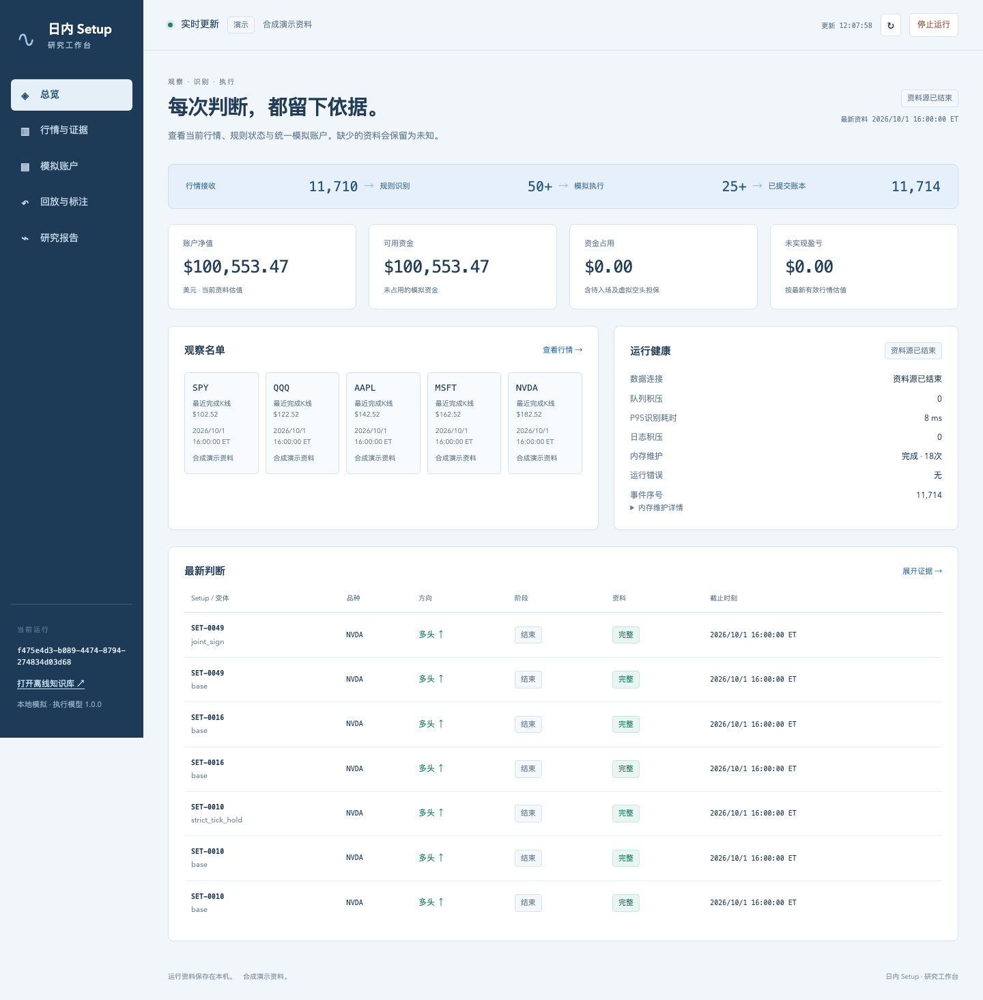

# Pa-Agent — Intraday Strategy Research & Paper Trading

**Latest workbench: [Intraday Setup Library v1.3.0](intraday-setup-library/README.md).**

A source-linked intraday strategy research workbench: turn documented trading setups into explicit recognition rules, inspect their evidence, and test execution through a replayable paper account. This is a research and engineering project, not a proven profitable trading system.

[中文说明](#中文说明) · [Run the demo](#run-the-latest-workbench) · [Verification](#verification-and-limits) · [Earlier Paper Desk](README.legacy.md)



*Screenshot: synthetic demonstration data, not live trading performance.*

## Latest workbench

- **50 source-linked base setups and 34 variants:** 84 executable recognition graphs with separate candidate, confirmation, trigger and invalidation states.
- **Sequential paper execution:** next-valid-quote fills, configurable slippage, position budgets, stop/target handling, daily risk controls and explicit missing-data states.
- **Replay and recovery:** SQLite event journal, atomic account updates, checkpoints and deterministic replay.
- **Research interface:** market evidence, paper account, event-by-event review, annotation and evaluation views, plus an offline searchable setup library.
- **Data modes:** a no-key synthetic demo, recorded-event replay and an Alpaca IEX connector. Actual live-connection and market-performance acceptance remain unverified for this release.

The latest workbench does not place live brokerage orders or require paid LLM calls. Its rules and execution model are separate from the earlier LLM-driven Paper Desk.

## Run the latest workbench

Use Python 3.11 or newer; the archived engineering evidence was produced with Python 3.14.3 on macOS. The synthetic demo uses the Python standard library and requires no API credentials.

```sh
git clone https://github.com/TonyLiuYX/Pa-Agent.git
cd Pa-Agent/intraday-setup-library
python3 -m runtime serve --mode demo --data-dir ../runtime-runs/demo
```

Open the local address printed by the command (normally `http://127.0.0.1:8765`). The default demo is finite and ends with `SOURCE_ENDED`; `--sessions 20 --pace 0.25` provides a longer synthetic run. Stop the server with Ctrl+C.

For recovery, replay and optional live-data setup, use the [full workbench guide](intraday-setup-library/README.md). Keep credentials in the local environment and runtime data outside the frozen `intraday-setup-library/` directory. Do not commit credentials or account databases.

For offline reading, open `intraday-setup-library/site/index.html` in a local browser after cloning.

## Verification and limits

From `intraday-setup-library/`:

```sh
# Structural, reference and release-manifest checks; no network is required.
python3 scripts/validate.py

# Isolated synthetic paper-execution tests; no live orders or API calls.
python3 -m unittest paper.tests
```

For the full optional JSON Schema checks, install `jsonschema` in your own virtual environment and use `python3 scripts/validate.py --require-jsonschema`. The first command reports skipped schema coverage when that dependency is unavailable.

The archived v1.3.0 acceptance report records a **10-hour fixed-version synthetic stability test**, **83,046 journal events**, **39 fault injections** and **18 recoveries**. These are historical local engineering results, not a new test performed by GitHub and not evidence of market profitability. The original runtime databases are intentionally not included.

Real-market labels, recognition precision/recall, U.S.-market transfer and profitability validation remain **not run**. The 50 reviewed setup records are documented source interpretations, not 50 independently validated or original profitable strategies. See the [publication notes](docs/releases/intraday-v1.3.0.md) and [archived verification scope](intraday-setup-library/reports/release-notes.md).

## Repository layout

| Path | Purpose |
| --- | --- |
| `intraday-setup-library/` | Latest v1.3.0 frozen workbench: source, setup catalog, tests, offline site and selected historical reports |
| `README.legacy.md` | Original Paper Desk instructions, preserved unchanged |
| `pa_engine/`, `knowledge/`, `策略/` | Earlier local Paper Desk and its source-linked knowledge |
| `paper-desk-cloud/` | Earlier independent cloud implementation |
| `docs/releases/intraday-v1.3.0.md` | Version provenance, import boundaries and checks |

The earlier code and Git history have been retained. These implementations are separate; do not mix their configuration, state directories or performance claims.

## 中文说明

最新版位于 **[intraday-setup-library/](intraday-setup-library/README.md)**，对应本地 2026 年 10 月 5 日完成的 v1.3.0 发布。它包含 50 个基础 setup、34 个变体、规则识别、模拟执行、持久化日志、恢复重放及研究工作台。

本次上传的是原发布包中的文件，不包含开发工作区的未完成改动、运行数据库、外部原始行情日志或凭证。原有 Pa-Agent / Paper Desk 代码和历史继续保留，使用方法见 [旧版说明](README.legacy.md)。

历史十小时测试使用合成数据，只证明对应版本和环境下的工程稳定性；真实行情连接验收、识别准确率和盈利验证尚未完成，不能将其写成实盘业绩。

## Rights and source attribution

See [NOTICE.md](NOTICE.md). No new open-source license is granted by this update. The workbench retains source attribution and bundled third-party notices; external chart links do not imply redistribution permission. Paper trading only; no investment advice or performance guarantee.
