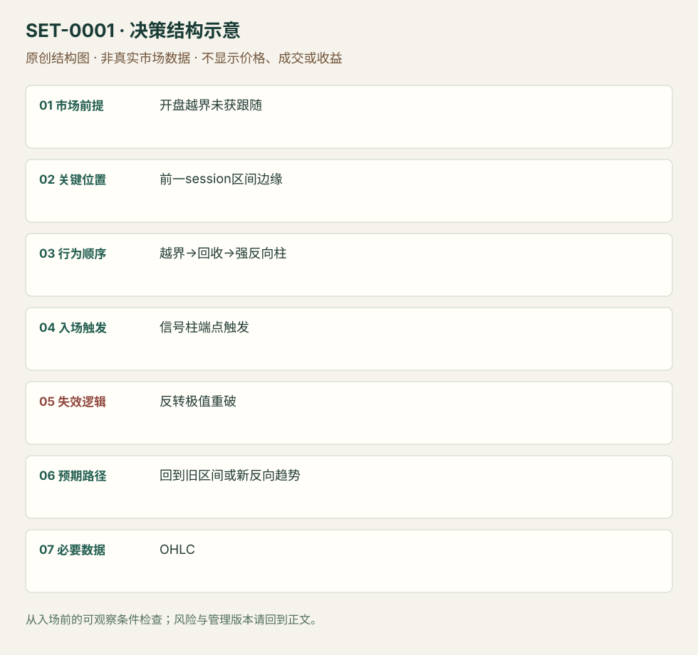

---
{
  "id": "SET-0001",
  "schema_version": "1.0.0",
  "name_zh": "前一交易区间突破失败后的开盘反转",
  "name_en": "Opening Failed Breakout of Prior Range",
  "aliases": [
    "Opening Reversal",
    "Failed BO below yesterday’s range"
  ],
  "name_nature": "editor_descriptive_with_source_term",
  "status": "reviewed",
  "summary": "开盘缺口把价格带出前一交易区间，但外侧推进迅速失败；强反向信号柱后考虑回到旧区间。重新在外侧建立推进会否定反转；开盘下跌本身不足以买入。",
  "mechanism": "failed_breakout",
  "tags": [
    "price_action",
    "opening",
    "reversal",
    "gap"
  ],
  "pa_role": "core",
  "markets_observed": [
    "ES期货（Brooks讲义）"
  ],
  "markets_supported": [],
  "migration_hypotheses": [],
  "session": "美股/ES现金参考段 09:30–16:00 America/New_York；收盘前平仓。期货夜盘单独建背景，不将其并入开盘区间。",
  "session_tags": [
    "intraday"
  ],
  "context_timeframe": "日线/前一session + 当日执行图；因来源而异",
  "trigger_timeframe": "讲义图周期未明确；不凭风格猜测",
  "data_requirements": [
    "OHLC",
    "previous_session_levels"
  ],
  "execution_mode": "mixed",
  "source_ids": [
    "SRC-0001"
  ],
  "evidence_ids": [
    "EVD-000001"
  ],
  "visual_ids": [
    "VIS-000001",
    "VIS-000058"
  ],
  "rule_completeness": "前提/触发/失效/管理已记录；来源与编辑模块分开",
  "independent_corroboration": "limited_single_family",
  "profit_evidence": "not_established",
  "created": "2026-10-02",
  "updated": "2026-10-02",
  "reviewed_at": "2026-10-02",
  "known_gaps": [
    "未开展独立回测；实际订单成交与成本未知"
  ],
  "logic_fingerprint": [
    "开盘越界未获跟随",
    "前一session区间边缘",
    "越界→回收→强反向柱",
    "信号柱端点触发",
    "反转极值重破",
    "回到旧区间或新反向趋势",
    "OHLC"
  ],
  "environment_tags": [
    "opening",
    "failed_auction"
  ],
  "structure_locations": [
    "prior_range_edge"
  ],
  "version": "1.0.0",
  "unknown_fields": {},
  "review_scope": "规则记录、引用范围、日内边界、逻辑区别与已看静态画面；不含独立回测、动态逐笔或账户核验",
  "source_coverage": {
    "substantive_read_sources": 1,
    "families": [
      "brooks"
    ],
    "core_support_source_ids": [
      "SRC-0001"
    ],
    "independence_note": "limited_single_family"
  },
  "method_families": [
    "price_action_reversal",
    "opening_gap"
  ],
  "market_types": [
    "futures"
  ]
}
---

# 前一交易区间突破失败后的开盘反转 · Opening Failed Breakout of Prior Range

## 1. 名称与快速概览

开盘缺口把价格带出前一交易区间，但外侧推进迅速失败；强反向信号柱后考虑回到旧区间。重新在外侧建立推进会否定反转；开盘下跌本身不足以买入。

记录口径：PA core；必要数据 OHLC、previous_session_levels。名称性质：编辑性描述名，英文保留来源术语以便检索。reviewed 只表示本条规则与证据记录审查通过，盈利状态为 not_established。

## 2. 本质与行为假说

可观察的是越界、回收和后续反向柱。Brooks将此解释为失败突破，空头回补可能帮助上涨；“被套空头”是行为假说，并没有参与者身份数据。缺口只提供位置，不能代替触发。

## 3. 适用市场与环境

前一session区间清楚，开盘首次试探外侧，反向实体与收盘强度已经出现。若连续大趋势柱继续扩大外侧区间，应保留原方向假说。

**来源实用市场：**ES期货（Brooks讲义）。

**Session：**美股/ES现金参考段 09:30–16:00 America/New_York；收盘前平仓。期货夜盘单独建背景，不将其并入开盘区间。

跨市场：本版不主张已经验证的跨市场迁移；更换市场必须重定数据来源、流动性与session。

## 4. 出现前的观察清单

必要：提前画前一交易区间边缘；已有突破与失败迹象。增强：反向柱收于自身高/低端。否决：仅一根长影线、强趋势连续收在区间外、反转止损距离已不可执行。

## 5. 形成过程与状态转换

旧区间标记 → 开盘越界 → 无法继续并回收 → 反向强柱形成 → 突破信号柱端点 → 检查能否留在旧区间。触发前若再次放量推进外侧，撤销等待反转的计划。

## 6. Entry trigger 与执行方式

来源版：多头等待靠近高点收盘的多头柱，在其高点上方用买入触发单；空头镜像。此处突破的是信号柱，不是追逐第一根下跌柱。订单触发与成交价分开记录。

## 7. Invalidation 与止损逻辑

来源原则：保护止损放在整个反转结构极值之外，不能因入场柱不是最低柱就只用入场柱低点。研究补充：重新接受区间外价格或反向跟随迅速消失应重审；时间阈值尚未测试。

## 8. Exit、target 与 trade management

先使用事前已知的旧区间内部障碍、开盘价或相反边缘作为管理参考。若演变为持续趋势，可按新形成的主要摆动保护；讲义给出退出标记，但不提供统一获利倍数。本库日内收盘前退出是边界约束。

## 9. 常见 variations

多空镜像与缺口大小作为同一记录的变体。没有缺口的盘中前日极值失败属于同族位置变体，不另计数。若等待的是整段拍卖接受而非快速回收，参见相近Profile条目。

## 10. 失败方式与不交易条件

正常亏损：合格反向柱之后仍创新极值。未成立：把开盘下跌直接当作拒绝。执行偏离：追入已远离结构的反转。来源歧义：如何量化“强柱”需自己固定定义；不能事后把亏损全部排除。

## 11. 与相近 setups 的区别

- [SET-0002](SET-0002.md)：ORB等待固定开盘区间形成并顺突破入场；本条已有外侧突破失败并交易反向回收。
- [SET-0007](SET-0007.md)：楔形反转必须出现分开的三次高潮推进；本条不要求三推。

## 12. 图表与案例解读

已查看公开讲义PDF第4页（印刷Slide 3），图中虚线右侧先跌出旧区间，随后绿色反转位置和粉色趋势买点。画面支持失败突破后上涨的结构；此页未显示可核对日期、品种标识与成交单，不据此认定真实成交。

- [VIS-000001] [开盘下破旧区间后向上反转并持续上涨的K线图](https://www.brookstradingcourse.com/wp-content/uploads/2018/10/181030-futuresio-Patterns-on-the-Open-Al-Brooks.pdf#page=4)；定位：PDF第4页，印刷Slide 3；左下开盘虚线附近。先看虚线附近的下破与回收，再看上涨展开；右侧完整走势属于事后信息。 验证：chart_viewed。

**本地原创示意（VIS-000058，非真实市场数据）：**

小屏阅读可[打开原尺寸示意图](../assets/diagrams/SET-0001.svg)并缩放。

此图用于对照识别顺序与风险定义；不计入真实案例覆盖率。

## 13. 证据、分歧与未知项

单一原始来源族，规则与图表可复核；概率百分比不采用为收益结论。入场与结构止损来自讲义，目标框架与时间退出是本研究明确添加的管理模块。

- [EVD-000001] Al Brooks，《Patterns on the Open》，[SRC-0001](https://www.brookstradingcourse.com/wp-content/uploads/2018/10/181030-futuresio-Patterns-on-the-Open-Al-Brooks.pdf)；定位：PDF页4及11–13（印刷Slide 3、10–12）。支持：失败突破后等强信号柱；触发单越过信号端点；结构止损越过反转极值

审查例外：此条只有一份富信息原始资料，足以还原本条规则；独立佐证有限，未用背景页冒充第二份核验。后续优先寻找独立规则/失败案例。

## 14. 可用于复盘的检查表

- [ ] 下单前的前提可核对：开盘越界未获跟随
- [ ] 事前标记位置：前一session区间边缘
- [ ] 行为按顺序出现：越界→回收→强反向柱
- [ ] 实际触发符合选定版本：信号柱端点触发
- [ ] 事先写明本次否定条件：反转极值重破
- [ ] 目标/路径只用当时已知信息：回到旧区间或新反向趋势
- [ ] 数据满足 OHLC；记录时间、点差、滑点、队列和未成交
- [ ] 记录截止平仓及规则偏离；正常亏损不事后改成“未成立”

## 15. 后续验证问题

固定首次越界后的观察窗口与强柱定义，用所有当时满足条件的样本检验；比较快速回收与持续外侧接受。测试需包含开盘滑点、触发后未成交和普通亏损。
