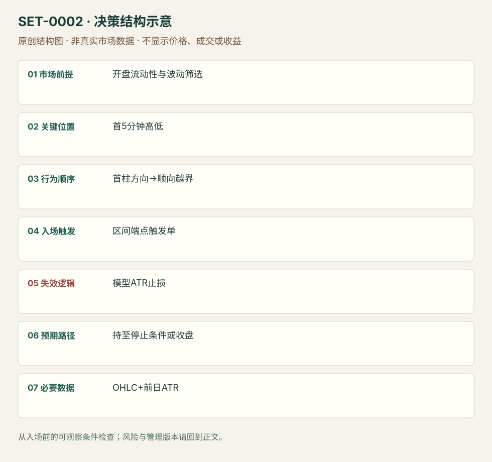

---
{
  "id": "SET-0002",
  "schema_version": "1.0.0",
  "name_zh": "五分钟开盘区间突破",
  "name_en": "5-minute Opening Range Breakout",
  "aliases": [
    "ORB",
    "5m ORB",
    "Opening Range Breakdown"
  ],
  "name_nature": "established_or_source_term",
  "status": "reviewed",
  "summary": "先用09:30–09:35的完整首柱确定区间和方向，只在其方向越过首柱高/低时入场；论文版本用前14日ATR的10%设置保护止损，未止损则16:00退出。",
  "mechanism": "opening_momentum",
  "tags": [
    "opening",
    "breakout",
    "momentum",
    "stocks_in_play"
  ],
  "pa_role": "supporting",
  "markets_observed": [
    "美国上市股票（论文样本）"
  ],
  "markets_supported": [],
  "migration_hypotheses": [],
  "session": "美股/ES现金参考段 09:30–16:00 America/New_York；收盘前平仓。期货夜盘单独建背景，不将其并入开盘区间。",
  "session_tags": [
    "intraday"
  ],
  "context_timeframe": "日线/前一session + 当日执行图；因来源而异",
  "trigger_timeframe": "5分钟形成区间，后续价格触发",
  "data_requirements": [
    "OHLC",
    "volume",
    "daily_ATR"
  ],
  "execution_mode": "systematic_source_version",
  "source_ids": [
    "SRC-0005"
  ],
  "evidence_ids": [
    "EVD-000002"
  ],
  "visual_ids": [
    "VIS-000002",
    "VIS-000059"
  ],
  "rule_completeness": "前提/触发/失效/管理已记录；来源与编辑模块分开",
  "independent_corroboration": "limited_single_family",
  "profit_evidence": "author_backtest_specific_version",
  "created": "2026-10-02",
  "updated": "2026-10-02",
  "reviewed_at": "2026-10-02",
  "known_gaps": [
    "未独立复现回测",
    "本次未核验全部相对量过滤结果",
    "订单级滑点与排队未核验"
  ],
  "logic_fingerprint": [
    "开盘流动性与波动筛选",
    "首5分钟高低",
    "首柱方向→顺向越界",
    "区间端点触发单",
    "模型ATR止损",
    "持至停止条件或收盘",
    "OHLC+前日ATR"
  ],
  "environment_tags": [
    "opening",
    "directional"
  ],
  "structure_locations": [
    "opening_range"
  ],
  "version": "1.0.0",
  "unknown_fields": {},
  "review_scope": "规则记录、引用范围、日内边界、逻辑区别与已看静态画面；不含独立回测、动态逐笔或账户核验",
  "source_coverage": {
    "substantive_read_sources": 1,
    "families": [
      "concretum-bbt"
    ],
    "core_support_source_ids": [
      "SRC-0005"
    ],
    "independence_note": "limited_single_family"
  },
  "method_families": [
    "opening_gap",
    "quantitative_time"
  ],
  "market_types": [
    "stocks"
  ]
}
---

# 五分钟开盘区间突破 · 5-minute Opening Range Breakout

## 1. 名称与快速概览

先用09:30–09:35的完整首柱确定区间和方向，只在其方向越过首柱高/低时入场；论文版本用前14日ATR的10%设置保护止损，未止损则16:00退出。

记录口径：PA supporting；必要数据 OHLC、volume、daily_ATR。名称性质：来源术语或研究术语。reviewed 只表示本条规则与证据记录审查通过，盈利状态为 author_backtest_specific_version。

## 2. 本质与行为假说

观察是开盘首柱方向与后续区间越界。作者认为首段方向可能反映日内供需；该解释不是机构身份观测。这个记录的核心是时间窗口和突破动量，PA辅助提供水平，不能因此自动归为纯PA。

## 3. 适用市场与环境

论文规则：开盘价大于5美元，前14日日均成交量至少100万股，前14日ATR大于0.50美元。所有阈值是论文美股版本，不是通用市场标准。十字星首柱不发订单。

**来源实用市场：**美国上市股票（论文样本）。

**Session：**美股/ES现金参考段 09:30–16:00 America/New_York；收盘前平仓。期货夜盘单独建背景，不将其并入开盘区间。

跨市场：本版不主张已经验证的跨市场迁移；更换市场必须重定数据来源、流动性与session。

## 4. 出现前的观察清单

必要：5分钟完整收盘；只使用已知前14日统计；标记区间高低与首柱方向。增强：异常相对成交量，但过滤版本应与基础版本分别记录。否决：未形成区间、方向十字星、点差吞噬ATR止损或暂停交易。

## 5. 形成过程与状态转换

事前流动性筛选 → 9:30开盘 → 9:35冻结首柱高低及方向 → 仅顺首柱方向挂触发单 → 越界成交后附保护订单 → 止损或当日收盘退出。禁止用当天最终成交量筛选。

## 6. Entry trigger 与执行方式

论文2.1节：阳首柱在其最高价买入触发，阴首柱在最低价卖出触发，不反手交易相反方向。触发单不保证在触发价成交；回测与实盘成交须单独核验。

## 7. Invalidation 与止损逻辑

论文版是成交价外侧10%前14日ATR；这是模型风险参数，不等于自然结构失效。返回开盘区间代表动量假说减弱，但基础回测并未因此立即退出。不能把结构版止损与论文收益拼接。

## 8. Exit、target 与 trade management

基础规则当日16:00 America/New_York平仓；不设置事后极值目标。主观版可按新摆动管理，但属于另一个待测管理版本。论文每股佣金0.0035美元、样本2016–2023；本库未重跑，也未独立确认订单级滑点。

## 9. 常见 variations

1/15/30/60分钟区间和结构止损均为参数或管理变体，不另计数。Stocks in Play相对量筛选是样本筛选版本，必须与基础策略分别评估。IB仅因时长变成60分钟不另创setup。

## 10. 失败方式与不交易条件

正常亏损：顺向越界后反转触及模型止损。未成立：9:35前预判区间。偏离：双向触发、十字星仍交易。执行局限：开盘点差、熔断、缺口穿越止损和同一分钟顺序不可判定。

## 11. 与相近 setups 的区别

- [SET-0001](SET-0001.md)：本条在区间外继续方向；前日失败突破反转已经观察到外侧推进失败。

## 12. 图表与案例解读

已查看论文PDF页8（印刷页7）Figure 2：BLDR，2024-01-23，5分钟图。首柱阴线，10:00附近下破；图注明确是hypothetical交易示例。历史价格图可核对，作者描述的13.62R不能当作审计实盘成交。

- [VIS-000002] [BLDR五分钟图上的开盘区间空头假设执行示例](https://alexandria.unisg.ch/server/api/core/bitstreams/3c2989c4-688d-4d78-8a71-f02690990d51/content#page=8)；定位：PDF页8／印刷页7，Figure 2。灰色区域为盘前盘后，箭头标记模型入场与收盘退出；图表完整后半段不能用于首段决策。 验证：chart_viewed_hypothetical_execution。

**本地原创示意（VIS-000059，非真实市场数据）：**

小屏阅读可[打开原尺寸示意图](../assets/diagrams/SET-0002.svg)并缩放。

此图用于对照识别顺序与风险定义；不计入真实案例覆盖率。

## 13. 证据、分歧与未知项

已核对原论文的策略定义、基础模型与数据章节。此记录规则完整但来源族独立佐证有限；作者回测与本研究验证分开。基础广泛股票组合并非标题暗示的无条件高收益，来源明确报告其弱于同期基准。

- [EVD-000002] Carlo Zarattini / Andrea Barbon / Andrew Aziz，《A Profitable Day Trading Strategy For The U.S. Equity Market》，[SRC-0005](https://alexandria.unisg.ch/server/api/core/bitstreams/3c2989c4-688d-4d78-8a71-f02690990d51/content)；定位：PDF页6–10，§2、§2.1、Figure 2。支持：首五分钟方向、流动性筛选、10%ATR止损和收盘退出；CRSP/IQFeed样本及佣金假设

审查例外：此条只有一份富信息原始资料，足以还原本条规则；独立佐证有限，未用背景页冒充第二份核验。后续优先寻找独立规则/失败案例。

## 14. 可用于复盘的检查表

- [ ] 下单前的前提可核对：开盘流动性与波动筛选
- [ ] 事前标记位置：首5分钟高低
- [ ] 行为按顺序出现：首柱方向→顺向越界
- [ ] 实际触发符合选定版本：区间端点触发单
- [ ] 事先写明本次否定条件：模型ATR止损
- [ ] 目标/路径只用当时已知信息：持至停止条件或收盘
- [ ] 数据满足 OHLC+前日ATR；记录时间、点差、滑点、队列和未成交
- [ ] 记录截止平仓及规则偏离；正常亏损不事后改成“未成立”

## 15. 后续验证问题

用逐笔或较细数据处理同柱先后顺序；重测2016–2023外样本与未成交订单。先复现基础版，再独立加入相对成交量过滤；记录不同市场波动与点差分层。
