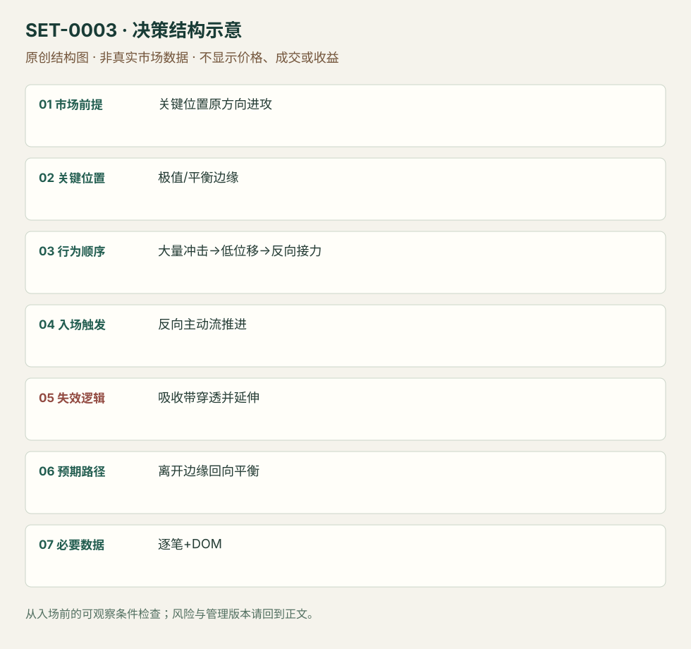

---
{
  "id": "SET-0003",
  "schema_version": "1.0.0",
  "name_zh": "关键位置吸收后的反转",
  "name_en": "Absorption Reversal",
  "aliases": [
    "Stopping Volume",
    "Iceberg absorption（非同义）"
  ],
  "name_nature": "editor_descriptive_with_source_term",
  "status": "reviewed",
  "summary": "在事先标记的极值或边缘，主动成交持续冲击却无法推进价格；等反方向主动流开始推进后考虑反转。吸收区域被重新穿透并继续成交推进即失效。",
  "mechanism": "passive_absorption",
  "tags": [
    "order_flow",
    "DOM",
    "reversal",
    "scalping"
  ],
  "pa_role": "supporting",
  "markets_observed": [
    "黄金期货 GCM1（Bookmap图例）",
    "期货（Jigsaw／AXIA文字案例，合约未明确）"
  ],
  "markets_supported": [],
  "migration_hypotheses": [],
  "session": "来源未说明统一交易段与时区。编辑日内边界：先锁定所选合约的交易日、现金活动段和截止时刻，在该计划段内进出；不从GCM1截图推定纽约时间。",
  "session_tags": [
    "intraday"
  ],
  "context_timeframe": "日线/前一session + 当日执行图；因来源而异",
  "trigger_timeframe": "逐笔成交／价格梯，无固定K线周期",
  "data_requirements": [
    "time_and_sales",
    "DOM",
    "bid_ask_volume"
  ],
  "execution_mode": "discretionary",
  "source_ids": [
    "SRC-0003",
    "SRC-0002",
    "SRC-0033"
  ],
  "evidence_ids": [
    "EVD-000003",
    "EVD-000004",
    "EVD-000100"
  ],
  "visual_ids": [
    "VIS-000055",
    "VIS-000060"
  ],
  "rule_completeness": "前提/触发/失效/管理已记录；来源与编辑模块分开",
  "independent_corroboration": "multiple_families",
  "profit_evidence": "not_established",
  "created": "2026-10-02",
  "updated": "2026-10-02",
  "reviewed_at": "2026-10-02",
  "known_gaps": [
    "未开展独立回测；实际订单成交与成本未知"
  ],
  "logic_fingerprint": [
    "关键位置原方向进攻",
    "极值/平衡边缘",
    "大量冲击→低位移→反向接力",
    "反向主动流推进",
    "吸收带穿透并延伸",
    "离开边缘回向平衡",
    "逐笔+DOM"
  ],
  "environment_tags": [
    "extreme_test"
  ],
  "structure_locations": [
    "swing_extreme"
  ],
  "version": "1.0.0",
  "unknown_fields": {},
  "review_scope": "规则记录、引用范围、日内边界、逻辑区别与已看静态画面；不含独立回测、动态逐笔或账户核验",
  "source_coverage": {
    "substantive_read_sources": 3,
    "families": [
      "axia",
      "bookmap",
      "jigsaw"
    ],
    "core_support_source_ids": [
      "SRC-0003",
      "SRC-0002",
      "SRC-0033"
    ],
    "independence_note": "multiple_families"
  },
  "method_families": [
    "tape_DOM",
    "liquidity_inventory"
  ],
  "market_types": [
    "futures"
  ]
}
---

# 关键位置吸收后的反转 · Absorption Reversal

## 1. 名称与快速概览

在事先标记的极值或边缘，主动成交持续冲击却无法推进价格；等反方向主动流开始推进后考虑反转。吸收区域被重新穿透并继续成交推进即失效。

记录口径：PA supporting；必要数据 time_and_sales、DOM、bid_ask_volume。名称性质：编辑性描述名，英文保留来源术语以便检索。reviewed 只表示本条规则与证据记录审查通过，盈利状态为 not_established。

## 2. 本质与行为假说

可观察的是成交量、价格位移和补充挂单之间的关系。Jigsaw区分挂单意图与实际成交：持续主动卖单而低点停住支持卖盘被承接的解释；仅有大买单或Delta背离不证明吸收，更无法证明订单属于同一机构。

## 3. 适用市场与环境

选择熟悉且能提供可靠逐笔和深度数据的集中竞价期货；先比较正常每档成交和推进速度。厚薄市场节奏不同，不能把某合约的绝对手数直接迁移。突破极值失败的背景增强，但不是每次吸收都反转。

**来源实际讨论市场：**黄金期货GCM1（已查看图例）和合约未明确的期货文字案例。

**Session：**来源未说明统一交易段与时区。编辑日内边界：先锁定所选合约的交易日、现金活动段和截止时刻，在该计划段内进出；不从GCM1截图推定纽约时间。

跨市场：本版不主张已经验证的跨市场迁移；更换市场必须重定数据来源、流动性与session。

## 4. 出现前的观察清单

必要：真实bid/ask成交分类与时间序列；关键位置已标记；高成交与低位移同时发生。增强：同侧流动性反复补充。否决：只有静态DOM截图、价格仍连续推进、数据掉包或聚合丢失过程。

## 5. 形成过程与状态转换

关键位置到达 → 主动冲击增加 → 价格推进停滞且供给持续承接 → 等反方向主动成交接力 → 价格离开吸收带 → 检查回测能否守住。触发前若原冲击方向重新推进，取消。

## 6. Entry trigger 与执行方式

原文允许等待其他交易者集中向反方向推进再参与，并非必须抄最低价。用成交节奏、同方向穿价速度及回测反应描述“roll”；市价主动成交会牺牲几档，限价可能排队未成交。

## 7. Invalidation 与止损逻辑

分析失效是吸收带承接不再有效，价格穿过并继续推进。保护单放在带外须考虑一段价格而非假定单一价位；如果逐笔掉线，订单流假说已不能继续核对。具体buffer与时间阈值来源未说明。

## 8. Exit、target 与 trade management

先以事前相邻平衡、旧极值或当天已形成结构为参考；反方向流停滞或原方向重新占优应减仓/退出。短线交易不能把每次流向变化都升级为全天反转。各管理阈值需要个人记录后测试。

## 9. 常见 variations

单价格、多档吸收及趋势回撤末端吸收是位置/执行变体。同一被动吸收也可显示为footprint或delta，不因换显示工具另计数。Iceberg是可能的订单机制，不能当作每个吸收的同义名。

## 10. 失败方式与不交易条件

正常亏损：离开带后重新穿透。未成立：把大挂单当成成交承接。偏离：还没有反向接力就抢入。数据局限：隐形单、撤单、重建逐笔和成交方向分类误差；静态图不能复原队列。

## 11. 与相近 setups 的区别

- [SET-0040](SET-0040.md)：耗尽关注主动冲击减少；本条关注大量主动冲击仍无法推进。
- [SET-0041](SET-0041.md)：主动roll需要突然反向冲击，不要求事先看到大量成交被承接。

## 12. 图表与案例解读

文字案例在157.67：原文描述几百手显示bid但累计几千手成交并继续补充。这里仅核对了文章文字，未查看视频DOM过程；不得推断合约、时间戳、真实入场或收益。公开Jigsaw PDF中的反转图是概念示意，不能充当真实成交案例。

另外实际查看Bookmap Fig 1黄金GCM1热图：1835附近多次卖出冲击，价格低点未有效下移，随后回升；CVD下行与低位价格保持可同时观察。来源称三次停止单冲击，但图不包含订单回执。画面支持承接与回升，不足以核验入场成交、止损或收益。

- [VIS-000055] [GCM1黄金热图低位承接与回升，图注明示的停止单类型是作者解释；没有实际订单核验。](https://bookmap.com/wp-content/uploads/2021/07/image3-1024x531.png)；定位：Fig 1 – Gold swing low bids absorb three attempts。GCM1黄金热图低位承接与回升，图注明示的停止单类型是作者解释；没有实际订单核验。 验证：chart_viewed。

**本地原创示意（VIS-000060，非真实市场数据）：**

小屏阅读可[打开原尺寸示意图](../assets/diagrams/SET-0003.svg)并缩放。

此图用于对照识别顺序与风险定义；不计入真实案例覆盖率。

## 13. 证据、分歧与未知项

AXIA案例由Jigsaw转载，因此两份AXIA/Jigsaw转载不能当两个独立族；本条另外使用Peter Davies的原始订单流讲义支持观察原则。吸收、耗尽与主动反转可能共存，但观察证据不同。

- [EVD-000003] Richard Bailey / Jigsaw转载，《Order Flow Absorption & Market Reversals by Axia Futures》，[SRC-0003](https://www.jigsawtrading.com/blog/order-flow-absorption-market-reversals/)；定位：正文157.67案例及最后一段。支持：持续主动卖出未能推进；可等待反方向动量再进入
- [EVD-000004] Peter Davies，《Practical Application of Order Flow, Part 2》，[SRC-0002](https://www.jigsawtrading.com/wp-content/uploads/2014/03/PracticalApplicationOfOrderFlow-Pt2.pdf)；定位：PDF页2、9–13，Reading Order Flow / Reversals / Momentum。支持：挂单与成交分开；吸收可能跨多档；反向主动成交构成另一观察
- [EVD-000100] [SRC-0033](https://bookmap.com/blog/identifying-true-liquidity-with-bookmap)；定位：Liquidity Dynamics / Fig 1 Gold。支持范围：旧低点附近主动卖出遇持续bid承接，价格难以下穿；只有反向主动买盘实际推进才能将吸收与反转联系。原站三次Sell Stop run为作者解释，不是订单审计。

Bookmap提供另一来源族的吸收定义及黄金画面；其平台营销和对真实流动性的强断言不被当作收益证据。具体承接带外保护、时间撤销和目标仍是编辑管理模块。

## 14. 可用于复盘的检查表

- [ ] 下单前的前提可核对：关键位置原方向进攻
- [ ] 事前标记位置：极值/平衡边缘
- [ ] 行为按顺序出现：大量冲击→低位移→反向接力
- [ ] 实际触发符合选定版本：反向主动流推进
- [ ] 事先写明本次否定条件：吸收带穿透并延伸
- [ ] 目标/路径只用当时已知信息：离开边缘回向平衡
- [ ] 数据满足 逐笔+DOM；记录时间、点差、滑点、队列和未成交
- [ ] 记录截止平仓及规则偏离；正常亏损不事后改成“未成立”

## 15. 后续验证问题

如何用成交/位移比区分吸收与普通暂停？同样成交量背景下比较等roll与抢入；纳入队列、延迟、漏单和不同厚度合约。记录撤单与成交分开，不从CVD推断某一个大户。
