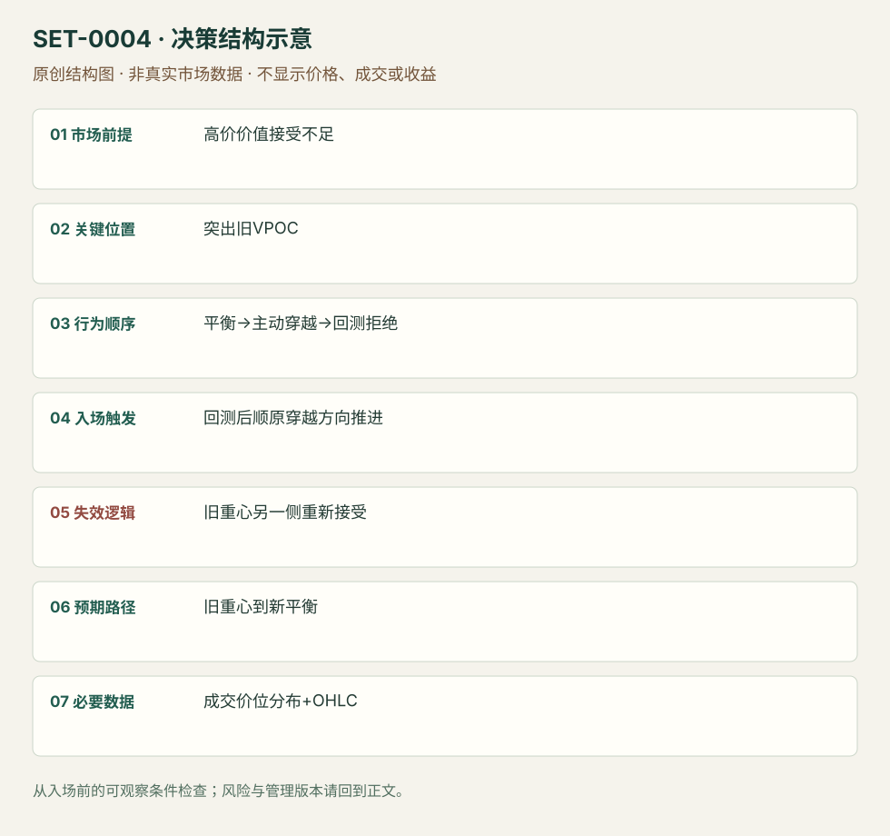

---
{
  "id": "SET-0004",
  "schema_version": "1.0.0",
  "name_zh": "显著成交重心跌破后的回测延续",
  "name_en": "Prominent VPOC Flip",
  "aliases": [
    "VPOC Break and Retest",
    "VPOC passive continuation"
  ],
  "name_nature": "established_or_source_term",
  "status": "reviewed",
  "summary": "更高价位未获持续价值接受，平衡日形成显著VPOC；当开盘主动跌破重心，等待回测不能重新站稳再考虑顺向延续。重新建立重心上方平衡将否定翻转假说。",
  "mechanism": "auction_acceptance_shift",
  "tags": [
    "volume_profile",
    "auction",
    "continuation",
    "opening"
  ],
  "pa_role": "supporting",
  "markets_observed": [
    "Bund期货（AXIA）"
  ],
  "markets_supported": [],
  "migration_hypotheses": [],
  "session": "Bund现金参考段；原文未提供精确执行时区和分钟。使用者应固定Europe/Berlin的现金开盘参考，期货完整session另记；本库要求当日退出。",
  "session_tags": [
    "intraday"
  ],
  "context_timeframe": "日线/前一session + 当日执行图；因来源而异",
  "trigger_timeframe": null,
  "data_requirements": [
    "OHLC",
    "volume_at_price",
    "session_profile"
  ],
  "execution_mode": "mixed",
  "source_ids": [
    "SRC-0004"
  ],
  "evidence_ids": [
    "EVD-000005"
  ],
  "visual_ids": [
    "VIS-000003",
    "VIS-000061"
  ],
  "rule_completeness": "前提/触发/失效/管理已记录；来源与编辑模块分开",
  "independent_corroboration": "limited_single_family",
  "profit_evidence": "not_established",
  "created": "2026-10-02",
  "updated": "2026-10-02",
  "reviewed_at": "2026-10-02",
  "known_gaps": [
    "未开展独立回测；实际订单成交与成本未知",
    "执行周期没有统一来源参数，使用前须锁定版本"
  ],
  "logic_fingerprint": [
    "高价价值接受不足",
    "突出旧VPOC",
    "平衡→主动穿越→回测拒绝",
    "回测后顺原穿越方向推进",
    "旧重心另一侧重新接受",
    "旧重心到新平衡",
    "成交价位分布+OHLC"
  ],
  "environment_tags": [
    "directional",
    "auction_shift"
  ],
  "structure_locations": [
    "VPOC"
  ],
  "version": "1.0.0",
  "unknown_fields": {
    "trigger_timeframe": "来源未提供统一执行周期；正文记录已知图例，不能当成统一参数"
  },
  "review_scope": "规则记录、引用范围、日内边界、逻辑区别与已看静态画面；不含独立回测、动态逐笔或账户核验",
  "source_coverage": {
    "substantive_read_sources": 1,
    "families": [
      "axia"
    ],
    "core_support_source_ids": [
      "SRC-0004"
    ],
    "independence_note": "limited_single_family"
  },
  "method_families": [
    "auction_profile"
  ],
  "market_types": [
    "futures"
  ]
}
---

# 显著成交重心跌破后的回测延续 · Prominent VPOC Flip

## 1. 名称与快速概览

更高价位未获持续价值接受，平衡日形成显著VPOC；当开盘主动跌破重心，等待回测不能重新站稳再考虑顺向延续。重新建立重心上方平衡将否定翻转假说。

记录口径：PA supporting；必要数据 OHLC、volume_at_price、session_profile。名称性质：来源术语或研究术语。reviewed 只表示本条规则与证据记录审查通过，盈利状态为 not_established。

## 2. 本质与行为假说

可见证据是先前价位成交分布、开盘方向和重心的穿越/回测。AXIA将价值无法跟随价格上涨视为接受不足；这不是只在任意POC附近机械做空，也不能把当日最终POC倒填成事前水平。

## 3. 适用市场与环境

背景来自数周Bund结构：下移价格未带动价值，随后回升又未能维持高位；右肩平衡留下清楚的成交重心。宏观背景可以跨日观察，执行和退出保持日内。单纯孤立POC而无背景不足。

**来源实用市场：**Bund期货（AXIA）。

**Session：**Bund现金参考段；原文未提供精确执行时区和分钟。使用者应固定Europe/Berlin的现金开盘参考，期货完整session另记；本库要求当日退出。

跨市场：本版不主张已经验证的跨市场迁移；更换市场必须重定数据来源、流动性与session。

## 4. 出现前的观察清单

必要：事前冻结参考session与显著VPOC；记录高价未持续接受；已看到主动开盘走弱。增强：区间下边缘也被突破。否决：VPOC仍在形成但被当成最终值、价位反复无方向穿越、只有头肩图形没有分布证据。

## 5. 形成过程与状态转换

背景价值拒绝 → 平衡与突出重心 → 开盘向下主动流 → 价格跌破 → 回测重心并失败 → 延续；触发前若回测重新在上方成交并形成平衡，撤销。

## 6. Entry trigger 与执行方式

来源有两个版本：主动版用重心跌破并结合Initial Balance突破；被动版等待跌破后回到VPOC。这条主记录选择被动版，触发是回测后再次向下推进。主动版是variation，不能把二者成交优势混合。

## 7. Invalidation 与止损逻辑

分析失效：不再是阻力的重心重新被上方接受。研究管理模块：保护单在回测结构高点之外，并以重心上方持续成交作为重审依据；原文没有给出通用tick数或等待分钟数。

## 8. Exit、target 与 trade management

使用当时可见的下一段平衡边缘、低量区域出口或旧低点；若在新低位建立平衡则降低延续预期。来源强调访问交易思路，不给统一目标或实盘成交流水；止盈参数须另测。

## 9. 常见 variations

主动穿越与被动回测属于执行版本；成交Profile和TPO不能直接互换VPOC定义。把任意移动POC反复穿越也叫flip会丢失“显著旧重心＋背景拒绝”的前提。

## 10. 失败方式与不交易条件

正常亏损：回测短暂拒绝后重建上方价值。未成立：没有事前重心或把POC当作万能阻力。偏离：追随已经远离VPOC的下跌。数据错误：合约换月、session划分或成交分布计算不同。

## 11. 与相近 setups 的区别

- [SET-0010](SET-0010.md)：普通突破回测只需价格边界；本条还需事先可识别的成交重心和高价接受不足。
- [SET-0035](SET-0035.md)：价值迁移延续要求新成交区建立；本条交易旧重心角色变化。

## 12. 图表与案例解读

已查看原文“Day trading VPOC”下的vpoc_flip图：红箭头标旧重心，现金开盘前已在其下，随后形成低位蓝框平衡。价格图没有清晰可核对交易日期与周期，故不补猜。图中的清算解释属于作者假说，图表本身不证明持仓身份。

- [VIS-000003] [Bund价格跌破旧VPOC后在较低区域形成新平衡](https://axiafutures.com/blog/wp-content/uploads/2020/07/vpoc_flip-1024x561.jpg)；定位：原文Day trading VPOC节，vpoc_flip图红箭头与Cash open标记。红色水平箭头是事前参考；右下蓝框是后续展开，不能用于设定入场前目标。 验证：chart_viewed。

**本地原创示意（VIS-000061，非真实市场数据）：**

小屏阅读可[打开原尺寸示意图](../assets/diagrams/SET-0004.svg)并缩放。

此图用于对照识别顺序与风险定义；不计入真实案例覆盖率。

## 13. 证据、分歧与未知项

单一来源族，背景、水平与主动/被动访问有直接支持。止损订单与目标具体化属于研究补充，尚无统一执行阈值。未证明VPOC翻转本身有正期望。

- [EVD-000005] Axia Futures，《Day Trading VPOC and Market Profile》，[SRC-0004](https://axiafutures.com/blog/day-trading-vpoc-and-market-profile/)；定位：Market Analysis、Day trading VPOC及Trading Summary。支持：高价价值接受不足、显著旧VPOC、开盘走弱；主动穿越或被动回测

审查例外：此条只有一份富信息原始资料，足以还原本条规则；独立佐证有限，未用背景页冒充第二份核验。后续优先寻找独立规则/失败案例。

## 14. 可用于复盘的检查表

- [ ] 下单前的前提可核对：高价价值接受不足
- [ ] 事前标记位置：突出旧VPOC
- [ ] 行为按顺序出现：平衡→主动穿越→回测拒绝
- [ ] 实际触发符合选定版本：回测后顺原穿越方向推进
- [ ] 事先写明本次否定条件：旧重心另一侧重新接受
- [ ] 目标/路径只用当时已知信息：旧重心到新平衡
- [ ] 数据满足 成交价位分布+OHLC；记录时间、点差、滑点、队列和未成交
- [ ] 记录截止平仓及规则偏离；正常亏损不事后改成“未成立”

## 15. 后续验证问题

预定义显著重心与接受所需时间/成交量，冻结参考session避免前视；比较主动与被动版的未成交率及成本。检验按背景价值拒绝分层后POC是否有额外信息。
