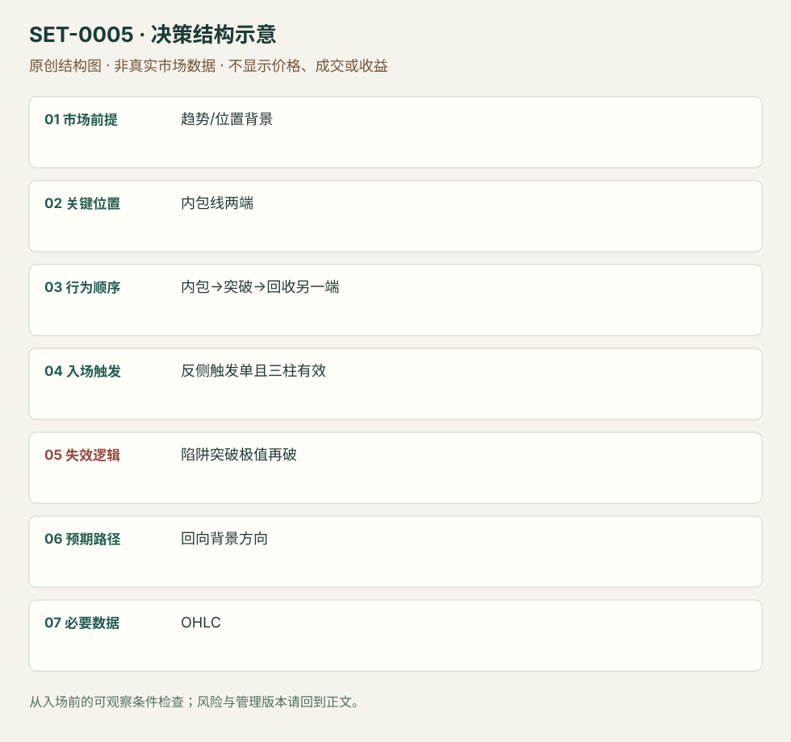

---
{
  "id": "SET-0005",
  "schema_version": "1.0.0",
  "name_zh": "内包线突破失败陷阱",
  "name_en": "Hikkake",
  "aliases": [
    "Inside Bar False Breakout",
    "Hikkake Trade Setup"
  ],
  "name_nature": "established_or_source_term",
  "status": "reviewed",
  "summary": "先出现内包线，再向一侧突破；短窗口内越过内包线另一端才交易反向。这里等的是突破失败，不是看到内包线就猜方向。",
  "mechanism": "inside_bar_trap",
  "tags": [
    "price_action",
    "failed_breakout",
    "reversal"
  ],
  "pa_role": "core",
  "markets_observed": [
    "ES期货5分钟日内案例"
  ],
  "markets_supported": [],
  "migration_hypotheses": [],
  "session": "美股/ES现金参考段 09:30–16:00 America/New_York；收盘前平仓。期货夜盘单独建背景，不将其并入开盘区间。",
  "session_tags": [
    "intraday"
  ],
  "context_timeframe": "日线/前一session + 当日执行图；因来源而异",
  "trigger_timeframe": "ES例5分钟",
  "data_requirements": [
    "OHLC"
  ],
  "execution_mode": "mixed",
  "source_ids": [
    "SRC-0007",
    "SRC-0008"
  ],
  "evidence_ids": [
    "EVD-000006",
    "EVD-000007"
  ],
  "visual_ids": [
    "VIS-000004",
    "VIS-000062"
  ],
  "rule_completeness": "前提/触发/失效/管理已记录；来源与编辑模块分开",
  "independent_corroboration": "limited_single_family",
  "profit_evidence": "not_established",
  "created": "2026-10-02",
  "updated": "2026-10-02",
  "reviewed_at": "2026-10-02",
  "known_gaps": [
    "未开展独立回测；实际订单成交与成本未知"
  ],
  "logic_fingerprint": [
    "趋势/位置背景",
    "内包线两端",
    "内包→突破→回收另一端",
    "反侧触发单且三柱有效",
    "陷阱突破极值再破",
    "回向背景方向",
    "OHLC"
  ],
  "environment_tags": [
    "directional",
    "failed_auction"
  ],
  "structure_locations": [
    "inside_bar_boundary"
  ],
  "version": "1.0.0",
  "markets_context_only": [
    "SPY、伦敦股票日线背景例"
  ],
  "unknown_fields": {},
  "review_scope": "规则记录、引用范围、日内边界、逻辑区别与已看静态画面；不含独立回测、动态逐笔或账户核验",
  "source_coverage": {
    "substantive_read_sources": 2,
    "families": [
      "galen-woods"
    ],
    "core_support_source_ids": [
      "SRC-0007",
      "SRC-0008"
    ],
    "independence_note": "limited_single_family"
  },
  "method_families": [
    "price_action_reversal"
  ],
  "market_types": [
    "futures"
  ]
}
---

# 内包线突破失败陷阱 · Hikkake

## 1. 名称与快速概览

先出现内包线，再向一侧突破；短窗口内越过内包线另一端才交易反向。这里等的是突破失败，不是看到内包线就猜方向。

记录口径：PA core；必要数据 OHLC。名称性质：来源术语或研究术语。reviewed 只表示本条规则与证据记录审查通过，盈利状态为 not_established。

## 2. 本质与行为假说

价格序列可核对；“被套突破者离场”是Galen的行为解释，不是持仓数据。三根有效期是该版本规则，不能忽略超期后又宣称严格满足。

## 3. 适用市场与环境

适合有方向背景、且短暂突破有参与理由的位置；拥挤小区间中的连续外包线容易两端触发。正文既有日线案例也有5分钟ES，不将日线持有期移入本库。

**来源实用市场：**ES期货5分钟日内案例、SPY、伦敦股票日线背景例。

**Session：**美股/ES现金参考段 09:30–16:00 America/New_York；收盘前平仓。期货夜盘单独建背景，不将其并入开盘区间。

跨市场：本版不主张已经验证的跨市场迁移；更换市场必须重定数据来源、流动性与session。

## 4. 出现前的观察清单

必要：严格内包关系；随后一柱高低共同向外移动。增强：背景趋势或拥挤区边缘。否决：外包柱同时破两端、已经超过三柱且仍按机械版本命名。

## 5. 形成过程与状态转换

母柱→内包柱→下一柱低高均更低（多头例）→内包柱高点被越过→管理；空头镜像。前三柱未触发即取消。

## 6. Entry trigger 与执行方式

Galen版多头挂内包柱高点买入触发单，空头挂低点卖出触发单；等待失败回收。作者允许主观延长窗口，但那是另一个版本，必须事前记录而非事后补理由。

## 7. Invalidation 与止损逻辑

源文补充案例采用突破柱极值外侧保护。反向重新穿越陷阱极值说明回收未持续。超大突破柱会扩大止损，不应仍把内包线窄幅当真实风险。

## 8. Exit、target 与 trade management

作者讨论停滞可保本离场或保留标准止损，并没有统一倍数。研究管理模块：使用当时已知拥挤区/趋势前高低；日内收盘前退出，延长持仓不能继承本条归类。

## 9. 常见 variations

多空镜像不另计；Modified Hikkake加入额外背景柱需独立研究，本版未计入。只等单根pinbar与完整Hikkake不是同一辨识序列。

## 10. 失败方式与不交易条件

正常亏损：合格失败突破后再反向穿越。未成立：少了先突破或超期。偏离：被两端触发仍重复追价。来源Example #4标题写Losing Bullish Trade，但正文是sell stop空头；按正文说明并保留此编辑不一致。

## 11. 与相近 setups 的区别

- [SET-0013](SET-0013.md)：ii突破交易压缩后的顺向释放，本条必须先有外侧突破失败。
- [SET-0001](SET-0001.md)：前日范围失败使用session边界；本条依赖特定内包与短窗口序列。

## 12. 图表与案例解读

已查看Example #3，ES 03-20，5分钟，图头21/2/2020；快速下跌后先有三个未触发的空头Hikkake，后出现多头Hikkake。箭头指突破柱，不是成交证明；显示钟点的时区未标注，不能等同美东。

- [VIS-000004] [ES日内下跌后内包线陷阱与未触发案例](https://www.tradingsetupsreview.com/hikkake/img/HikkakeIntradayExample_hu072a7a54134cbb7e99e683e5591b73b1_87893_1280x0_resize_q75_h1_box.webp)；定位：Example #3: Intraday Hikkake Pattern，第4幅图。先分清未触发箭头与最终触发的水平虚线；作者胜例不证明所有陷阱有优势。 验证：chart_viewed。

**本地原创示意（VIS-000062，非真实市场数据）：**

小屏阅读可[打开原尺寸示意图](../assets/diagrams/SET-0005.svg)并缩放。

此图用于对照识别顺序与风险定义；不计入真实案例覆盖率。

## 13. 证据、分歧与未知项

两篇Galen材料属于一个来源族，不算独立佐证。规则和日内图完整，三柱有效期与可选主观延长存在版本差异；无充分盈利数据。

- [EVD-000006] Galen Woods，《Hikkake Trade Setup》，[SRC-0007](https://www.tradingsetupsreview.com/hikkake/)；定位：Hikkake Trading Rules、Example #3、Example #4。支持：内包→单侧突破→三柱内另一端触发；反例标题与交易方向有不一致
- [EVD-000007] Galen Woods，《4 Price Action Trading Strategies That Profit From Trapped Traders》，[SRC-0008](https://www.tradingsetupsreview.com/4-day-trading-strategies-profit-trapped-traders/)；定位：Strategy #1与Hikkake Trading Example。支持：可使用突破柱极值保护；停滞退出与保留止损是不同管理选择

审查边界：来源份数与独立核心核验分开；当前类别为 limited_single_family。正文中的概念、官方事实、衍生解说或同族资料只按其支持范围使用。

## 14. 可用于复盘的检查表

- [ ] 下单前的前提可核对：趋势/位置背景
- [ ] 事前标记位置：内包线两端
- [ ] 行为按顺序出现：内包→突破→回收另一端
- [ ] 实际触发符合选定版本：反侧触发单且三柱有效
- [ ] 事先写明本次否定条件：陷阱突破极值再破
- [ ] 目标/路径只用当时已知信息：回向背景方向
- [ ] 数据满足 OHLC；记录时间、点差、滑点、队列和未成交
- [ ] 记录截止平仓及规则偏离；正常亏损不事后改成“未成立”

## 15. 后续验证问题

固定机械三柱版与主观延长版分别登记；包含所有未触发及外包两端触发样本。按拥挤程度、突破柱大小和时段分层，计入触发单滑点。
