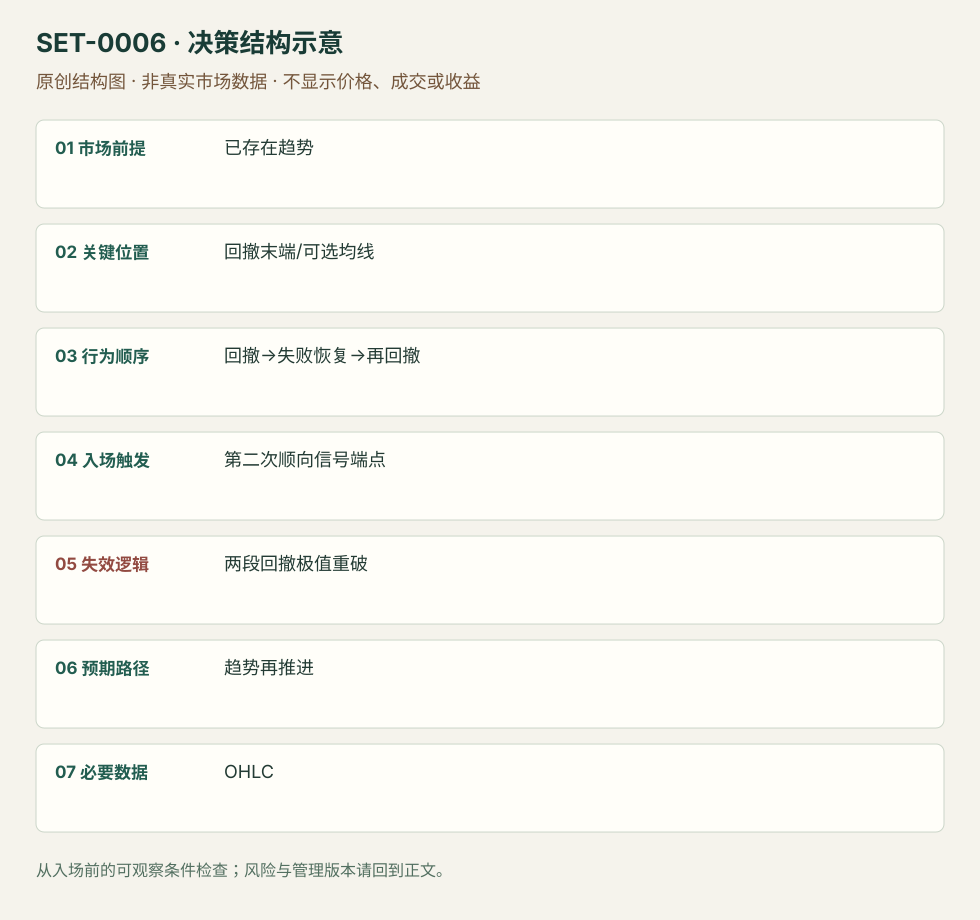

---
{
  "id": "SET-0006",
  "schema_version": "1.0.0",
  "name_zh": "趋势中的两段回撤第二次入场",
  "name_en": "High 2 / Low 2 Two-Legged Pullback",
  "aliases": [
    "H2",
    "L2",
    "M2B",
    "M2S",
    "Two-legged pullback"
  ],
  "name_nature": "editor_descriptive_with_source_term",
  "status": "reviewed",
  "summary": "已形成方向趋势，回撤第一次恢复趋势未能持续，随后第二段回撤结束，才通过顺趋势信号考虑加入。回撤极值被穿透说明本次恢复失败。",
  "mechanism": "complex_pullback",
  "tags": [
    "price_action",
    "continuation",
    "pullback"
  ],
  "pa_role": "core",
  "markets_observed": [
    "ES期货5分钟",
    "SPY ETF 3分钟"
  ],
  "markets_supported": [],
  "migration_hypotheses": [],
  "session": "美股/ES现金参考段 09:30–16:00 America/New_York；收盘前平仓。期货夜盘单独建背景，不将其并入开盘区间。",
  "session_tags": [
    "intraday"
  ],
  "context_timeframe": "日线/前一session + 当日执行图；因来源而异",
  "trigger_timeframe": null,
  "data_requirements": [
    "OHLC",
    "EMA_optional"
  ],
  "execution_mode": "mixed",
  "source_ids": [
    "SRC-0015",
    "SRC-0017"
  ],
  "evidence_ids": [
    "EVD-000008",
    "EVD-000009"
  ],
  "visual_ids": [
    "VIS-000005",
    "VIS-000006",
    "VIS-000063"
  ],
  "rule_completeness": "前提/触发/失效/管理已记录；来源与编辑模块分开",
  "independent_corroboration": "independent_context_only",
  "profit_evidence": "not_established",
  "created": "2026-10-02",
  "updated": "2026-10-02",
  "reviewed_at": "2026-10-02",
  "known_gaps": [
    "未开展独立回测；实际订单成交与成本未知",
    "执行周期没有统一来源参数，使用前须锁定版本"
  ],
  "logic_fingerprint": [
    "已存在趋势",
    "回撤末端/可选均线",
    "回撤→失败恢复→再回撤",
    "第二次顺向信号端点",
    "两段回撤极值重破",
    "趋势再推进",
    "OHLC"
  ],
  "environment_tags": [
    "directional",
    "pullback"
  ],
  "structure_locations": [
    "pullback_extreme"
  ],
  "version": "1.0.0",
  "unknown_fields": {
    "trigger_timeframe": "来源未提供统一执行周期；正文记录已知图例，不能当成统一参数"
  },
  "review_scope": "规则记录、引用范围、日内边界、逻辑区别与已看静态画面；不含独立回测、动态逐笔或账户核验",
  "source_coverage": {
    "substantive_read_sources": 2,
    "families": [
      "adam-grimes",
      "galen-woods"
    ],
    "core_support_source_ids": [
      "SRC-0015"
    ],
    "independence_note": "independent_context_only"
  },
  "method_families": [
    "price_action_trend"
  ],
  "market_types": [
    "futures",
    "ETF"
  ]
}
---

# 趋势中的两段回撤第二次入场 · High 2 / Low 2 Two-Legged Pullback

## 1. 名称与快速概览

已形成方向趋势，回撤第一次恢复趋势未能持续，随后第二段回撤结束，才通过顺趋势信号考虑加入。回撤极值被穿透说明本次恢复失败。

记录口径：PA core；必要数据 OHLC、EMA_optional。名称性质：编辑性描述名，英文保留来源术语以便检索。reviewed 只表示本条规则与证据记录审查通过，盈利状态为 not_established。

## 2. 本质与行为假说

可见的是两段反向摆动之间一次失败的恢复。Brooks/Galen解释为反趋势与过早顺趋势参与者被困；Grimes用复杂回撤描述同一序列。这里不是机械数两根阴线。

## 3. 适用市场与环境

需要事前已有较少重叠、连续推进的趋势。EMA20是Galen的参考位置版本；在频繁穿越均线的平衡段，两段回撤本身不产生方向优势。

**来源实用市场：**ES期货5分钟、SPY ETF 3分钟。

**Session：**美股/ES现金参考段 09:30–16:00 America/New_York；收盘前平仓。期货夜盘单独建背景，不将其并入开盘区间。

跨市场：本版不主张已经验证的跨市场迁移；更换市场必须重定数据来源、流动性与session。

## 4. 出现前的观察清单

必要：方向背景与两段可分开的回撤；先前趋势极值未被实质破坏。增强：第二段接近EMA/旧支撑且有拒绝。否决：仅凭两根逆色柱计数、回撤已变宽平衡。

## 5. 形成过程与状态转换

趋势推进→第一回撤→恢复失败→第二回撤→顺向信号柱→越过信号柱→管理。若第二段出现新的强反趋势推进，取消。

## 6. Entry trigger 与执行方式

Galen MA版本在测试20EMA的信号柱高/低外一tick用触发单。普通H2不必刚好摸均线；固定规则时需标明版本。信号柱尚未收盘的抢入与完成后触发分别记录。

## 7. Invalidation 与止损逻辑

保护回撤摆动极值而非只保护最后小柱；第二段被突破后趋势仍可能最终恢复，但本次结构止损可正常亏损。固定tick数不是定义。

## 8. Exit、target 与 trade management

先看事前趋势极值与第二段推进；强趋势可留部分按新摆动退出。弱跟随或重叠增加时降低延续期待。目标与时间退出是研究管理模块。

## 9. 常见 variations

H2/L2多空、嵌套大小与EMA版本合并。三段楔形回撤的额外失败次数若专门研究，需证明不同，不在本版重复计。

## 10. 失败方式与不交易条件

正常亏损：第二尝试后仍穿回撤极值。未成立：把区间交替摆动当强趋势。偏离：第一尝试即入而记为H2。图中亏例本身仍满足表面两段，不事后删除。

## 11. 与相近 setups 的区别

- [SET-0009](SET-0009.md)：微通道第一次回撤之前没有正常回撤；本条必须已有第一次恢复失败。
- [SET-0015](SET-0015.md)：缩量回撤需要量能退潮，不要求两次恢复；本条必须两段。

## 12. 图表与案例解读

已查看Galen的赢例与亏例。赢例先有均线拒绝和强下推，再两段回升；亏例虽有连续较高低点，但夹有空头柱，后续买入止损。图头5/12/2013与6/12/2013格式存在月/日歧义，保留原写法不转换ISO日期。

- [VIS-000005] [Two-Legged Pullback Moving Average Winning Trade](https://www.tradingsetupsreview.com/two-legged-pullback-to-moving-average-m2b-m2s/img/Two-Legged-Pullback-Moving-Average-Winning-Trade_hu2b130d61c66aca0ec2d66af67f81810b_263536_1280x0_resize_q75_h1_box_3.webp)；定位：Winning Trade - M2S。黑圈是前期均线拒绝，红箭头是两段回升末端。 验证：chart_viewed。
- [VIS-000006] [Two-Legged Pullback Moving Average Losing Trade](https://www.tradingsetupsreview.com/two-legged-pullback-to-moving-average-m2b-m2s/img/Two-Legged-Pullback-Moving-Average-Losing-Trade_hu498e52fddf2e67b96ea47ce3967d34d9_277564_1280x0_resize_q75_h1_box_3.webp)；定位：Losing Trade - M2B。绿色箭头后的合格表面信号没有持续；提醒不能把胜例背景当事后过滤。 验证：chart_viewed。

**本地原创示意（VIS-000063，非真实市场数据）：**

小屏阅读可[打开原尺寸示意图](../assets/diagrams/SET-0006.svg)并缩放。

此图用于对照识别顺序与风险定义；不计入真实案例覆盖率。

## 13. 证据、分歧与未知项

Brooks起源经Galen复述，不把它当新的独立起源；Grimes独立解释复杂回撤。同一逻辑也叫M2，与H2合并，不把来源“高概率”措辞当可测结论。

- [EVD-000008] Galen Woods，《Two-legged Pullback to Moving Average (M2B, M2S)》，[SRC-0015](https://www.tradingsetupsreview.com/two-legged-pullback-to-moving-average-m2b-m2s/)；定位：Trading Rules、Winning M2S、Losing M2B。支持：强趋势中两段回撤至EMA，信号柱端点外触发；横盘背景有失败例
- [EVD-000009] Adam Grimes，《Fundamental Trading Patterns》，[SRC-0017](https://adamhgrimes.com/fundamental-trading-patterns/)；定位：Complex Pullback。支持：第一次恢复趋势失败，再次回撤后第二次恢复趋势

审查边界：来源份数与独立核心核验分开；当前类别为 independent_context_only。正文中的概念、官方事实、衍生解说或同族资料只按其支持范围使用。

## 14. 可用于复盘的检查表

- [ ] 下单前的前提可核对：已存在趋势
- [ ] 事前标记位置：回撤末端/可选均线
- [ ] 行为按顺序出现：回撤→失败恢复→再回撤
- [ ] 实际触发符合选定版本：第二次顺向信号端点
- [ ] 事先写明本次否定条件：两段回撤极值重破
- [ ] 目标/路径只用当时已知信息：趋势再推进
- [ ] 数据满足 OHLC；记录时间、点差、滑点、队列和未成交
- [ ] 记录截止平仓及规则偏离；正常亏损不事后改成“未成立”

## 15. 后续验证问题

固定摆动分段规则并保留所有不清楚计数；对两段与一段回撤作同背景对照，测成本和错过强趋势的机会代价。
