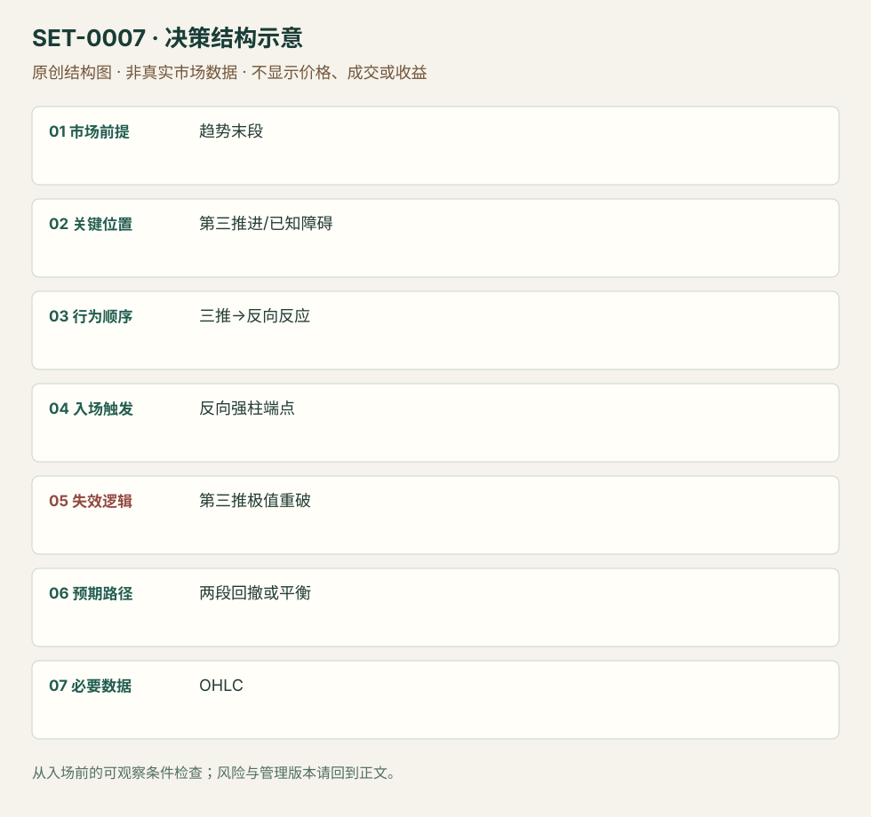

---
{
  "id": "SET-0007",
  "schema_version": "1.0.0",
  "name_zh": "三推高潮后的反转",
  "name_en": "Three-Push Wedge Climax Reversal",
  "aliases": [
    "Wedge Top/Bottom",
    "Parabolic Wedge"
  ],
  "name_nature": "editor_descriptive_with_source_term",
  "status": "reviewed",
  "summary": "方向走势连续三次推进至极值或已知障碍，第三次后出现反向信号，考虑两段回撤或转为平衡。新一轮同向强突破会否定本次高潮反转。",
  "mechanism": "climactic_reversal",
  "tags": [
    "price_action",
    "reversal",
    "climax"
  ],
  "pa_role": "core",
  "markets_observed": [
    "ES日内（Brooks讲义）"
  ],
  "markets_supported": [],
  "migration_hypotheses": [],
  "session": "美股/ES现金参考段 09:30–16:00 America/New_York；收盘前平仓。期货夜盘单独建背景，不将其并入开盘区间。",
  "session_tags": [
    "intraday"
  ],
  "context_timeframe": "日线/前一session + 当日执行图；因来源而异",
  "trigger_timeframe": null,
  "data_requirements": [
    "OHLC"
  ],
  "execution_mode": "mixed",
  "source_ids": [
    "SRC-0016",
    "SRC-0001"
  ],
  "evidence_ids": [
    "EVD-000010",
    "EVD-000011"
  ],
  "visual_ids": [
    "VIS-000007",
    "VIS-000064"
  ],
  "rule_completeness": "前提/触发/失效/管理已记录；来源与编辑模块分开",
  "independent_corroboration": "limited_single_family",
  "profit_evidence": "not_established",
  "created": "2026-10-02",
  "updated": "2026-10-02",
  "reviewed_at": "2026-10-02",
  "known_gaps": [
    "未开展独立回测；实际订单成交与成本未知",
    "执行周期没有统一来源参数，使用前须锁定版本"
  ],
  "logic_fingerprint": [
    "趋势末段",
    "第三推进/已知障碍",
    "三推→反向反应",
    "反向强柱端点",
    "第三推极值重破",
    "两段回撤或平衡",
    "OHLC"
  ],
  "environment_tags": [
    "extended",
    "climax"
  ],
  "structure_locations": [
    "third_push_extreme"
  ],
  "version": "1.0.0",
  "unknown_fields": {
    "trigger_timeframe": "来源未提供统一执行周期；正文记录已知图例，不能当成统一参数"
  },
  "review_scope": "规则记录、引用范围、日内边界、逻辑区别与已看静态画面；不含独立回测、动态逐笔或账户核验",
  "source_coverage": {
    "substantive_read_sources": 2,
    "families": [
      "brooks"
    ],
    "core_support_source_ids": [
      "SRC-0016",
      "SRC-0001"
    ],
    "independence_note": "limited_single_family"
  },
  "method_families": [
    "price_action_reversal"
  ],
  "market_types": [
    "futures"
  ]
}
---

# 三推高潮后的反转 · Three-Push Wedge Climax Reversal

## 1. 名称与快速概览

方向走势连续三次推进至极值或已知障碍，第三次后出现反向信号，考虑两段回撤或转为平衡。新一轮同向强突破会否定本次高潮反转。

记录口径：PA core；必要数据 OHLC。名称性质：编辑性描述名，英文保留来源术语以便检索。reviewed 只表示本条规则与证据记录审查通过，盈利状态为 not_established。

## 2. 本质与行为假说

观察三次有间隔的推进与跟随强度；“耗尽”是解释。Brooks楔形不要求教科书收敛，但不能把强微通道中的每根柱当一推。

## 3. 适用市场与环境

方向推进后段或支撑阻力附近；紧通道更可能先只有小反转。入场前用推进间的反向摆动识别三推，不事后找三个方便的高点。

**来源实用市场：**ES日内（Brooks讲义）。

**Session：**美股/ES现金参考段 09:30–16:00 America/New_York；收盘前平仓。期货夜盘单独建背景，不将其并入开盘区间。

跨市场：本版不主张已经验证的跨市场迁移；更换市场必须重定数据来源、流动性与session。

## 4. 出现前的观察清单

必要：三次可区分的摆动与第三次后的反向反应。增强：尾部增长、实体减弱、已知阻力。否决：仍是首次强突破、没有反向信号或第三推太强而未经复测。

## 5. 形成过程与状态转换

第一推→回撤→第二推→回撤→第三推→反向柱/微双顶底→触发。第三推还在强推进时不猜极值。

## 6. Entry trigger 与执行方式

Brooks版空头在靠近低点收盘的空头柱下方触发；强最后一推后可等微双顶底再进。只看到三推不构成订单。

## 7. Invalidation 与止损逻辑

整个反转极值之外表达失效；重新强势穿越第三推而延伸时反转假说失败。扩大成更大楔形属于新机会，不能用无限放宽止损保留原单。

## 8. Exit、target 与 trade management

作者常期待至少两段反向运动；在当时已知旧摆动、均线或平衡区管理。强原趋势下先以小回撤假说处理，不保证回到当日另端。

## 9. 常见 variations

普通/抛物线楔形作为强度版本合并；三推顺趋势回撤归两段/复杂回撤家族，不把相同交易重复计为wedge flag。

## 10. 失败方式与不交易条件

正常亏损：明确三推反转后原趋势再次恢复。未成立：把连续六柱单向微通道分成三推。来源讲义页36有高潮后继续跌的反例；赔率数字未获样本支持。

## 11. 与相近 setups 的区别

- [SET-0008](SET-0008.md)：MTR必须先破旧趋势结构再重测；本条可以在第一轮高潮末端触发。
- [SET-0011](SET-0011.md)：Final flag必须先有晚段横向旗形及其突破失败；本条不要求旗形。

## 12. 图表与案例解读

已查看Wedge Top: Reversal Day图，第三推处微双顶与空头信号，后续红色区块展示两段下跌。原图省略坐标日期；PDF页36作为待进一步逐页复核的失败线索，不将未看页写成已核对画面。

- [VIS-000007] [Wedge Top - Reversal day](https://www.brookstradingcourse.com/wp-content/uploads/2019/01/W-U-1-680x383.png)；定位：Wedges章节第1幅，Wedge Top: Reversal Day。先看三次推进与反向柱，再看两个标注下跌段；后者是事后展开。 验证：chart_viewed。

**本地原创示意（VIS-000064，非真实市场数据）：**

小屏阅读可[打开原尺寸示意图](../assets/diagrams/SET-0007.svg)并缩放。

此图用于对照识别顺序与风险定义；不计入真实案例覆盖率。

## 13. 证据、分歧与未知项

Brooks单一来源族；规则清楚，几何与bar count仍需经验。三推与微通道不是可随意互换的标签。无本库回测或独立盈利证明。

- [EVD-000010] Al Brooks，《10 best price action trading patterns》，[SRC-0016](https://www.brookstradingcourse.com/price-action/10-best-price-action-trading-patterns/)；定位：Wedges: three pushes up or down。支持：三次分开的推进与反向信号；几何可不收敛
- [EVD-000011] Al Brooks，《Patterns on the Open》，[SRC-0001](https://www.brookstradingcourse.com/wp-content/uploads/2018/10/181030-futuresio-Patterns-on-the-Open-Al-Brooks.pdf)；定位：PDF页25–27及36。支持：卖出高潮可等微双底；强原趋势第一反转可能很小且楔形会失败

审查边界：来源份数与独立核心核验分开；当前类别为 limited_single_family。正文中的概念、官方事实、衍生解说或同族资料只按其支持范围使用。

## 14. 可用于复盘的检查表

- [ ] 下单前的前提可核对：趋势末段
- [ ] 事前标记位置：第三推进/已知障碍
- [ ] 行为按顺序出现：三推→反向反应
- [ ] 实际触发符合选定版本：反向强柱端点
- [ ] 事先写明本次否定条件：第三推极值重破
- [ ] 目标/路径只用当时已知信息：两段回撤或平衡
- [ ] 数据满足 OHLC；记录时间、点差、滑点、队列和未成交
- [ ] 记录截止平仓及规则偏离；正常亏损不事后改成“未成立”

## 15. 后续验证问题

如何在不看未来时稳定区分一推和多推？比较强末推等复测与首次反向柱，含楔形扩大后的原单亏损。
