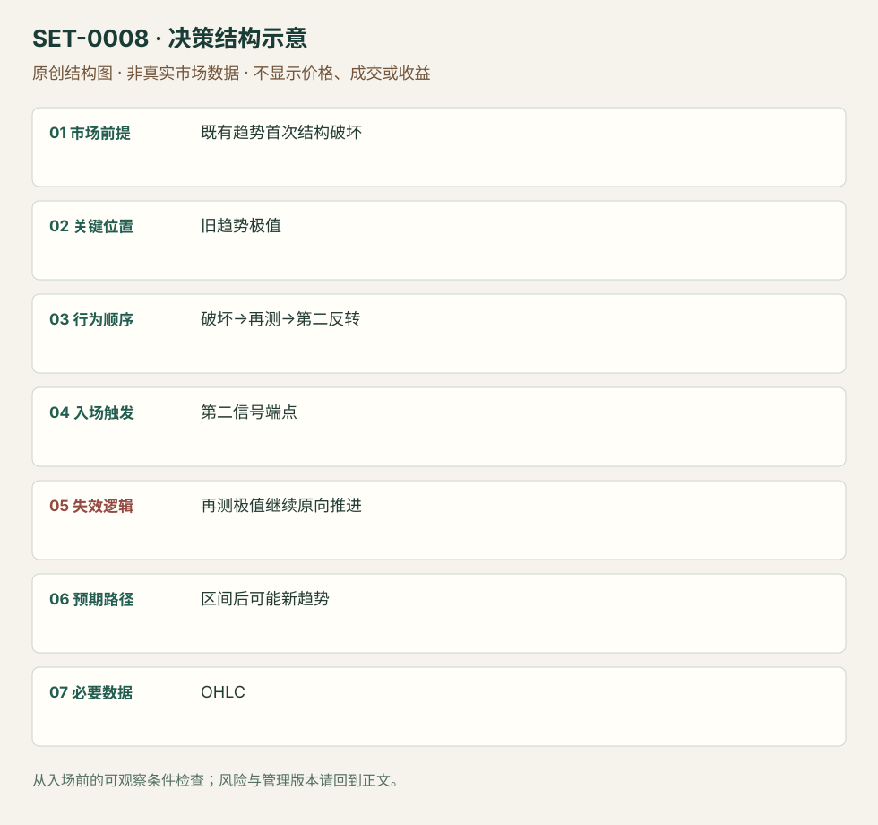

---
{
  "id": "SET-0008",
  "schema_version": "1.0.0",
  "name_zh": "旧趋势破坏后再测极值的主要反转",
  "name_en": "Major Trend Reversal",
  "aliases": [],
  "name_nature": "editor_descriptive_with_source_term",
  "status": "reviewed",
  "summary": "旧趋势第一次被反向推进打断后，不立刻宣布反转；等待再次试探旧极值及第二次反向信号。再测区域不能继续承受原方向推进是关键。",
  "mechanism": "trend_regime_reversal",
  "tags": [
    "price_action",
    "reversal",
    "structure"
  ],
  "pa_role": "core",
  "markets_observed": [
    "ES期货图例"
  ],
  "markets_supported": [],
  "migration_hypotheses": [],
  "session": "美股/ES现金参考段 09:30–16:00 America/New_York；收盘前平仓。期货夜盘单独建背景，不将其并入开盘区间。",
  "session_tags": [
    "intraday"
  ],
  "context_timeframe": "日线/前一session + 当日执行图；因来源而异",
  "trigger_timeframe": null,
  "data_requirements": [
    "OHLC",
    "trend_structure"
  ],
  "execution_mode": "mixed",
  "source_ids": [
    "SRC-0016",
    "SRC-0001"
  ],
  "evidence_ids": [
    "EVD-000012",
    "EVD-000013"
  ],
  "visual_ids": [
    "VIS-000008",
    "VIS-000065"
  ],
  "rule_completeness": "前提/触发/失效/管理已记录；来源与编辑模块分开",
  "independent_corroboration": "limited_single_family",
  "profit_evidence": "not_established",
  "created": "2026-10-02",
  "updated": "2026-10-02",
  "reviewed_at": "2026-10-02",
  "known_gaps": [
    "未开展独立回测；实际订单成交与成本未知",
    "执行周期没有统一来源参数，使用前须锁定版本"
  ],
  "logic_fingerprint": [
    "既有趋势首次结构破坏",
    "旧趋势极值",
    "破坏→再测→第二反转",
    "第二信号端点",
    "再测极值继续原向推进",
    "区间后可能新趋势",
    "OHLC"
  ],
  "environment_tags": [
    "regime_change"
  ],
  "structure_locations": [
    "old_trend_extreme"
  ],
  "version": "1.0.0",
  "unknown_fields": {
    "trigger_timeframe": "来源未提供统一执行周期；正文记录已知图例，不能当成统一参数"
  },
  "review_scope": "规则记录、引用范围、日内边界、逻辑区别与已看静态画面；不含独立回测、动态逐笔或账户核验",
  "source_coverage": {
    "substantive_read_sources": 2,
    "families": [
      "brooks"
    ],
    "core_support_source_ids": [
      "SRC-0016",
      "SRC-0001"
    ],
    "independence_note": "limited_single_family"
  },
  "method_families": [
    "price_action_reversal"
  ],
  "market_types": [
    "futures"
  ]
}
---

# 旧趋势破坏后再测极值的主要反转 · Major Trend Reversal

## 1. 名称与快速概览

旧趋势第一次被反向推进打断后，不立刻宣布反转；等待再次试探旧极值及第二次反向信号。再测区域不能继续承受原方向推进是关键。

记录口径：PA core；必要数据 OHLC、trend_structure。名称性质：编辑性描述名，英文保留来源术语以便检索。reviewed 只表示本条规则与证据记录审查通过，盈利状态为 not_established。

## 2. 本质与行为假说

可见事实是旧通道破坏、回测和第二信号。新趋势形成属于待确认结果；“旧参与者被迫退出”只是解释。

## 3. 适用市场与环境

先有可识别趋势及通道；第一反向波具有足以打断原推进的实体与距离。密集重叠、没有旧趋势的区间不属于本条。

**来源实用市场：**ES期货图例。

**Session：**美股/ES现金参考段 09:30–16:00 America/New_York；收盘前平仓。期货夜盘单独建背景，不将其并入开盘区间。

跨市场：本版不主张已经验证的跨市场迁移；更换市场必须重定数据来源、流动性与session。

## 4. 出现前的观察清单

必要：旧趋势及极值提前标记，第一破坏已经发生，再测仍可观察。增强：回测弱于首次冲击。否决：凭一根逆色柱或事后重画通道。

## 5. 形成过程与状态转换

趋势→反向冲击越通道→旧方向再测→不能持续扩大旧极值→第二反向信号→管理。回测若恢复连续原向趋势柱，取消。

## 6. Entry trigger 与执行方式

Brooks版本以第二反向信号柱端点触发；旧极值可以是更低低点、更高低点或双底镜像。只在通道破坏即入是另一时机，不能在复盘中归入本条。

## 7. Invalidation 与止损逻辑

假说失效于再测区域继续形成原向推进；保护再测摆动极值。紧信号柱止损与宽结构止损分开评估，不能亏损后向外挪。

## 8. Exit、target 与 trade management

先以旧区间中部及对侧已知摆动管理，再根据新推进决定留仓。出现反向重叠时按区间退出；完整反转趋势不能作为保证目标。日内剩余时间不足时结束。

## 9. 常见 variations

LL、HL、HH、LH MTR是同一观察顺序；扩张三角中的MTR仍只计一次。无需机械规定极值完全相等。

## 10. 失败方式与不交易条件

正常亏损：再测信号后再创新极值。未成立：旧通道未破或把小回调当冲击。偏离：第一次抄底却用第二次名称；图上最后大反转不能倒推初次有效。

## 11. 与相近 setups 的区别

- [SET-0014](SET-0014.md)：Anti在第一冲击后首回撤即可考虑；本条要求旧极值再次接受检验。
- [SET-0007](SET-0007.md)：楔形要求三段推进；MTR必须先发生旧通道破坏与再测。

## 12. 图表与案例解读

已查看Brooks LL-MTR图：左段为紧空头通道，红线标第一次向上破坏，随后再创低点，绿色标第二次反向信号。入场前可知破坏和再测，右侧上涨当时未知。图未标日期、周期和品种，不能据此做收益统计。

- [VIS-000008] [Tight bear channel - Minor reversal leading to Major Reversal](https://www.brookstradingcourse.com/wp-content/uploads/2019/01/LL-MTR-680x381.png)；定位：Major trend reversals / LL-MTR。紧空头通道破坏后再测低点，第二次反向信号。 验证：chart_viewed。

**本地原创示意（VIS-000065，非真实市场数据）：**

小屏阅读可[打开原尺寸示意图](../assets/diagrams/SET-0008.svg)并缩放。

此图用于对照识别顺序与风险定义；不计入真实案例覆盖率。

## 13. 证据、分歧与未知项

两份Brooks材料属于同族，独立佐证有限。图例支持过程识别，不提供完整订单或成本记录。管理是研究模块，来源百分比经验不作为概率。

- [EVD-000012] Al Brooks，《10 best price action trading patterns》，[SRC-0016](https://www.brookstradingcourse.com/price-action/10-best-price-action-trading-patterns/)；定位：Major trend reversals。支持：旧趋势先被破坏，再测趋势极值，出现第二次反转机会
- [EVD-000013] Al Brooks，《Patterns on the Open》，[SRC-0001](https://www.brookstradingcourse.com/wp-content/uploads/2018/10/181030-futuresio-Patterns-on-the-Open-Al-Brooks.pdf)；定位：PDF页24–26。支持：强趋势反转需要多步过程，第一次通常先转为区间

审查边界：来源份数与独立核心核验分开；当前类别为 limited_single_family。正文中的概念、官方事实、衍生解说或同族资料只按其支持范围使用。

## 14. 可用于复盘的检查表

- [ ] 下单前的前提可核对：既有趋势首次结构破坏
- [ ] 事前标记位置：旧趋势极值
- [ ] 行为按顺序出现：破坏→再测→第二反转
- [ ] 实际触发符合选定版本：第二信号端点
- [ ] 事先写明本次否定条件：再测极值继续原向推进
- [ ] 目标/路径只用当时已知信息：区间后可能新趋势
- [ ] 数据满足 OHLC；记录时间、点差、滑点、队列和未成交
- [ ] 记录截止平仓及规则偏离；正常亏损不事后改成“未成立”

## 15. 后续验证问题

固定通道和回测定义，保留未转趋势的区间结果；比较第一次反转与第二次反转的机会、风险和成本。
