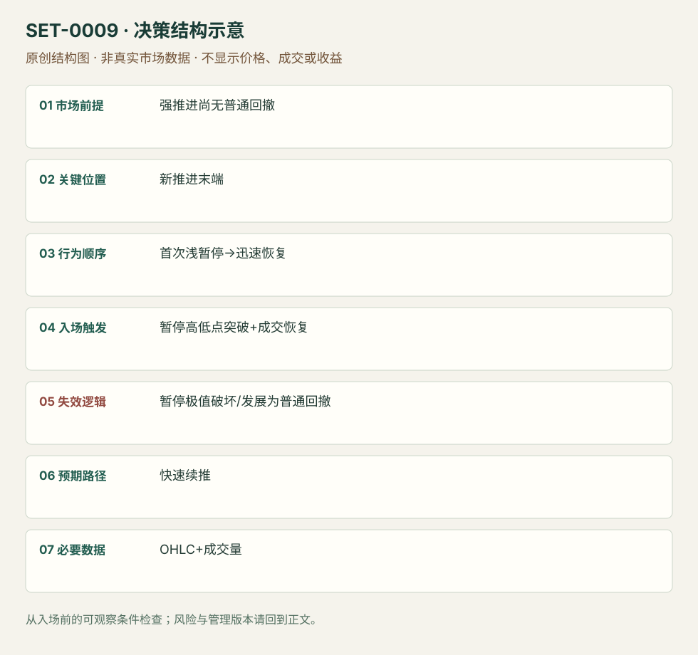

---
{
  "id": "SET-0009",
  "schema_version": "1.0.0",
  "name_zh": "强推进后的首次微型回撤",
  "name_en": "First Micro Pullback After Strong Drive",
  "aliases": [],
  "name_nature": "editor_descriptive_with_source_term",
  "status": "reviewed",
  "summary": "价格以连续方向推进、尚未出现普通回撤的方式快速离开基点；第一次短暂停顿未演变成常规回撤时，考虑顺向恢复。微回撤极值破坏即结束本次快速延续假说。",
  "mechanism": "first_shallow_pause",
  "tags": [
    "price_action",
    "momentum",
    "continuation",
    "scalping"
  ],
  "pa_role": "core",
  "markets_observed": [
    "ES期货5分钟",
    "AHPI美股10秒/1分钟"
  ],
  "markets_supported": [],
  "migration_hypotheses": [],
  "session": "美股/ES现金参考段 09:30–16:00 America/New_York；收盘前平仓。期货夜盘单独建背景，不将其并入开盘区间。",
  "session_tags": [
    "intraday"
  ],
  "context_timeframe": "日线/前一session + 当日执行图；因来源而异",
  "trigger_timeframe": null,
  "data_requirements": [
    "OHLC",
    "volume"
  ],
  "execution_mode": "mixed",
  "source_ids": [
    "SRC-0009",
    "SRC-0025"
  ],
  "evidence_ids": [
    "EVD-000014",
    "EVD-000015"
  ],
  "visual_ids": [
    "VIS-000009",
    "VIS-000066"
  ],
  "rule_completeness": "前提/触发/失效/管理已记录；来源与编辑模块分开",
  "independent_corroboration": "multiple_families",
  "profit_evidence": "not_established",
  "created": "2026-10-02",
  "updated": "2026-10-02",
  "reviewed_at": "2026-10-02",
  "known_gaps": [
    "未开展独立回测；实际订单成交与成本未知",
    "执行周期没有统一来源参数，使用前须锁定版本"
  ],
  "logic_fingerprint": [
    "强推进尚无普通回撤",
    "新推进末端",
    "首次浅暂停→迅速恢复",
    "暂停高低点突破+成交恢复",
    "暂停极值破坏/发展为普通回撤",
    "快速续推",
    "OHLC+成交量"
  ],
  "environment_tags": [
    "strong_drive",
    "pullback"
  ],
  "structure_locations": [
    "first_pause"
  ],
  "version": "1.0.0",
  "unknown_fields": {
    "trigger_timeframe": "来源未提供统一执行周期；正文记录已知图例，不能当成统一参数"
  },
  "review_scope": "规则记录、引用范围、日内边界、逻辑区别与已看静态画面；不含独立回测、动态逐笔或账户核验",
  "source_coverage": {
    "substantive_read_sources": 2,
    "families": [
      "brooks",
      "warrior"
    ],
    "core_support_source_ids": [
      "SRC-0009",
      "SRC-0025"
    ],
    "independence_note": "multiple_families"
  },
  "method_families": [
    "price_action_trend",
    "opening_gap"
  ],
  "market_types": [
    "futures",
    "stocks"
  ]
}
---

# 强推进后的首次微型回撤 · First Micro Pullback After Strong Drive

## 1. 名称与快速概览

价格以连续方向推进、尚未出现普通回撤的方式快速离开基点；第一次短暂停顿未演变成常规回撤时，考虑顺向恢复。微回撤极值破坏即结束本次快速延续假说。

记录口径：PA core；必要数据 OHLC、volume。名称性质：编辑性描述名，英文保留来源术语以便检索。reviewed 只表示本条规则与证据记录审查通过，盈利状态为 not_established。

## 2. 本质与行为假说

关键是第一次休息和持续推进，而非小红柱的名称。来源把快速恢复解释为持续需求；K线只能证实推进与浅暂停。

## 3. 适用市场与环境

已有快速突破、连续趋势柱或很少回撤的微通道；前方有事前已知空间。AHPI来源是小盘动量股，并非所有ES微通道的成交条件。

**来源实用市场：**ES期货5分钟、AHPI美股10秒/1分钟。

**Session：**美股/ES现金参考段 09:30–16:00 America/New_York；收盘前平仓。期货夜盘单独建背景，不将其并入开盘区间。

跨市场：本版不主张已经验证的跨市场迁移；更换市场必须重定数据来源、流动性与session。

## 4. 出现前的观察清单

必要：新强推进、此前无普通回撤、暂停极浅且短。增强：突破区域未重叠、恢复成交增加。否决：多次深回撤后才出现小柱、直接撞入更高周期阻力。

## 5. 形成过程与状态转换

快速推进→首次浅暂停→未回收启动区→再次越暂停高点并恢复成交→管理；暂停发展成普通回撤时取消微型版本。

## 6. Entry trigger 与执行方式

Ross版不机械买第一根10秒柱新高，而等成交回到场内并突破暂停高点。Brooks日内例以首次回撤信号处理。二者分别保留，不将周期和条件拼成统一标准。

## 7. Invalidation 与止损逻辑

保护首次微回撤的低点/高点；Ross不希望持有等待它变成1分钟或5分钟普通回撤。若跨极值则本次快速恢复失效；跳价可能越过计划价格。

## 8. Exit、target 与 trade management

Ross以邻近半美元/整数位作首目标的具体股票版本；ES可用事前突破摆动或结构目标。快速失去推进时减仓，日内强势普通回撤的持仓模块须另行声明。

## 9. 常见 variations

10秒、1分钟、5分钟是观察尺度；空头镜像合并。没有暂停直接追涨不属于本条；从普通多段回撤进场归入SET-0006或0015。

## 10. 失败方式与不交易条件

正常亏损：首次浅暂停随后扩展。未成立：此前已经数次回撤。偏离：追涨成交太远或把紧止损不断放宽。小盘股停牌与点差会使微结构风险失真。

## 11. 与相近 setups 的区别

- [SET-0006](SET-0006.md)：H2必须第一次恢复失败后再回撤，本条此前没有普通回撤。
- [SET-0015](SET-0015.md)：缩量多柱回撤已经有普通反向摆动，本条只处理强推进的第一次短暂停顿。

## 12. 图表与案例解读

已查看AHPI PDF页9：5分钟图说明大背景，1分钟与10秒图标出13:09附近新突破后的短暂停顿；10秒画面显示2021-07-13。作者讨论约10.75入场及10.21结构低点，但10.50只是心理止损替代，不能混用结果。其后到11.54的运动为回顾信息，并非事前确定目标。

- [VIS-000009] [来源PDF第9页图表](https://media.warriortrading.com/2022/06/03110459/Technical-Analysis-v3.pdf#page=9)；定位：PDF页序 9。AHPI三个周期展示首次微回撤；箭头后的走势属于回顾。 验证：chart_viewed_pdf_page。

**本地原创示意（VIS-000066，非真实市场数据）：**

小屏阅读可[打开原尺寸示意图](../assets/diagrams/SET-0009.svg)并缩放。

此图用于对照识别顺序与风险定义；不计入真实案例覆盖率。

## 13. 证据、分歧与未知项

两族提供各自执行版本，不构成同一股票规则盈利复现。Brooks评论指出长微通道不是多段楔形；记录脚注让使用者复核计数。

- [EVD-000014] Brad / Jed，《E-mini Bulls Finding Support Testing September 11 Low》，[SRC-0009](https://www.brookstradingcourse.com/analysis/e-mini-bulls-finding-support-testing-september-11th-low/)；定位：日内分析bar 22–32与Jed评论。支持：连续强多头微通道之后，首次回撤维持突破缺口
- [EVD-000015] Ross Cameron / Warrior Trading，《Technical Analysis: Gap and Go, Pullback and Reversal Setups》，[SRC-0025](https://media.warriortrading.com/2022/06/03110459/Technical-Analysis-v3.pdf)；定位：PDF页7–9。支持：快速强势股的微回撤，量能恢复突破高点入场，保护微回撤低点

## 14. 可用于复盘的检查表

- [ ] 下单前的前提可核对：强推进尚无普通回撤
- [ ] 事前标记位置：新推进末端
- [ ] 行为按顺序出现：首次浅暂停→迅速恢复
- [ ] 实际触发符合选定版本：暂停高低点突破+成交恢复
- [ ] 事先写明本次否定条件：暂停极值破坏/发展为普通回撤
- [ ] 目标/路径只用当时已知信息：快速续推
- [ ] 数据满足 OHLC+成交量；记录时间、点差、滑点、队列和未成交
- [ ] 记录截止平仓及规则偏离；正常亏损不事后改成“未成立”

## 15. 后续验证问题

先定义何为普通回撤，避免用持续时间事后分组；测试短暂停顿订单滑点、停牌与未成交率。
