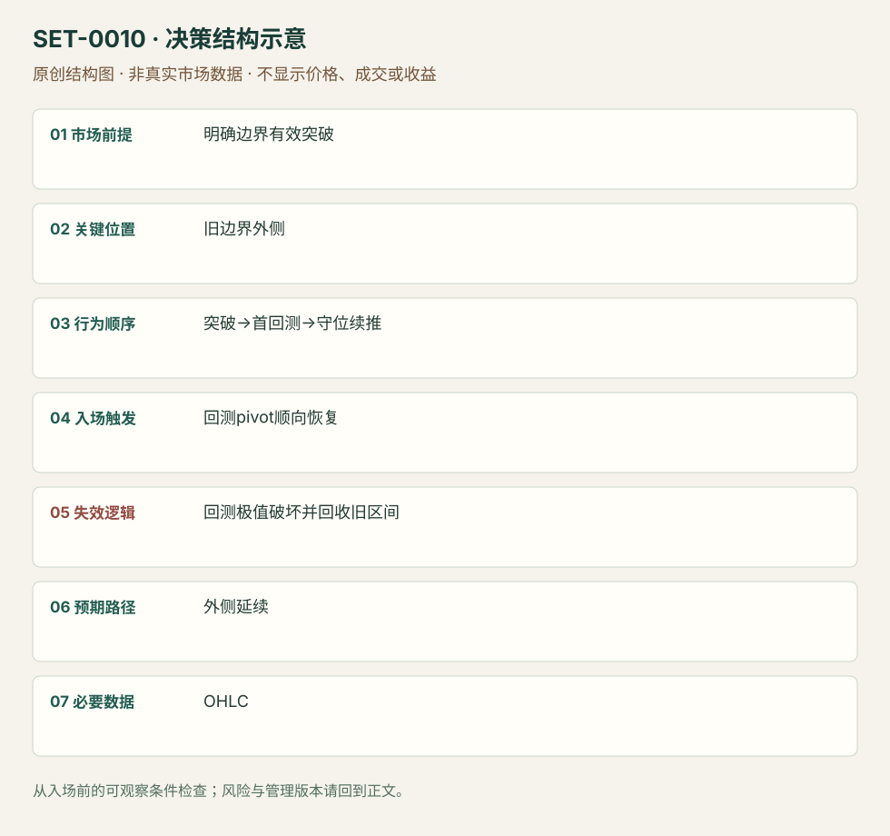

---
{
  "id": "SET-0010",
  "schema_version": "1.0.0",
  "name_zh": "突破后首次回测守住旧边界",
  "name_en": "Breakout Pullback / Break and Retest",
  "aliases": [],
  "name_nature": "editor_descriptive_with_source_term",
  "status": "reviewed",
  "summary": "旧边界被突破后，等待第一次回测证明外侧能够承接，再通过回测摆动的顺向恢复加入。重新接受到旧区间内部会否定本次回测延续。",
  "mechanism": "boundary_acceptance_retest",
  "tags": [
    "price_action",
    "breakout",
    "continuation"
  ],
  "pa_role": "core",
  "markets_observed": [
    "GM美股1分钟",
    "Brooks日内图例"
  ],
  "markets_supported": [],
  "migration_hypotheses": [],
  "session": "美股/ES现金参考段 09:30–16:00 America/New_York；收盘前平仓。期货夜盘单独建背景，不将其并入开盘区间。",
  "session_tags": [
    "intraday"
  ],
  "context_timeframe": "日线/前一session + 当日执行图；因来源而异",
  "trigger_timeframe": null,
  "data_requirements": [
    "OHLC",
    "volume_optional"
  ],
  "execution_mode": "mixed",
  "source_ids": [
    "SRC-0013",
    "SRC-0016"
  ],
  "evidence_ids": [
    "EVD-000016",
    "EVD-000017"
  ],
  "visual_ids": [
    "VIS-000010",
    "VIS-000011",
    "VIS-000067"
  ],
  "rule_completeness": "前提/触发/失效/管理已记录；来源与编辑模块分开",
  "independent_corroboration": "multiple_families",
  "profit_evidence": "not_established",
  "created": "2026-10-02",
  "updated": "2026-10-02",
  "reviewed_at": "2026-10-02",
  "known_gaps": [
    "未开展独立回测；实际订单成交与成本未知",
    "执行周期没有统一来源参数，使用前须锁定版本"
  ],
  "logic_fingerprint": [
    "明确边界有效突破",
    "旧边界外侧",
    "突破→首回测→守位续推",
    "回测pivot顺向恢复",
    "回测极值破坏并回收旧区间",
    "外侧延续",
    "OHLC"
  ],
  "environment_tags": [
    "directional",
    "pullback"
  ],
  "structure_locations": [
    "broken_boundary"
  ],
  "version": "1.0.0",
  "unknown_fields": {
    "trigger_timeframe": "来源未提供统一执行周期；正文记录已知图例，不能当成统一参数"
  },
  "review_scope": "规则记录、引用范围、日内边界、逻辑区别与已看静态画面；不含独立回测、动态逐笔或账户核验",
  "source_coverage": {
    "substantive_read_sources": 2,
    "families": [
      "brooks",
      "sai-trades"
    ],
    "core_support_source_ids": [
      "SRC-0013",
      "SRC-0016"
    ],
    "independence_note": "multiple_families"
  },
  "method_families": [
    "price_action_trend"
  ],
  "market_types": [
    "stocks",
    "futures"
  ]
}
---

# 突破后首次回测守住旧边界 · Breakout Pullback / Break and Retest

## 1. 名称与快速概览

旧边界被突破后，等待第一次回测证明外侧能够承接，再通过回测摆动的顺向恢复加入。重新接受到旧区间内部会否定本次回测延续。

记录口径：PA core；必要数据 OHLC、volume_optional。名称性质：编辑性描述名，英文保留来源术语以便检索。reviewed 只表示本条规则与证据记录审查通过，盈利状态为 not_established。

## 2. 本质与行为假说

可见的变化是边界另一侧的成交与价格承接。“阻力转支撑”是对结果的描述，不是提前保证。

## 3. 适用市场与环境

先有明确且反复测试的边界、有效突破及尚未延伸过远的回测。旧区间仍占主导或突破已经数轮拉锯时，首回测资格消失。

**来源实用市场：**GM美股1分钟、Brooks日内图例。

**Session：**美股/ES现金参考段 09:30–16:00 America/New_York；收盘前平仓。期货夜盘单独建背景，不将其并入开盘区间。

跨市场：本版不主张已经验证的跨市场迁移；更换市场必须重定数据来源、流动性与session。

## 4. 出现前的观察清单

必要：水平下单前确定、突破发生、首次回测可辨。增强：量增、外侧实体不重叠旧边界。否决：将当天后来形成的高点倒用为水平，远离结构追价。

## 5. 形成过程与状态转换

旧边界测试→越界→第一次退回边界附近→外侧承接→新pivot顺向越过→管理；跌回旧区间并建立新重叠则取消。

## 6. Entry trigger 与执行方式

SAI版本可在突破时或回测守住时执行，本条只计后者；等新pivot及恢复成交。Brooks允许回测略穿边界而实体缺口仍在，与一tick严格守位是不同版本。

## 7. Invalidation 与止损逻辑

回测摆动极值破坏是结构失效；SAI以最近pivot收盘破坏为一版，距离太远才讨论VWAP替代。替代止损属于另一次风险设计，不能套用同一结果。

## 8. Exit、target 与 trade management

先看突破前可知的下一阻力或等幅路径；SAI例在续推失去动量或延伸数柱时部分退出。出现回到旧平衡的行为时结束延续。

## 9. 常见 variations

Break-and-retest、BO test、双底回测合并；低量回测可增强，但不要求两段或固定量阈值。只靠换参考线不另建条目。

## 10. 失败方式与不交易条件

正常亏损：首回测看似守住却再入旧区间。未成立：旧水平只测试一次且缺乏背景。偏离：把直接突破买入写成回测买入。成交缺口与图上实体缺口需区分。

## 11. 与相近 setups 的区别

- [SET-0013](SET-0013.md)：II在压缩释放时入，本条释放已发生且等待回测。
- [SET-0004](SET-0004.md)：VPOC迁移要求新的价值成交分布；本条不需要Profile。

## 12. 图表与案例解读

已查看SAI页26的GM图及Brooks BO-test图。GM右图蓝箭头在突破后的回测附近，后续橙箭头是管理示意；日期和时区不够清楚。Brooks图中有略穿边界两tick却保留实体缺口的双底，说明严格价格触碰规则与结构规则不能互相替换。

- [VIS-000010] [来源PDF第26页图表](https://saitrades.com/wp-content/uploads/2021/03/Trading-the-Open-Playbook.pdf#page=26)；定位：PDF页序 26。GM突破后首回测；箭头只展示作者案例。 验证：chart_viewed_pdf_page。
- [VIS-000011] [Magnets: Breakout test - Double bottom](https://www.brookstradingcourse.com/wp-content/uploads/2019/01/BT-BL-680x380.png)；定位：Magnets / BT-BL。双底回测略穿突破价格，但实体缺口仍可辨。 验证：chart_viewed。

**本地原创示意（VIS-000067，非真实市场数据）：**

小屏阅读可[打开原尺寸示意图](../assets/diagrams/SET-0010.svg)并缩放。

此图用于对照识别顺序与风险定义；不计入真实案例覆盖率。

## 13. 证据、分歧与未知项

两个家族解释同一边界承接过程；具体收盘止损和略穿边界规则不同。未复现样本与收益。

- [EVD-000016] SAI Trades，《My Experience: Trading the Open Playbook》，[SRC-0013](https://saitrades.com/wp-content/uploads/2021/03/Trading-the-Open-Playbook.pdf)；定位：PDF页26。支持：多次测试的水平放量突破，回测留在外侧后续推，以新pivot管理
- [EVD-000017] Al Brooks，《10 best price action trading patterns》，[SRC-0016](https://www.brookstradingcourse.com/price-action/10-best-price-action-trading-patterns/)；定位：Magnets / Breakout Test: Double Bottom。支持：强小回撤趋势中回测突破位置，可以形成双底并留下实体缺口

## 14. 可用于复盘的检查表

- [ ] 下单前的前提可核对：明确边界有效突破
- [ ] 事前标记位置：旧边界外侧
- [ ] 行为按顺序出现：突破→首回测→守位续推
- [ ] 实际触发符合选定版本：回测pivot顺向恢复
- [ ] 事先写明本次否定条件：回测极值破坏并回收旧区间
- [ ] 目标/路径只用当时已知信息：外侧延续
- [ ] 数据满足 OHLC；记录时间、点差、滑点、队列和未成交
- [ ] 记录截止平仓及规则偏离；正常亏损不事后改成“未成立”

## 15. 后续验证问题

记录最初水平画法及回测容忍度，比较收盘守位与实体缺口版本；计入回测未成交。
