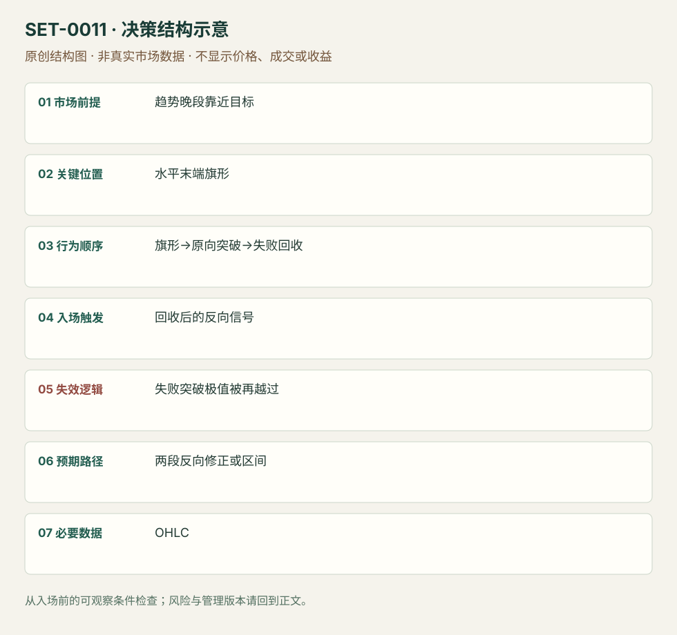

---
{
  "id": "SET-0011",
  "schema_version": "1.0.0",
  "name_zh": "趋势末端最后旗形突破失败",
  "name_en": "Final Flag Reversal",
  "aliases": [],
  "name_nature": "editor_descriptive_with_source_term",
  "status": "reviewed",
  "summary": "已经推进较久的趋势在邻近目标处形成横向旗形；看似恢复原趋势的突破不能持续并被回收时，考虑反向运动。突破重新建立原向推进则失败。",
  "mechanism": "late_continuation_failure",
  "tags": [
    "price_action",
    "reversal",
    "trap"
  ],
  "pa_role": "core",
  "markets_observed": [
    "Brooks日内价格图"
  ],
  "markets_supported": [],
  "migration_hypotheses": [],
  "session": "美股/ES现金参考段 09:30–16:00 America/New_York；收盘前平仓。期货夜盘单独建背景，不将其并入开盘区间。",
  "session_tags": [
    "intraday"
  ],
  "context_timeframe": "日线/前一session + 当日执行图；因来源而异",
  "trigger_timeframe": null,
  "data_requirements": [
    "OHLC"
  ],
  "execution_mode": "mixed",
  "source_ids": [
    "SRC-0016"
  ],
  "evidence_ids": [
    "EVD-000018"
  ],
  "visual_ids": [
    "VIS-000012",
    "VIS-000068"
  ],
  "rule_completeness": "前提/触发/失效/管理已记录；来源与编辑模块分开",
  "independent_corroboration": "limited_single_family",
  "profit_evidence": "not_established",
  "created": "2026-10-02",
  "updated": "2026-10-02",
  "reviewed_at": "2026-10-02",
  "known_gaps": [
    "未开展独立回测；实际订单成交与成本未知",
    "执行周期没有统一来源参数，使用前须锁定版本"
  ],
  "logic_fingerprint": [
    "趋势晚段靠近目标",
    "水平末端旗形",
    "旗形→原向突破→失败回收",
    "回收后的反向信号",
    "失败突破极值被再越过",
    "两段反向修正或区间",
    "OHLC"
  ],
  "environment_tags": [
    "extended",
    "failed_auction"
  ],
  "structure_locations": [
    "late_flag"
  ],
  "version": "1.0.0",
  "unknown_fields": {
    "trigger_timeframe": "来源未提供统一执行周期；正文记录已知图例，不能当成统一参数"
  },
  "review_scope": "规则记录、引用范围、日内边界、逻辑区别与已看静态画面；不含独立回测、动态逐笔或账户核验",
  "source_coverage": {
    "substantive_read_sources": 1,
    "families": [
      "brooks"
    ],
    "core_support_source_ids": [
      "SRC-0016"
    ],
    "independence_note": "limited_single_family"
  },
  "method_families": [
    "price_action_reversal"
  ],
  "market_types": [
    "unconfirmed"
  ]
}
---

# 趋势末端最后旗形突破失败 · Final Flag Reversal

## 1. 名称与快速概览

已经推进较久的趋势在邻近目标处形成横向旗形；看似恢复原趋势的突破不能持续并被回收时，考虑反向运动。突破重新建立原向推进则失败。

记录口径：PA core；必要数据 OHLC。名称性质：编辑性描述名，英文保留来源术语以便检索。reviewed 只表示本条规则与证据记录审查通过，盈利状态为 not_established。

## 2. 本质与行为假说

可见是晚段横向重叠、对侧压力及突破回收；“最后”是候选位置判断，只有事后才知道它确实终结趋势。

## 3. 适用市场与环境

事前已有多轮推进或延伸，已知目标/阻力接近，旗形更加水平且出现逆向压力。初期健康趋势的普通旗形不合适。

**来源实用市场：**Brooks日内价格图。

**Session：**美股/ES现金参考段 09:30–16:00 America/New_York；收盘前平仓。期货夜盘单独建背景，不将其并入开盘区间。

跨市场：本版不主张已经验证的跨市场迁移；更换市场必须重定数据来源、流动性与session。

## 4. 出现前的观察清单

必要：较晚趋势段、水平重叠、延续失败。增强：磁铁接近、反向柱强。否决：仅因图形横向就提前做反转，或初始冲击仍很强。

## 5. 形成过程与状态转换

趋势推进→晚段横向旗形→原向越界→跟随消失→回收旗形/反向信号→管理；顺向强跟随恢复则取消。

## 6. Entry trigger 与执行方式

来源围绕失败延续和反向信号；本研究的可复盘执行版等回收后反向信号端点触发。该具体等待方式是编辑操作化，不声称Brooks统一下单规则。

## 7. Invalidation 与止损逻辑

失败突破极值重新被有效越过、恢复原向跟随会否定反转；保护该极值。反转距离过远就放弃，不能扩大止损只为保留假说。

## 8. Exit、target 与 trade management

以横旗对侧、旧摆动及两段修正为管理参照；来源TBTL属于经验期待，不是固定持有期限或实证概率。允许先转为区间，日内到时退出。

## 9. 常见 variations

多空镜像、旗形大小和MTR重叠标签只计本条一次；若同一交易也符合MTR，复盘选择主因并保留次标签。

## 10. 失败方式与不交易条件

正常亏损：突破回收后原趋势再续。未成立：早段旗形或没有延续尝试。偏离：提前猜最后一旗。趋势强时很多旗形延续，应保留反例。

## 11. 与相近 setups 的区别

- [SET-0008](SET-0008.md)：MTR必先破旧通道再测极值；本条必先出现晚段横旗及其延续失败。
- [SET-0005](SET-0005.md)：Hikkake必有inside-bar和限定时序；本条没有该K线序列要求。

## 12. 图表与案例解读

已查看FF-D图：空头推进中蓝色横旗后出现新低，随后绿色反向区域；作者又标LL-MTR。同一机会可有两个描述，不能按标签算两次交易。初次横旗时后续新低与上涨尚未知。原图缺品种、日期和周期，实际入场及盈亏未披露。

- [VIS-000012] [Final bear flag - Lower Low Major Trend Reversal](https://www.brookstradingcourse.com/wp-content/uploads/2019/01/FF-D-680x382.png)；定位：Final flags / FF-D。蓝色横旗之后向下突破失败，再反向；与LL-MTR标签重叠。 验证：chart_viewed。

**本地原创示意（VIS-000068，非真实市场数据）：**

小屏阅读可[打开原尺寸示意图](../assets/diagrams/SET-0011.svg)并缩放。

此图用于对照识别顺序与风险定义；不计入真实案例覆盖率。

## 13. 证据、分歧与未知项

单一原始教学材料，独立佐证有限。编辑触发与日内退出模块明确标出；没有可使用的胜率数据。

- [EVD-000018] Al Brooks，《10 best price action trading patterns》，[SRC-0016](https://www.brookstradingcourse.com/price-action/10-best-price-action-trading-patterns/)；定位：Final flags。支持：趋势末端横向旗形、磁铁和对侧压力，延续突破失败后反向处理

审查例外：此条只有一份富信息原始资料，足以还原本条规则；独立佐证有限，未用背景页冒充第二份核验。后续优先寻找独立规则/失败案例。

## 14. 可用于复盘的检查表

- [ ] 下单前的前提可核对：趋势晚段靠近目标
- [ ] 事前标记位置：水平末端旗形
- [ ] 行为按顺序出现：旗形→原向突破→失败回收
- [ ] 实际触发符合选定版本：回收后的反向信号
- [ ] 事先写明本次否定条件：失败突破极值被再越过
- [ ] 目标/路径只用当时已知信息：两段反向修正或区间
- [ ] 数据满足 OHLC；记录时间、点差、滑点、队列和未成交
- [ ] 记录截止平仓及规则偏离；正常亏损不事后改成“未成立”

## 15. 后续验证问题

事前固定“晚段”和磁铁选取标准，保留成功延续的横旗；测反转候选的漏判与误判。
