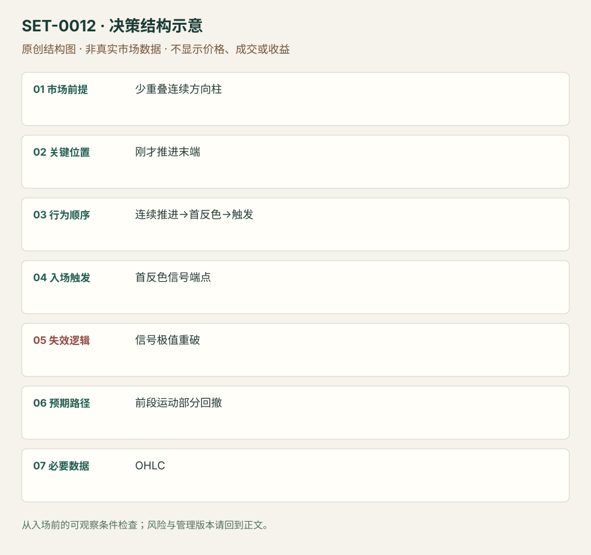

---
{
  "id": "SET-0012",
  "schema_version": "1.0.0",
  "name_zh": "连续推进后的分数回撤反向短交易",
  "name_en": "Bulkowski Retrace Day Trade",
  "aliases": [],
  "name_nature": "editor_descriptive_with_source_term",
  "status": "reviewed",
  "summary": "短周期出现至少三根连续同向、少重叠推进后，首个逆色信号被越过，考虑只捕捉刚才运动的一部分回撤。信号极值破坏即退出，不要求完整趋势反转。",
  "mechanism": "streak_partial_retrace",
  "tags": [
    "price_action",
    "mean_reversion",
    "scalping"
  ],
  "pa_role": "core",
  "markets_observed": [
    "ES期货1/5分钟",
    "股票1/5分钟（Bulkowski规则）"
  ],
  "markets_supported": [],
  "migration_hypotheses": [],
  "session": "美股/ES现金参考段 09:30–16:00 America/New_York；收盘前平仓。期货夜盘单独建背景，不将其并入开盘区间。",
  "session_tags": [
    "intraday"
  ],
  "context_timeframe": "日线/前一session + 当日执行图；因来源而异",
  "trigger_timeframe": null,
  "data_requirements": [
    "OHLC"
  ],
  "execution_mode": "mixed",
  "source_ids": [
    "SRC-0053",
    "SRC-0058"
  ],
  "evidence_ids": [
    "EVD-000019",
    "EVD-000020"
  ],
  "visual_ids": [
    "VIS-000013",
    "VIS-000069"
  ],
  "rule_completeness": "前提/触发/失效/管理已记录；来源与编辑模块分开",
  "independent_corroboration": "limited_derivative_corroboration",
  "profit_evidence": "not_established",
  "created": "2026-10-02",
  "updated": "2026-10-02",
  "reviewed_at": "2026-10-02",
  "known_gaps": [
    "未开展独立回测；实际订单成交与成本未知",
    "执行周期没有统一来源参数，使用前须锁定版本"
  ],
  "logic_fingerprint": [
    "少重叠连续方向柱",
    "刚才推进末端",
    "连续推进→首反色→触发",
    "首反色信号端点",
    "信号极值重破",
    "前段运动部分回撤",
    "OHLC"
  ],
  "environment_tags": [
    "extended"
  ],
  "structure_locations": [
    "streak_extreme"
  ],
  "version": "1.0.0",
  "unknown_fields": {
    "trigger_timeframe": "来源未提供统一执行周期；正文记录已知图例，不能当成统一参数"
  },
  "review_scope": "规则记录、引用范围、日内边界、逻辑区别与已看静态画面；不含独立回测、动态逐笔或账户核验",
  "source_coverage": {
    "substantive_read_sources": 2,
    "families": [
      "bulkowski",
      "galen-woods"
    ],
    "core_support_source_ids": [
      "SRC-0053",
      "SRC-0058"
    ],
    "independence_note": "limited_derivative_corroboration"
  },
  "method_families": [
    "price_action_reversal"
  ],
  "market_types": [
    "futures",
    "stocks"
  ]
}
---

# 连续推进后的分数回撤反向短交易 · Bulkowski Retrace Day Trade

## 1. 名称与快速概览

短周期出现至少三根连续同向、少重叠推进后，首个逆色信号被越过，考虑只捕捉刚才运动的一部分回撤。信号极值破坏即退出，不要求完整趋势反转。

记录口径：PA core；必要数据 OHLC。名称性质：编辑性描述名，英文保留来源术语以便检索。reviewed 只表示本条规则与证据记录审查通过，盈利状态为 not_established。

## 2. 本质与行为假说

连续推进及首逆色信号可见；“已经耗尽”不是已证事实。本条以部分修正为目的，最早信号允许失败。

## 3. 适用市场与环境

1或5分钟可见连贯推进、实体明显且少重叠；信号至已知回撤目标有空间。区间密集交替的三根同色不算。

**来源实用市场：**ES期货1/5分钟、股票1/5分钟（Bulkowski规则）。

**Session：**美股/ES现金参考段 09:30–16:00 America/New_York；收盘前平仓。期货夜盘单独建背景，不将其并入开盘区间。

跨市场：本版不主张已经验证的跨市场迁移；更换市场必须重定数据来源、流动性与session。

## 4. 出现前的观察清单

必要：连续推进起点与当时极值明确、至少三根方向柱、首逆色柱完成。增强：前一session参考线。否决：信号风险已大于可见部分回撤空间。

## 5. 形成过程与状态转换

短期连贯运动→首逆色柱→端点触发→部分回撤→逐柱退出；信号未触发或恢复原向推进则取消。

## 6. Entry trigger 与执行方式

Bulkowski股票版信号高外一至两美分触发，空头镜像；期货应按tick适配并单独测试，不照搬美分。不能以最终最低点当买价。

## 7. Invalidation 与止损逻辑

原版保护信号柱低；过大信号柱作者提供缩小周期或实体中点保护两种替代。中点并非完整结构失效，可能更易提前出局，分别记录。

## 8. Exit、target 与 trade management

先根据已完成推进计算38%/50%修正参照，接近后用1分钟前柱低移动保护。Galen偏向更大反转的管理是另一版本，不继承原版目标结果。

## 9. 常见 variations

连续柱超过三根和周期变化合并；多空不分条。第二次再入属于SET-0019，原始第一反向交易仍须记录亏损。

## 10. 失败方式与不交易条件

正常亏损：首反色后新极值。未成立：高重叠小柱不构成强运动。偏离：事后把第二次信号代替失败第一笔。手续费可能侵蚀短目标。

## 11. 与相近 setups 的区别

- [SET-0007](SET-0007.md)：楔形需三个分开的摆动推进，本条是连续柱的一次推进。
- [SET-0040](SET-0040.md)：订单流耗尽要求成交/梯级变化，本条仅观察价格且目标是部分回撤。

## 12. 图表与案例解读

已查看Galen亏例：ES09-13，1分钟，图头27/7/2013。绿色箭头第一次反向触发后继续破低止损，橙圈之后才出现双底。后来的上涨不能使绿色箭头的亏损消失；其数小时跨图中午夜的时钟时区未披露，不能转成纽约执行时间。

- [VIS-000013] [Retrace Day Trading Setup Losing Trade](https://www.tradingsetupsreview.com/bulkowskis-retrace-day-trading-setup/img/Retrace-Day-Trading-Setup-Losing-Trade_hub0c1e4ea003b39f11d0dea029c698347_367455_1280x0_resize_q75_h1_box_3.webp)；定位：Losing Trade。第一次绿色反向信号失败，之后另有双底及趋势线突破。 验证：chart_viewed。

**本地原创示意（VIS-000069，非真实市场数据）：**

小屏阅读可[打开原尺寸示意图](../assets/diagrams/SET-0012.svg)并缩放。

此图用于对照识别顺序与风险定义；不计入真实案例覆盖率。

## 13. 证据、分歧与未知项

Bulkowski原规则与Galen自己的期货案例已阅读；Galen是规则转述加实践例，不作为独立盈利复制。以作者明示的规则为主，未阅读付费书。

- [EVD-000019] Galen Woods，《Bulkowski's Retrace Day Trading Setup》，[SRC-0053](https://www.tradingsetupsreview.com/bulkowskis-retrace-day-trading-setup/)；定位：Trading Rules、Winning/Losing Trade。支持：至少三根同向收盘后首逆色信号，捕捉前段部分回撤，包含亏损例
- [EVD-000020] Thomas Bulkowski，《Bulkowski's Retrace Day Trading Setup (long)》，[SRC-0058](https://www.thepatternsite.com/retracel.html)；定位：Methodology与Checklist。支持：短周期信号高外触发、信号低外保护，接近38%/50%回撤目标改逐柱保护

审查边界：来源份数与独立核心核验分开；当前类别为 limited_derivative_corroboration。正文中的概念、官方事实、衍生解说或同族资料只按其支持范围使用。

## 14. 可用于复盘的检查表

- [ ] 下单前的前提可核对：少重叠连续方向柱
- [ ] 事前标记位置：刚才推进末端
- [ ] 行为按顺序出现：连续推进→首反色→触发
- [ ] 实际触发符合选定版本：首反色信号端点
- [ ] 事先写明本次否定条件：信号极值重破
- [ ] 目标/路径只用当时已知信息：前段运动部分回撤
- [ ] 数据满足 OHLC；记录时间、点差、滑点、队列和未成交
- [ ] 记录截止平仓及规则偏离；正常亏损不事后改成“未成立”

## 15. 后续验证问题

固定推进分段、同色定义及可交易目标空间；比较信号柱与中点止损，保留第一失败和后续再入。
