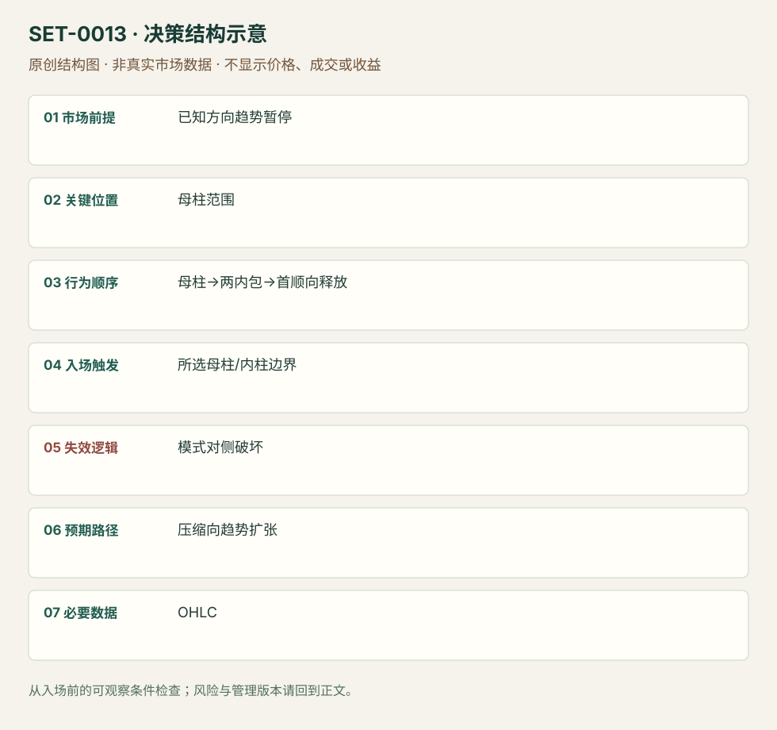

---
{
  "id": "SET-0013",
  "schema_version": "1.0.0",
  "name_zh": "趋势内双内包压缩首次释放",
  "name_en": "Double Inside Bar Trend Release",
  "aliases": [],
  "name_nature": "editor_descriptive_with_source_term",
  "status": "reviewed",
  "summary": "已明确方向背景中，母柱后两根内包柱使区间缩窄；第一次顺背景释放时考虑加入，母柱对侧或压缩结构破坏否定本次释放。",
  "mechanism": "nested_compression_release",
  "tags": [
    "price_action",
    "breakout",
    "compression"
  ],
  "pa_role": "core",
  "markets_observed": [
    "FDAX期货3分钟",
    "Brooks开盘日内讲义"
  ],
  "markets_supported": [],
  "migration_hypotheses": [],
  "session": "FDAX来源3分钟图的完整时区未明；编辑执行按Europe/Berlin现金参考段另锁截止并当日退出。Brooks ES开盘讲义背景若迁移需用America/New_York另立版本。",
  "session_tags": [
    "intraday"
  ],
  "context_timeframe": "日线/前一session + 当日执行图；因来源而异",
  "trigger_timeframe": null,
  "data_requirements": [
    "OHLC"
  ],
  "execution_mode": "mixed",
  "source_ids": [
    "SRC-0019",
    "SRC-0001"
  ],
  "evidence_ids": [
    "EVD-000021",
    "EVD-000022"
  ],
  "visual_ids": [
    "VIS-000014",
    "VIS-000070"
  ],
  "rule_completeness": "前提/触发/失效/管理已记录；来源与编辑模块分开",
  "independent_corroboration": "independent_context_only",
  "profit_evidence": "not_established",
  "created": "2026-10-02",
  "updated": "2026-10-02",
  "reviewed_at": "2026-10-02",
  "known_gaps": [
    "未开展独立回测；实际订单成交与成本未知",
    "执行周期没有统一来源参数，使用前须锁定版本"
  ],
  "logic_fingerprint": [
    "已知方向趋势暂停",
    "母柱范围",
    "母柱→两内包→首顺向释放",
    "所选母柱/内柱边界",
    "模式对侧破坏",
    "压缩向趋势扩张",
    "OHLC"
  ],
  "environment_tags": [
    "directional",
    "compression"
  ],
  "structure_locations": [
    "mother_bar"
  ],
  "version": "1.0.0",
  "unknown_fields": {
    "trigger_timeframe": "来源未提供统一执行周期；正文记录已知图例，不能当成统一参数"
  },
  "review_scope": "规则记录、引用范围、日内边界、逻辑区别与已看静态画面；不含独立回测、动态逐笔或账户核验",
  "source_coverage": {
    "substantive_read_sources": 2,
    "families": [
      "brooks",
      "galen-woods"
    ],
    "core_support_source_ids": [
      "SRC-0019"
    ],
    "independence_note": "independent_context_only"
  },
  "method_families": [
    "compression_breakout"
  ],
  "market_types": [
    "futures"
  ]
}
---

# 趋势内双内包压缩首次释放 · Double Inside Bar Trend Release

## 1. 名称与快速概览

已明确方向背景中，母柱后两根内包柱使区间缩窄；第一次顺背景释放时考虑加入，母柱对侧或压缩结构破坏否定本次释放。

记录口径：PA core；必要数据 OHLC。名称性质：编辑性描述名，英文保留来源术语以便检索。reviewed 只表示本条规则与证据记录审查通过，盈利状态为 not_established。

## 2. 本质与行为假说

嵌套与突破可见，“蓄能”只是比喻；每个ii并无方向优势。规则在释放前就能识别完整压缩。

## 3. 适用市场与环境

方向已由背景而非两根小柱决定；趋势内暂停优先。连续窄柱拥挤、多次双向触发的区间回避。

**来源实用市场：**FDAX期货3分钟、Brooks开盘日内讲义。

**Session：**FDAX来源3分钟图的完整时区未明；编辑执行按Europe/Berlin现金参考段另锁截止并当日退出。Brooks ES开盘讲义背景若迁移需用America/New_York另立版本。

跨市场：本版不主张已经验证的跨市场迁移；更换市场必须重定数据来源、流动性与session。

## 4. 出现前的观察清单

必要：母柱界限、两根内包柱及方向背景。增强：压缩位于顺向摆动末端。否决：宽区间中间、母柱过大或突发事件临近。

## 5. 形成过程与状态转换

母柱→第一内包→第二内包→顺向首次越界→管理；先发生逆向结构破坏则撤销当前计划。

## 6. Entry trigger 与执行方式

Galen保守版用母柱高低外触发，激进版用内柱边界，不能互换结果。来源另有用收盘内包代替影线内包的定义，必须固定一版。

## 7. Invalidation 与止损逻辑

母柱另一边是宽结构保护；内柱另一边是较紧模式风险。释放后重新陷入拥挤属时间/质量失效，具体等待柱数为研究参数。

## 8. Exit、target 与 trade management

先以方向背景已知摆动作目标；失去跟随或双向回收时退出。不要仅因后来趋势很大就选择无限持有模块。

## 9. 常见 variations

ii、triple inside与更高周期三角形若表达同一压缩释放，合并为变体。反向失败转向Hikkake时，主机会改变为突破失败。

## 10. 失败方式与不交易条件

正常亏损：第一次释放随后穿过模式。未成立：两柱未满足所选inside定义。偏离：母柱版名义却用内柱紧止损。多次双向触发可能产生连续成本。

## 11. 与相近 setups 的区别

- [SET-0005](SET-0005.md)：Hikkake等待inside之后首次突破失败；本条抓首次释放。
- [SET-0016](SET-0016.md)：压力突破必反复攻击事前水平、反向回撤缩短；本条必有嵌套母柱，不要求反复水平测试。

## 12. 图表与案例解读

已查看FDAX12-20的3分钟StopOrderEntries图：一组绿色区域在趋势里，另一组黄色区域处于拥挤；图内分别展示母柱与更近触发。图头12/10/2020格式歧义，时区未知。图中的后续上下运动不能让初始拥挤自动变成趋势背景。

- [VIS-000014] [Stop Order Entries For Breakouts](https://www.tradingsetupsreview.com/double-inside-bar-pattern-for-intraday-trading/img/StopOrderEntriesForBreakouts_hua3514bbad1562644f0c99f23c77d9982_73194_1280x0_resize_q75_h1_box.webp)；定位：StopOrderEntries。母柱/内柱不同触发位置；同样ii在趋势与拥挤中含义不同。 验证：chart_viewed。

**本地原创示意（VIS-000070，非真实市场数据）：**

小屏阅读可[打开原尺寸示意图](../assets/diagrams/SET-0013.svg)并缩放。

此图用于对照识别顺序与风险定义；不计入真实案例覆盖率。

## 13. 证据、分歧与未知项

Galen和Brooks两家对压缩说明相容，但Brooks反向开盘版本不能当本条顺趋势例。规则参数及背景选择尚无独立收益验证。

- [EVD-000021] Galen Woods，《Double Inside Bar Pattern For Intraday Trading》，[SRC-0019](https://www.tradingsetupsreview.com/double-inside-bar-pattern-for-intraday-trading/)；定位：Identifying、Entry、Failures。支持：两根连续inside bar、母柱/内柱触发与失效，强调趋势和拥挤过滤
- [EVD-000022] Al Brooks，《Patterns on the Open》，[SRC-0001](https://www.brookstradingcourse.com/wp-content/uploads/2018/10/181030-futuresio-Patterns-on-the-Open-Al-Brooks.pdf)；定位：PDF页22。支持：ii压缩可作为突破模式，开盘例存在反向突破变体

审查边界：来源份数与独立核心核验分开；当前类别为 independent_context_only。正文中的概念、官方事实、衍生解说或同族资料只按其支持范围使用。

## 14. 可用于复盘的检查表

- [ ] 下单前的前提可核对：已知方向趋势暂停
- [ ] 事前标记位置：母柱范围
- [ ] 行为按顺序出现：母柱→两内包→首顺向释放
- [ ] 实际触发符合选定版本：所选母柱/内柱边界
- [ ] 事先写明本次否定条件：模式对侧破坏
- [ ] 目标/路径只用当时已知信息：压缩向趋势扩张
- [ ] 数据满足 OHLC；记录时间、点差、滑点、队列和未成交
- [ ] 记录截止平仓及规则偏离；正常亏损不事后改成“未成立”

## 15. 后续验证问题

对同一批候选比较影线内包和收盘内包，记录触发宽度与成本；避免凭后续收益选择定义。
