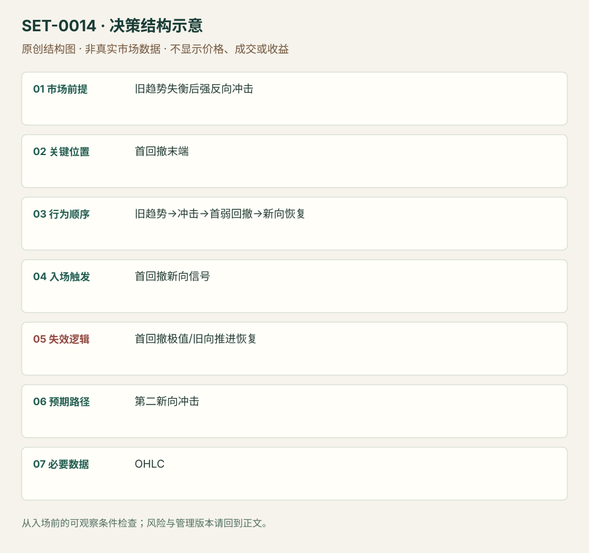

---
{
  "id": "SET-0014",
  "schema_version": "1.0.0",
  "name_zh": "趋势第一次反向冲击后的首回撤",
  "name_en": "Anti / Snap Pullback",
  "aliases": [],
  "name_nature": "editor_descriptive_with_source_term",
  "status": "reviewed",
  "summary": "旧趋势已有失衡迹象，第一次强反向冲击打断它；首个较弱反向回撤不能恢复旧推进时，考虑新方向恢复。冲击被完全否定会使假说失效。",
  "mechanism": "new_regime_first_pullback",
  "tags": [
    "price_action",
    "reversal",
    "continuation"
  ],
  "pa_role": "core",
  "markets_observed": [
    "美股开盘1分钟（SAI）"
  ],
  "markets_supported": [],
  "migration_hypotheses": [],
  "session": "美股/ES现金参考段 09:30–16:00 America/New_York；收盘前平仓。期货夜盘单独建背景，不将其并入开盘区间。",
  "session_tags": [
    "intraday"
  ],
  "context_timeframe": "日线/前一session + 当日执行图；因来源而异",
  "trigger_timeframe": null,
  "data_requirements": [
    "OHLC",
    "volume_optional"
  ],
  "execution_mode": "mixed",
  "source_ids": [
    "SRC-0017",
    "SRC-0013"
  ],
  "evidence_ids": [
    "EVD-000023",
    "EVD-000024"
  ],
  "visual_ids": [
    "VIS-000015",
    "VIS-000071"
  ],
  "rule_completeness": "前提/触发/失效/管理已记录；来源与编辑模块分开",
  "independent_corroboration": "independent_context_only",
  "profit_evidence": "not_established",
  "created": "2026-10-02",
  "updated": "2026-10-02",
  "reviewed_at": "2026-10-02",
  "known_gaps": [
    "未开展独立回测；实际订单成交与成本未知",
    "执行周期没有统一来源参数，使用前须锁定版本"
  ],
  "logic_fingerprint": [
    "旧趋势失衡后强反向冲击",
    "首回撤末端",
    "旧趋势→冲击→首弱回撤→新向恢复",
    "首回撤新向信号",
    "首回撤极值/旧向推进恢复",
    "第二新向冲击",
    "OHLC"
  ],
  "environment_tags": [
    "regime_change",
    "pullback"
  ],
  "structure_locations": [
    "first_new_direction_pullback"
  ],
  "version": "1.0.0",
  "markets_context_only": [
    "Grimes结构教学不限市场"
  ],
  "unknown_fields": {
    "trigger_timeframe": "来源未提供统一执行周期；正文记录已知图例，不能当成统一参数"
  },
  "review_scope": "规则记录、引用范围、日内边界、逻辑区别与已看静态画面；不含独立回测、动态逐笔或账户核验",
  "source_coverage": {
    "substantive_read_sources": 2,
    "families": [
      "adam-grimes",
      "sai-trades"
    ],
    "core_support_source_ids": [
      "SRC-0017"
    ],
    "independence_note": "independent_context_only"
  },
  "method_families": [
    "price_action_reversal"
  ],
  "market_types": [
    "stocks"
  ]
}
---

# 趋势第一次反向冲击后的首回撤 · Anti / Snap Pullback

## 1. 名称与快速概览

旧趋势已有失衡迹象，第一次强反向冲击打断它；首个较弱反向回撤不能恢复旧推进时，考虑新方向恢复。冲击被完全否定会使假说失效。

记录口径：PA core；必要数据 OHLC、volume_optional。名称性质：编辑性描述名，英文保留来源术语以便检索。reviewed 只表示本条规则与证据记录审查通过，盈利状态为 not_established。

## 2. 本质与行为假说

必须先看到新方向的冲击，不能在旧趋势里猜顶底。“新趋势”仍是候选；被打断的趋势也可能转为宽区间。

## 3. 适用市场与环境

旧趋势已有延伸，冲击相对于先前摆动明显增强，首回撤与冲击形成不对称。只是普通回撤、尚未改变旧推进的不适合。

**来源实用市场：**美股开盘1分钟（SAI）、Grimes结构教学不限市场。

**Session：**美股/ES现金参考段 09:30–16:00 America/New_York；收盘前平仓。期货夜盘单独建背景，不将其并入开盘区间。

跨市场：本版不主张已经验证的跨市场迁移；更换市场必须重定数据来源、流动性与session。

## 4. 出现前的观察清单

必要：旧趋势、第一强反向波、其后的首回撤。增强：缩小实体/量能反向回撤。否决：多个来回后才追认首回撤，或冲击很小。

## 5. 形成过程与状态转换

旧趋势→延伸/高潮→首次强反向冲击→首个较弱回撤→新向恢复→管理；回撤重建旧向连续推进则取消。

## 6. Entry trigger 与执行方式

Grimes用结构界定Anti，指标版本为辅助。本研究将首回撤结束后的顺冲击方向信号端点作为可记录触发；SAI可在破下行趋势后回测试探买盘恢复。具体形式须标来源。

## 7. Invalidation 与止损逻辑

保护首回撤极值，冲击起点是更宽环境否定；二者不能混为同一风险。首回撤极值破坏后不因希望大反转继续拖延。

## 8. Exit、target 与 trade management

先看冲击极值及下一已知障碍；SAI开盘下行反转常遇VWAP与盘前阻力，见弱可部分退出。冲击后变平衡则用区间管理。

## 9. 常见 variations

Linda Raschke指标Anti未完整复核，本版只采用Grimes结构释义。First Cross不在未读原始规则时当确证别名。

## 10. 失败方式与不交易条件

正常亏损：冲击后首回撤继续旧趋势。未成立：没有强冲击。偏离：先抄底后套Anti名称，或回撤已多轮。需要记录冲击的相对尺度。

## 11. 与相近 setups 的区别

- [SET-0008](SET-0008.md)：MTR等待再测旧极值；Anti只要求首次反向冲击后的首回撤。
- [SET-0009](SET-0009.md)：微回撤需要未有普通回撤的强推进，但不要求之前的旧趋势被打断。

## 12. 图表与案例解读

已查看SAI页23：左图早盘有下行且量增，右图下行趋势线被突破后出现回测并继续恢复；作者图是具体下行反转例，不能据此验证所有Anti。图上后来接近VWAP的上涨是回顾，日期未核对；较强反向波与较弱回测在入场前已可比较。

- [VIS-000015] [来源PDF第23页图表](https://saitrades.com/wp-content/uploads/2021/03/Trading-the-Open-Playbook.pdf#page=23)；定位：PDF页序 23。早盘下行破坏与首回测的日内类比；不要求MTR那样再测旧极值。 验证：chart_viewed_pdf_page。

**本地原创示意（VIS-000071，非真实市场数据）：**

小屏阅读可[打开原尺寸示意图](../assets/diagrams/SET-0014.svg)并缩放。

此图用于对照识别顺序与风险定义；不计入真实案例覆盖率。

## 13. 证据、分歧与未知项

Grimes结构与SAI日内版本相互补充，SAI未使用Anti这个名称。触发操作化、时间平仓属研究补充；未核对Raschke原始书/课程。

- [EVD-000023] Adam Grimes，《Fundamental Trading Patterns》，[SRC-0017](https://adamhgrimes.com/fundamental-trading-patterns/)；定位：Snap Pullbacks / Antis。支持：旧趋势延伸或高潮后首次尖锐反向冲击，随后首回撤是新趋势候选
- [EVD-000024] SAI Trades，《My Experience: Trading the Open Playbook》，[SRC-0013](https://saitrades.com/wp-content/uploads/2021/03/Trading-the-Open-Playbook.pdf)；定位：PDF页23。支持：早盘下行被破坏，回测破坏位置后买盘恢复的日内反转版本

审查边界：来源份数与独立核心核验分开；当前类别为 independent_context_only。正文中的概念、官方事实、衍生解说或同族资料只按其支持范围使用。

## 14. 可用于复盘的检查表

- [ ] 下单前的前提可核对：旧趋势失衡后强反向冲击
- [ ] 事前标记位置：首回撤末端
- [ ] 行为按顺序出现：旧趋势→冲击→首弱回撤→新向恢复
- [ ] 实际触发符合选定版本：首回撤新向信号
- [ ] 事先写明本次否定条件：首回撤极值/旧向推进恢复
- [ ] 目标/路径只用当时已知信息：第二新向冲击
- [ ] 数据满足 OHLC；记录时间、点差、滑点、队列和未成交
- [ ] 记录截止平仓及规则偏离；正常亏损不事后改成“未成立”

## 15. 后续验证问题

固定冲击相对强度与弱回撤标准，比较转区间和形成新趋势的结果，不把二者合并为成功。
