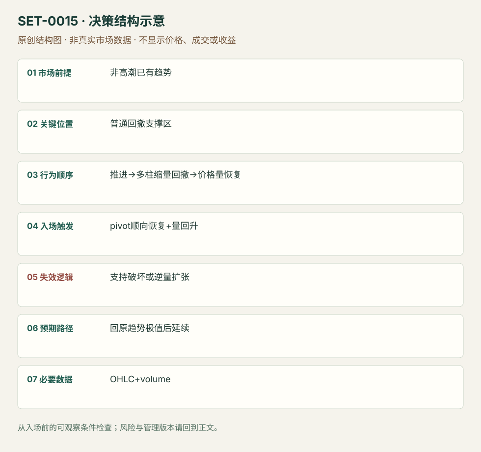

---
{
  "id": "SET-0015",
  "schema_version": "1.0.0",
  "name_zh": "缩量普通回撤后的成交恢复",
  "name_en": "Low-Volume Pullback",
  "aliases": [],
  "name_nature": "editor_descriptive_with_source_term",
  "status": "reviewed",
  "summary": "已有方向推进之后形成普通多柱回撤，逆向成交逐渐减少；关键支撑仍在且顺向成交重新出现时考虑延续。回撤支持区破坏或逆向成交扩张否定。",
  "mechanism": "countertrend_volume_dryup",
  "tags": [
    "price_action",
    "volume",
    "continuation",
    "pullback"
  ],
  "pa_role": "core",
  "markets_observed": [
    "美股1分钟（SAI）"
  ],
  "markets_supported": [],
  "migration_hypotheses": [],
  "session": "美股/ES现金参考段 09:30–16:00 America/New_York；收盘前平仓。期货夜盘单独建背景，不将其并入开盘区间。",
  "session_tags": [
    "intraday"
  ],
  "context_timeframe": "日线/前一session + 当日执行图；因来源而异",
  "trigger_timeframe": null,
  "data_requirements": [
    "OHLC",
    "volume"
  ],
  "execution_mode": "mixed",
  "source_ids": [
    "SRC-0020",
    "SRC-0013"
  ],
  "evidence_ids": [
    "EVD-000025",
    "EVD-000026"
  ],
  "visual_ids": [
    "VIS-000016",
    "VIS-000072"
  ],
  "rule_completeness": "前提/触发/失效/管理已记录；来源与编辑模块分开",
  "independent_corroboration": "independent_context_only",
  "profit_evidence": "not_established",
  "created": "2026-10-02",
  "updated": "2026-10-02",
  "reviewed_at": "2026-10-02",
  "known_gaps": [
    "未开展独立回测；实际订单成交与成本未知",
    "执行周期没有统一来源参数，使用前须锁定版本"
  ],
  "logic_fingerprint": [
    "非高潮已有趋势",
    "普通回撤支撑区",
    "推进→多柱缩量回撤→价格量恢复",
    "pivot顺向恢复+量回升",
    "支持破坏或逆量扩张",
    "回原趋势极值后延续",
    "OHLC+volume"
  ],
  "environment_tags": [
    "directional",
    "pullback"
  ],
  "structure_locations": [
    "pullback_extreme"
  ],
  "version": "1.0.0",
  "markets_context_only": [
    "日线股票/ETF（Galen背景例）"
  ],
  "unknown_fields": {
    "trigger_timeframe": "来源未提供统一执行周期；正文记录已知图例，不能当成统一参数"
  },
  "review_scope": "规则记录、引用范围、日内边界、逻辑区别与已看静态画面；不含独立回测、动态逐笔或账户核验",
  "source_coverage": {
    "substantive_read_sources": 2,
    "families": [
      "galen-woods",
      "sai-trades"
    ],
    "core_support_source_ids": [
      "SRC-0013"
    ],
    "independence_note": "independent_context_only"
  },
  "method_families": [
    "price_action_trend"
  ],
  "market_types": [
    "stocks"
  ]
}
---

# 缩量普通回撤后的成交恢复 · Low-Volume Pullback

## 1. 名称与快速概览

已有方向推进之后形成普通多柱回撤，逆向成交逐渐减少；关键支撑仍在且顺向成交重新出现时考虑延续。回撤支持区破坏或逆向成交扩张否定。

记录口径：PA core；必要数据 OHLC、volume。名称性质：编辑性描述名，英文保留来源术语以便检索。reviewed 只表示本条规则与证据记录审查通过，盈利状态为 not_established。

## 2. 本质与行为假说

成交量降低说明活动下降，不能仅凭它断言卖盘全消失或有人吸筹。恢复成交与价格响应必须同时检查。

## 3. 适用市场与环境

已建立有空间的趋势、非高潮末端；回撤结构较有序。午间普遍低量须与同时间季节性区分，不能直接当方向优势。

**来源实用市场：**美股1分钟（SAI）、日线股票/ETF（Galen背景例）。

**Session：**美股/ES现金参考段 09:30–16:00 America/New_York；收盘前平仓。期货夜盘单独建背景，不将其并入开盘区间。

跨市场：本版不主张已经验证的跨市场迁移；更换市场必须重定数据来源、流动性与session。

## 4. 出现前的观察清单

必要：先前方向冲击、普通回撤、量能相对下降、支持区未破。增强：回测旧水平且恢复量增加。否决：高潮量之后急跌、刚开盘量自然下降或数据遗漏。

## 5. 形成过程与状态转换

方向推进→数柱普通回撤→量弱且支持仍在→顺向价格/成交恢复→入场管理；逆向量加速则取消。

## 6. Entry trigger 与执行方式

SAI用回撤pivot上方买盘增强、趋势恢复触发；Galen日线版的量带筛选只作背景研究，不套到分钟图。量回升但价格不动可能为吸收，不能自动买。

## 7. Invalidation 与止损逻辑

回撤pivot/支持区破坏否定本次承接，订单保护围绕它而非量能百分比。逆向放量是撤销触发或提早退出理由，不代替硬结构风险。

## 8. Exit、target 与 trade management

先观察事前已有日内高低点及下一阻力；触及后弱跟随可分批。强趋势才测试结构跟踪；SAI数柱延伸退出和Galen长目标分属不同模块。

## 9. 常见 variations

ABCD、普通bull/bear flag与本条若核心是缩量承接则合并；不因EMA换参数另计。两段并不是本条必要条件。

## 10. 失败方式与不交易条件

正常亏损：量弱回撤后再次破支持。未成立：高潮末端或只看一根低量柱。偏离：用当日最终量归一化历史信号，形成前视偏差。股票分笔成交量与外汇tick量不等价。

## 11. 与相近 setups 的区别

- [SET-0006](SET-0006.md)：H2必有第一次恢复失败、第二段；本条必有量能退潮，回撤可只有一段。
- [SET-0009](SET-0009.md)：本条已经形成普通多柱回撤；微回撤是强推进首次极短暂停。

## 12. 图表与案例解读

已查看SAI页22的FirstRetest图：先突破，回撤至参考线附近的小柱与低量可见，蓝箭头处买盘恢复，右侧再涨。它说明日内执行背景；Galen SPLS反例是日线高潮，不能冒充已查看的日内败例。量栏来自图表，不提供逐笔交易者身份。

- [VIS-000016] [来源PDF第22页图表](https://saitrades.com/wp-content/uploads/2021/03/Trading-the-Open-Playbook.pdf#page=22)；定位：PDF页序 22。First Retest案例的弱量回撤与恢复；价格边界与量能共同观察。 验证：chart_viewed_pdf_page。

**本地原创示意（VIS-000072，非真实市场数据）：**

小屏阅读可[打开原尺寸示意图](../assets/diagrams/SET-0015.svg)并缩放。

此图用于对照识别顺序与风险定义；不计入真实案例覆盖率。

## 13. 证据、分歧与未知项

日线例与分钟例不能合成统一阈值。已标出两来源的周期差异；管理依版本记录，没有成本后胜率。

- [EVD-000025] Galen Woods，《Low Volume Pullback Strategy (Expanded)》，[SRC-0020](https://www.tradingsetupsreview.com/low-volume-pullback-strategy-expanded/)；定位：GME、SPY与SPLS三案例。支持：顺势回撤时量能降低，恢复时量回升；高潮背景反例
- [EVD-000026] SAI Trades，《My Experience: Trading the Open Playbook》，[SRC-0013](https://saitrades.com/wp-content/uploads/2021/03/Trading-the-Open-Playbook.pdf)；定位：PDF页22、24–25。支持：日内首回撤至少数柱，回撤量弱，支撑上方买盘重新增强

审查边界：来源份数与独立核心核验分开；当前类别为 independent_context_only。正文中的概念、官方事实、衍生解说或同族资料只按其支持范围使用。

## 14. 可用于复盘的检查表

- [ ] 下单前的前提可核对：非高潮已有趋势
- [ ] 事前标记位置：普通回撤支撑区
- [ ] 行为按顺序出现：推进→多柱缩量回撤→价格量恢复
- [ ] 实际触发符合选定版本：pivot顺向恢复+量回升
- [ ] 事先写明本次否定条件：支持破坏或逆量扩张
- [ ] 目标/路径只用当时已知信息：回原趋势极值后延续
- [ ] 数据满足 OHLC+volume；记录时间、点差、滑点、队列和未成交
- [ ] 记录截止平仓及规则偏离；正常亏损不事后改成“未成立”

## 15. 后续验证问题

使用同时间历史成交量归一化，比较纯价格版本；检验量减是否只是午间季节性。
