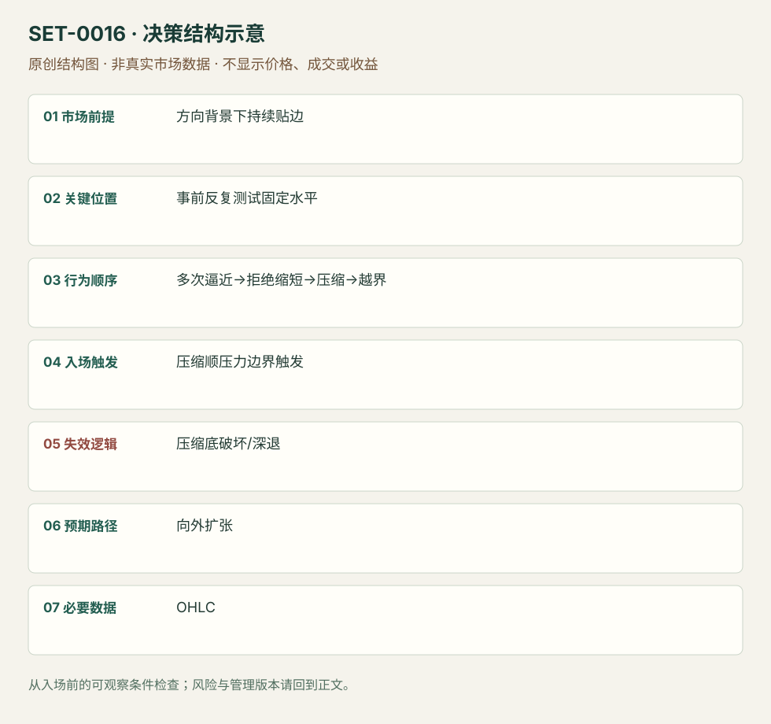

---
{
  "id": "SET-0016",
  "schema_version": "1.0.0",
  "name_zh": "反复逼近固定边界的压力突破",
  "name_en": "Buildup / Pressure Breakout",
  "aliases": [],
  "name_nature": "editor_descriptive_with_source_term",
  "status": "reviewed",
  "summary": "事前固定水平遭到反复试探，而每次退离更短，价格贴近边界压缩；顺压力越界时考虑扩张。压缩底部被破或价格重新深退说明压力假说失效。",
  "mechanism": "progressive_boundary_pressure",
  "tags": [
    "price_action",
    "breakout",
    "compression"
  ],
  "pa_role": "core",
  "markets_observed": [
    "美股盘中15分钟（SAI）"
  ],
  "markets_supported": [],
  "migration_hypotheses": [],
  "session": "美股/ES现金参考段 09:30–16:00 America/New_York；收盘前平仓。期货夜盘单独建背景，不将其并入开盘区间。",
  "session_tags": [
    "intraday"
  ],
  "context_timeframe": "日线/前一session + 当日执行图；因来源而异",
  "trigger_timeframe": null,
  "data_requirements": [
    "OHLC",
    "volume_optional"
  ],
  "execution_mode": "mixed",
  "source_ids": [
    "SRC-0059",
    "SRC-0060",
    "SRC-0013"
  ],
  "evidence_ids": [
    "EVD-000027",
    "EVD-000028",
    "EVD-000029"
  ],
  "visual_ids": [
    "VIS-000056",
    "VIS-000073"
  ],
  "rule_completeness": "前提/触发/失效/管理已记录；来源与编辑模块分开",
  "independent_corroboration": "independent_context_only",
  "profit_evidence": "not_established",
  "created": "2026-10-02",
  "updated": "2026-10-02",
  "reviewed_at": "2026-10-02",
  "known_gaps": [
    "未开展独立回测；实际订单成交与成本未知",
    "执行周期没有统一来源参数，使用前须锁定版本"
  ],
  "logic_fingerprint": [
    "方向背景下持续贴边",
    "事前反复测试固定水平",
    "多次逼近→拒绝缩短→压缩→越界",
    "压缩顺压力边界触发",
    "压缩底破坏/深退",
    "向外扩张",
    "OHLC"
  ],
  "environment_tags": [
    "directional",
    "compression"
  ],
  "structure_locations": [
    "fixed_horizontal_boundary"
  ],
  "version": "1.0.0",
  "markets_context_only": [
    "外汇/加密较长周期（Rayner）"
  ],
  "unknown_fields": {
    "trigger_timeframe": "来源未提供统一执行周期；正文记录已知图例，不能当成统一参数"
  },
  "review_scope": "规则记录、引用范围、日内边界、逻辑区别与已看静态画面；不含独立回测、动态逐笔或账户核验",
  "source_coverage": {
    "substantive_read_sources": 3,
    "families": [
      "rayner-teo",
      "sai-trades"
    ],
    "core_support_source_ids": [
      "SRC-0013"
    ],
    "independence_note": "independent_context_only"
  },
  "method_families": [
    "compression_breakout"
  ],
  "market_types": [
    "stocks"
  ]
}
---

# 反复逼近固定边界的压力突破 · Buildup / Pressure Breakout

## 1. 名称与快速概览

事前固定水平遭到反复试探，而每次退离更短，价格贴近边界压缩；顺压力越界时考虑扩张。压缩底部被破或价格重新深退说明压力假说失效。

记录口径：PA core；必要数据 OHLC、volume_optional。名称性质：编辑性描述名，英文保留来源术语以便检索。reviewed 只表示本条规则与证据记录审查通过，盈利状态为 not_established。

## 2. 本质与行为假说

可见是反复接近、拒绝距离缩短。“供应耗尽”与“强买方承接”均可能解释，OHLC无法确定谁撤单或补单。

## 3. 适用市场与环境

方向背景支持，边界前形成紧密结构且距离近。早已大幅加速、远离可保护结构的追价不属于本条。

**来源实用市场：**美股盘中15分钟（SAI）、外汇/加密较长周期（Rayner）。

**Session：**美股/ES现金参考段 09:30–16:00 America/New_York；收盘前平仓。期货夜盘单独建背景，不将其并入开盘区间。

跨市场：本版不主张已经验证的跨市场迁移；更换市场必须重定数据来源、流动性与session。

## 4. 出现前的观察清单

必要：固定水平多次测试、反向摆动距离逐步缩短、紧压缩。增强：回撤量降。否决：水平下方每次遭到相同幅度拒绝、区间越来越宽。

## 5. 形成过程与状态转换

先定水平→多次逼近→逆向回撤缩短→贴边压缩→越界与恢复成交→管理；大幅退离压缩底则取消。

## 6. Entry trigger 与执行方式

Rayner在压缩区高外触发；SAI强调日内量能与盘前水平。以完成压缩和顺向越界为共同结构，是否等收盘分别记录，不视为统一固定参数。

## 7. Invalidation 与止损逻辑

压缩相反极值是结构否定位置；Rayner不同课程讨论1或2ATR缓冲，不择优拼接。SAI用pivot/趋势线收盘止损的一版另列。

## 8. Exit、target 与 trade management

先看更高周期事前阻力及压缩尺寸扩张路径；持续强推进可结构跟踪。失败越界回到压缩内部时退出，午后持仓受所选session结束约束。

## 9. 常见 variations

Ascending/descending triangle、buildup、flat-top if相同反复攻击序列合并。单纯对称三角或ii压缩未必有这组压力证据。

## 10. 失败方式与不交易条件

正常亏损：边界仍有补给而突破失败。未成立：只看最终三角形、未有反复水平攻击。偏离：大柱远离结构后追入。Rayner承认选漂亮例教学，不作抽样盈利证据。

## 11. 与相近 setups 的区别

- [SET-0013](SET-0013.md)：II必须两根嵌套内包柱；本条必须反复攻击固定水平且拒绝幅度缩短。
- [SET-0010](SET-0010.md)：回测突破需要越界已经发生；本条在第一次有效越界之前建立压力假说。

## 12. 图表与案例解读

已实际查看SAI公开PDF页30的GME价格图。图中反复接近事先水平、下方回撤逐步收窄，随后越界展开；15分钟背景与分钟执行应分开。后续快速上涨是事后信息，不能当成入场前已知目标。此图支持日内压力结构；Rayner较长周期例只支持机制解释，不能核验同一日内参数。

- [VIS-000056] [来源PDF第30页图表](https://saitrades.com/wp-content/uploads/2021/03/Trading-the-Open-Playbook.pdf#page=30)；定位：PDF页序 30。GME反复压向水平与回撤收窄后的释放，价格图支持结构，文字止损版本须单列。 验证：chart_viewed_pdf_page。

**本地原创示意（VIS-000073，非真实市场数据）：**

小屏阅读可[打开原尺寸示意图](../assets/diagrams/SET-0016.svg)并缩放。

此图用于对照识别顺序与风险定义；不计入真实案例覆盖率。

## 13. 证据、分歧与未知项

Rayner图例多为较长周期；本版日内实践依据SAI，而非擅自把4小时持仓迁移到日内。具体ATR数值冲突作为版本记录。

- [EVD-000027] Rayner Teo，《#1: How to Trade Breakouts Like a Pro》，[SRC-0059](https://www.tradingwithrayner.com/course/how-to-trade-breakouts-like-a-pro-how-to-trade-breakouts-like-a-pro/)；定位：Trade breakouts with buildup。支持：价格停留阻力附近而没有深回撤，越区间高点入，止损需对应附近结构
- [EVD-000028] Rayner Teo，《#6: How to Avoid False Breakout》，[SRC-0060](https://www.tradingwithrayner.com/course/how-to-avoid-false-breakout-my-secret-technique/)；定位：BTC、EURUSD与USD/CAD例。支持：反向反弹幅度缩短、区间变窄；不追大幅加速后的突破
- [EVD-000029] SAI Trades，《My Experience: Trading the Open Playbook》，[SRC-0013](https://saitrades.com/wp-content/uploads/2021/03/Trading-the-Open-Playbook.pdf)；定位：PDF页27、30。支持：日内固定水平下方压缩，多次测试和缩量，放量突破版本

审查边界：来源份数与独立核心核验分开；当前类别为 independent_context_only。正文中的概念、官方事实、衍生解说或同族资料只按其支持范围使用。

## 14. 可用于复盘的检查表

- [ ] 下单前的前提可核对：方向背景下持续贴边
- [ ] 事前标记位置：事前反复测试固定水平
- [ ] 行为按顺序出现：多次逼近→拒绝缩短→压缩→越界
- [ ] 实际触发符合选定版本：压缩顺压力边界触发
- [ ] 事先写明本次否定条件：压缩底破坏/深退
- [ ] 目标/路径只用当时已知信息：向外扩张
- [ ] 数据满足 OHLC；记录时间、点差、滑点、队列和未成交
- [ ] 记录截止平仓及规则偏离；正常亏损不事后改成“未成立”

## 15. 后续验证问题

按事前摆动记录拒绝距离而非事后拟合线；比较突破后继续补给与真正价格推进，固定ATR版本。
