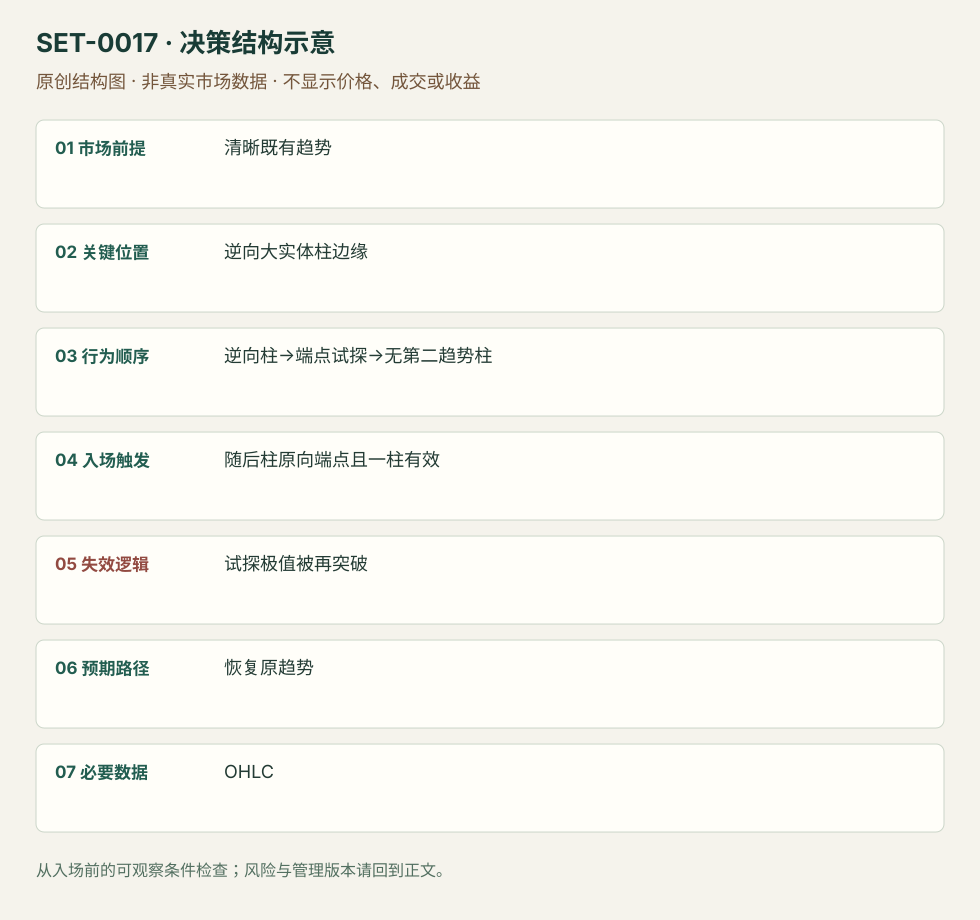

---
{
  "id": "SET-0017",
  "schema_version": "1.0.0",
  "name_zh": "逆趋势实体柱试探失败后的顺势入场",
  "name_en": "Trend Bar Failure",
  "aliases": [],
  "name_nature": "editor_descriptive_with_source_term",
  "status": "reviewed",
  "summary": "明确趋势里出现逆向大实体柱，随后试探该柱逆趋势端点却不能形成第二根逆向实体推进；下一柱顺势端点被越过时考虑趋势恢复。只挂单一柱，不触发即取消。",
  "mechanism": "countertrend_commitment_failure",
  "tags": [
    "price_action",
    "trap",
    "continuation"
  ],
  "pa_role": "core",
  "markets_observed": [
    "ES期货5分钟"
  ],
  "markets_supported": [],
  "migration_hypotheses": [],
  "session": "美股/ES现金参考段 09:30–16:00 America/New_York；收盘前平仓。期货夜盘单独建背景，不将其并入开盘区间。",
  "session_tags": [
    "intraday"
  ],
  "context_timeframe": "日线/前一session + 当日执行图；因来源而异",
  "trigger_timeframe": null,
  "data_requirements": [
    "OHLC",
    "EMA_optional"
  ],
  "execution_mode": "mixed",
  "source_ids": [
    "SRC-0047",
    "SRC-0008"
  ],
  "evidence_ids": [
    "EVD-000030",
    "EVD-000031"
  ],
  "visual_ids": [
    "VIS-000017",
    "VIS-000074"
  ],
  "rule_completeness": "前提/触发/失效/管理已记录；来源与编辑模块分开",
  "independent_corroboration": "limited_single_family",
  "profit_evidence": "not_established",
  "created": "2026-10-02",
  "updated": "2026-10-02",
  "reviewed_at": "2026-10-02",
  "known_gaps": [
    "未开展独立回测；实际订单成交与成本未知",
    "执行周期没有统一来源参数，使用前须锁定版本"
  ],
  "logic_fingerprint": [
    "清晰既有趋势",
    "逆向大实体柱边缘",
    "逆向柱→端点试探→无第二趋势柱",
    "随后柱原向端点且一柱有效",
    "试探极值被再突破",
    "恢复原趋势",
    "OHLC"
  ],
  "environment_tags": [
    "directional",
    "failed_auction"
  ],
  "structure_locations": [
    "countertrend_bar"
  ],
  "version": "1.0.0",
  "unknown_fields": {
    "trigger_timeframe": "来源未提供统一执行周期；正文记录已知图例，不能当成统一参数"
  },
  "review_scope": "规则记录、引用范围、日内边界、逻辑区别与已看静态画面；不含独立回测、动态逐笔或账户核验",
  "source_coverage": {
    "substantive_read_sources": 2,
    "families": [
      "galen-woods"
    ],
    "core_support_source_ids": [
      "SRC-0047",
      "SRC-0008"
    ],
    "independence_note": "limited_single_family"
  },
  "method_families": [
    "price_action_trend"
  ],
  "market_types": [
    "futures"
  ]
}
---

# 逆趋势实体柱试探失败后的顺势入场 · Trend Bar Failure

## 1. 名称与快速概览

明确趋势里出现逆向大实体柱，随后试探该柱逆趋势端点却不能形成第二根逆向实体推进；下一柱顺势端点被越过时考虑趋势恢复。只挂单一柱，不触发即取消。

记录口径：PA core；必要数据 OHLC、EMA_optional。名称性质：编辑性描述名，英文保留来源术语以便检索。reviewed 只表示本条规则与证据记录审查通过，盈利状态为 not_established。

## 2. 本质与行为假说

价格试探逆向承诺并拒绝跟随可见；“被困逆势交易者”是解释，并无账户身份记录。大实体本身不能证明趋势终结。

## 3. 适用市场与环境

背景方向清楚，逆向柱是局部挑战。频繁交替大实体、EMA斜率不清且重叠密集时不采用。

**来源实用市场：**ES期货5分钟。

**Session：**美股/ES现金参考段 09:30–16:00 America/New_York；收盘前平仓。期货夜盘单独建背景，不将其并入开盘区间。

跨市场：本版不主张已经验证的跨市场迁移；更换市场必须重定数据来源、流动性与session。

## 4. 出现前的观察清单

必要：趋势背景、逆向趋势柱及低/高被试探、无第二逆向趋势柱。增强：原向支持区域。否决：逆向连续推进已成立。

## 5. 形成过程与状态转换

原趋势→逆向大实体→试探其端点但无跟随→设下一柱原向触发→一柱内成交或取消。

## 6. Entry trigger 与执行方式

Galen将趋势柱实体大于总范围50%操作化；多头等逆向低点被试探后的柱高外buy stop，空头镜像。触发必须在下一柱期限内。

## 7. Invalidation 与止损逻辑

本研究以失败试探极值为结构保护；逆向重新推进会否定本次承诺失败。紧信号柱风险与整个试探极值风险不同，来源没有统一跨市场固定tick。

## 8. Exit、target 与 trade management

趋势既有极值为第一参考；强恢复可跟踪后续摆动。成交后迟迟不推进或转拥挤时缩短期待；退出具体模块为研究补充。

## 9. 常见 variations

Pipe、inside-bar failure与本条重叠时保留别名；并非每个pipe都符合端点试探和一柱期限，不能仅按形状归入。

## 10. 失败方式与不交易条件

正常亏损：失败试探后再次逆向。未成立：第二逆向趋势柱已成。偏离：挂单数柱等到很晚触发。未成交不等于亏损。

## 11. 与相近 setups 的区别

- [SET-0005](SET-0005.md)：Hikkake要求inside起点及其后假突破，本条要求逆向大实体承诺且一柱期限。
- [SET-0006](SET-0006.md)：H2要求两段回撤；本条不数两段，只检验逆向柱是否获得跟随。

## 12. 图表与案例解读

已查看ES12-13，5分钟，2013-11-15图。案例1与4明示Buy order not triggered，属于取消/未成交；案例2逆向柱试探均线后没有强跟随，顺向柱触发。案例3同时inside失败，不增加计数。图轴跨午夜且时区未知，不能据时钟改变原规则。

- [VIS-000017] [Trend Bar Failure ES Example](https://www.tradingsetupsreview.com/simple-effective-price-action-trading-setup/img/Trend-Bar-Failure-ES-Example_hu173a0984f89a7c34dc9ecae244b3ecd2_260633_1280x0_resize_q75_h1_box_3.webp)；定位：ES 5-minute Example。两处未触发例与一处有限跟随；不能把未触发归为止损。 验证：chart_viewed。

**本地原创示意（VIS-000074，非真实市场数据）：**

小屏阅读可[打开原尺寸示意图](../assets/diagrams/SET-0017.svg)并缩放。

此图用于对照识别顺序与风险定义；不计入真实案例覆盖率。

## 13. 证据、分歧与未知项

两份Galen材料属于同族，独立佐证有限。明确实体50%与取消期限归作者；结构止损操作化归研究，未核验作者高概率措辞。

- [EVD-000030] Galen Woods，《A Simple and Effective Price Action Trading Setup》，[SRC-0047](https://www.tradingsetupsreview.com/simple-effective-price-action-trading-setup/)；定位：Rules for Long/Short、ES Example。支持：逆向趋势柱端点先被突破但没有第二根逆向趋势柱跟随，下一柱端点顺向触发且一柱未成交取消
- [EVD-000031] Galen Woods，《4 Price Action Trading Strategies That Profit From Trapped Traders》，[SRC-0008](https://www.tradingsetupsreview.com/4-day-trading-strategies-profit-trapped-traders/)；定位：Trend Bar Failure。支持：以逆势承诺失败捕捉恢复原趋势，陷阱说明不能识别真实参与者

审查边界：来源份数与独立核心核验分开；当前类别为 limited_single_family。正文中的概念、官方事实、衍生解说或同族资料只按其支持范围使用。

## 14. 可用于复盘的检查表

- [ ] 下单前的前提可核对：清晰既有趋势
- [ ] 事前标记位置：逆向大实体柱边缘
- [ ] 行为按顺序出现：逆向柱→端点试探→无第二趋势柱
- [ ] 实际触发符合选定版本：随后柱原向端点且一柱有效
- [ ] 事先写明本次否定条件：试探极值被再突破
- [ ] 目标/路径只用当时已知信息：恢复原趋势
- [ ] 数据满足 OHLC；记录时间、点差、滑点、队列和未成交
- [ ] 记录截止平仓及规则偏离；正常亏损不事后改成“未成立”

## 15. 后续验证问题

记录未成交和取消的全体候选；检验一柱期限相对无限挂单的影响，固定实体比例。
