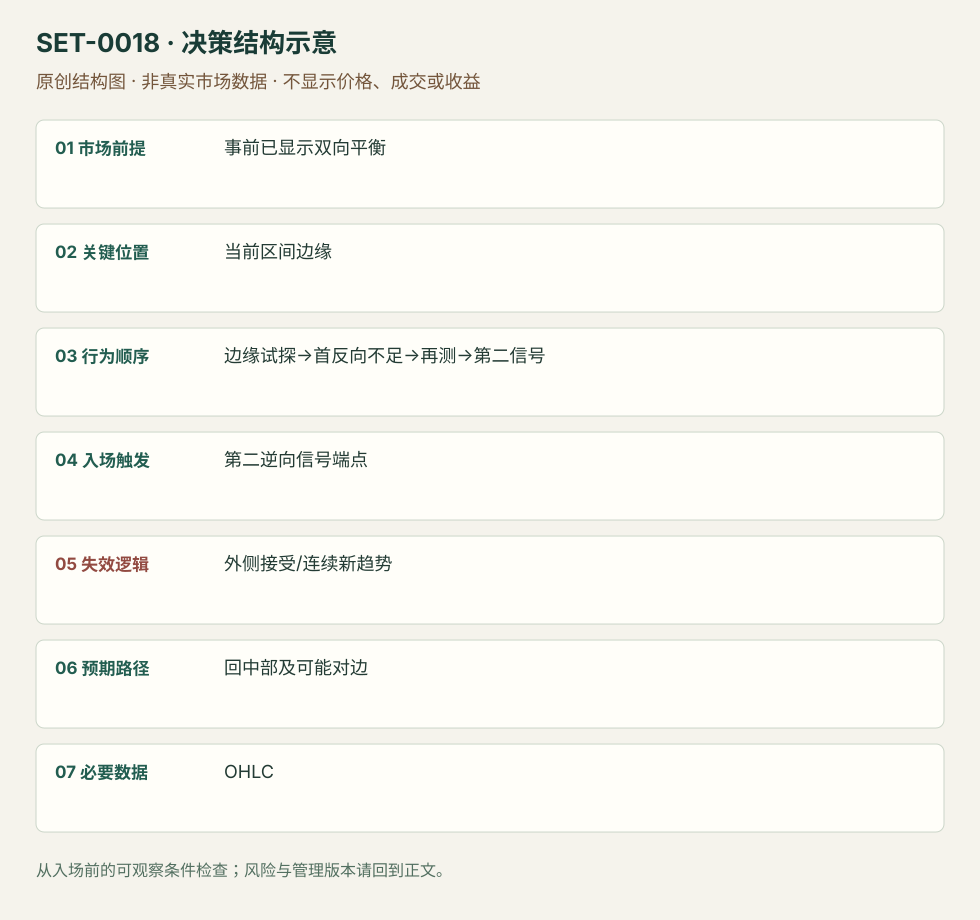

---
{
  "id": "SET-0018",
  "schema_version": "1.0.0",
  "name_zh": "平衡区间边缘的第二次反向信号",
  "name_en": "Trading Range Edge Second Signal Fade",
  "aliases": [],
  "name_nature": "editor_descriptive_with_source_term",
  "status": "reviewed",
  "summary": "事前已经有双向回撤与重叠的平衡区间；价格来到边缘后首次逆向尝试未推进，第二反向信号出现才考虑回区间中部。边缘外连续接受否定区间反向。",
  "mechanism": "balance_edge_rejection",
  "tags": [
    "price_action",
    "mean_reversion",
    "range"
  ],
  "pa_role": "core",
  "markets_observed": [
    "Brooks日内区间图"
  ],
  "markets_supported": [],
  "migration_hypotheses": [],
  "session": "美股/ES现金参考段 09:30–16:00 America/New_York；收盘前平仓。期货夜盘单独建背景，不将其并入开盘区间。",
  "session_tags": [
    "intraday"
  ],
  "context_timeframe": "日线/前一session + 当日执行图；因来源而异",
  "trigger_timeframe": null,
  "data_requirements": [
    "OHLC",
    "prior_session_levels_optional"
  ],
  "execution_mode": "mixed",
  "source_ids": [
    "SRC-0016",
    "SRC-0001"
  ],
  "evidence_ids": [
    "EVD-000032",
    "EVD-000033"
  ],
  "visual_ids": [
    "VIS-000018",
    "VIS-000075"
  ],
  "rule_completeness": "前提/触发/失效/管理已记录；来源与编辑模块分开",
  "independent_corroboration": "limited_single_family",
  "profit_evidence": "not_established",
  "created": "2026-10-02",
  "updated": "2026-10-02",
  "reviewed_at": "2026-10-02",
  "known_gaps": [
    "未开展独立回测；实际订单成交与成本未知",
    "执行周期没有统一来源参数，使用前须锁定版本"
  ],
  "logic_fingerprint": [
    "事前已显示双向平衡",
    "当前区间边缘",
    "边缘试探→首反向不足→再测→第二信号",
    "第二逆向信号端点",
    "外侧接受/连续新趋势",
    "回中部及可能对边",
    "OHLC"
  ],
  "environment_tags": [
    "balance"
  ],
  "structure_locations": [
    "range_edge"
  ],
  "version": "1.0.0",
  "unknown_fields": {
    "trigger_timeframe": "来源未提供统一执行周期；正文记录已知图例，不能当成统一参数"
  },
  "review_scope": "规则记录、引用范围、日内边界、逻辑区别与已看静态画面；不含独立回测、动态逐笔或账户核验",
  "source_coverage": {
    "substantive_read_sources": 2,
    "families": [
      "brooks"
    ],
    "core_support_source_ids": [
      "SRC-0016",
      "SRC-0001"
    ],
    "independence_note": "limited_single_family"
  },
  "method_families": [
    "price_action_reversal"
  ],
  "market_types": [
    "unconfirmed"
  ]
}
---

# 平衡区间边缘的第二次反向信号 · Trading Range Edge Second Signal Fade

## 1. 名称与快速概览

事前已经有双向回撤与重叠的平衡区间；价格来到边缘后首次逆向尝试未推进，第二反向信号出现才考虑回区间中部。边缘外连续接受否定区间反向。

记录口径：PA core；必要数据 OHLC、prior_session_levels_optional。名称性质：编辑性描述名，英文保留来源术语以便检索。reviewed 只表示本条规则与证据记录审查通过，盈利状态为 not_established。

## 2. 本质与行为假说

双向价格响应和边缘拒绝可见；区间两侧的流动性故事不是成交身份事实。第二信号增加等待，也可能减少可交易空间。

## 3. 适用市场与环境

前面已出现深回撤、尾部、双向交替或前一日平衡延续；不能等当天走完才叫区间日。强单向新趋势反例必须保留。

**来源实用市场：**Brooks日内区间图。

**Session：**美股/ES现金参考段 09:30–16:00 America/New_York；收盘前平仓。期货夜盘单独建背景，不将其并入开盘区间。

跨市场：本版不主张已经验证的跨市场迁移；更换市场必须重定数据来源、流动性与session。

## 4. 出现前的观察清单

必要：入场前可证的平衡行为、上下界与中部、第二逆向信号。增强：边缘冲击未获持续跟随。否决：外侧持续同向实体/价值迁移。

## 5. 形成过程与状态转换

平衡已识别→边缘测试→首次逆向恢复不足→再测→第二反向信号→中部管理；有效突破建立则取消反向。

## 6. Entry trigger 与执行方式

Brooks示例在区间上部第二次卖出、下部第二次失败突破买入。具体信号柱端点触发为讲义的一般执行法；中间位置不因出现同样信号入。

## 7. Invalidation 与止损逻辑

再测外侧极值保护本次反向；区间外连续推进属于环境失效。正常扫出后再返回也仍是一笔按风险规则的亏损。

## 8. Exit、target 与 trade management

先在中部评估/减仓，出现明确双向响应才测试对边。来源图中后来突破新高不是预先目标；区间假说发生变化就重新定义。

## 9. 常见 variations

Anchor-zone或Bollinger边缘若不改变平衡→边缘→第二反向序列，作为位置辅助；不以换参考线另计。

## 10. 失败方式与不交易条件

正常亏损：第二信号后区间变趋势。未成立：没有事前平衡、只见水平。偏离：在中部反向或强突破第一根即猜顶。宽止损与近中部可能令交易不可执行。

## 11. 与相近 setups 的区别

- [SET-0006](SET-0006.md)：H2依据既有单向趋势恢复，本条依据已经出现双向平衡并预期中部。
- [SET-0037](SET-0037.md)：价值区轮转需前一profile及开盘外→回内的接受时间，本条无需Profile或外部开盘。

## 12. 图表与案例解读

已查看SB-2bs图：左侧深回撤及再次高点提示双向环境；上部红标第二卖出，随后下部绿标第二买入，原图买例后来到新高。入场前只应看到第二信号和旧区间中部，不能把后来新高当目标。画面缺日期、品种与周期，未作真实收益认定。

- [VIS-000018] [Trading Range reversals - Second buy and sell signals at reversals](https://www.brookstradingcourse.com/wp-content/uploads/2019/01/SB-2bs-680x383.png)；定位：Trading Range: 2nd Buy and Sell Signals。先有深回撤和重叠，红/绿区域为区间边缘第二次反向。 验证：chart_viewed。

**本地原创示意（VIS-000075，非真实市场数据）：**

小屏阅读可[打开原尺寸示意图](../assets/diagrams/SET-0018.svg)并缩放。

此图用于对照识别顺序与风险定义；不计入真实案例覆盖率。

## 13. 证据、分歧与未知项

两份Brooks教学属同族，独立佐证有限。区间环境判定与退出需经验，本版记录可观察项并留待测试。

- [EVD-000032] Al Brooks，《10 best price action trading patterns》，[SRC-0016](https://www.brookstradingcourse.com/price-action/10-best-price-action-trading-patterns/)；定位：Trading range reversals / SB-2bs。支持：宽回撤与重叠提示区间，强边缘冲击可等第二次信号反向
- [EVD-000033] Al Brooks，《Patterns on the Open》，[SRC-0001](https://www.brookstradingcourse.com/wp-content/uploads/2018/10/181030-futuresio-Patterns-on-the-Open-Al-Brooks.pdf)；定位：PDF页6–9。支持：开盘交易区间可以双向交易，但需强信号和结构保护

审查边界：来源份数与独立核心核验分开；当前类别为 limited_single_family。正文中的概念、官方事实、衍生解说或同族资料只按其支持范围使用。

## 14. 可用于复盘的检查表

- [ ] 下单前的前提可核对：事前已显示双向平衡
- [ ] 事前标记位置：当前区间边缘
- [ ] 行为按顺序出现：边缘试探→首反向不足→再测→第二信号
- [ ] 实际触发符合选定版本：第二逆向信号端点
- [ ] 事先写明本次否定条件：外侧接受/连续新趋势
- [ ] 目标/路径只用当时已知信息：回中部及可能对边
- [ ] 数据满足 OHLC；记录时间、点差、滑点、队列和未成交
- [ ] 记录截止平仓及规则偏离；正常亏损不事后改成“未成立”

## 15. 后续验证问题

冻结入场前区间边界和环境标签，记录突破转趋势的样本；比较第一与第二信号的错过和成本。
