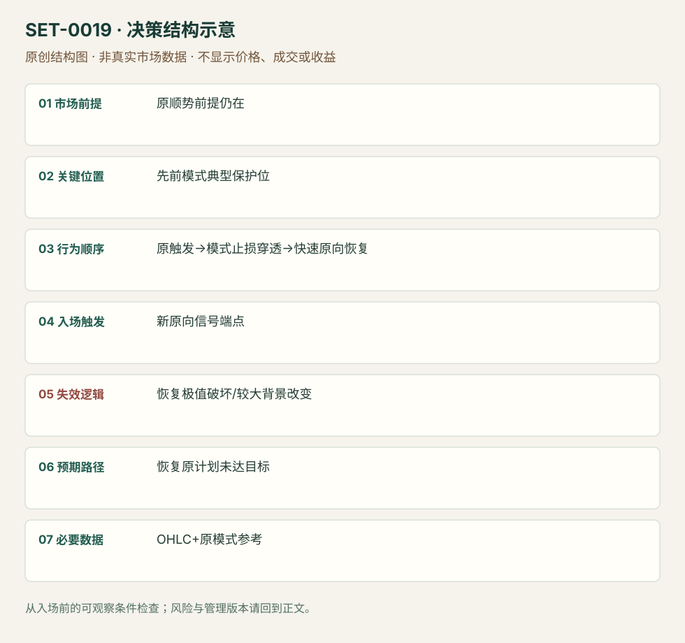

---
{
  "id": "SET-0019",
  "schema_version": "1.0.0",
  "name_zh": "原始顺势信号止损后快速恢复的延迟入场",
  "name_en": "Stopped-Out Setup Re-entry",
  "aliases": [],
  "name_nature": "editor_descriptive_with_source_term",
  "status": "reviewed",
  "summary": "先观察某个顺势模式已触发，再看到其典型模式止损被穿透而较大方向前提尚在；价格快速恢复后才执行延迟入场。背景已经转向就禁止再入。",
  "mechanism": "failed_pattern_stop_recovery",
  "tags": [
    "price_action",
    "trap",
    "continuation"
  ],
  "pa_role": "core",
  "markets_observed": [
    "NYMEX CL期货3分钟（日内顺势再入案例）"
  ],
  "markets_supported": [],
  "migration_hypotheses": [],
  "session": "CL来源图未标时区；图有01:40–03:30片段与右侧缺口，不能推定现金开盘。编辑执行限定所选合约同一交易日，事先锁定截止时刻和平仓；跨日6E/6J仅作背景边界。",
  "session_tags": [
    "intraday"
  ],
  "context_timeframe": "日线/前一session + 当日执行图；因来源而异",
  "trigger_timeframe": "3分钟CL来源实例；Pin原方法另有30/60分钟，非统一执行参数",
  "data_requirements": [
    "OHLC",
    "original_pattern_stop_reference"
  ],
  "execution_mode": "mixed",
  "source_ids": [
    "SRC-0048",
    "SRC-0053",
    "SRC-0051"
  ],
  "evidence_ids": [
    "EVD-000034",
    "EVD-000035",
    "EVD-000101"
  ],
  "visual_ids": [
    "VIS-000019",
    "VIS-000020",
    "VIS-000057",
    "VIS-000076"
  ],
  "rule_completeness": "前提/触发/失效/管理已记录；来源与编辑模块分开",
  "independent_corroboration": "limited_single_family",
  "profit_evidence": "not_established",
  "created": "2026-10-02",
  "updated": "2026-10-02",
  "reviewed_at": "2026-10-02",
  "known_gaps": [
    "未开展独立回测；实际订单成交与成本未知"
  ],
  "logic_fingerprint": [
    "原顺势前提仍在",
    "先前模式典型保护位",
    "原触发→模式止损穿透→快速原向恢复",
    "新原向信号端点",
    "恢复极值破坏/较大背景改变",
    "恢复原计划未达目标",
    "OHLC+原模式参考"
  ],
  "markets_context_only": [
    "6E 30分钟、6J小时跨日原始方法例",
    "ES1分钟逆向Retrace失败后双底（相关但不同方向前提）"
  ],
  "environment_tags": [
    "directional",
    "failed_auction"
  ],
  "structure_locations": [
    "original_stop_reference"
  ],
  "version": "1.0.0",
  "unknown_fields": {},
  "review_scope": "规则记录、引用范围、日内边界、逻辑区别与已看静态画面；不含独立回测、动态逐笔或账户核验",
  "source_coverage": {
    "substantive_read_sources": 3,
    "families": [
      "galen-woods"
    ],
    "core_support_source_ids": [
      "SRC-0048",
      "SRC-0051"
    ],
    "independence_note": "limited_single_family"
  },
  "method_families": [
    "price_action_trend"
  ],
  "market_types": [
    "futures"
  ]
}
---

# 原始顺势信号止损后快速恢复的延迟入场 · Stopped-Out Setup Re-entry

## 1. 名称与快速概览

先观察某个顺势模式已触发，再看到其典型模式止损被穿透而较大方向前提尚在；价格快速恢复后才执行延迟入场。背景已经转向就禁止再入。

记录口径：PA core；必要数据 OHLC、original_pattern_stop_reference。名称性质：编辑性描述名，英文保留来源术语以便检索。reviewed 只表示本条规则与证据记录审查通过，盈利状态为 not_established。

## 2. 本质与行为假说

可以观察触发价、典型止损和恢复；不能证明具体交易者真的被止损。本条不要求研究者先亏一笔，原始信号可只观察。

## 3. 适用市场与环境

原方向依据、原模式触发和模式保护位事先有记录，穿透后方向依据仍成立。本版直接日内例是Galen的CL三分钟NR7失败后再入讨论；6E/6J较长、跨日图只用于定义与失败边界。ES Retrace逆向失败后双底只能算相关观察，不能支持本条“原顺势前提”本身。

**来源实际日内市场：**NYMEX CL期货3分钟。

**Session：**CL来源图未标时区；图有01:40–03:30片段与右侧缺口，不能推定现金开盘。编辑执行限定所选合约同一交易日，事先锁定截止时刻和平仓；跨日6E/6J仅作背景边界。

跨市场迁移未验证。

## 4. 出现前的观察清单

必要：原模式完整、已实际穿触发价、其模式止损被穿、背景仍有效。增强：迅速恢复。否决：原目标已到、穿透很深或经历长时间新趋势。

## 5. 形成过程与状态转换

原信号完成（不入）→触发→模式保护位被穿→无持续反向推进→原向新信号→延迟入；若较大背景已破则终止。

## 6. Entry trigger 与执行方式

Galen Pin版以新的原向柱端点触发，支持以别的模式作为原信号。文章空头规则写buy却描述向下突破，按卖出镜像理解并标出文字冲突，不机械执行错方向。

CL日内版本：原空头模式止损被扫后仍未站上背景EMA，等待新的向下恢复端点再入。来源允许再入但未披露第二笔精确价或订单，因此新端点触发是编辑操作化版本，必须单独记录。

## 7. Invalidation 与止损逻辑

新的恢复摆动极值是本次风险；更大方向依据破坏为环境否定。不能无限重复“再入”，也不能从第一笔止损后报复性加仓。

## 8. Exit、target 与 trade management

先看原先未达到的目标/摆动；若原目标已到才止损，其后再入没有原机会空间，来源视为差背景。弱恢复与当日时限退出属研究模块。

## 9. 常见 variations

先交易原信号再入与跳过原信号后入分开记录净结果；多空镜像、Pin/其他模式变体合并。

## 10. 失败方式与不交易条件

正常亏损：新信号后再破恢复极值。未成立：较大方向已反转。偏离：只因亏损而反复加仓。6J失败例原/新信号距离大且跌至均线下，提示前提改变。

## 11. 与相近 setups 的区别

- [SET-0006](SET-0006.md)：H2只要求首次恢复失败，本条必须典型触发已发生且对应模式止损被穿。
- [SET-0005](SET-0005.md)：Hikkake不要求先前顺势模式已触发且其止损被扫。

## 12. 图表与案例解读

已查看6E30分钟图及ES日内亏例。6E图先有Pin触发、低点被穿、随后新Pin恢复；图轴跨当地午夜，日期11/4/2014歧义且原方法未声明平仓，不当成已证日内收益。ES1分钟图的绿色首交易失败后橙圈双底是候选新机会；不能以第二次上涨覆盖第一笔亏损。

- [VIS-000019] [Forex Price Action Re-Entry Trading Strategy (Winning)](https://www.tradingsetupsreview.com/forex-price-action-re-entry-trading/img/Forex-Price-Action-Re-Entry-Trading-Strategy-Winning_hu87b00e3c6cdcedf0f68b6f93fb65240a_243908_1280x0_resize_q75_h1_box_3.webp)；定位：Example #1 Bullish Re-entry。原信号触发、保护位穿透、新Pin恢复，原文范围不限严格日内。 验证：chart_viewed。
- [VIS-000020] [Retrace Day Trading Setup Losing Trade](https://www.tradingsetupsreview.com/bulkowskis-retrace-day-trading-setup/img/Retrace-Day-Trading-Setup-Losing-Trade_hub0c1e4ea003b39f11d0dea029c698347_367455_1280x0_resize_q75_h1_box_3.webp)；定位：Losing Trade后续double bottom。日内原反向模式止损后另有双底候选，未披露实际第二笔成交。 验证：chart_viewed。

补充已查看CL02-14三分钟NR7失败图：黑框中的连续窄柱先向下触发，随后上穿模式高点止损；价格始终未越20EMA，之后再次向下。可观察的是原笔亏损和背景保持；新一笔成交与结果未披露。图日期原写3/1/2014，月日顺序未核实。

- [VIS-000057] [NR7 Trading Strategy Losing Trade](https://www.tradingsetupsreview.com/nr7-trading-strategy/img/NR7-Trading-Strategy-Losing-Trade_hub90100aec52c7ce2349001a8b8011f27_211984_1280x0_resize_q75_h1_box_3.webp)；定位：Losing Trade – Bearish NR7，黑框、EMA和止损区域。CL02-14三分钟原空头NR7止损后，EMA下方背景仍在；后续再入只是作者允许的机会，未披露实际第二笔订单。 验证：chart_viewed。

**本地原创示意（VIS-000076，非真实市场数据）：**

小屏阅读可[打开原尺寸示意图](../assets/diagrams/SET-0019.svg)并缩放。

此图用于对照识别顺序与风险定义；不计入真实案例覆盖率。

## 13. 证据、分歧与未知项

两份材料同为Galen，独立佐证有限；日内子样本和平仓为编辑边界。原始方法的所有跨日例不能计入日内实证。

- [EVD-000034] Galen Woods，《Forex Price Action Re-Entry Trading Strategy》，[SRC-0048](https://www.tradingsetupsreview.com/forex-price-action-re-entry-trading/)；定位：Formulating、Guidelines、Winning/Losing examples。支持：原信号已触发、模式止损被小幅穿透、原方向背景仍在，再恢复时才进
- [EVD-000035] Galen Woods，《Bulkowski's Retrace Day Trading Setup》，[SRC-0053](https://www.tradingsetupsreview.com/bulkowskis-retrace-day-trading-setup/)；定位：Losing Trade后续double bottom。支持：第一次日内反向信号止损后出现双底和可再入机会
- [EVD-000101] [SRC-0051](https://www.tradingsetupsreview.com/nr7-trading-strategy/)；定位：Losing Trade – Bearish NR7 / Review。支持范围：CL三分钟顺势NR7原触发后止损于NR7高点；假突破期间价格一直在EMA下，原空头前提未改变，作者允许再入。拥挤是原笔亏损原因，不能用后来下跌抹去亏损。

新增CL日内例仍来自Galen同一族，故独立佐证有限。Source 53仅作逆向原模式失败后出现新结构的背景信息，不能冒充本条核心顺势规则的第二份验证。

审查边界：来源份数与独立核心核验分开；当前类别为 limited_single_family。正文中的概念、官方事实、衍生解说或同族资料只按其支持范围使用。

## 14. 可用于复盘的检查表

- [ ] 下单前的前提可核对：原顺势前提仍在
- [ ] 事前标记位置：先前模式典型保护位
- [ ] 行为按顺序出现：原触发→模式止损穿透→快速原向恢复
- [ ] 实际触发符合选定版本：新原向信号端点
- [ ] 事先写明本次否定条件：恢复极值破坏/较大背景改变
- [ ] 目标/路径只用当时已知信息：恢复原计划未达目标
- [ ] 数据满足 OHLC+原模式参考；记录时间、点差、滑点、队列和未成交
- [ ] 记录截止平仓及规则偏离；正常亏损不事后改成“未成立”

## 15. 后续验证问题

预先指定典型模式止损与有限穿透标准，单独统计严格当日子样本；区分观察延迟入与实际先亏后再入。
