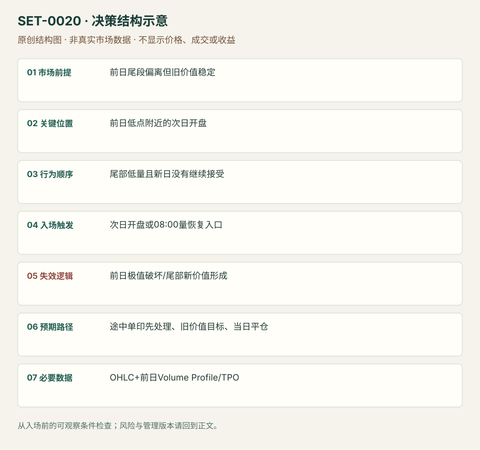

---
{
  "id": "SET-0020",
  "schema_version": "1.0.0",
  "name_zh": "前日低量尾部的次日回价值区",
  "name_en": "Caught in the Hole",
  "aliases": [],
  "name_nature": "established_or_source_term",
  "status": "reviewed",
  "summary": "前日尾段价格走远，但主要价值区没有跟随；次日近尾段极值开盘时，寻找弱持仓退出而返回旧价值的机会。源例是 EUR/USD 期货向下尾段后的多头，并非见到缺口就回补。",
  "mechanism": "trapped_inventory_unwind",
  "tags": [
    "auction",
    "mean_reversion",
    "opening",
    "prior_value"
  ],
  "pa_role": "supporting",
  "markets_observed": [
    "EUR/USD期货"
  ],
  "markets_supported": [],
  "migration_hypotheses": [],
  "session": "来源以前日/次日自定义期货 profile；图中23:00开盘和08:00 BST活动点。数据商重置时区未核实；本库只计同一新 session 内进出，结束前平仓。",
  "session_tags": [
    "opening",
    "european_open"
  ],
  "context_timeframe": "日线/前一session + 当日执行图；因来源而异",
  "trigger_timeframe": null,
  "data_requirements": [
    "OHLC",
    "session_volume_profile",
    "TPO"
  ],
  "execution_mode": "mixed",
  "source_ids": [
    "SRC-0038",
    "SRC-0006"
  ],
  "evidence_ids": [
    "EVD-000036",
    "EVD-000037"
  ],
  "visual_ids": [
    "VIS-000021",
    "VIS-000077"
  ],
  "rule_completeness": "前提/触发/失效/管理已记录；来源与编辑模块分开",
  "independent_corroboration": "limited_single_family",
  "profit_evidence": "not_established",
  "created": "2026-10-02",
  "updated": "2026-10-02",
  "reviewed_at": "2026-10-02",
  "known_gaps": [
    "未开展独立回测；实际订单成交与成本未知",
    "执行周期没有统一来源参数，使用前须锁定版本"
  ],
  "logic_fingerprint": [
    "前日尾段偏离但旧价值稳定",
    "前日低点附近的次日开盘",
    "尾部低量且新日没有继续接受",
    "次日开盘或08:00量恢复入口",
    "前日极值破坏/尾部新价值形成",
    "途中单印先处理、旧价值目标、当日平仓",
    "OHLC+前日Volume Profile/TPO"
  ],
  "environment_tags": [
    "session_boundary",
    "extended"
  ],
  "structure_locations": [
    "prior_profile_tail"
  ],
  "version": "1.0.0",
  "unknown_fields": {
    "trigger_timeframe": "来源未提供统一执行周期；正文记录已知图例，不能当成统一参数"
  },
  "review_scope": "规则记录、引用范围、日内边界、逻辑区别与已看静态画面；不含独立回测、动态逐笔或账户核验",
  "source_coverage": {
    "substantive_read_sources": 2,
    "families": [
      "axia"
    ],
    "core_support_source_ids": [
      "SRC-0038",
      "SRC-0006"
    ],
    "independence_note": "limited_single_family"
  },
  "method_families": [
    "opening_gap",
    "auction_profile",
    "liquidity_inventory"
  ],
  "market_types": [
    "futures"
  ]
}
---

# 前日低量尾部的次日回价值区 · Caught in the Hole

## 1. 名称与快速概览

前日尾段价格走远，但主要价值区没有跟随；次日近尾段极值开盘时，寻找弱持仓退出而返回旧价值的机会。源例是 EUR/USD 期货向下尾段后的多头，并非见到缺口就回补。

记录口径：PA supporting；必要数据 OHLC、session_volume_profile、TPO。名称性质：来源术语或研究术语。reviewed 只表示本条规则与证据记录审查通过，盈利状态为 not_established。

## 2. 本质与行为假说

行为假说是尾段卖出者需要新的持续卖盘维持低价，若没有，新日回到旧价值会迫使其买回。成交量分布能支持“尾部参与少”，不能识别每个交易者实际持仓。核心参考在前日已经形成，允许直接从次日开盘进入。

## 3. 适用市场与环境

适合旧价值稳定、收盘偏离大且偏离区量少，下一日仍近旧极值的情境。若价值本身已下移，或新日继续在尾部积累大量成交，则假说变弱。

**来源实用市场：**EUR/USD期货。

**Session：**来源以前日/次日自定义期货 profile；图中23:00开盘和08:00 BST活动点。数据商重置时区未核实；本库只计同一新 session 内进出，结束前平仓。

跨市场：本版不主张已经验证的跨市场迁移；更换市场必须重定数据来源、流动性与session。

## 4. 出现前的观察清单

先固定前日完整 session、价值区边界、极值及尾部成交；用同一 session 设置比较。检查新开盘到失效极值的距离，以及至价值区途中单印或低量节点是否先阻挡。

## 5. 形成过程与状态转换

前日稳定价值 → 临近结束低量快速离开 → 次日近极值开盘 → 新方向延续没有出现/买入活动恢复 → 逐段返回旧价值。盘前不能用次日最终 Profile 倒推旧价值。

## 6. Entry trigger 与执行方式

来源主版可在开盘买入，风险是前日低点；前提是开盘确实近低点。来源替代版在英国交易者进入的 08:00 BST 观察量增加并买入。后者是确认更强但空间更小的版本，复盘必须标明所用入口。

## 7. Invalidation 与止损逻辑

前日低点被有效跌破构成原版失效；执行缓冲、成交滑点和是否用硬止损，来源未统一，本库要求下单前注明。若低点未破但低价开始持续被接受，应重新评估而非盲等旧价值。

## 8. Exit、target 与 trade management

旧价值下边界是方向目标；途中单印区先处理。源例在 1.1867–1.1870 遇阻，缺少继续买入应退出；回价值不能成为忽略实际阻力的理由。日内版在预定 session 结束前平仓。

## 9. 常见 variations

对称向上尾部后做空归同一条。开盘入口和 08:00 确认入口保留为版本；以 T-Note 等相关市场确认是可研究过滤器，不另计 Setup。

## 10. 失败方式与不交易条件

开盘已接近价值区，潜在空间过小；新基本信息支持持续重新定价；低价形成新平衡；忽略途中单印障碍；把价格跌幅大误当作尾部量少。

## 11. 与相近 setups 的区别

- [SET-0038](SET-0038.md)：本条使用已结束前日和次日开盘；0038 在当前 session 的伸展末端等失败触发。
- [SET-0050](SET-0050.md)：0050 以隔夜极值失败和当日现金开盘线反穿触发，不要求旧价值分布。

## 12. 图表与案例解读

已看结果图：蓝框标单印，开盘线在其下，右侧盘中反弹多次受阻；底部成交量与价格图提供顺序。作者说等待 9.5 小时，图表不等于已执行该笔交易。

- [VIS-000021] [旧价值下沿和单印区在图中已标出；价格进入单印区后没有直达旧价值，体现分段管理。](https://axiafutures.com/blog/wp-content/uploads/2020/08/Caught-in-hole-reults-1024x588.png)；定位：How Did...结果图。旧价值下沿和单印区在图中已标出；价格进入单印区后没有直达旧价值，体现分段管理。 验证：chart_viewed。

**本地原创示意（VIS-000077，非真实市场数据）：**

小屏阅读可[打开原尺寸示意图](../assets/diagrams/SET-0020.svg)并缩放。

此图用于对照识别顺序与风险定义；不计入真实案例覆盖率。

## 13. 证据、分歧与未知项

两项解释来自 Axia 家族，独立佐证有限。文章给出单例的假设收益和持仓时长，不是可重复成交审计。先固定价值区口径，才能验证该假说。

- [EVD-000036] Richard Bailey，《Market Profile Caught In The Hole Trade》，[SRC-0038](https://axiafutures.com/blog/market-profile-caught-in-the-hole-trade/)；定位：What Is The Trading Strategy? / How Did...Play Out?。支持：前日价格远离稳定价值而尾段量少；次日近极值开盘可逆向，前日低点失效，单印区障碍决定减仓。
- [EVD-000037] Axia Futures / Isaac，《Open Drive Trading Strategies》，[SRC-0006](https://axiafutures.com/blog/open-drive-trading-strategies/)；定位：Strategy 1: ES overnight weak positioning。支持：同作者团队把开盘前远离价值、弱隔夜持仓的反向交易称为 caught in a hole；解释相关情境，不是独立验证。

审查边界：来源份数与独立核心核验分开；当前类别为 limited_single_family。正文中的概念、官方事实、衍生解说或同族资料只按其支持范围使用。

## 14. 可用于复盘的检查表

- [ ] 下单前的前提可核对：前日尾段偏离但旧价值稳定
- [ ] 事前标记位置：前日低点附近的次日开盘
- [ ] 行为按顺序出现：尾部低量且新日没有继续接受
- [ ] 实际触发符合选定版本：次日开盘或08:00量恢复入口
- [ ] 事先写明本次否定条件：前日极值破坏/尾部新价值形成
- [ ] 目标/路径只用当时已知信息：途中单印先处理、旧价值目标、当日平仓
- [ ] 数据满足 OHLC+前日Volume Profile/TPO；记录时间、点差、滑点、队列和未成交
- [ ] 记录截止平仓及规则偏离；正常亏损不事后改成“未成立”

## 15. 后续验证问题

尾段偏离与成交稀疏怎样量化？开盘直入和等量恢复的收益/滑点差别多大？大消息日是否失效？
