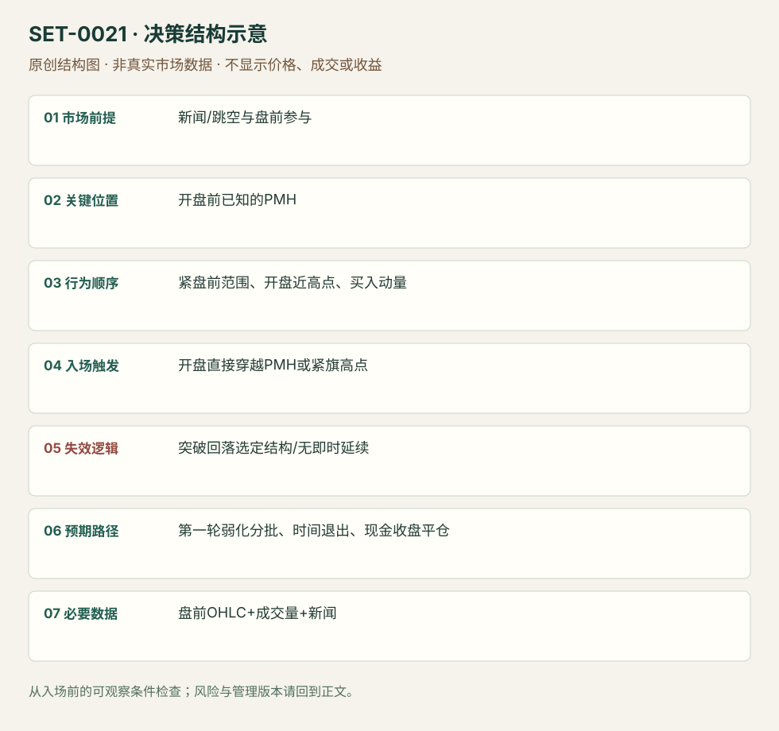

---
{
  "id": "SET-0021",
  "schema_version": "1.0.0",
  "name_zh": "盘前高点的开盘动量突破",
  "name_en": "Gap and Go / Pre-market High Break",
  "aliases": [],
  "name_nature": "editor_descriptive_with_source_term",
  "status": "reviewed",
  "summary": "带催化和盘前参与的股票，在现金开盘接近盘前高点时突破该高点，捕捉最早的一轮动量。参考高点在 09:30 前固定，和先等完整五分钟区间的 ORB 有不同等待条件。",
  "mechanism": "opening_momentum",
  "tags": [
    "opening",
    "gap",
    "breakout",
    "news"
  ],
  "pa_role": "core",
  "markets_observed": [
    "美国个股"
  ],
  "markets_supported": [],
  "migration_hypotheses": [],
  "session": "美股/ES现金参考段 09:30–16:00 America/New_York；收盘前平仓。期货夜盘单独建背景，不将其并入开盘区间。",
  "session_tags": [
    "opening",
    "premarket"
  ],
  "context_timeframe": "日线/前一session + 当日执行图；因来源而异",
  "trigger_timeframe": "开盘1分钟/短旗，来源版本不同",
  "data_requirements": [
    "OHLC",
    "volume",
    "premarket",
    "news"
  ],
  "execution_mode": "mixed",
  "source_ids": [
    "SRC-0025",
    "SRC-0013"
  ],
  "evidence_ids": [
    "EVD-000038",
    "EVD-000039"
  ],
  "visual_ids": [
    "VIS-000022",
    "VIS-000078"
  ],
  "rule_completeness": "前提/触发/失效/管理已记录；来源与编辑模块分开",
  "independent_corroboration": "multiple_families",
  "profit_evidence": "not_established",
  "created": "2026-10-02",
  "updated": "2026-10-02",
  "reviewed_at": "2026-10-02",
  "known_gaps": [
    "未开展独立回测；实际订单成交与成本未知"
  ],
  "logic_fingerprint": [
    "新闻/跳空与盘前参与",
    "开盘前已知的PMH",
    "紧盘前范围、开盘近高点、买入动量",
    "开盘直接穿越PMH或紧旗高点",
    "突破回落选定结构/无即时延续",
    "第一轮弱化分批、时间退出、现金收盘平仓",
    "盘前OHLC+成交量+新闻"
  ],
  "environment_tags": [
    "opening",
    "gap",
    "news"
  ],
  "structure_locations": [
    "premarket_high"
  ],
  "version": "1.0.0",
  "unknown_fields": {},
  "review_scope": "规则记录、引用范围、日内边界、逻辑区别与已看静态画面；不含独立回测、动态逐笔或账户核验",
  "source_coverage": {
    "substantive_read_sources": 2,
    "families": [
      "sai-trades",
      "warrior"
    ],
    "core_support_source_ids": [
      "SRC-0025",
      "SRC-0013"
    ],
    "independence_note": "multiple_families"
  },
  "method_families": [
    "opening_gap",
    "event_driven"
  ],
  "market_types": [
    "stocks"
  ]
}
---

# 盘前高点的开盘动量突破 · Gap and Go / Pre-market High Break

## 1. 名称与快速概览

带催化和盘前参与的股票，在现金开盘接近盘前高点时突破该高点，捕捉最早的一轮动量。参考高点在 09:30 前固定，和先等完整五分钟区间的 ORB 有不同等待条件。

记录口径：PA core；必要数据 OHLC、volume、premarket、news。名称性质：编辑性描述名，英文保留来源术语以便检索。reviewed 只表示本条规则与证据记录审查通过，盈利状态为 not_established。

## 2. 本质与行为假说

假说是新关注在开盘集中成交，盘前卖压被持续买入越过。低流通股或大 gap 是来源的选股条件，不能单独替代价格和成交触发，也不能证明空头实际被挤压。

## 3. 适用市场与环境

Warrior 版本偏价低、较小流通股、有新闻和显著跳空；SAI 偏紧盘前范围。流动性不足、价差过大或开盘跳跃过高时，机会和可执行性可能冲突。

**来源实用市场：**美国个股。

**Session：**美股/ES现金参考段 09:30–16:00 America/New_York；收盘前平仓。期货夜盘单独建背景，不将其并入开盘区间。

跨市场：本版不主张已经验证的跨市场迁移；更换市场必须重定数据来源、流动性与session。

## 4. 出现前的观察清单

查新闻原始发布时间与内容；在开盘前锁定 PMH、PML、近端小旗低点。选股阈值分版本：Warrior 最低 gap 5%、偏好20%和较低流通股；SAI 总清单1.5%与正文2%有差异，不能混成唯一标准。

## 5. 形成过程与状态转换

新催化/跳空 → 盘前形成紧范围 → 开盘近 PMH → 主动买入扩大成交并穿越高点 → 能继续向上才管理持有。无突破或冲过即回落属于未成立/失败。

## 6. Entry trigger 与执行方式

Warrior 核心是突破 PMH 或紧旗上沿进入，要求很快工作；SAI 为动量推过 PMH。预置 stop-entry 可能在跳价处成交，主动成交则须记录追价距离，不能假设都在水平线上成交。

## 7. Invalidation 与止损逻辑

结构止损用选定旗低/PMH失守；SAI 另有 PMH、VWAP、LOD 中选定水平且等1分钟收盘的版。收盘确认和硬止损的尾部风险不同，不能事后任选最宽者。Warrior 无延续约数分钟便撤，属于时间失效。

## 8. Exit、target 与 trade management

冲过高点后第一段衰弱可部分退出；剩余跟短线转弱。Warrior 不工作的交易快速撤；本库日内版不得因股票故事好而变成隔夜持仓。

## 9. 常见 variations

在 PMH 前小旗提前入是更早版本，标明尚未突破；高流通股或不同 gap 阈值是选股版本。盘前高突破与一般 Gap and Go 子结构归一个主条目。

## 10. 失败方式与不交易条件

PMH 上方立刻被拒；盘前已长时间趋势耗尽；开盘价离触发太远；价差和停牌风险使原定止损不能实现；把只有开盘红绿首棒的方向过滤混入本条。

## 11. 与相近 setups 的区别

- [SET-0002](SET-0002.md)：0002 必须等待第一根5分钟棒结束；本条的边界在盘前已知并可在开盘立刻触发。
- [SET-0009](SET-0009.md)：0009 是已发生强驱动后的第一微回调，本条须穿越盘前边界。

## 12. 图表与案例解读

已看 SAI 第21页 BYND：盘前多次紧贴黄线，现金开盘量柱明显增加。箭头是作者示例标记，没有订单成交证明；图上年月日字段不足以唯一核实案例日期。

- [VIS-000022] [来源PDF第21页图表](https://saitrades.com/wp-content/uploads/2021/03/Trading-the-Open-Playbook.pdf#page=21)；定位：PDF页序 21。BYND 左5分钟右1分钟，盘前黄线范围在开盘时被绿棒突破；橙箭头提示后续衰弱。 验证：chart_viewed_pdf_page。

**本地原创示意（VIS-000078，非真实市场数据）：**

小屏阅读可[打开原尺寸示意图](../assets/diagrams/SET-0021.svg)并缩放。

此图用于对照识别顺序与风险定义；不计入真实案例覆盖率。

## 13. 证据、分歧与未知项

两个实践家族解释同一开盘行为，但不是统一参数策略的独立回测。来源给方向性偏好和画面，不提供完整所有交易清单。

- [EVD-000038] Ross Cameron / Warrior Trading，《Technical Analysis Series》，[SRC-0025](https://media.warriortrading.com/2022/06/03110459/Technical-Analysis-v3.pdf)；定位：Technical Analysis Series PDF页序3–4。支持：Gap and Go 先查催化、流通股与盘前高点，开盘突破盘前高点或旗形，不能延续则迅速退出。
- [EVD-000039] SAI Trades，《My Experience: Trading the Open Playbook》，[SRC-0013](https://saitrades.com/wp-content/uploads/2021/03/Trading-the-Open-Playbook.pdf)；定位：PDF页序10及21 PM High Push and Break。支持：紧盘前区间、开盘近盘前高、进入高点的动量；1分钟收盘止损版本和冲高见弱减仓。

## 14. 可用于复盘的检查表

- [ ] 下单前的前提可核对：新闻/跳空与盘前参与
- [ ] 事前标记位置：开盘前已知的PMH
- [ ] 行为按顺序出现：紧盘前范围、开盘近高点、买入动量
- [ ] 实际触发符合选定版本：开盘直接穿越PMH或紧旗高点
- [ ] 事先写明本次否定条件：突破回落选定结构/无即时延续
- [ ] 目标/路径只用当时已知信息：第一轮弱化分批、时间退出、现金收盘平仓
- [ ] 数据满足 盘前OHLC+成交量+新闻；记录时间、点差、滑点、队列和未成交
- [ ] 记录截止平仓及规则偏离；正常亏损不事后改成“未成立”

## 15. 后续验证问题

开盘追价相对 PMH 多远后失去期望空间？停牌重开是否应另建状态？同一价差下，大 gap 的实际可成交样本怎样？
