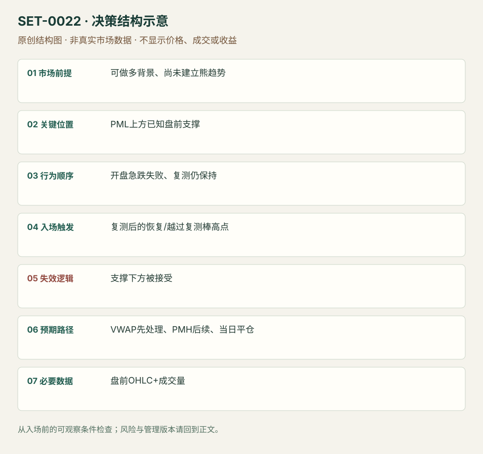

---
{
  "id": "SET-0022",
  "schema_version": "1.0.0",
  "name_zh": "开盘洗盘后守住盘前支撑",
  "name_en": "Opening Washout Support Buy",
  "aliases": [],
  "name_nature": "editor_descriptive_with_source_term",
  "status": "reviewed",
  "summary": "原本仍有做多背景的股票，开盘先急跌，在盘前低点上方的支撑区失败，再测试仍能守住时做多。不能把已连续建立 lower highs/lows 的熊趋势都叫洗盘。",
  "mechanism": "failed_opening_selloff",
  "tags": [
    "opening",
    "reversal",
    "support"
  ],
  "pa_role": "core",
  "markets_observed": [
    "美国个股"
  ],
  "markets_supported": [],
  "migration_hypotheses": [],
  "session": "美股/ES现金参考段 09:30–16:00 America/New_York；收盘前平仓。期货夜盘单独建背景，不将其并入开盘区间。",
  "session_tags": [
    "intraday"
  ],
  "context_timeframe": "日线/前一session + 当日执行图；因来源而异",
  "trigger_timeframe": "1分钟执行/5分钟背景",
  "data_requirements": [
    "OHLC",
    "volume",
    "premarket"
  ],
  "execution_mode": "mixed",
  "source_ids": [
    "SRC-0013",
    "SRC-0018"
  ],
  "evidence_ids": [
    "EVD-000040",
    "EVD-000041"
  ],
  "visual_ids": [
    "VIS-000023",
    "VIS-000079"
  ],
  "rule_completeness": "前提/触发/失效/管理已记录；来源与编辑模块分开",
  "independent_corroboration": "independent_context_only",
  "profit_evidence": "not_established",
  "created": "2026-10-02",
  "updated": "2026-10-02",
  "reviewed_at": "2026-10-02",
  "known_gaps": [
    "未开展独立回测；实际订单成交与成本未知"
  ],
  "logic_fingerprint": [
    "可做多背景、尚未建立熊趋势",
    "PML上方已知盘前支撑",
    "开盘急跌失败、复测仍保持",
    "复测后的恢复/越过复测棒高点",
    "支撑下方被接受",
    "VWAP先处理、PMH后续、当日平仓",
    "盘前OHLC+成交量"
  ],
  "environment_tags": [
    "opening",
    "gap"
  ],
  "structure_locations": [
    "premarket_support"
  ],
  "version": "1.0.0",
  "unknown_fields": {},
  "review_scope": "规则记录、引用范围、日内边界、逻辑区别与已看静态画面；不含独立回测、动态逐笔或账户核验",
  "source_coverage": {
    "substantive_read_sources": 2,
    "families": [
      "adam-grimes",
      "sai-trades"
    ],
    "core_support_source_ids": [
      "SRC-0013"
    ],
    "independence_note": "independent_context_only"
  },
  "method_families": [
    "opening_gap"
  ],
  "market_types": [
    "stocks"
  ]
}
---

# 开盘洗盘后守住盘前支撑 · Opening Washout Support Buy

## 1. 名称与快速概览

原本仍有做多背景的股票，开盘先急跌，在盘前低点上方的支撑区失败，再测试仍能守住时做多。不能把已连续建立 lower highs/lows 的熊趋势都叫洗盘。

记录口径：PA core；必要数据 OHLC、volume、premarket。名称性质：编辑性描述名，英文保留来源术语以便检索。reviewed 只表示本条规则与证据记录审查通过，盈利状态为 not_established。

## 2. 本质与行为假说

两次对同一支撑的测试提供短线卖盘未能维持更低价格的证据；“庄家洗盘”是来源解释，参与者动机无法从影线验证。关键是先有支撑和有效恢复。

## 3. 适用市场与环境

偏有催化、盘前背景不坏而开盘出现急红棒的个股。若跌破盘前低点并继续下移价值，或市场整体同向急跌，应放弃原多头背景。

**来源实用市场：**美国个股。

**Session：**美股/ES现金参考段 09:30–16:00 America/New_York；收盘前平仓。期货夜盘单独建背景，不将其并入开盘区间。

跨市场：本版不主张已经验证的跨市场迁移；更换市场必须重定数据来源、流动性与session。

## 4. 出现前的观察清单

提前画盘前低点及其上方已成立支撑，标当日开盘线、VWAP和PMH；比较开盘抛压与之后恢复量。支撑不能由事后看到的最低点临时发明。

## 5. 形成过程与状态转换

开盘卖出 → 已知支撑处下影和恢复 → 第二次回测支撑仍守 → 向上恢复信号 → 先逼近VWAP。第二次明确跌破则结构失效。

## 6. Entry trigger 与执行方式

来源要求看到支撑被测试并保持；可在复测后强恢复棒高点触发，本库把“强恢复”落实为收回测试区且向上穿越复测棒高点的编辑执行版。未等复测的影线抢入属于更早且不同风险版本。

## 7. Invalidation 与止损逻辑

SAI 是强跌破支撑或1分钟收盘跌破；缓冲和硬灾难止损必须另设并记录，不能将收盘检查当保证价格。支撑被接受在下方，原来的失败卖出假说撤销。

## 8. Exit、target 与 trade management

先看 VWAP，再看 PMH/更高参考；到 VWAP 无法恢复时缩减或退出。结构恢复并不保证全天上行。现金收盘前结束。

## 9. 常见 variations

只碰盘前低点、盘前低点上方支撑或当日已知支撑，是位置版本；无复测的 V 字入场须标早入。不得以支撑名称不同拆分多个洗盘条目。

## 10. 失败方式与不交易条件

根本没有先验支撑；第二次测试成交更强而压低价格；处于已建立下跌趋势；支撑至VWAP空间太小；把每次开盘下跌都解释为有意清扫。

## 11. 与相近 setups 的区别

- [SET-0023](SET-0023.md)：0023 的决定触发是重新站上当日VWAP；本条可在仍低于VWAP的支撑复测处进入。
- [SET-0018](SET-0018.md)：0018 在已确认平衡边缘等第二信号；本条处理现金开盘突发洗盘并依赖盘前背景。

## 12. 图表与案例解读

已看第19页 SPCE 示例，支撑在盘前低点上方，开盘急跌后留下下影并回测。此图支持形态识别，没有展示所有失败样本或可核对的逐笔成交。

- [VIS-000023] [来源PDF第19页图表](https://saitrades.com/wp-content/uploads/2021/03/Trading-the-Open-Playbook.pdf#page=19)；定位：PDF页序 19。SPCE 支撑测试后反弹，黄色支撑与盘前低点提供预先参考。 验证：chart_viewed_pdf_page。

**本地原创示意（VIS-000079，非真实市场数据）：**

小屏阅读可[打开原尺寸示意图](../assets/diagrams/SET-0022.svg)并缩放。

此图用于对照识别顺序与风险定义；不计入真实案例覆盖率。

## 13. 证据、分歧与未知项

完整开盘规则主要来自 SAI，Grimes 只佐证一般失败测试结构，独立核心佐证仍有限。来源对 market makers 动机的断言未被采用为规则。

- [EVD-000040] SAI Trades，《My Experience: Trading the Open Playbook》，[SRC-0013](https://saitrades.com/wp-content/uploads/2021/03/Trading-the-Open-Playbook.pdf)；定位：PDF页序19 Opening Washout Long。支持：开盘红棒向下洗出，但在盘前低点上方支撑留下影，复测不再失守后做多；先看VWAP/盘前高。
- [EVD-000041] Adam Grimes，《Market Pattern: The Failure Test》，[SRC-0018](https://adamhgrimes.com/failure-test/)；定位：Failure test trading patterns: failure means return into earlier structure。支持：独立结构解释支持穿出后恢复才有失败信息；未直接验证开盘洗盘的选股规则。

审查边界：来源份数与独立核心核验分开；当前类别为 independent_context_only。正文中的概念、官方事实、衍生解说或同族资料只按其支持范围使用。

## 14. 可用于复盘的检查表

- [ ] 下单前的前提可核对：可做多背景、尚未建立熊趋势
- [ ] 事前标记位置：PML上方已知盘前支撑
- [ ] 行为按顺序出现：开盘急跌失败、复测仍保持
- [ ] 实际触发符合选定版本：复测后的恢复/越过复测棒高点
- [ ] 事先写明本次否定条件：支撑下方被接受
- [ ] 目标/路径只用当时已知信息：VWAP先处理、PMH后续、当日平仓
- [ ] 数据满足 盘前OHLC+成交量；记录时间、点差、滑点、队列和未成交
- [ ] 记录截止平仓及规则偏离；正常亏损不事后改成“未成立”

## 15. 后续验证问题

等复测与首次影线进入的漏单/亏损比例？低成交量反弹是否有效？开盘市场同向压力怎样影响样本？
