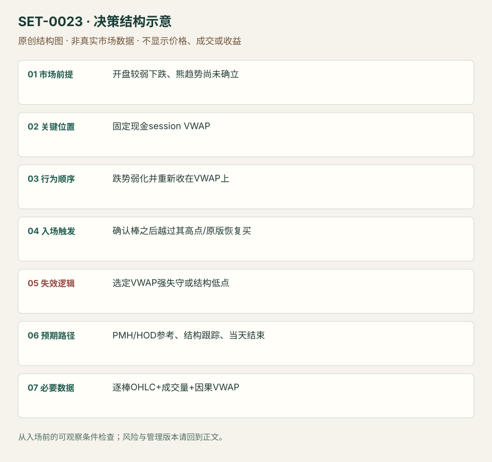

---
{
  "id": "SET-0023",
  "schema_version": "1.0.0",
  "name_zh": "弱开盘跌势的 VWAP 收复",
  "name_en": "Opening Washout VWAP Reclaim",
  "aliases": [],
  "name_nature": "editor_descriptive_with_source_term",
  "status": "reviewed",
  "summary": "现金开盘后出现较弱卖出，随后恢复到当日 VWAP 上方，等待确认棒或其高点突破进入。VWAP 必须是事先定义的同一 session 计算，触发是收复而非简单触碰。",
  "mechanism": "value_reclaim",
  "tags": [
    "opening",
    "vwap",
    "reversal"
  ],
  "pa_role": "supporting",
  "markets_observed": [
    "美国个股"
  ],
  "markets_supported": [],
  "migration_hypotheses": [],
  "session": "美股/ES现金参考段 09:30–16:00 America/New_York；收盘前平仓。期货夜盘单独建背景，不将其并入开盘区间。",
  "session_tags": [
    "intraday"
  ],
  "context_timeframe": "日线/前一session + 当日执行图；因来源而异",
  "trigger_timeframe": "1分钟/5分钟来源版本",
  "data_requirements": [
    "OHLC",
    "volume",
    "VWAP"
  ],
  "execution_mode": "mixed",
  "source_ids": [
    "SRC-0013",
    "SRC-0022"
  ],
  "evidence_ids": [
    "EVD-000042",
    "EVD-000043"
  ],
  "visual_ids": [
    "VIS-000024",
    "VIS-000025",
    "VIS-000080"
  ],
  "rule_completeness": "前提/触发/失效/管理已记录；来源与编辑模块分开",
  "independent_corroboration": "multiple_families",
  "profit_evidence": "not_established",
  "created": "2026-10-02",
  "updated": "2026-10-02",
  "reviewed_at": "2026-10-02",
  "known_gaps": [
    "未开展独立回测；实际订单成交与成本未知"
  ],
  "logic_fingerprint": [
    "开盘较弱下跌、熊趋势尚未确立",
    "固定现金session VWAP",
    "跌势弱化并重新收在VWAP上",
    "确认棒之后越过其高点/原版恢复买",
    "选定VWAP强失守或结构低点",
    "PMH/HOD参考、结构跟踪、当天结束",
    "逐棒OHLC+成交量+因果VWAP"
  ],
  "environment_tags": [
    "opening",
    "regime_change"
  ],
  "structure_locations": [
    "session_VWAP"
  ],
  "version": "1.0.0",
  "unknown_fields": {},
  "review_scope": "规则记录、引用范围、日内边界、逻辑区别与已看静态画面；不含独立回测、动态逐笔或账户核验",
  "source_coverage": {
    "substantive_read_sources": 2,
    "families": [
      "sai-trades",
      "tradingsim"
    ],
    "core_support_source_ids": [
      "SRC-0013",
      "SRC-0022"
    ],
    "independence_note": "multiple_families"
  },
  "method_families": [
    "opening_gap",
    "VWAP"
  ],
  "market_types": [
    "stocks"
  ]
}
---

# 弱开盘跌势的 VWAP 收复 · Opening Washout VWAP Reclaim

## 1. 名称与快速概览

现金开盘后出现较弱卖出，随后恢复到当日 VWAP 上方，等待确认棒或其高点突破进入。VWAP 必须是事先定义的同一 session 计算，触发是收复而非简单触碰。

记录口径：PA supporting；必要数据 OHLC、volume、VWAP。名称性质：编辑性描述名，英文保留来源术语以便检索。reviewed 只表示本条规则与证据记录审查通过，盈利状态为 not_established。

## 2. 本质与行为假说

价格恢复至成交均价上方，是早期卖出没有继续占优的可观察代理。它不等于每个空头亏损，也不证明机构买入。VWAP 计算的成交场所和盘前是否纳入会改变信号。

## 3. 适用市场与环境

SAI 限定弱开盘下降，明确区别已经形成 lower highs/lows 的熊趋势。若 VWAP 强斜向下、回升量弱并多次失败，更容易只是反弹。

**来源实用市场：**美国个股。

**Session：**美股/ES现金参考段 09:30–16:00 America/New_York；收盘前平仓。期货夜盘单独建背景，不将其并入开盘区间。

跨市场：本版不主张已经验证的跨市场迁移；更换市场必须重定数据来源、流动性与session。

## 4. 出现前的观察清单

确认基准重置时点和可交易数据；标 LOD、PMH、最近局部低点。观察早跌是否弱化，VWAP下方是否仍不断形成新低。

## 5. 形成过程与状态转换

开盘下降 → 下行动能减弱 → 棒收回VWAP上方 → 突破确认棒高点/恢复买量 → 持续在均价上方才有延续。

## 6. Entry trigger 与执行方式

来源有直接VWAP上方恢复买和等收盘两版。本库标准复盘入口为确认棒收于VWAP上方后，下一棒越过高点；触发未到则撤单。用VWAP触碰限价是提前版，应分开统计。

## 7. Invalidation 与止损逻辑

强收于VWAP下方是原版失效；局部低点是 TradingSim 结构保护版；SAI 也讨论宽至LOD的选择。三者不能在同一交易亏损后切换；初始风险需在入场前固定。

## 8. Exit、target 与 trade management

先看PMH或当日已知高点；越过后跟结构低点，不因“已收复”忽略第二次跌穿。交易日结束强制平仓；所有分批价与数量须留记录。

## 9. 常见 variations

开盘洗盘和盘中均价收复共享触发，但本条主版限早期弱跌。更换VWAP锚点、标准差带或加EMA只作为计算/过滤版本。

## 10. 失败方式与不交易条件

多次穿线震荡；均价下降时仅短暂收上；确认棒过长导致空间小；把最终当日VWAP放回早期信号；失败后凭日低宽止损继续等待。

## 11. 与相近 setups 的区别

- [SET-0022](SET-0022.md)：0022 在先验支撑复测处进入，可能尚未收复VWAP；本条必须恢复成交均价。
- [SET-0024](SET-0024.md)：0024 在原弱方向背景中等穿越偏离失败后的回测做空，而非把首次穿线当多头恢复。

## 12. 图表与案例解读

已看 PTON 与 IMMY 图。IMMY 箭头明确区分收于VWAP上方和之后突破；这是文字执行顺序的视觉佐证。IMMY完整交易日日期和时区未确认。

- [VIS-000024] [来源PDF第20页图表](https://saitrades.com/wp-content/uploads/2021/03/Trading-the-Open-Playbook.pdf#page=20)；定位：PDF页序 20。PTON 早跌后收复紫色VWAP，作者给出早入和确认路线。 验证：chart_viewed_pdf_page。
- [VIS-000025] [Conservative VWAP Entry](https://www.tradingsim.com/hs-fs/hubfs/Imported_Blog_Media/Conservative-VWAP-Entry-1-1024x782-1.png?width=1024&height=782&name=Conservative-VWAP-Entry-1-1024x782-1.png)；定位：Chapter 1 Conservative Entry。IMMY 先收上蓝线，再突破确认棒高点；图内箭头为作者教学标记。 验证：chart_viewed。

**本地原创示意（VIS-000080，非真实市场数据）：**

小屏阅读可[打开原尺寸示意图](../assets/diagrams/SET-0023.svg)并缩放。

此图用于对照识别顺序与风险定义；不计入真实案例覆盖率。

## 13. 证据、分歧与未知项

SAI 与 TradingSim 来自不同实践家族，但均为教育例和执行讨论，没有本版本经成本的独立收益证据。SAI 收盘止损可能在快速跌势中扩大实际亏损。

- [EVD-000042] SAI Trades，《My Experience: Trading the Open Playbook》，[SRC-0013](https://saitrades.com/wp-content/uploads/2021/03/Trading-the-Open-Playbook.pdf)；定位：PDF页序20 Opening Washout Long: VWAP Reclaim。支持：跌势较弱、不是已建立熊趋势；在VWAP上方恢复买入，VWAP强失守/LOD版本止损。
- [EVD-000043] Al Hill / TradingSim，《The VWAP Indicator Ultimate Guide And Video》，[SRC-0022](https://www.tradingsim.com/blog/vwap-indicator)；定位：Chapter 1 Conservative Entry / VWAP Trade examples。支持：等棒收于VWAP上方并突破其高点是更保守入场；强跌破后并不一定返回。

## 14. 可用于复盘的检查表

- [ ] 下单前的前提可核对：开盘较弱下跌、熊趋势尚未确立
- [ ] 事前标记位置：固定现金session VWAP
- [ ] 行为按顺序出现：跌势弱化并重新收在VWAP上
- [ ] 实际触发符合选定版本：确认棒之后越过其高点/原版恢复买
- [ ] 事先写明本次否定条件：选定VWAP强失守或结构低点
- [ ] 目标/路径只用当时已知信息：PMH/HOD参考、结构跟踪、当天结束
- [ ] 数据满足 逐棒OHLC+成交量+因果VWAP；记录时间、点差、滑点、队列和未成交
- [ ] 记录截止平仓及规则偏离；正常亏损不事后改成“未成立”

## 15. 后续验证问题

是否纳入盘前成交对触发时刻影响多大？确认棒上穿的跳价成本怎样？多次穿线日如何定义禁入？
