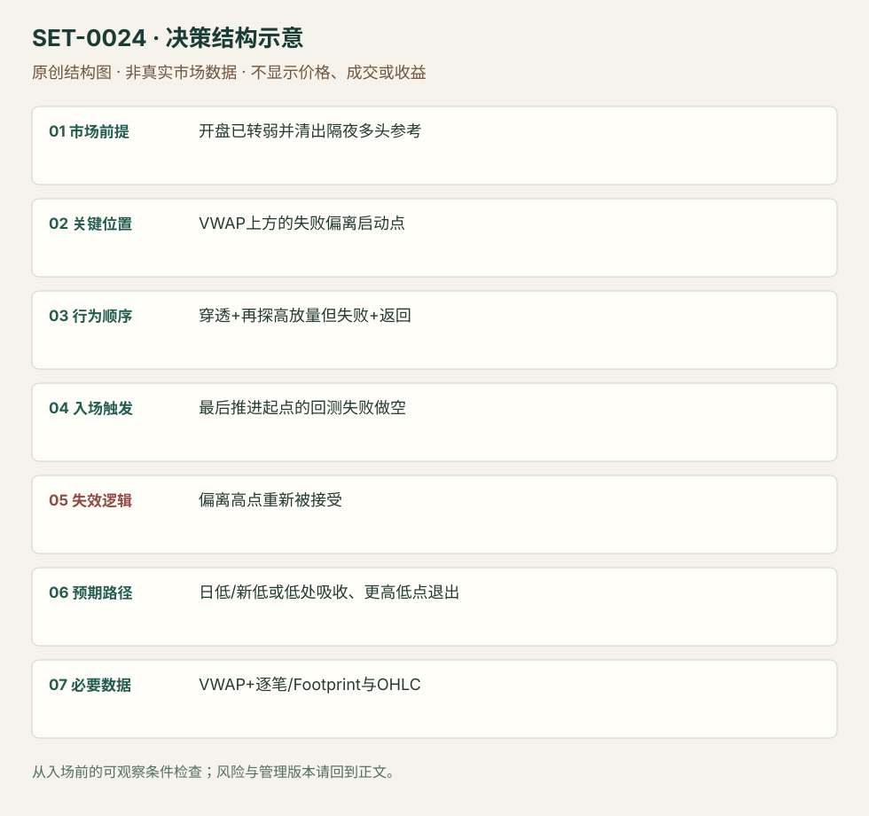

---
{
  "id": "SET-0024",
  "schema_version": "1.0.0",
  "name_zh": "VWAP 穿透、偏离失败与回测",
  "name_en": "VWAP Penetration–Deviation–Retest",
  "aliases": [],
  "name_nature": "editor_descriptive_with_source_term",
  "status": "reviewed",
  "summary": "在已转弱的 session 中，反弹不仅接近 VWAP，还穿透并再做一次高成交偏离；偏离失败后，回测最后推进的起点做原弱方向。三阶段少一个便不是本条。",
  "mechanism": "failed_countertrend_probe",
  "tags": [
    "vwap",
    "order_flow",
    "reversal",
    "retest"
  ],
  "pa_role": "supporting",
  "markets_observed": [
    "S&P500期货"
  ],
  "markets_supported": [],
  "migration_hypotheses": [],
  "session": "美股/ES现金参考段 09:30–16:00 America/New_York；收盘前平仓。期货夜盘单独建背景，不将其并入开盘区间。",
  "session_tags": [
    "intraday"
  ],
  "context_timeframe": "日线/前一session + 当日执行图；因来源而异",
  "trigger_timeframe": "1秒/Footprint",
  "data_requirements": [
    "OHLC",
    "VWAP",
    "footprint",
    "trade_prints"
  ],
  "execution_mode": "mixed",
  "source_ids": [
    "SRC-0070",
    "SRC-0022"
  ],
  "evidence_ids": [
    "EVD-000044",
    "EVD-000045"
  ],
  "visual_ids": [
    "VIS-000026",
    "VIS-000027",
    "VIS-000081"
  ],
  "rule_completeness": "前提/触发/失效/管理已记录；来源与编辑模块分开",
  "independent_corroboration": "independent_context_only",
  "profit_evidence": "not_established",
  "created": "2026-10-02",
  "updated": "2026-10-02",
  "reviewed_at": "2026-10-02",
  "known_gaps": [
    "未开展独立回测；实际订单成交与成本未知"
  ],
  "logic_fingerprint": [
    "开盘已转弱并清出隔夜多头参考",
    "VWAP上方的失败偏离启动点",
    "穿透+再探高放量但失败+返回",
    "最后推进起点的回测失败做空",
    "偏离高点重新被接受",
    "日低/新低或低处吸收、更高低点退出",
    "VWAP+逐笔/Footprint与OHLC"
  ],
  "environment_tags": [
    "directional",
    "failed_auction"
  ],
  "structure_locations": [
    "session_VWAP",
    "probe_origin"
  ],
  "version": "1.0.0",
  "unknown_fields": {},
  "review_scope": "规则记录、引用范围、日内边界、逻辑区别与已看静态画面；不含独立回测、动态逐笔或账户核验",
  "source_coverage": {
    "substantive_read_sources": 2,
    "families": [
      "axia",
      "tradingsim"
    ],
    "core_support_source_ids": [
      "SRC-0070"
    ],
    "independence_note": "independent_context_only"
  },
  "method_families": [
    "VWAP",
    "tape_DOM"
  ],
  "market_types": [
    "futures"
  ]
}
---

# VWAP 穿透、偏离失败与回测 · VWAP Penetration–Deviation–Retest

## 1. 名称与快速概览

在已转弱的 session 中，反弹不仅接近 VWAP，还穿透并再做一次高成交偏离；偏离失败后，回测最后推进的起点做原弱方向。三阶段少一个便不是本条。

记录口径：PA supporting；必要数据 OHLC、VWAP、footprint、trade_prints。名称性质：编辑性描述名，英文保留来源术语以便检索。reviewed 只表示本条规则与证据记录审查通过，盈利状态为 not_established。

## 2. 本质与行为假说

假说是穿透均价后的新买入未能推动继续上涨，回测失败位置会暴露脆弱多头。大打印只表示大成交，不能证明交易者身份或清扫意图。

## 3. 适用市场与环境

源例ES隔夜偏多，现金开盘先清掉隔夜低点；随后回到VWAP寻找卖出。只有均价触碰、持续强趋势上穿且被接受，都不满足。

**来源实用市场：**S&P500期货。

**Session：**美股/ES现金参考段 09:30–16:00 America/New_York；收盘前平仓。期货夜盘单独建背景，不将其并入开盘区间。

跨市场：本版不主张已经验证的跨市场迁移；更换市场必须重定数据来源、流动性与session。

## 4. 出现前的观察清单

锁定隔夜低、现金开盘行为和当日VWAP；逐笔/Footprint识别穿透与更高探测时成交是否增加。预先圈出最后推进起点，不能等跌完再选。

## 5. 形成过程与状态转换

背景转弱 → 反弹到VWAP → 穿透 → 高成交继续探高却不持续 → 返回最后推进起点 → 回测不能重启上涨 → 空头执行。

## 6. Entry trigger 与执行方式

原文在失败偏离启动位置的回测做空；可用回测处报价/主动卖出，须有卖压恢复的实际证据。若没有看到回测，不能把最高点事后当成交入口。

## 7. Invalidation 与止损逻辑

偏离高点上方；重新被接受在高点上方撤销失败假说。以成交量强弱作软判断也需要硬风险边界，否则订单流词汇不能界定最大亏损。

## 8. Exit、target 与 trade management

目标已清出的日低或新低；接近日低出现吸收/更高低点应退出，不坚持必须创新低。若突破失败起点后久久不续跌，时间失效阈值由测试设定，属编辑模块。

## 9. 常见 variations

买方向对称；1秒打印与Footprint只是观察形式。普通VWAP回抽空不自动满足穿透和二次偏离，归相关父逻辑而不另计本条。

## 10. 失败方式与不交易条件

均价之上建立新价值；最后探高持续创新高；回测点无法在当时辨认；供应商成交归类不可靠；把非公开Heavy Hitters身份判断当必需可复现数据。

## 11. 与相近 setups 的区别

- [SET-0023](SET-0023.md)：0023 用收上VWAP且继续突破作恢复信号；本条须观察穿透失败后再回测。
- [SET-0043](SET-0043.md)：0043 用明确失败的对角失衡区做原趋势；本条规定均价穿透与二次偏离，不必须堆叠失衡。

## 12. 图表与案例解读

已看两图，均有作者明确 P/E/R 标注；可以核对状态先后。静态截图不能核对实时成交速度或原文所称参与者，日期和时区未核实。

- [VIS-000026] [1sec chart with Footprint and Heavy Hitters](https://axiafutures.com/blog/wp-content/uploads/2022/01/vwap3-1024x583.png)；定位：1sec chart with Footprint and Heavy Hitters。作者黄标P/E/R展示穿透、偏离和回测；白色价格与大打印后在回测点转弱。 验证：chart_viewed。
- [VIS-000027] [Footprint chart with reversal into VWAP](https://axiafutures.com/blog/wp-content/uploads/2022/01/vwap5-1024x557.png)；定位：Footprint chart with a reversal into VWAP。另一日脚印图标三个阶段；偏离高点和回测区可见。 验证：chart_viewed。

**本地原创示意（VIS-000081，非真实市场数据）：**

小屏阅读可[打开原尺寸示意图](../assets/diagrams/SET-0024.svg)并缩放。

此图用于对照识别顺序与风险定义；不计入真实案例覆盖率。

## 13. 证据、分歧与未知项

三阶段规则主要由 Axia 同家族两张例图解释；TradingSim提供失败边界，核心独立复核有限。原文把大打印称 heavy hitters，本库仅记录成交大小与价格响应。

- [EVD-000044] Axia Futures，《VWAP Trend Trading Strategies》，[SRC-0070](https://axiafutures.com/blog/vwap-trend-trading-strategies/)；定位：VWAP Selling Strategy: Penetration / Deviation / Retest。支持：隔夜多头被开盘下跌清出后回升VWAP，穿透后增量探高失败，在最后推进起点回测做空，止损偏离高点、目标日低/吸收。
- [EVD-000045] Al Hill / TradingSim，《The VWAP Indicator Ultimate Guide And Video》，[SRC-0022](https://www.tradingsim.com/blog/vwap-indicator)；定位：Chapter 9 Hard Break of VWAP / RIOT and MBI。支持：独立来源给VWAP失守后不能期待必然回归的反例；不佐证三阶段精确触发。

审查边界：来源份数与独立核心核验分开；当前类别为 independent_context_only。正文中的概念、官方事实、衍生解说或同族资料只按其支持范围使用。

## 14. 可用于复盘的检查表

- [ ] 下单前的前提可核对：开盘已转弱并清出隔夜多头参考
- [ ] 事前标记位置：VWAP上方的失败偏离启动点
- [ ] 行为按顺序出现：穿透+再探高放量但失败+返回
- [ ] 实际触发符合选定版本：最后推进起点的回测失败做空
- [ ] 事先写明本次否定条件：偏离高点重新被接受
- [ ] 目标/路径只用当时已知信息：日低/新低或低处吸收、更高低点退出
- [ ] 数据满足 VWAP+逐笔/Footprint与OHLC；记录时间、点差、滑点、队列和未成交
- [ ] 记录截止平仓及规则偏离；正常亏损不事后改成“未成立”

## 15. 后续验证问题

偏离启动点能否无事后信息一致标注？大成交的阈值是否需按产品归一化？不用专有大打印指标的等价性怎样？
