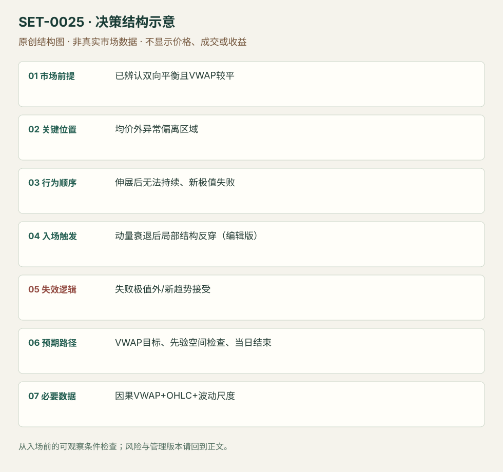

---
{
  "id": "SET-0025",
  "schema_version": "1.0.0",
  "name_zh": "平衡日的 VWAP 过度偏离回归",
  "name_en": "Flat VWAP Stretch Fade",
  "aliases": [],
  "name_nature": "editor_descriptive_with_source_term",
  "status": "reviewed",
  "summary": "在价格反复围绕均价、VWAP较平的平衡日，过度偏离伴随延续衰弱时，逆向捕捉回到均价。偏离本身没有入场信息，不能在趋势日不断加仓反向。",
  "mechanism": "intraday_mean_reversion",
  "tags": [
    "vwap",
    "balance",
    "mean_reversion"
  ],
  "pa_role": "supporting",
  "markets_observed": [
    "指数期货（教育规则）",
    "S&P500期货（回顾研究）"
  ],
  "markets_supported": [],
  "migration_hypotheses": [],
  "session": "美股/ES现金参考段 09:30–16:00 America/New_York；收盘前平仓。期货夜盘单独建背景，不将其并入开盘区间。",
  "session_tags": [
    "intraday"
  ],
  "context_timeframe": "日线/前一session + 当日执行图；因来源而异",
  "trigger_timeframe": null,
  "data_requirements": [
    "OHLC",
    "volume",
    "VWAP"
  ],
  "execution_mode": "mixed",
  "source_ids": [
    "SRC-0071",
    "SRC-0022"
  ],
  "evidence_ids": [
    "EVD-000046",
    "EVD-000047",
    "EVD-000102"
  ],
  "visual_ids": [
    "VIS-000082"
  ],
  "rule_completeness": "前提/触发/失效/管理已记录；来源与编辑模块分开",
  "independent_corroboration": "independent_context_only",
  "profit_evidence": "not_established",
  "created": "2026-10-02",
  "updated": "2026-10-02",
  "reviewed_at": "2026-10-02",
  "known_gaps": [
    "偏离和斜率阈值未统一",
    "具体编辑触发未回测",
    "缺少完整真实入场案例",
    "执行周期没有统一来源参数，使用前须锁定版本"
  ],
  "logic_fingerprint": [
    "已辨认双向平衡且VWAP较平",
    "均价外异常偏离区域",
    "伸展后无法持续、新极值失败",
    "动量衰退后局部结构反穿（编辑版）",
    "失败极值外/新趋势接受",
    "VWAP目标、先验空间检查、当日结束",
    "因果VWAP+OHLC+波动尺度"
  ],
  "environment_tags": [
    "balance",
    "extended"
  ],
  "structure_locations": [
    "session_VWAP"
  ],
  "version": "1.0.0",
  "unknown_fields": {
    "trigger_timeframe": "来源未提供统一执行周期；正文记录已知图例，不能当成统一参数"
  },
  "review_scope": "规则记录、引用范围、日内边界、逻辑区别与已看静态画面；不含独立回测、动态逐笔或账户核验",
  "source_coverage": {
    "substantive_read_sources": 2,
    "families": [
      "ninjatrader",
      "tradingsim"
    ],
    "core_support_source_ids": [
      "SRC-0071"
    ],
    "independence_note": "independent_context_only"
  },
  "method_families": [
    "VWAP"
  ],
  "market_types": [
    "futures"
  ]
}
---

# 平衡日的 VWAP 过度偏离回归 · Flat VWAP Stretch Fade

## 1. 名称与快速概览

在价格反复围绕均价、VWAP较平的平衡日，过度偏离伴随延续衰弱时，逆向捕捉回到均价。偏离本身没有入场信息，不能在趋势日不断加仓反向。

记录口径：PA supporting；必要数据 OHLC、volume、VWAP。名称性质：编辑性描述名，英文保留来源术语以便检索。reviewed 只表示本条规则与证据记录审查通过，盈利状态为 not_established。

## 2. 本质与行为假说

假说是平衡环境的额外偏离缺少新的持续接受，因而回到成交中心。水平VWAP只是状态代理，仍须检查日内高低是否扩张及信息是否改变。

## 3. 适用市场与环境

均价斜率小、价格双向轮转、没有持续新消息重新定价。来源没有通用“过度”数值；需要按品种与同一时刻波动研究阈值。

**来源实用市场：**指数期货（教育规则）、S&P500期货（回顾研究）。

**Session：**美股/ES现金参考段 09:30–16:00 America/New_York；收盘前平仓。期货夜盘单独建背景，不将其并入开盘区间。

跨市场：本版不主张已经验证的跨市场迁移；更换市场必须重定数据来源、流动性与session。

## 4. 出现前的观察清单

记录因果VWAP、当时波动尺度与既有范围；判断是否已有连续趋势和价值迁移。选定何种衰退确认及最大允许偏离，禁止使用最终当天最高偏离作为条件。

## 5. 形成过程与状态转换

平衡成立 → 单侧远离均价 → 新极值无法继续/恢复失败 → 反向价格确认 → 回到均价或极值外失效。

## 6. Entry trigger 与执行方式

来源给过度伸展与动量衰退，本库编辑执行版为新极值失败后跌破最后局部上升低点做空（下侧对称）；没有结构确认只因距离大进入是更早假设版，单独测试。

## 7. Invalidation 与止损逻辑

失败极值之外固定缓冲；继续扩张且均价开始同向倾斜时取消原平衡假说。没有有限结构边界的样本不入场；不可用加仓摊低代替失效退出。

## 8. Exit、target 与 trade management

VWAP为首要目标；回归过程中出现新的接受区可提前处理。进入前检查目标距离与止损距离。收盘前平仓，未回到均价也结束。

## 9. 常见 variations

标准差带、百分比或ATR用于量化偏离是版本参数，不计新setup；不能将任意0.4%套所有产品。带上沿触碰限价版须独立测试衰退缺失的影响。

## 10. 失败方式与不交易条件

趋势日斜VWAP不断上移；新闻使价格中心改变；等待事后最高点才进入的回测；目标偏近但止损偏远；用无限补仓制造高胜率。

## 11. 与相近 setups 的区别

- [SET-0024](SET-0024.md)：0024 必须穿透和偏离均价后回测起点；本条在远离且平衡的外侧等衰退。
- [SET-0038](SET-0038.md)：0038 依赖旧价值分布与低量伸展，本条目标为动态成交均价并要求当日平衡。

## 12. 图表与案例解读

视觉缺口：已查看 TradingSim 研究汇总图，但它是10次观察的收益柱图，不是可核对本条触发的价格案例，因此未计入真实图表覆盖。需要补充含入场前VWAP斜率和失败极值的完整日内图。

**本地原创示意（VIS-000082，非真实市场数据）：**

小屏阅读可[打开原尺寸示意图](../assets/diagrams/SET-0025.svg)并缩放。

此图用于对照识别顺序与风险定义；不计入真实案例覆盖率。

## 13. 证据、分歧与未知项

NinjaTrader提供偏离均价的fade框架；TradingSim仅作尺度研究与限制背景，没有独立核验本条完整触发。两者均未证明此编辑版本盈利。TradingSim研究的事后最大偏离和“潜在平均收益”不构成真实入场回报；本库将其作为方法限制证据。

- [EVD-000046] NinjaTrader editorial team，《The Definitive Guide to VWAP Strategies for New Futures Traders》，[SRC-0071](https://ninjatrader.com/futures/blogs/vwap-strategies-futures/)；定位：Mean Reversion to VWAP / Risk management。支持：价格过度远离均价且动量衰退时反向，均价为目标、极值外止损；趋势环境会失败。
- [EVD-000047] Al Hill / TradingSim，《The VWAP Indicator Ultimate Guide And Video》，[SRC-0022](https://www.tradingsim.com/blog/vwap-indicator)；定位：Chapter 8 Reason 5 / Chapter 11 S&P500 ES Study。支持：较平的VWAP与偏离提供均值回归背景；2018年研究取事后峰值偏离，不能直接当可执行策略。

- [EVD-000102] **编辑操作化，未测试：**将平衡偏离的动量衰退用局部结构反穿触发；尺度、确认与buffer由使用者事先锁定，未测试。 原文边界：源文仅给偏离均价的fade框架和均价目标，没有这套统一局部触发参数。

审查修正：TradingSim偏离研究为背景而非本条完整触发核验，当前独立性为independent_context_only。

## 14. 可用于复盘的检查表

- [ ] 下单前的前提可核对：已辨认双向平衡且VWAP较平
- [ ] 事前标记位置：均价外异常偏离区域
- [ ] 行为按顺序出现：伸展后无法持续、新极值失败
- [ ] 实际触发符合选定版本：动量衰退后局部结构反穿（编辑版）
- [ ] 事先写明本次否定条件：失败极值外/新趋势接受
- [ ] 目标/路径只用当时已知信息：VWAP目标、先验空间检查、当日结束
- [ ] 数据满足 因果VWAP+OHLC+波动尺度；记录时间、点差、滑点、队列和未成交
- [ ] 记录截止平仓及规则偏离；正常亏损不事后改成“未成立”

## 15. 后续验证问题

平衡如何在入场前判断而不看全天形状？相同时间波动标准化能否替代固定百分比？成本后目标距离多少才可行？
