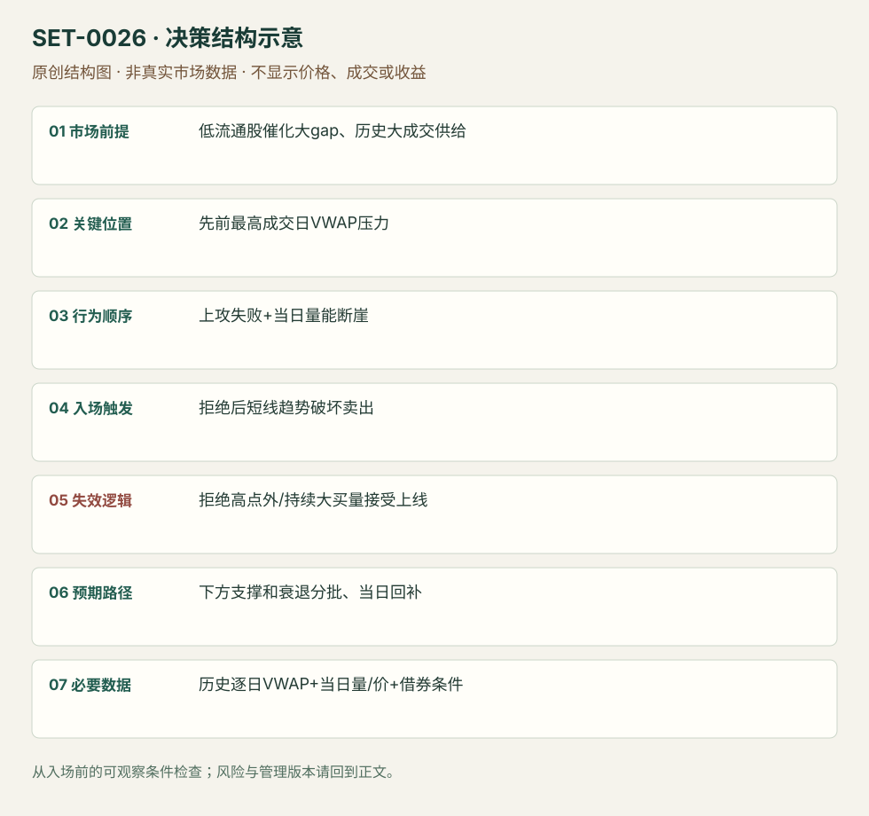

---
{
  "id": "SET-0026",
  "schema_version": "1.0.0",
  "name_zh": "历史高成交日 VWAP 压力与量能断崖",
  "name_en": "VWAP Boulevard Short",
  "aliases": [],
  "name_nature": "established_or_source_term",
  "status": "reviewed",
  "summary": "小盘催化股大幅跳空时，以先前最高成交日的 VWAP 作为潜在套牢供给参考；当上攻该区失败且量能明显退潮，做转弱的空头。这里的线不是今天的 VWAP。",
  "mechanism": "overhead_supply_rejection",
  "tags": [
    "vwap",
    "gap",
    "volume",
    "short"
  ],
  "pa_role": "supporting",
  "markets_observed": [
    "美国小盘个股"
  ],
  "markets_supported": [],
  "migration_hypotheses": [],
  "session": "美股/ES现金参考段 09:30–16:00 America/New_York；收盘前平仓。期货夜盘单独建背景，不将其并入开盘区间。",
  "session_tags": [
    "opening",
    "premarket"
  ],
  "context_timeframe": "日线/前一session + 当日执行图；因来源而异",
  "trigger_timeframe": "1分钟/盘前+日内",
  "data_requirements": [
    "OHLC",
    "volume",
    "historical_session_VWAP",
    "premarket"
  ],
  "execution_mode": "mixed",
  "source_ids": [
    "SRC-0023",
    "SRC-0022"
  ],
  "evidence_ids": [
    "EVD-000048",
    "EVD-000049"
  ],
  "visual_ids": [
    "VIS-000028",
    "VIS-000029",
    "VIS-000083"
  ],
  "rule_completeness": "前提/触发/失效/管理已记录；来源与编辑模块分开",
  "independent_corroboration": "limited_single_family",
  "profit_evidence": "not_established",
  "created": "2026-10-02",
  "updated": "2026-10-02",
  "reviewed_at": "2026-10-02",
  "known_gaps": [
    "未开展独立回测；实际订单成交与成本未知"
  ],
  "logic_fingerprint": [
    "低流通股催化大gap、历史大成交供给",
    "先前最高成交日VWAP压力",
    "上攻失败+当日量能断崖",
    "拒绝后短线趋势破坏卖出",
    "拒绝高点外/持续大买量接受上线",
    "下方支撑和衰退分批、当日回补",
    "历史逐日VWAP+当日量/价+借券条件"
  ],
  "environment_tags": [
    "gap",
    "news",
    "extended"
  ],
  "structure_locations": [
    "historical_high_volume_day_VWAP"
  ],
  "version": "1.0.0",
  "unknown_fields": {},
  "review_scope": "规则记录、引用范围、日内边界、逻辑区别与已看静态画面；不含独立回测、动态逐笔或账户核验",
  "source_coverage": {
    "substantive_read_sources": 2,
    "families": [
      "tradingsim"
    ],
    "core_support_source_ids": [
      "SRC-0023",
      "SRC-0022"
    ],
    "independence_note": "limited_single_family"
  },
  "method_families": [
    "opening_gap",
    "VWAP"
  ],
  "market_types": [
    "stocks"
  ]
}
---

# 历史高成交日 VWAP 压力与量能断崖 · VWAP Boulevard Short

## 1. 名称与快速概览

小盘催化股大幅跳空时，以先前最高成交日的 VWAP 作为潜在套牢供给参考；当上攻该区失败且量能明显退潮，做转弱的空头。这里的线不是今天的 VWAP。

记录口径：PA supporting；必要数据 OHLC、volume、historical_session_VWAP、premarket。名称性质：来源术语或研究术语。reviewed 只表示本条规则与证据记录审查通过，盈利状态为 not_established。

## 2. 本质与行为假说

历史高成交区可能留下供给是可检验假说，VWAP均价不能证明当前尚有多少套牢者。必须有当日失败和量变化；作者策略的 low float 和 gap 条件不能简化成任何锚定均价触碰。

## 3. 适用市场与环境

来源偏低流通股、很大gap（核心版本至少约50%），关注开盘至10:00前能否停滞和量断崖。若持续高量并越过历史压力，则原空头预期撤销。

**来源实用市场：**美国小盘个股。

**Session：**美股/ES现金参考段 09:30–16:00 America/New_York；收盘前平仓。期货夜盘单独建背景，不将其并入开盘区间。

跨市场：本版不主张已经验证的跨市场迁移；更换市场必须重定数据来源、流动性与session。

## 4. 出现前的观察清单

按来源回看高成交日并保存所选日、各日VWAP和日量，不能事后挑最准的一条。查催化、借券和当前价差，留盘前走势；借不到券属于不可执行，不是没有形态。

## 5. 形成过程与状态转换

高关注gap → 接近历史大成交VWAP → 推进失败/趋势转弱 → 当日量显著下降 → 空头触发 → 低量持续或重新强买入决定管理。

## 6. Entry trigger 与执行方式

来源按历史线附近被拒与趋势破坏建立空头。编辑可审查触发为拒绝后跌破当前反弹局部低点；仅碰线即卖是提前版。必须记录量断崖相对哪段，不以日后最终量柱定义。

## 7. Invalidation 与止损逻辑

拒绝高点外；若大成交恢复并被接受在线上方，撤销供给拒绝。实际空单需写回补与借券约束，不能将该线看成无限可靠的卖点。

## 8. Exit、target 与 trade management

随动量减弱减仓，参考盘前支撑/当日低点，强买入回来则退出；不因来源展示暴跌而要求每次拿到收盘最低。现金收盘前回补。

## 9. 常见 variations

历史线以上持续大成交可产生长方向，作为本方法失败/翻转场景记录；XSPA/VCNX/SPI不同股票不是新Setup。历史锚点选法是版本字段。

## 10. 失败方式与不交易条件

SPI式买量持续且保持高位；选错历史大成交日；仅有日量小却价格被接受上涨；借券费用/停牌使空头执行偏离；线附近波动反复导致追空。

## 11. 与相近 setups 的区别

- [SET-0025](SET-0025.md)：0025 使用今天平VWAP并回到均价；本条历史高成交日线只是潜在供给参考。
- [SET-0021](SET-0021.md)：0021 开盘强买量突破PMH，本条寻找这类动量失败后的历史压力拒绝，但两者不能只因做多/做空而算同一交易。

## 12. 图表与案例解读

已看 XSPA 拒绝图和 SPI 持续强量图。XSPA显示3/8，完整年份来自文章；图内本地时间与纽约现金时间映射未核实。SPI是空头预期的反例，不把它包装为成功空单。

- [VIS-000028] [XSPA intraday #vwapboulevard rejection](https://www.tradingsim.com/hs-fs/hubfs/Imported_Blog_Media/XSPApremarket-2.png?width=1024&height=723&name=XSPApremarket-2.png)；定位：XSPA intraday #vwapboulevard rejection。黑线2.71为历史参考，接近后未越过，后续量衰退且价格转弱。 验证：chart_viewed。
- [VIS-000029] [SPI 10am vwap test](https://www.tradingsim.com/hs-fs/hubfs/Imported_Blog_Media/SPI10am-2.png?width=1024&height=689&name=SPI10am-2.png)；定位：SPI volume remains high into 10am。SPI持续买量并强势高位，不能因遇线就空；失败边界示例。 验证：chart_viewed。

**本地原创示意（VIS-000083，非真实市场数据）：**

小屏阅读可[打开原尺寸示意图](../assets/diagrams/SET-0026.svg)并缩放。

此图用于对照识别顺序与风险定义；不计入真实案例覆盖率。

## 13. 证据、分歧与未知项

核心来自 TradingSim 对 @team3dstocks 方法的解释，独立佐证有限。文章包含 EYES 的2020正文与2021推文日期冲突，本条不靠该例定日期；没有看原推文视频或Level II回放。

- [EVD-000048] John McDowell / team3dstocks引用，《VWAP Boulevard: The Ultimate Day Trading Strategy for Low-Float Stocks [#vwapboulevard]》，[SRC-0023](https://www.tradingsim.com/blog/vwap-boulevard)；定位：Origins / Calculate VWAP Boulevard / SPI / XSPA / volume cliff。支持：取过去高成交日的VWAP为上方参考，低流通股大gap尝试失败且10点前量断崖，转弱做空；持续量上攻如SPI可失败。
- [EVD-000049] Al Hill / TradingSim，《The VWAP Indicator Ultimate Guide And Video》，[SRC-0022](https://www.tradingsim.com/blog/vwap-indicator)；定位：VWAP Boulevard section。支持：同平台概览历史锚点应用；属于同家族交叉链接，不能算独立佐证。

审查边界：来源份数与独立核心核验分开；当前类别为 limited_single_family。正文中的概念、官方事实、衍生解说或同族资料只按其支持范围使用。

## 14. 可用于复盘的检查表

- [ ] 下单前的前提可核对：低流通股催化大gap、历史大成交供给
- [ ] 事前标记位置：先前最高成交日VWAP压力
- [ ] 行为按顺序出现：上攻失败+当日量能断崖
- [ ] 实际触发符合选定版本：拒绝后短线趋势破坏卖出
- [ ] 事先写明本次否定条件：拒绝高点外/持续大买量接受上线
- [ ] 目标/路径只用当时已知信息：下方支撑和衰退分批、当日回补
- [ ] 数据满足 历史逐日VWAP+当日量/价+借券条件；记录时间、点差、滑点、队列和未成交
- [ ] 记录截止平仓及规则偏离；正常亏损不事后改成“未成立”

## 15. 后续验证问题

历史均价供给的选择规则能否前瞻固定？借券成本后哪些市值区间有效？量断崖按分钟时间归一化是否必要？
