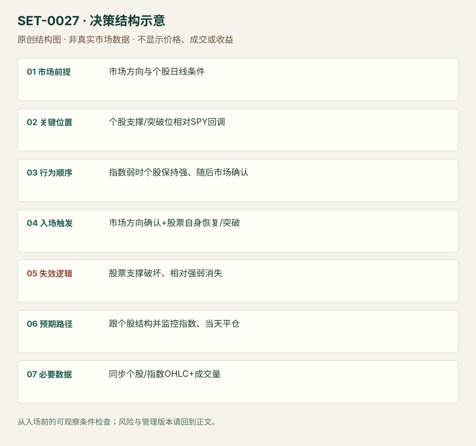

---
{
  "id": "SET-0027",
  "schema_version": "1.0.0",
  "name_zh": "市场确认后的个股相对强弱交易",
  "name_en": "Market-confirmed Relative Strength / Weakness",
  "aliases": [],
  "name_nature": "editor_descriptive_with_source_term",
  "status": "reviewed",
  "summary": "先用市场回调检验股票是否抗跌/逆市上涨，再等市场和个股方向同时支持入场。相对强弱是个股相对指数的表现，不是 RSI；市场判断在决策结构中有独立作用。",
  "mechanism": "cross_market_relative_strength",
  "tags": [
    "relative_strength",
    "stock_selection",
    "market_confirmation"
  ],
  "pa_role": "supporting",
  "markets_observed": [
    "美国个股与SPY",
    "CAT期权（来源执行示例）"
  ],
  "markets_supported": [],
  "migration_hypotheses": [],
  "session": "美股/ES现金参考段 09:30–16:00 America/New_York；收盘前平仓。期货夜盘单独建背景，不将其并入开盘区间。",
  "session_tags": [
    "intraday"
  ],
  "context_timeframe": "日线/前一session + 当日执行图；因来源而异",
  "trigger_timeframe": "1分钟/5分钟与同步市场确认",
  "data_requirements": [
    "stock_OHLC",
    "index_OHLC",
    "volume"
  ],
  "execution_mode": "mixed",
  "source_ids": [
    "SRC-0026",
    "SRC-0049",
    "SRC-0083"
  ],
  "evidence_ids": [
    "EVD-000050",
    "EVD-000051",
    "EVD-000052"
  ],
  "visual_ids": [
    "VIS-000030",
    "VIS-000084"
  ],
  "rule_completeness": "前提/触发/失效/管理已记录；来源与编辑模块分开",
  "independent_corroboration": "multiple_families",
  "profit_evidence": "not_established",
  "created": "2026-10-02",
  "updated": "2026-10-02",
  "reviewed_at": "2026-10-02",
  "known_gaps": [
    "未开展独立回测；实际订单成交与成本未知"
  ],
  "logic_fingerprint": [
    "市场方向与个股日线条件",
    "个股支撑/突破位相对SPY回调",
    "指数弱时个股保持强、随后市场确认",
    "市场方向确认+股票自身恢复/突破",
    "股票支撑破坏、相对强弱消失",
    "跟个股结构并监控指数、当天平仓",
    "同步个股/指数OHLC+成交量"
  ],
  "environment_tags": [
    "market_alignment"
  ],
  "structure_locations": [
    "stock_support",
    "market_context"
  ],
  "version": "1.0.0",
  "unknown_fields": {},
  "review_scope": "规则记录、引用范围、日内边界、逻辑区别与已看静态画面；不含独立回测、动态逐笔或账户核验",
  "source_coverage": {
    "substantive_read_sources": 3,
    "families": [
      "oneoption",
      "smb"
    ],
    "core_support_source_ids": [
      "SRC-0026",
      "SRC-0049",
      "SRC-0083"
    ],
    "independence_note": "multiple_families"
  },
  "method_families": [
    "relative_strength_lead_lag"
  ],
  "market_types": [
    "stocks",
    "ETF",
    "options"
  ]
}
---

# 市场确认后的个股相对强弱交易 · Market-confirmed Relative Strength / Weakness

## 1. 名称与快速概览

先用市场回调检验股票是否抗跌/逆市上涨，再等市场和个股方向同时支持入场。相对强弱是个股相对指数的表现，不是 RSI；市场判断在决策结构中有独立作用。

记录口径：PA supporting；必要数据 stock_OHLC、index_OHLC、volume。名称性质：编辑性描述名，英文保留来源术语以便检索。reviewed 只表示本条规则与证据记录审查通过，盈利状态为 not_established。

## 2. 本质与行为假说

假说是逆着指数压力仍能保持的股票有额外需求，指数转顺后更易释放。用同步价格响应确认，而不是仅比较两个无关百分比或把高beta当强势。

## 3. 适用市场与环境

选择流动性充足、有清楚日线位置和相对参与量的美股，市场有可辨认回调和恢复。市场极端单向、关系突然变换或股票受独立坏消息影响时不套用。

**来源实用市场：**美国个股与SPY、CAT期权（来源执行示例）。

**Session：**美股/ES现金参考段 09:30–16:00 America/New_York；收盘前平仓。期货夜盘单独建背景，不将其并入开盘区间。

跨市场：本版不主张已经验证的跨市场迁移；更换市场必须重定数据来源、流动性与session。

## 4. 出现前的观察清单

同一时间戳比较股票、SPY及必要的行业指数；画股票支撑、阻力、市场转向线，查日线是否仍冲突。OneOption的1OP/1OSI为专有指标版本，不在本包提供或伪造。

## 5. 形成过程与状态转换

市场回落 → 股票保持关键支撑/继续上行 → 市场恢复或停止施压 → 股票突破/顺势恢复确认 → 同时监控市场与个股结构。弱方向对称。

## 6. Entry trigger 与执行方式

SMB例用SPY越85和AAPL带量越126.25共同确认；本库可审查的价格版就是先有抗跌，再有同步方向与个股结构触发。OneOption原版使用1OP确认，本条将价格代理单独标为版本，不能声称效果等价。

## 7. Invalidation 与止损逻辑

个股所依赖的支撑破坏是价格风险边界；相对强弱消失且市场反向是软退出信息。初始止损不能只写“市场变弱”，应在股票上固定可成交价；来源跨日建议不采用为日内保护。

## 8. Exit、target 与 trade management

有序强势可按股票结构追踪，达到已知目标或相对表现下降减仓；当市场继续恶化即重新评估。日内部分全部在现金收盘前退出，来源CAT临近期权到期的gamma风险需单独建执行记录。

## 9. 常见 variations

强与弱对称计一条；股票本身与期权是执行载体版本，成本和损益不可混计；1OP专有版与公开价格版分开保存。

## 10. 失败方式与不交易条件

同步数据错误；指数反弹但个股仍弱；只看全天涨幅忽略入场前抗跌；把RS和RSI混为一谈；源例利润百分比受低价期权杠杆影响而错误外推。

## 11. 与相近 setups 的区别

- [SET-0030](SET-0030.md)：0030 两个相关期货同方向、领导市场先破IB带动滞后市场；本条先用相反响应检验股票强弱再等市场。
- [SET-0028](SET-0028.md)：0028 必须有前一日新消息和次日关键位接受；本条不必须第二天事件。

## 12. 图表与案例解读

已看OneOption第55页：灰色SPY回调，CAT继续抬高；右侧作者展示CAT当天到期call报价。日期来自合约Nov01’19及章节叙事，未验证账户成交；这里仅用作相对强弱识别。

- [VIS-000030] [来源PDF第55页图表](https://oneoption.com/wp-content/uploads/2022/07/ebook-old.pdf#page=55)；定位：PDF页序 55。CAT 1分钟黑线价格与SPY灰线对照，市场回调时股票继续高；报价截图时区与图轴不同，不能直接合并为同一时钟。 验证：chart_viewed_pdf_page。

**本地原创示意（VIS-000084，非真实市场数据）：**

小屏阅读可[打开原尺寸示意图](../assets/diagrams/SET-0027.svg)并缩放。

此图用于对照识别顺序与风险定义；不计入真实案例覆盖率。

## 13. 证据、分歧与未知项

OneOption与SMB实践解释来自两个家族，支持共同决策结构；没有本条参数化策略的独立成本后回测。CAT资料是作者展示的价格/报价，未核对账户流水。

- [EVD-000050] Peter Stolcers，《Our Trading Methodology》，[SRC-0026](https://oneoption.com/intro-series/our-trading-methodology/)；定位：Market first / Relative strength / entry confirmation。支持：先判断市场，再选市场回落时保持强势的股票；市场方向确认后入场并观察相对强弱与技术支撑。
- [EVD-000051] Jeff Tomasulo，《Second Day Play》，[SRC-0049](https://www.smbtraining.com/blog/second-day-play)；定位：AAPL 124 / SPY 84–85 case。支持：AAPL在SPY下降时守124；SPY恢复85且AAPL越126.25伴随量时买入，给出个股与市场共同确认。
- [EVD-000052] Pete Stolcers，《Powerful Trading Strategies (OneOption public ebook)》，[SRC-0083](https://oneoption.com/wp-content/uploads/2022/07/ebook-old.pdf)；定位：PDF页序26及52–55。支持：区分RS与RSI；CAT在SPY回调时继续上涨，1分钟对照及交易截图展示日内执行。

## 14. 可用于复盘的检查表

- [ ] 下单前的前提可核对：市场方向与个股日线条件
- [ ] 事前标记位置：个股支撑/突破位相对SPY回调
- [ ] 行为按顺序出现：指数弱时个股保持强、随后市场确认
- [ ] 实际触发符合选定版本：市场方向确认+股票自身恢复/突破
- [ ] 事先写明本次否定条件：股票支撑破坏、相对强弱消失
- [ ] 目标/路径只用当时已知信息：跟个股结构并监控指数、当天平仓
- [ ] 数据满足 同步个股/指数OHLC+成交量；记录时间、点差、滑点、队列和未成交
- [ ] 记录截止平仓及规则偏离；正常亏损不事后改成“未成立”

## 15. 后续验证问题

怎样剔除beta影响而保留真正的相对表现？行业与SPY给冲突时如何处理？等待市场确认与直接买强股的差别？
