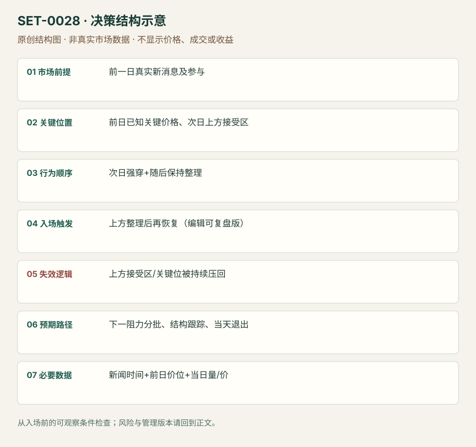

---
{
  "id": "SET-0028",
  "schema_version": "1.0.0",
  "name_zh": "新消息后的第二日关键位接受",
  "name_en": "Second-day News Acceptance Play",
  "aliases": [],
  "name_nature": "editor_descriptive_with_source_term",
  "status": "reviewed",
  "summary": "前一日重要新信息带来参与和清晰价位；次日仍显示主动性，跨过关键位并在上方形成接受区，交易后续延续。不是任何第一天上涨后第二天小旗都符合。",
  "mechanism": "delayed_event_repricing",
  "tags": [
    "news",
    "second_day",
    "momentum",
    "acceptance"
  ],
  "pa_role": "supporting",
  "markets_observed": [
    "美国个股"
  ],
  "markets_supported": [],
  "migration_hypotheses": [],
  "session": "美股/ES现金参考段 09:30–16:00 America/New_York；收盘前平仓。期货夜盘单独建背景，不将其并入开盘区间。",
  "session_tags": [
    "opening",
    "second_day"
  ],
  "context_timeframe": "日线/前一session + 当日执行图；因来源而异",
  "trigger_timeframe": "开盘10–15分钟背景+后续整理",
  "data_requirements": [
    "OHLC",
    "volume",
    "news",
    "prior_day_levels"
  ],
  "execution_mode": "mixed",
  "source_ids": [
    "SRC-0050",
    "SRC-0049"
  ],
  "evidence_ids": [
    "EVD-000053",
    "EVD-000054",
    "EVD-000103"
  ],
  "visual_ids": [
    "VIS-000085"
  ],
  "rule_completeness": "前提/触发/失效/管理已记录；来源与编辑模块分开",
  "independent_corroboration": "limited_single_family",
  "profit_evidence": "not_established",
  "created": "2026-10-02",
  "updated": "2026-10-02",
  "reviewed_at": "2026-10-02",
  "known_gaps": [
    "未观看对应视频或图表",
    "第二日接受区触发为编辑操作化",
    "没有独立同规则回测"
  ],
  "logic_fingerprint": [
    "前一日真实新消息及参与",
    "前日已知关键价格、次日上方接受区",
    "次日强穿+随后保持整理",
    "上方整理后再恢复（编辑可复盘版）",
    "上方接受区/关键位被持续压回",
    "下一阻力分批、结构跟踪、当天退出",
    "新闻时间+前日价位+当日量/价"
  ],
  "environment_tags": [
    "news",
    "second_day"
  ],
  "structure_locations": [
    "prior_news_day_level"
  ],
  "version": "1.0.0",
  "unknown_fields": {},
  "review_scope": "规则记录、引用范围、日内边界、逻辑区别与已看静态画面；不含独立回测、动态逐笔或账户核验",
  "source_coverage": {
    "substantive_read_sources": 2,
    "families": [
      "smb"
    ],
    "core_support_source_ids": [
      "SRC-0050",
      "SRC-0049"
    ],
    "independence_note": "limited_single_family"
  },
  "method_families": [
    "event_driven"
  ],
  "market_types": [
    "stocks"
  ]
}
---

# 新消息后的第二日关键位接受 · Second-day News Acceptance Play

## 1. 名称与快速概览

前一日重要新信息带来参与和清晰价位；次日仍显示主动性，跨过关键位并在上方形成接受区，交易后续延续。不是任何第一天上涨后第二天小旗都符合。

记录口径：PA supporting；必要数据 OHLC、volume、news、prior_day_levels。名称性质：编辑性描述名，英文保留来源术语以便检索。reviewed 只表示本条规则与证据记录审查通过，盈利状态为 not_established。

## 2. 本质与行为假说

新信息未一次完成定价是行为假说，前日变化与当日接受都必须观察。先验催化影响对象、前日关键位和次日量/价确认共同决定机会，不凭“利好还会发酵”持仓。

## 3. 适用市场与环境

来源MRNA重大合同消息次日、AAPL与市场分歧后的次日机会。适合仍有明显相对参与且前日参考未被否认；信息已更正、次日直接跌破重要接受区则不成立。

**来源实用市场：**美国个股。

**Session：**美股/ES现金参考段 09:30–16:00 America/New_York；收盘前平仓。期货夜盘单独建背景，不将其并入开盘区间。

跨市场：本版不主张已经验证的跨市场迁移；更换市场必须重定数据来源、流动性与session。

## 4. 出现前的观察清单

保存原新闻来源与时间、前日高低/收盘/接受位；整理不同情境路线，比较同一开盘时刻相对成交。日线目标可能属于swing，日内目标另外选。

## 5. 形成过程与状态转换

第一日重大催化形成参考 → 第二日初段强穿关键位 → 上方保持且卖出不能压回 → 小区间后继续上推 → 跟随结构或在接受失败时退出。

## 6. Entry trigger 与执行方式

公开逐字稿以第一轮越位和保持为核心；编辑复盘版在上方整理后重新越过整理高进入，使失效区可见。第一轮直接追与整理后二次入场分版本，不把两次成交计两个setup。

## 7. Invalidation 与止损逻辑

整理下沿/关键位下方重新被接受是原方向失效，选哪一层在交易前固定。原文没有统一机械缓冲，因此编辑的价位止损不能继承作者口头收益。

## 8. Exit、target 与 trade management

下一已知阻力和驱动衰退处分批，保持区逐步抬高才跟踪；到日终平仓。SMB AAPL 的更远日线目标与跨日机会只是背景，本条不把它当日内必达目标。

## 9. 常见 variations

合同、财报、监管消息是事件类别，计同一信息延迟接受机制；不同日线关键位和时间长度是版本。无新消息的普通旗形归0015。

## 10. 失败方式与不交易条件

新闻读错或已更正；次日没有相对量；开盘强冲随后接受回关键位下方；目标过远转成swing；用后来的第二次强推才反向挑“重要”价位。

## 11. 与相近 setups 的区别

- [SET-0015](SET-0015.md)：0015 是普通趋势的低量回调；本条必须前日重大信息和次日的关键位接受，不能只加一个news标签。
- [SET-0029](SET-0029.md)：0029 捕捉刚发布后的第一分钟；本条在事件次日经过新的接受过程。

## 12. 图表与案例解读

视觉缺口：MRNA网页的公开逐字稿谈及图表，但未取得和查看对应画面，因此没有把口述的10–15分钟/20分钟结构列为已看案例。

**本地原创示意（VIS-000085，非真实市场数据）：**

小屏阅读可[打开原尺寸示意图](../assets/diagrams/SET-0028.svg)并缩放。

此图用于对照识别顺序与风险定义；不计入真实案例覆盖率。

## 13. 证据、分歧与未知项

两条来源都属SMB家族。实际阅读了公开网页逐字稿，没有看视频/图表或核对时间码；核心佐证与视觉案例仍有限。

- [EVD-000053] Steve Spencer，《The Explosive Second Day Play》，[SRC-0050](https://www.smbtraining.com/blog/the-explosive-second-day-play)；定位：公开逐字稿：MRNA second day / first10–15min / consolidation。支持：前一日重大催化与3个关键位，第二日头10–15分钟强突破，随后约20分钟保持再延续；分开重要消息与实际价格确认。
- [EVD-000054] Jeff Tomasulo，《Second Day Play》，[SRC-0049](https://www.smbtraining.com/blog/second-day-play)；定位：Second Day Play: AAPL / SPY levels。支持：第二日仍需股票/市场关键位和成交共同确认；125–126等价格仅属于原案例。

审查边界：来源份数与独立核心核验分开；当前类别为 limited_single_family。正文中的概念、官方事实、衍生解说或同族资料只按其支持范围使用。

- [EVD-000103] **编辑操作化，未测试：**第二日消息关键位上方接受后，采用整理端点再恢复作为可复盘触发，版本未测试。 原文边界：公开转写描述MRNA第二日驱动后整理再推，不给跨股票统一参数。

## 14. 可用于复盘的检查表

- [ ] 下单前的前提可核对：前一日真实新消息及参与
- [ ] 事前标记位置：前日已知关键价格、次日上方接受区
- [ ] 行为按顺序出现：次日强穿+随后保持整理
- [ ] 实际触发符合选定版本：上方整理后再恢复（编辑可复盘版）
- [ ] 事先写明本次否定条件：上方接受区/关键位被持续压回
- [ ] 目标/路径只用当时已知信息：下一阻力分批、结构跟踪、当天退出
- [ ] 数据满足 新闻时间+前日价位+当日量/价；记录时间、点差、滑点、队列和未成交
- [ ] 记录截止平仓及规则偏离；正常亏损不事后改成“未成立”

## 15. 后续验证问题

第2日延续相对普通高RVOL旗形有额外信息吗？重要价位能否第一天结束时固定？消息更正日应怎样剔除？
