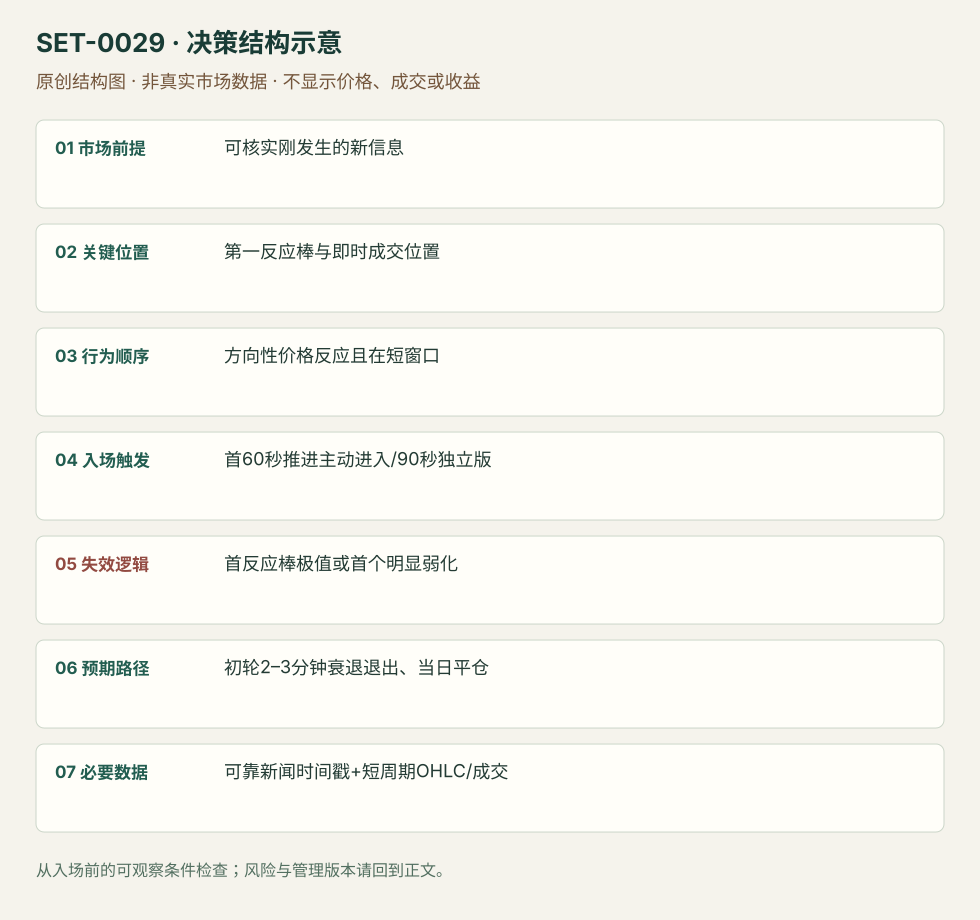

---
{
  "id": "SET-0029",
  "schema_version": "1.0.0",
  "name_zh": "突发新闻的第一轮价格反应",
  "name_en": "Breaking News First Move",
  "aliases": [],
  "name_nature": "editor_descriptive_with_source_term",
  "status": "reviewed",
  "summary": "真正的新消息刚到达、股票立即显示方向反应时，捕捉第一轮极短动量。新闻发布时间、收到时间和股价反应时间必须记录；已经延伸数分钟的追价不属主版。",
  "mechanism": "immediate_information_shock",
  "tags": [
    "news",
    "momentum",
    "scalping"
  ],
  "pa_role": "supporting",
  "markets_observed": [
    "美国个股"
  ],
  "markets_supported": [],
  "migration_hypotheses": [],
  "session": "美股/ES现金参考段 09:30–16:00 America/New_York；收盘前平仓。期货夜盘单独建背景，不将其并入开盘区间。",
  "session_tags": [
    "news_release"
  ],
  "context_timeframe": "日线/前一session + 当日执行图；因来源而异",
  "trigger_timeframe": "1分钟内/最长90秒版本",
  "data_requirements": [
    "OHLC",
    "news_timestamp",
    "volume"
  ],
  "execution_mode": "mixed",
  "source_ids": [
    "SRC-0013",
    "SRC-0042"
  ],
  "evidence_ids": [
    "EVD-000055",
    "EVD-000056"
  ],
  "visual_ids": [
    "VIS-000031",
    "VIS-000086"
  ],
  "rule_completeness": "前提/触发/失效/管理已记录；来源与编辑模块分开",
  "independent_corroboration": "independent_context_only",
  "profit_evidence": "not_established",
  "created": "2026-10-02",
  "updated": "2026-10-02",
  "reviewed_at": "2026-10-02",
  "known_gaps": [
    "未开展独立回测；实际订单成交与成本未知"
  ],
  "logic_fingerprint": [
    "可核实刚发生的新信息",
    "第一反应棒与即时成交位置",
    "方向性价格反应且在短窗口",
    "首60秒推进主动进入/90秒独立版",
    "首反应棒极值或首个明显弱化",
    "初轮2–3分钟衰退退出、当日平仓",
    "可靠新闻时间戳+短周期OHLC/成交"
  ],
  "environment_tags": [
    "news",
    "information_shock"
  ],
  "structure_locations": [
    "first_reaction_bar"
  ],
  "version": "1.0.0",
  "unknown_fields": {},
  "review_scope": "规则记录、引用范围、日内边界、逻辑区别与已看静态画面；不含独立回测、动态逐笔或账户核验",
  "source_coverage": {
    "substantive_read_sources": 2,
    "families": [
      "sai-trades",
      "smb"
    ],
    "core_support_source_ids": [
      "SRC-0013"
    ],
    "independence_note": "independent_context_only"
  },
  "method_families": [
    "event_driven"
  ],
  "market_types": [
    "stocks"
  ]
}
---

# 突发新闻的第一轮价格反应 · Breaking News First Move

## 1. 名称与快速概览

真正的新消息刚到达、股票立即显示方向反应时，捕捉第一轮极短动量。新闻发布时间、收到时间和股价反应时间必须记录；已经延伸数分钟的追价不属主版。

记录口径：PA supporting；必要数据 OHLC、news_timestamp、volume。名称性质：编辑性描述名，英文保留来源术语以便检索。reviewed 只表示本条规则与证据记录审查通过，盈利状态为 not_established。

## 2. 本质与行为假说

价格对信息迅速重估可造成短时单向活动。不能因新闻标题看似利好便下单，必须看到反应；不接受原文“及时进就永远不会止损”的不可验证保证。

## 3. 适用市场与环境

来源偏盘中突发新闻。公告刚到、交易连续、价差与流动性允许快速执行；已停牌、谣言未核实、延时转载或价格已抢先反应时先处理可执行性。

**来源实用市场：**美国个股。

**Session：**美股/ES现金参考段 09:30–16:00 America/New_York；收盘前平仓。期货夜盘单独建背景，不将其并入开盘区间。

跨市场：本版不主张已经验证的跨市场迁移；更换市场必须重定数据来源、流动性与session。

## 4. 出现前的观察清单

锁定新闻原始时间与本地到达时间；分清股票消息和市场消息。预设第一反应棒、可接受追价、止损和滑点预算。源文也讨论期权溢价下降，股票与期权执行不得混统计。

## 5. 形成过程与状态转换

新信息到达 → 股价首轮反应 → 极短窗口入场 → 2–3分钟初推 → 首次衰弱减仓/退出。无反应为未成立；初推失败为正常规则失败。

## 6. Entry trigger 与执行方式

正文建议只在首分钟，清单允许最长1分30秒；本库保留严格≤60秒主版与≤90秒备选，不能混算。具体执行为源方向持续推进时主动成交；没有假设自己能抢到公告前价格。

## 7. Invalidation 与止损逻辑

首个反应棒低点为长方向硬边界（空向对称）；原文偏首个弱化即撤，往往比硬边界早。首棒太宽使风险无法承担就跳过，不能缩至随机价假装风险小。

## 8. Exit、target 与 trade management

预计初轮2–3分钟冲高，出现挣扎便逐步退出。该时长是来源经验描述，不是盈利承诺；新闻修订与反向强反应须立即重新判断。日内结束必须平。

## 9. 常见 variations

只改变消息类别不计新条；新闻后形成低量回调才进入归0015的事件版本。即时首推和0028第二日接受的等待阶段不同。

## 10. 失败方式与不交易条件

标题旧闻；到达延迟；没有实际方向反应；首棒太宽或跳价太多；期权点差吃掉空间；将最初一次正向打印当持续动量。

## 11. 与相近 setups 的区别

- [SET-0031](SET-0031.md)：0031 有事前共识分支与多市场确认；本条处理突然到达的个股信息第一轮。
- [SET-0015](SET-0015.md)：新闻第一轮后的普通小回调是0015事件版本，不能重复计数。

## 12. 图表与案例解读

已看第31页两张冲高图；能辨认突然量增和冲后衰弱。新闻标题、发布时间与实际订单未同屏，因此仅支持价格案例而不是反应延迟测量。

- [VIS-000031] [来源PDF第31页图表](https://saitrades.com/wp-content/uploads/2021/03/Trading-the-Open-Playbook.pdf#page=31)；定位：PDF页序 31。来源展示BIDU突发冲高与成交柱；绿色/橙色箭头是作者的进出提示，不含新闻终端原始时间。 验证：chart_viewed_pdf_page。

**本地原创示意（VIS-000086，非真实市场数据）：**

小屏阅读可[打开原尺寸示意图](../assets/diagrams/SET-0029.svg)并缩放。

此图用于对照识别顺序与风险定义；不计入真实案例覆盖率。

## 13. 证据、分歧与未知项

完整超短规则来自SAI单份playbook；SMB只佐证新信息/参与前提。90秒与首分钟的内部版本冲突已保留；未独立验证作者的“永不止损”断言。

- [EVD-000055] SAI Trades，《My Experience: Trading the Open Playbook》，[SRC-0013](https://saitrades.com/wp-content/uploads/2021/03/Trading-the-Open-Playbook.pdf)；定位：PDF页序31 Breaking News - First Move。支持：须有刚发布消息及股价反应，第一分钟进入、清单上限90秒，首个反应棒低点为硬保护，2–3分钟冲高见弱减仓。
- [EVD-000056] SMB Capital，《The Big Dawg Consolidation Cheat Sheet》，[SRC-0042](https://smbpowerpoints.s3.amazonaws.com/The_Big_Dog_Consolidation_Cheat_Sheet.pdf)；定位：Big Dawg Consolidation: fresh news / heavy relative volume。支持：独立SMB资料强调新消息与相对成交参与，但其后续旗形入场不是本条的第一分钟规则。

审查边界：来源份数与独立核心核验分开；当前类别为 independent_context_only。正文中的概念、官方事实、衍生解说或同族资料只按其支持范围使用。

## 14. 可用于复盘的检查表

- [ ] 下单前的前提可核对：可核实刚发生的新信息
- [ ] 事前标记位置：第一反应棒与即时成交位置
- [ ] 行为按顺序出现：方向性价格反应且在短窗口
- [ ] 实际触发符合选定版本：首60秒推进主动进入/90秒独立版
- [ ] 事先写明本次否定条件：首反应棒极值或首个明显弱化
- [ ] 目标/路径只用当时已知信息：初轮2–3分钟衰退退出、当日平仓
- [ ] 数据满足 可靠新闻时间戳+短周期OHLC/成交；记录时间、点差、滑点、队列和未成交
- [ ] 记录截止平仓及规则偏离；正常亏损不事后改成“未成立”

## 15. 后续验证问题

收到延迟如何分组？从第一反应起计时与新闻源时计时差别？股票和期权相同触发的成本后差异？
