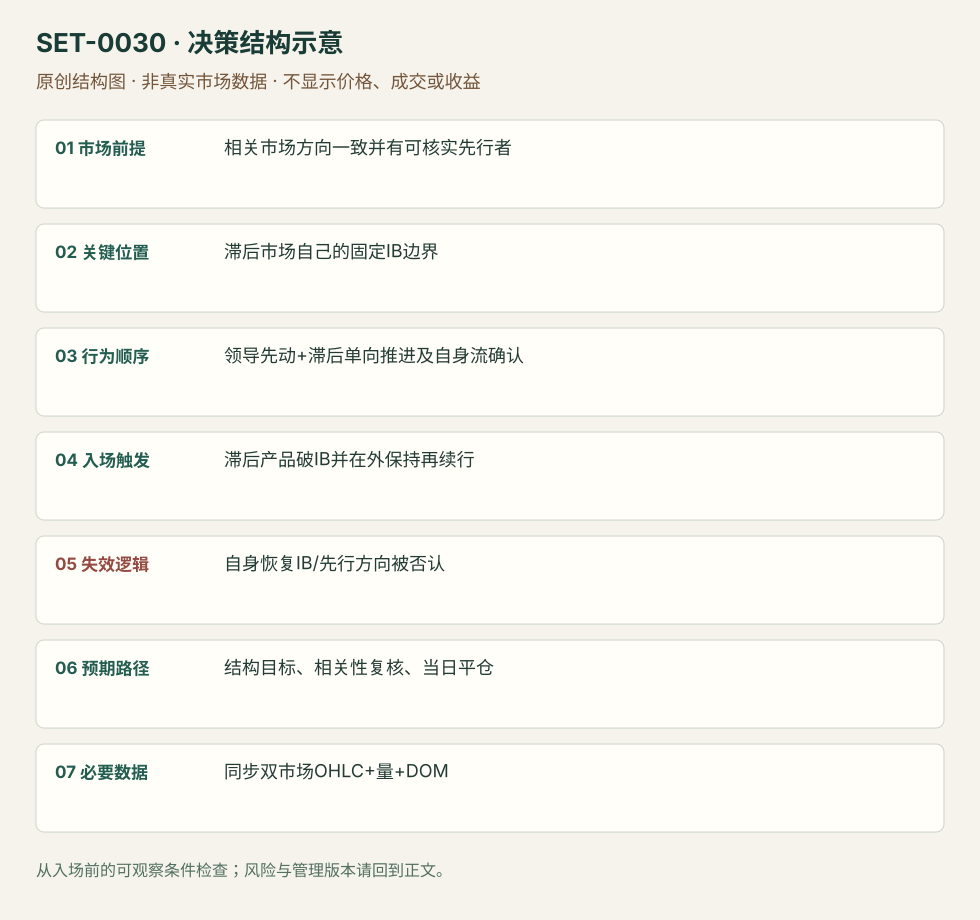

---
{
  "id": "SET-0030",
  "schema_version": "1.0.0",
  "name_zh": "领导市场先行的滞后市场 IB 突破",
  "name_en": "Correlated-market-led Initial Balance Break",
  "aliases": [],
  "name_nature": "source_term",
  "status": "reviewed",
  "summary": "一个相关期货先显示方向，另一个向自身 Initial Balance 边界单向推进；滞后市场也得到自身成交与报价确认后交易突破。相关市场领先是本条的必需条件，单市场强量突破归其他条。",
  "mechanism": "lead_lag_breakout",
  "tags": [
    "correlation",
    "opening",
    "order_flow",
    "breakout"
  ],
  "pa_role": "supporting",
  "markets_observed": [
    "Eurostoxx期货与DAX期货"
  ],
  "markets_supported": [],
  "migration_hypotheses": [],
  "session": "来源欧洲现金开盘与自设IB；图轴时区未明。本库使用Europe/Berlin现金参考段另行锁定IB窗口，图例窗口不能默认为纽约首小时；该日收盘前平仓。",
  "session_tags": [
    "european_open",
    "opening"
  ],
  "context_timeframe": "日线/前一session + 当日执行图；因来源而异",
  "trigger_timeframe": null,
  "data_requirements": [
    "synchronized_market_OHLC",
    "volume",
    "DOM",
    "initial_balance"
  ],
  "execution_mode": "mixed",
  "source_ids": [
    "SRC-0073",
    "SRC-0072"
  ],
  "evidence_ids": [
    "EVD-000057",
    "EVD-000058"
  ],
  "visual_ids": [
    "VIS-000032",
    "VIS-000087"
  ],
  "rule_completeness": "前提/触发/失效/管理已记录；来源与编辑模块分开",
  "independent_corroboration": "limited_single_family",
  "profit_evidence": "not_established",
  "created": "2026-10-02",
  "updated": "2026-10-02",
  "reviewed_at": "2026-10-02",
  "known_gaps": [
    "未开展独立回测；实际订单成交与成本未知",
    "执行周期没有统一来源参数，使用前须锁定版本"
  ],
  "logic_fingerprint": [
    "相关市场方向一致并有可核实先行者",
    "滞后市场自己的固定IB边界",
    "领导先动+滞后单向推进及自身流确认",
    "滞后产品破IB并在外保持再续行",
    "自身恢复IB/先行方向被否认",
    "结构目标、相关性复核、当日平仓",
    "同步双市场OHLC+量+DOM"
  ],
  "environment_tags": [
    "market_alignment",
    "opening",
    "directional"
  ],
  "structure_locations": [
    "initial_balance"
  ],
  "version": "1.0.0",
  "unknown_fields": {
    "trigger_timeframe": "来源未提供统一执行周期；正文记录已知图例，不能当成统一参数"
  },
  "review_scope": "规则记录、引用范围、日内边界、逻辑区别与已看静态画面；不含独立回测、动态逐笔或账户核验",
  "source_coverage": {
    "substantive_read_sources": 2,
    "families": [
      "axia"
    ],
    "core_support_source_ids": [
      "SRC-0073",
      "SRC-0072"
    ],
    "independence_note": "limited_single_family"
  },
  "method_families": [
    "relative_strength_lead_lag",
    "auction_profile"
  ],
  "market_types": [
    "futures"
  ]
}
---

# 领导市场先行的滞后市场 IB 突破 · Correlated-market-led Initial Balance Break

## 1. 名称与快速概览

一个相关期货先显示方向，另一个向自身 Initial Balance 边界单向推进；滞后市场也得到自身成交与报价确认后交易突破。相关市场领先是本条的必需条件，单市场强量突破归其他条。

记录口径：PA supporting；必要数据 synchronized_market_OHLC、volume、DOM、initial_balance。名称性质：来源术语或研究术语。reviewed 只表示本条规则与证据记录审查通过，盈利状态为 not_established。

## 2. 本质与行为假说

共同信息对相关市场的反应可能不同步，领导市场提供滞后市场突破的前置证据。源文重点是DAX先行和Eurostoxx自身报价下移；本库限定该组合，而不声称任意相关资产都能预测彼此。

## 3. 适用市场与环境

来源欧洲现金开盘附近 Eurostoxx/DAX，下跌方向示例。两者时钟可靠、关系仍存在，并且滞后产品自身IB已固定；独立成分股新闻和不同休市会削弱关系。

**来源实用市场：**Eurostoxx期货与DAX期货。

**Session：**来源欧洲现金开盘与自设IB；图轴时区未明。本库使用Europe/Berlin现金参考段另行锁定IB窗口，图例窗口不能默认为纽约首小时；该日收盘前平仓。

跨市场：本版不主张已经验证的跨市场迁移；更换市场必须重定数据来源、流动性与session。

## 4. 出现前的观察清单

同时记录两市场IB、现金开盘时刻、同期相对量；以当时截图保存谁先跨参考。DOM中被动卖单下移必须有实际成交/价格响应，单纯报价数量不够。

## 5. 形成过程与状态转换

领导市场先行动 → 滞后市场单向逼近IBL → 其量/速度增加且反弹弱 → 自身破IBL → 小两向交易仍不能返回中段 → 再续跌。

## 6. Entry trigger 与执行方式

来源在滞后市场突破并保持时执行；编辑审查版要领导市场仍保持弱、滞后市场在IB外停顿后继续向下。与只把DAX放屏幕上的普通突破不同，两市场条件须同时满足。

## 7. Invalidation 与止损逻辑

滞后市场回IB内部并恢复到事前选定反弹高点撤销保持；领导市场方向被否认是额外软失效。精确缓冲与时长源文未给，属于需测试的编辑风险模块。

## 8. Exit、target 与 trade management

下一已知结构为参考，报价单向性消失、回抽深度加大时减仓；领导/滞后关系消失重新评估。数据发布前是否清仓应事先定，本库日内版在现金参考段结束前平仓。

## 9. 常见 variations

上方向和不同欧洲相关产品是迁移假说；没有独立素材不能直接声明支持。快量与被动报价下移是同一机会的确认层，不分成两条。

## 10. 失败方式与不交易条件

因时钟错位造成假领先；领导市场已反转而滞后仍追；IB口径不同；大量报价撤销未成交；自身突破后已恢复中段。

## 11. 与相近 setups 的区别

- [SET-0027](SET-0027.md)：0027 利用个股在指数回调时逆向抗跌；本条两个相关期货同向而先后突破。
- [SET-0039](SET-0039.md)：0039 只需同一产品相对成交能量改变；本条双市场先行不可删。

## 12. 图表与案例解读

已看双市场价格/量图，作者给出领先叙事和两个黄框。没有动态回放，DOM下移的文字描述已读但未直接观察。

- [VIS-000032] [Chart of STOXX and DAX market before and after the Initial Balance break](https://axiafutures.com/blog/wp-content/uploads/2020/10/16-context-1024x605.png)；定位：Chart of STOXX and DAX before and after IB break。左右黄框固定IB，现金开盘后两者下行；静态图不够测量精确领先时长。 验证：chart_viewed。

**本地原创示意（VIS-000087，非真实市场数据）：**

小屏阅读可[打开原尺寸示意图](../assets/diagrams/SET-0030.svg)并缩放。

此图用于对照识别顺序与风险定义；不计入真实案例覆盖率。

## 13. 证据、分歧与未知项

同一Axia家族两项讨论，独立佐证有限。文字提到视频回放，未观看，故不能把静态图当实际测到毫秒级领先或DOM动态。

- [EVD-000057] Axia Futures，《Initial Balance Break Led By Other Correlated Market》，[SRC-0073](https://axiafutures.com/blog/initial-balance-break-led-by-other-correlated-market/)；定位：Clues Leading... / Large Orders Chasing...。支持：DAX先行、Eurostoxx向IB低单向逼近，现金开盘量/速度增加、报价下移，突破后反弹不能恢复IB中段。
- [EVD-000058] Axia Futures，《Trading Initial Balance Break Using Market Profile》，[SRC-0072](https://axiafutures.com/blog/trading-initial-balance-break-using-market-profile/)；定位：IB break summary / failure to reach target before NFP。支持：同家族IB案例表明先验结构不保证到达目标，未续行及临近数据发布需要管理。

审查边界：来源份数与独立核心核验分开；当前类别为 limited_single_family。正文中的概念、官方事实、衍生解说或同族资料只按其支持范围使用。

## 14. 可用于复盘的检查表

- [ ] 下单前的前提可核对：相关市场方向一致并有可核实先行者
- [ ] 事前标记位置：滞后市场自己的固定IB边界
- [ ] 行为按顺序出现：领导先动+滞后单向推进及自身流确认
- [ ] 实际触发符合选定版本：滞后产品破IB并在外保持再续行
- [ ] 事先写明本次否定条件：自身恢复IB/先行方向被否认
- [ ] 目标/路径只用当时已知信息：结构目标、相关性复核、当日平仓
- [ ] 数据满足 同步双市场OHLC+量+DOM；记录时间、点差、滑点、队列和未成交
- [ ] 记录截止平仓及规则偏离；正常亏损不事后改成“未成立”

## 15. 后续验证问题

领先需多长才大于数据延迟？把DAX条件移除的消融结果？报价跟随与主动成交哪个提供额外信息？
