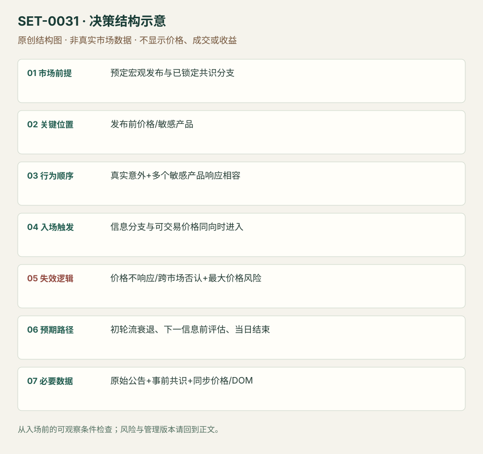

---
{
  "id": "SET-0031",
  "schema_version": "1.0.0",
  "name_zh": "事前预案中的宏观意外与跨市场确认",
  "name_en": "Preplanned Macro Surprise Reaction",
  "aliases": [],
  "name_nature": "editor_descriptive_with_source_term",
  "status": "reviewed",
  "summary": "在预定发布前写出共识和不同意外分支；信息到达后，选择对该信息敏感的产品，并用实际跨市场响应确认方向。没有事前预案的即时新闻追价不属本条。",
  "mechanism": "macro_surprise_repricing",
  "tags": [
    "news",
    "macro",
    "correlation"
  ],
  "pa_role": "supporting",
  "markets_observed": [
    "美国债券/黄金/ES期货（FOMC）",
    "欧洲债券/Eurostoxx/EUR（ECB）"
  ],
  "markets_supported": [],
  "migration_hypotheses": [],
  "session": "按原事件日发布时刻执行；FOMC示例14:00 America/New_York，ECB示例以当日发布为起点，原图时区未核。与各产品现金session分开记录，日内结束前平仓。",
  "session_tags": [
    "news_release",
    "macro"
  ],
  "context_timeframe": "日线/前一session + 当日执行图；因来源而异",
  "trigger_timeframe": null,
  "data_requirements": [
    "official_release",
    "consensus_notes",
    "synchronized_prices",
    "DOM"
  ],
  "execution_mode": "mixed",
  "source_ids": [
    "SRC-0044",
    "SRC-0045",
    "SRC-0086"
  ],
  "evidence_ids": [
    "EVD-000059",
    "EVD-000060",
    "EVD-000061"
  ],
  "visual_ids": [
    "VIS-000033",
    "VIS-000088"
  ],
  "rule_completeness": "前提/触发/失效/管理已记录；来源与编辑模块分开",
  "independent_corroboration": "independent_event_facts_only",
  "profit_evidence": "not_established",
  "created": "2026-10-02",
  "updated": "2026-10-02",
  "reviewed_at": "2026-10-02",
  "known_gaps": [
    "未开展独立回测；实际订单成交与成本未知",
    "执行周期没有统一来源参数，使用前须锁定版本"
  ],
  "logic_fingerprint": [
    "预定宏观发布与已锁定共识分支",
    "发布前价格/敏感产品",
    "真实意外+多个敏感产品响应相容",
    "信息分支与可交易价格同向时进入",
    "价格不响应/跨市场否认+最大价格风险",
    "初轮流衰退、下一信息前评估、当日结束",
    "原始公告+事前共识+同步价格/DOM"
  ],
  "environment_tags": [
    "scheduled_event",
    "information_shock"
  ],
  "structure_locations": [
    "event_response"
  ],
  "version": "1.0.0",
  "unknown_fields": {
    "trigger_timeframe": "来源未提供统一执行周期；正文记录已知图例，不能当成统一参数"
  },
  "review_scope": "规则记录、引用范围、日内边界、逻辑区别与已看静态画面；不含独立回测、动态逐笔或账户核验",
  "source_coverage": {
    "substantive_read_sources": 3,
    "families": [
      "axia",
      "ecb"
    ],
    "core_support_source_ids": [
      "SRC-0044",
      "SRC-0045"
    ],
    "independence_note": "independent_event_facts_only"
  },
  "method_families": [
    "event_driven"
  ],
  "market_types": [
    "futures",
    "FX_venue_unconfirmed"
  ]
}
---

# 事前预案中的宏观意外与跨市场确认 · Preplanned Macro Surprise Reaction

## 1. 名称与快速概览

在预定发布前写出共识和不同意外分支；信息到达后，选择对该信息敏感的产品，并用实际跨市场响应确认方向。没有事前预案的即时新闻追价不属本条。

记录口径：PA supporting；必要数据 official_release、consensus_notes、synchronized_prices、DOM。名称性质：编辑性描述名，英文保留来源术语以便检索。reviewed 只表示本条规则与证据记录审查通过，盈利状态为 not_established。

## 2. 本质与行为假说

价格重估相对已包含的预期，单看数值大或鹰鸽措辞不够。跨市场确认用来区分文本解释与正在发生的定价；价格不配合便撤掉初始计划。

## 3. 适用市场与环境

来源FOMC/ECB有明确时刻的宏观公布。需要可靠原始公告和正常可交易市场；跳跃、深度消失或产品暂时停牌时不假设连续成交。

**来源实用市场：**美国债券/黄金/ES期货（FOMC）、欧洲债券/Eurostoxx/EUR（ECB）。

**Session：**按原事件日发布时刻执行；FOMC示例14:00 America/New_York，ECB示例以当日发布为起点，原图时区未核。与各产品现金session分开记录，日内结束前平仓。

跨市场：本版不主张已经验证的跨市场迁移；更换市场必须重定数据来源、流动性与session。

## 4. 出现前的观察清单

提前固定共识来源、关键数值/政策维度、不同方向应响应的产品、无惊喜路线与错误路线。存发布前价位与时钟；避免发布后用新报道重写共识。

## 5. 形成过程与状态转换

事前共识分支 → 实际信息与共识出现差异 → 多产品价格/流显示相容响应 → 进入最敏感且可执行产品 → 响应消失便退出。

## 6. Entry trigger 与执行方式

来源可在信息明确且产品立即响应时快速进入；本库要求信息分支与实际方向均成立。官方公告支持内容事实，不提供订单入口；无法读取发布时间或未观察报价，则不能声称抓到首个可成交价。

## 7. Invalidation 与止损逻辑

主失效是价格没有按计划响应或相关产品集体反向，及时切断；还需发布前确定每笔最大价格风险。事件跳价可能越过保护价，精确缓冲为编辑模块，不能伪称来源统一点数。

## 8. Exit、target 与 trade management

最初明确重估后随流衰退减仓，下一波信息前评估；消息解读否认即退出。单次文本交易不默认持到下一个记者会；全部为当日风险。

## 9. 常见 variations

央行与经济数据是事件维度，不能按机构重复计数；选择更敏感市场是执行分支。二次信息到达后改方向归0032。

## 10. 失败方式与不交易条件

没有提前固定共识；只看标题遗漏其他条件；强行认定所有产品同等敏感；认为预测文本正确就能容忍逆向价格；假设新闻期点差不变。

## 11. 与相近 setups 的区别

- [SET-0029](SET-0029.md)：0029 无须预定宏观共识与多产品响应；本条先验分支决定反应。
- [SET-0032](SET-0032.md)：0032 已有第一段价格反应，后续信息改变净含义才重新判断。

## 12. 图表与案例解读

已看ECB三市场图。最初强上行之后EUR/Stoxx转弱，不能把整天视为单向成功。公告规模由ECB原文核对，共识和作者订单仍仅来自复盘叙述。

- [VIS-000033] [ECB June 2020](https://axiafutures.com/blog/wp-content/uploads/2020/12/June-2020-ECB-1024x546.png)；定位：Strong reaction in BTP, Euro and Stoxx to increased PEPP。三市场对June2020信息的反应各异，后段也并非持续同向；支持选择敏感产品与动态管理。 验证：chart_viewed。

**本地原创示意（VIS-000088，非真实市场数据）：**

小屏阅读可[打开原尺寸示意图](../assets/diagrams/SET-0031.svg)并缩放。

此图用于对照识别顺序与风险定义；不计入真实案例覆盖率。

## 13. 证据、分歧与未知项

Axia两个事件讨论来自同家族。ECB原公告独立核对实际内容，却不是独立setup/收益验证；“独立事件事实”与“独立交易佐证”分开标注。

- [EVD-000059] Axia Futures，《Trading the Fed Rate Decision》，[SRC-0044](https://axiafutures.com/blog/trading-the-fed-rate-decision/)；定位：Preparing For FOMC / statement first short failure / cross-market clues。支持：先写共识与意外分支；信息看似鹰派但价格不响应时切断初始方向，不能只按文本持仓。
- [EVD-000060] Axia Futures，《How To Trade The ECB Decision – December 2020》，[SRC-0045](https://axiafutures.com/blog/how-to-trade-the-ecb-decision-december-2020/)；定位：June2020: which markets react best。支持：PEPP规模相对事前预期变化，不同产品敏感性不同；BTP、Stoxx与EUR反应较Bund强。
- [EVD-000061] ECB，《Monetary policy decisions — 4 June 2020》，[SRC-0086](https://www.ecb.europa.eu/press/pr/date/2020/html/ecb.mp200604~a307d3429c.en.html)；定位：公告第(1)及(2)项。支持：ECB实际决定PEPP增加6000亿欧元并延长；核对公告事实，不核验当时5000亿共识或交易。

审查边界：来源份数与独立核心核验分开；当前类别为 independent_event_facts_only。正文中的概念、官方事实、衍生解说或同族资料只按其支持范围使用。

## 14. 可用于复盘的检查表

- [ ] 下单前的前提可核对：预定宏观发布与已锁定共识分支
- [ ] 事前标记位置：发布前价格/敏感产品
- [ ] 行为按顺序出现：真实意外+多个敏感产品响应相容
- [ ] 实际触发符合选定版本：信息分支与可交易价格同向时进入
- [ ] 事先写明本次否定条件：价格不响应/跨市场否认+最大价格风险
- [ ] 目标/路径只用当时已知信息：初轮流衰退、下一信息前评估、当日结束
- [ ] 数据满足 原始公告+事前共识+同步价格/DOM；记录时间、点差、滑点、队列和未成交
- [ ] 记录截止平仓及规则偏离；正常亏损不事后改成“未成立”

## 15. 后续验证问题

共识的实时版本如何存档？选敏感产品的规则能否事前固定？不等待价格确认和等待几秒的成本收益？
