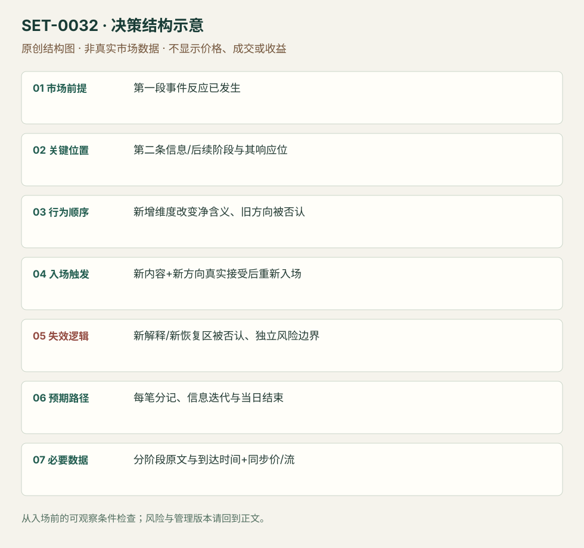

---
{
  "id": "SET-0032",
  "schema_version": "1.0.0",
  "name_zh": "多阶段公告的净信息重新判断",
  "name_en": "Multi-part Announcement Reassessment",
  "aliases": [],
  "name_nature": "editor_descriptive_with_source_term",
  "status": "reviewed",
  "summary": "第一条信息已引起价格反应，随后另一维度或记者会新增内容改变净含义；在观察到实际重新定价后重新建立方向。不是因亏损而临时把解释改到赢的一边。",
  "mechanism": "sequential_information_repricing",
  "tags": [
    "news",
    "macro",
    "reversal"
  ],
  "pa_role": "supporting",
  "markets_observed": [
    "Bund/BTP期货（ECB）",
    "债券/黄金/ES（FOMC）"
  ],
  "markets_supported": [],
  "migration_hypotheses": [],
  "session": "事件当日，各信息阶段分别留时间戳；2019ECB原公告标CET记者会14:30，网页标签并不能替代夏令时转换核对。该日参考session结束前平仓。",
  "session_tags": [
    "news_release",
    "macro"
  ],
  "context_timeframe": "日线/前一session + 当日执行图；因来源而异",
  "trigger_timeframe": null,
  "data_requirements": [
    "official_release",
    "news_sequence",
    "prices",
    "DOM"
  ],
  "execution_mode": "mixed",
  "source_ids": [
    "SRC-0045",
    "SRC-0044",
    "SRC-0085",
    "SRC-0084"
  ],
  "evidence_ids": [
    "EVD-000062",
    "EVD-000063",
    "EVD-000064",
    "EVD-000065"
  ],
  "visual_ids": [
    "VIS-000034",
    "VIS-000089"
  ],
  "rule_completeness": "前提/触发/失效/管理已记录；来源与编辑模块分开",
  "independent_corroboration": "independent_event_facts_only",
  "profit_evidence": "not_established",
  "created": "2026-10-02",
  "updated": "2026-10-02",
  "reviewed_at": "2026-10-02",
  "known_gaps": [
    "未开展独立回测；实际订单成交与成本未知",
    "执行周期没有统一来源参数，使用前须锁定版本"
  ],
  "logic_fingerprint": [
    "第一段事件反应已发生",
    "第二条信息/后续阶段与其响应位",
    "新增维度改变净含义、旧方向被否认",
    "新内容+新方向真实接受后重新入场",
    "新解释/新恢复区被否认、独立风险边界",
    "每笔分记、信息迭代与当日结束",
    "分阶段原文与到达时间+同步价/流"
  ],
  "environment_tags": [
    "scheduled_event",
    "regime_change"
  ],
  "structure_locations": [
    "new_information_stage"
  ],
  "version": "1.0.0",
  "unknown_fields": {
    "trigger_timeframe": "来源未提供统一执行周期；正文记录已知图例，不能当成统一参数"
  },
  "review_scope": "规则记录、引用范围、日内边界、逻辑区别与已看静态画面；不含独立回测、动态逐笔或账户核验",
  "source_coverage": {
    "substantive_read_sources": 4,
    "families": [
      "axia",
      "ecb",
      "federal-reserve"
    ],
    "core_support_source_ids": [
      "SRC-0045",
      "SRC-0044"
    ],
    "independence_note": "independent_event_facts_only"
  },
  "method_families": [
    "event_driven"
  ],
  "market_types": [
    "futures"
  ]
}
---

# 多阶段公告的净信息重新判断 · Multi-part Announcement Reassessment

## 1. 名称与快速概览

第一条信息已引起价格反应，随后另一维度或记者会新增内容改变净含义；在观察到实际重新定价后重新建立方向。不是因亏损而临时把解释改到赢的一边。

记录口径：PA supporting；必要数据 official_release、news_sequence、prices、DOM。名称性质：编辑性描述名，英文保留来源术语以便检索。reviewed 只表示本条规则与证据记录审查通过，盈利状态为 not_established。

## 2. 本质与行为假说

规模、期限和条件共同决定政策作用。先前交易的依据可被随后信息否认，只有存下各信息到达顺序，才能检验重新判断是否前瞻。

## 3. 适用市场与环境

源例ECB同一公告的规模/期限与FOMC声明/记者会两阶段。限定可辨认新信息，纯价格来回波动、无新增内容不套本条。

**来源实用市场：**Bund/BTP期货（ECB）、债券/黄金/ES（FOMC）。

**Session：**事件当日，各信息阶段分别留时间戳；2019ECB原公告标CET记者会14:30，网页标签并不能替代夏令时转换核对。该日参考session结束前平仓。

跨市场：本版不主张已经验证的跨市场迁移；更换市场必须重定数据来源、流动性与session。

## 4. 出现前的观察清单

准备不同政策维度及其权重、第二阶段时间；记录首阶段方向、是否持仓和退出。官方文字版本只证明内容，终端何时显示与人何时读到仍要记录。

## 5. 形成过程与状态转换

第一段反应/初始计划 → 新信息改变总效果 → 原价格方向失去支持 → 新方向价格与相关市场确认 → 重新进入或翻转 → 复核继续到达的信息。

## 6. Entry trigger 与执行方式

来源在净含义改变且真实方向恢复后进入。编辑版要求第二阶段信息已可核实，价格越过该阶段恢复点；不能事后把每次价格拐点对应到一条新闻。先关闭原单再开新单，分别计损益。

## 7. Invalidation 与止损逻辑

新信息解释被随后内容否认或市场未接受新方向即退出；每次新仓另有结构/价格风险边界。不能用“信息复杂”拖延第一单止损，交易翻转也不能掩盖先亏。

## 8. Exit、target 与 trade management

重估推进后流衰退/已知目标处减仓；进一步公告将再改变净含义时先退出或缩小。日内版不持仓到第二天等政策影响。

## 9. 常见 variations

同份公告继续阅读与定时记者会是信息阶段版本；ECB、Fed不另计setup。只改文本解释但无新内容属于无效事后叙事。

## 10. 失败方式与不交易条件

遗漏条款、依赖错误终端转述；新方向未被接受；第一单亏损后报复翻转；停牌使理论翻转价不可成交；没有可靠到达序列。

## 11. 与相近 setups 的区别

- [SET-0031](SET-0031.md)：0031 从已锁共识反应于首次真实意外；本条必须后续信息改变已有反应。
- [SET-0014](SET-0014.md)：0014 可仅由价格冲击后弱回调触发；本条必须可核对新增信息。

## 12. 图表与案例解读

已看ECB价格图：起始低点、随后大反转与Bund Volatility Stop标记均可见。图无法给出阅读条款的毫秒时刻，不能用最低价假设翻转成交。

- [VIS-000034] [ECB Sep 2019 BTP and Bund](https://axiafutures.com/blog/wp-content/uploads/2020/12/Bund-BTP-Sep-2019-white-box-1024x634.png)；定位：ECB September2019 BTP and Bund 1minute charts。先跌后急反转、Bund波动停顿被标出；提示不能假设连续成交。 验证：chart_viewed。

**本地原创示意（VIS-000089，非真实市场数据）：**

小屏阅读可[打开原尺寸示意图](../assets/diagrams/SET-0032.svg)并缩放。

此图用于对照识别顺序与风险定义；不计入真实案例覆盖率。

## 13. 证据、分歧与未知项

Axia给两个事件复盘，官方声明独立核对内容事实，未独立证明时间顺序、当时共识和收益。未观看记者会视频；FOMC终端图片只读到文字，不冒充音频或实时行情回放。

- [EVD-000062] Axia Futures，《How To Trade The ECB Decision – December 2020》，[SRC-0045](https://axiafutures.com/blog/how-to-trade-the-ecb-decision-december-2020/)；定位：September2019: APP size versus duration。支持：首读月度APP规模失望下跌，继续读无结束日期导致反转；多维度信息不可只凭第一个数字。
- [EVD-000063] Axia Futures，《Trading the Fed Rate Decision》，[SRC-0044](https://axiafutures.com/blog/trading-the-fed-rate-decision/)；定位：statement versus Powell conference: taper mid2022。支持：声明阶段初始空单价格不支持；记者会新信息改变解释，跨市场反应才支持后续方向。
- [EVD-000064] ECB，《Monetary policy decisions — 12 September 2019》，[SRC-0085](https://www.ecb.europa.eu/press/pr/date/2019/html/ecb.mp190912~08de50b4d2.en.html)；定位：公告第(2)项及记者会时间。支持：APP每月200亿、从11月起并按需要持续；核对规模与条件期限，非价格因果或成交审计。
- [EVD-000065] Federal Reserve Board，《Federal Reserve issues FOMC statement》，[SRC-0084](https://www.federalreserve.gov/newsevents/pressreleases/monetary20210922a.htm)；定位：For release 2pm EDT / pace moderation wording。支持：核对2021-09-22声明14:00EDT和购债放慢表述，不代表记者会措辞已看视频。

审查边界：来源份数与独立核心核验分开；当前类别为 independent_event_facts_only。正文中的概念、官方事实、衍生解说或同族资料只按其支持范围使用。

## 14. 可用于复盘的检查表

- [ ] 下单前的前提可核对：第一段事件反应已发生
- [ ] 事前标记位置：第二条信息/后续阶段与其响应位
- [ ] 行为按顺序出现：新增维度改变净含义、旧方向被否认
- [ ] 实际触发符合选定版本：新内容+新方向真实接受后重新入场
- [ ] 事先写明本次否定条件：新解释/新恢复区被否认、独立风险边界
- [ ] 目标/路径只用当时已知信息：每笔分记、信息迭代与当日结束
- [ ] 数据满足 分阶段原文与到达时间+同步价/流；记录时间、点差、滑点、队列和未成交
- [ ] 记录截止平仓及规则偏离；正常亏损不事后改成“未成立”

## 15. 后续验证问题

政策维度权重是否能事前写出？新信息和纯情绪回抽怎样分辨？第一段止损是否独立于预计第二阶段？
