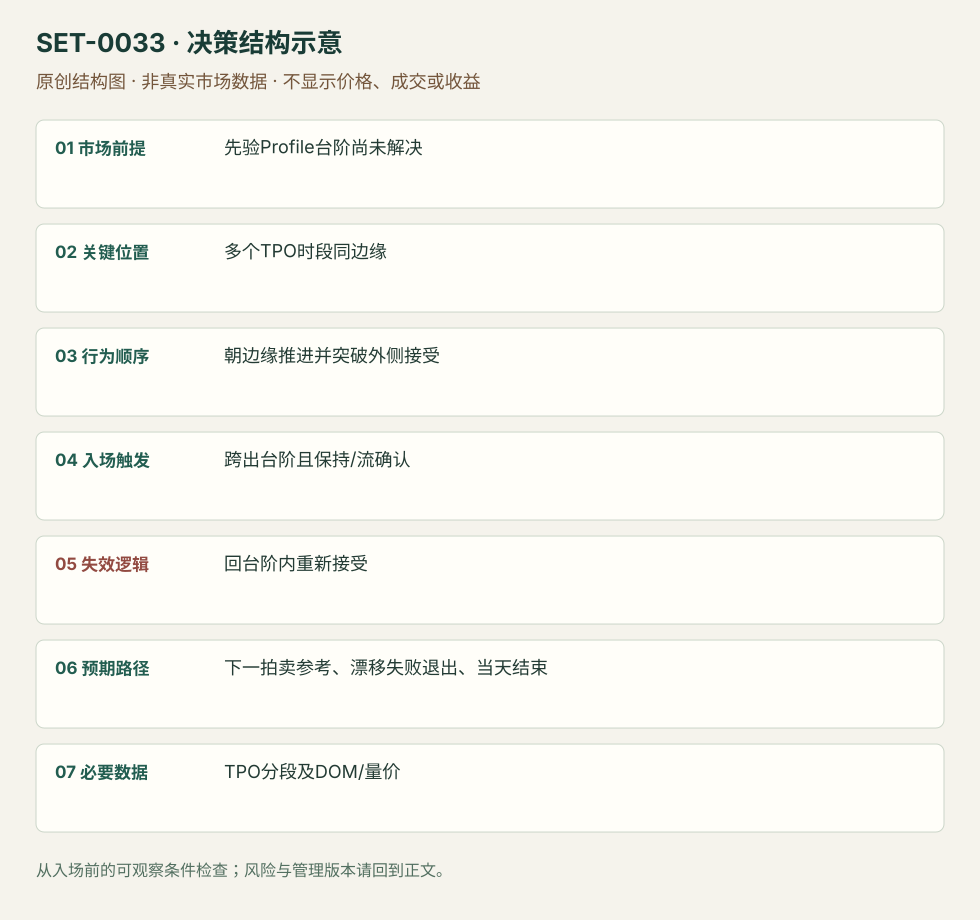

---
{
  "id": "SET-0033",
  "schema_version": "1.0.0",
  "name_zh": "TPO 台阶的破位与接受",
  "name_en": "TPO Ledge Break and Acceptance",
  "aliases": [],
  "name_nature": "source_term",
  "status": "reviewed",
  "summary": "固定 TPO 台阶由多个时段在同价附近止步形成；在上下文与实际流支持下，跨出台阶并被接受，交易拍卖边界的解决。台阶不是成交量POC，也不要求0016式逐次缩小回调。",
  "mechanism": "auction_boundary_resolution",
  "tags": [
    "auction",
    "TPO",
    "breakout"
  ],
  "pa_role": "supporting",
  "markets_observed": [
    "GBP/USD（原场所/合约未确认）",
    "Bund期货"
  ],
  "markets_supported": [],
  "migration_hypotheses": [],
  "session": "依原期货数据商分段；图的session/TPO参数与时区未完整说明。本库要求复盘固定分段，并在当日计划session结束前平仓。",
  "session_tags": [
    "intraday"
  ],
  "context_timeframe": "日线/前一session + 当日执行图；因来源而异",
  "trigger_timeframe": null,
  "data_requirements": [
    "TPO",
    "OHLC",
    "volume",
    "DOM"
  ],
  "execution_mode": "discretionary",
  "source_ids": [
    "SRC-0010",
    "SRC-0062"
  ],
  "evidence_ids": [
    "EVD-000066",
    "EVD-000067"
  ],
  "visual_ids": [
    "VIS-000035",
    "VIS-000036",
    "VIS-000090"
  ],
  "rule_completeness": "前提/触发/失效/管理已记录；来源与编辑模块分开",
  "independent_corroboration": "limited_single_family",
  "profit_evidence": "not_established",
  "created": "2026-10-02",
  "updated": "2026-10-02",
  "reviewed_at": "2026-10-02",
  "known_gaps": [
    "未开展独立回测；实际订单成交与成本未知",
    "执行周期没有统一来源参数，使用前须锁定版本"
  ],
  "logic_fingerprint": [
    "先验Profile台阶尚未解决",
    "多个TPO时段同边缘",
    "朝边缘推进并突破外侧接受",
    "跨出台阶且保持/流确认",
    "回台阶内重新接受",
    "下一拍卖参考、漂移失败退出、当天结束",
    "TPO分段及DOM/量价"
  ],
  "environment_tags": [
    "balance",
    "compression"
  ],
  "structure_locations": [
    "TPO_ledge"
  ],
  "version": "1.0.0",
  "unknown_fields": {
    "trigger_timeframe": "来源未提供统一执行周期；正文记录已知图例，不能当成统一参数"
  },
  "review_scope": "规则记录、引用范围、日内边界、逻辑区别与已看静态画面；不含独立回测、动态逐笔或账户核验",
  "source_coverage": {
    "substantive_read_sources": 2,
    "families": [
      "axia"
    ],
    "core_support_source_ids": [
      "SRC-0010",
      "SRC-0062"
    ],
    "independence_note": "limited_single_family"
  },
  "method_families": [
    "auction_profile"
  ],
  "market_types": [
    "futures",
    "FX_venue_unconfirmed"
  ]
}
---

# TPO 台阶的破位与接受 · TPO Ledge Break and Acceptance

## 1. 名称与快速概览

固定 TPO 台阶由多个时段在同价附近止步形成；在上下文与实际流支持下，跨出台阶并被接受，交易拍卖边界的解决。台阶不是成交量POC，也不要求0016式逐次缩小回调。

记录口径：PA supporting；必要数据 TPO、OHLC、volume、DOM。名称性质：来源术语或研究术语。reviewed 只表示本条规则与证据记录审查通过，盈利状态为 not_established。

## 2. 本质与行为假说

重复停在同价提示拍卖尚未完成的结构，但“最终会修复”没有无条件时限。突破后的接受和方向行为才说明此次解决开始，而非任何越线打印。

## 3. 适用市场与环境

来源GBP/USD弱漂移和Bund边缘结构，适合已画出的TPO平边缘及清楚上方/下方路线。已在边缘外建立新平衡但没有方向流时，目标和节奏需重估。

**来源实用市场：**GBP/USD（原场所/合约未确认）、Bund期货。

**Session：**依原期货数据商分段；图的session/TPO参数与时区未完整说明。本库要求复盘固定分段，并在当日计划session结束前平仓。

跨市场：本版不主张已经验证的跨市场迁移；更换市场必须重定数据来源、流动性与session。

## 4. 出现前的观察清单

锁定TPO时段、session和台阶位置；检查是否真正多个时段同边缘、是否已有excess。单个OHLC高低相等不能自动成为TPO台阶。

## 5. 形成过程与状态转换

既有台阶未解决 → 朝边缘推进 → 跨出台阶 → 边缘外能保持/旧范围回测失败 → 解决方向续行。跨出却不能持久的漂移留作反例。

## 6. Entry trigger 与执行方式

在台阶突破且外侧被接受时顺突破进入；DOM速度/反向拍卖无力可提供确认。具体最小保持时长来源未统一，编辑执行版须选择时段/棒确认后固定，不能看结果后解释“接受”。

## 7. Invalidation 与止损逻辑

回到台阶内并重新接受、突破结构被否认；初始硬保护选近端结构，风险太大跳过。不能因poor high名称而无限等待回去修复。

## 8. Exit、target 与 trade management

下一Profile边缘/旧极值/价值边界为参照；突破漂移无加速并回到台阶内时退出。解决后新台阶是之后的参考，不是把同一图再算新setup。

## 9. 常见 variations

poor high/poor low 平边缘、TPO ledge上下方向是同一拍卖边界解决逻辑；是否有成交量节点作辅助为版本。

## 10. 失败方式与不交易条件

孤立形态没有上下文；窄价位采样造成假台阶；跨出后弱漂移无持续接受；引用未来完成Profile；“迟早修复”变成隔夜持仓。

## 11. 与相近 setups 的区别

- [SET-0016](SET-0016.md)：0016 必须反复攻击且回调缩小，只有平边缘不够；本条依TPO拍卖台阶并观察外侧接受。
- [SET-0034](SET-0034.md)：0034 等台阶解决反复失败后，从相反边缘的加速撤仓进入。

## 12. 图表与案例解读

已看GBPUSD和Bund两图，含TPO与价/量。GBPUSD后段反转提示机械破位不能代表持续方向；静态图未核对DOM速度。

- [VIS-000035] [Late day break lower through the ledge creating the drift move](https://axiafutures.com/blog/wp-content/uploads/2020/07/trade1_marketprofile-1024x554.png)；定位：Ledge1 resolved GBPUSD example。图中ledge突破后只是弱漂移，后来反向加速，展示接受不足的边界。 验证：chart_viewed。
- [VIS-000036] [Breakout higher after ledge has been tested from both side and higher low created](https://axiafutures.com/blog/wp-content/uploads/2020/07/trade1b_marketprofile-1024x588.png)；定位：Bund resolved ledge as subsequent reference。台阶解决后旧区成为新参考；Higher Lows是后续行为，不能全算初始突破条件。 验证：chart_viewed。

**本地原创示意（VIS-000090，非真实市场数据）：**

小屏阅读可[打开原尺寸示意图](../assets/diagrams/SET-0033.svg)并缩放。

此图用于对照识别顺序与风险定义；不计入真实案例覆盖率。

## 13. 证据、分歧与未知项

主要同Axia家族实践，独立佐证有限；图中既有解决也有后段失败，不推出成功率。TPO与Footprint未完成拍卖的零Bid/Ask不是相同数据定义。

- [EVD-000066] Axia Futures，《How To Trade A Market Profile Ledge》，[SRC-0010](https://axiafutures.com/blog/trading-market-profile-ledge/)；定位：Ledge 1 resolved / subsequent ledge reference。支持：多个TPO阶段同价边缘组成ledge，突破后要判断是否保持；弱漂移也可能反转，已解决的ledge可成为新参考。
- [EVD-000067] Axia Futures，《Trading Strategies Around Poor Lows And Poor Highs》，[SRC-0062](https://axiafutures.com/blog/trading-strategies-around-poor-lows-and-poor-highs/)；定位：poor high/poor low trading strategies。支持：缺少excess的平边缘是潜在待解决结构；必须结合流和接受，不应机械假设一定修复。

审查边界：来源份数与独立核心核验分开；当前类别为 limited_single_family。正文中的概念、官方事实、衍生解说或同族资料只按其支持范围使用。

## 14. 可用于复盘的检查表

- [ ] 下单前的前提可核对：先验Profile台阶尚未解决
- [ ] 事前标记位置：多个TPO时段同边缘
- [ ] 行为按顺序出现：朝边缘推进并突破外侧接受
- [ ] 实际触发符合选定版本：跨出台阶且保持/流确认
- [ ] 事先写明本次否定条件：回台阶内重新接受
- [ ] 目标/路径只用当时已知信息：下一拍卖参考、漂移失败退出、当天结束
- [ ] 数据满足 TPO分段及DOM/量价；记录时间、点差、滑点、队列和未成交
- [ ] 记录截止平仓及规则偏离；正常亏损不事后改成“未成立”

## 15. 后续验证问题

接受需要多少时段可操作？TPO采样改变台阶数量多少？修复比例是否随旧结构年龄变化？
