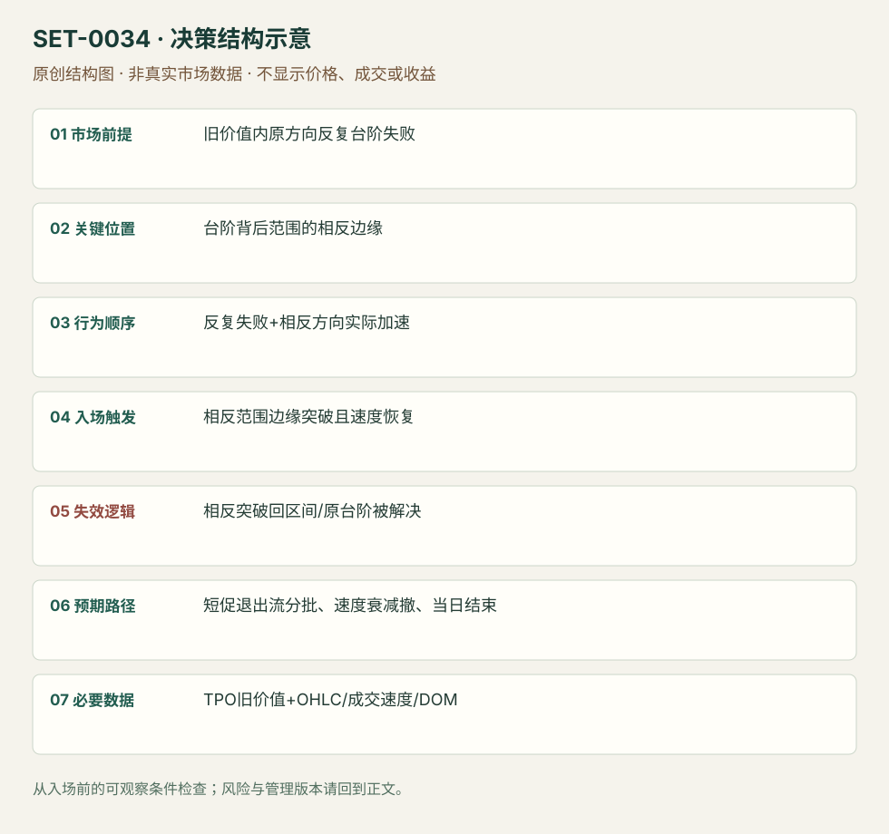

---
{
  "id": "SET-0034",
  "schema_version": "1.0.0",
  "name_zh": "台阶久攻不破后的反向持仓退出",
  "name_en": "Failed Ledge Positioning Unwind",
  "aliases": [],
  "name_nature": "editor_descriptive_with_source_term",
  "status": "reviewed",
  "summary": "台阶附近多次单方向尝试仍不能解决，价格困在旧价值内；当相反边缘被快速越过时，交易原方向持仓退出。与0033顺台阶解决的方向相反，目标和持有期待也不同。",
  "mechanism": "failed_auction_unwind",
  "tags": [
    "auction",
    "TPO",
    "failed_breakout",
    "momentum"
  ],
  "pa_role": "supporting",
  "markets_observed": [
    "原油期货"
  ],
  "markets_supported": [],
  "migration_hypotheses": [],
  "session": "原油源图跨前后数据商日段，时区未标；本条限定当前执行session的机会和当日退出，不要求源图所有棒都属于纽约现金日。",
  "session_tags": [
    "intraday"
  ],
  "context_timeframe": "日线/前一session + 当日执行图；因来源而异",
  "trigger_timeframe": null,
  "data_requirements": [
    "TPO",
    "OHLC",
    "volume",
    "DOM"
  ],
  "execution_mode": "discretionary",
  "source_ids": [
    "SRC-0010",
    "SRC-0011"
  ],
  "evidence_ids": [
    "EVD-000068",
    "EVD-000069"
  ],
  "visual_ids": [
    "VIS-000037",
    "VIS-000091"
  ],
  "rule_completeness": "前提/触发/失效/管理已记录；来源与编辑模块分开",
  "independent_corroboration": "limited_single_family",
  "profit_evidence": "not_established",
  "created": "2026-10-02",
  "updated": "2026-10-02",
  "reviewed_at": "2026-10-02",
  "known_gaps": [
    "未开展独立回测；实际订单成交与成本未知",
    "执行周期没有统一来源参数，使用前须锁定版本"
  ],
  "logic_fingerprint": [
    "旧价值内原方向反复台阶失败",
    "台阶背后范围的相反边缘",
    "反复失败+相反方向实际加速",
    "相反范围边缘突破且速度恢复",
    "相反突破回区间/原台阶被解决",
    "短促退出流分批、速度衰减撤、当日结束",
    "TPO旧价值+OHLC/成交速度/DOM"
  ],
  "environment_tags": [
    "balance",
    "failed_auction"
  ],
  "structure_locations": [
    "TPO_ledge",
    "opposite_range_edge"
  ],
  "version": "1.0.0",
  "unknown_fields": {
    "trigger_timeframe": "来源未提供统一执行周期；正文记录已知图例，不能当成统一参数"
  },
  "review_scope": "规则记录、引用范围、日内边界、逻辑区别与已看静态画面；不含独立回测、动态逐笔或账户核验",
  "source_coverage": {
    "substantive_read_sources": 2,
    "families": [
      "axia"
    ],
    "core_support_source_ids": [
      "SRC-0010",
      "SRC-0011"
    ],
    "independence_note": "limited_single_family"
  },
  "method_families": [
    "auction_profile",
    "liquidity_inventory"
  ],
  "market_types": [
    "futures"
  ]
}
---

# 台阶久攻不破后的反向持仓退出 · Failed Ledge Positioning Unwind

## 1. 名称与快速概览

台阶附近多次单方向尝试仍不能解决，价格困在旧价值内；当相反边缘被快速越过时，交易原方向持仓退出。与0033顺台阶解决的方向相反，目标和持有期待也不同。

记录口径：PA supporting；必要数据 TPO、OHLC、volume、DOM。名称性质：编辑性描述名，英文保留来源术语以便检索。reviewed 只表示本条规则与证据记录审查通过，盈利状态为 not_established。

## 2. 本质与行为假说

弱尝试中的仓位积累是作者解释，不能直接观测个体库存。可观察证据是多次失败、困在价值内、相反方向加速；短促反弹不能被误当长期新趋势。

## 3. 适用市场与环境

源例原油卖压被ledge反复挡住，旧价值内形成窄范围。若原方向终于被接受在台阶外，原持仓退出假说失效。

**来源实用市场：**原油期货。

**Session：**原油源图跨前后数据商日段，时区未标；本条限定当前执行session的机会和当日退出，不要求源图所有棒都属于纽约现金日。

跨市场：本版不主张已经验证的跨市场迁移；更换市场必须重定数据来源、流动性与session。

## 4. 出现前的观察清单

标未解决台阶、失败次数、旧价值边界与后续窄范围反向边缘；留每次失败时截图。不要用最终当天Profile称当时“旧价值”。

## 5. 形成过程与状态转换

原方向多次攻击失败 → 旧价值内范围收紧/停留 → 相反边缘被拿走且速度增加 → 原方向持仓可能退出 → 反弹减弱或回原趋势。

## 6. Entry trigger 与执行方式

来源用相反方向破位后的速度提升取得入口。编辑版将范围反向边缘越过与实际成交加速共同确认；不能在未越过时仅凭“空头多”抢反向。

## 7. Invalidation 与止损逻辑

反向破位失败、回到窄范围内部且重新接受；若原台阶被主动解决也否认本假说。具体硬保护为已知破位枢轴，而不是原大范围另一端。

## 8. Exit、target 与 trade management

第一轮退出冲击、旧价值另一参考或明显速度衰退处分批，偏短持有；源图随后重新跌，说明退出流不等于趋势反转。日内结束。

## 9. 常见 variations

买方多次攻高不成后向下撤仓对称；不同ledge名称不拆条。没有反复失败与相反边缘结构的单次假突破归一般失败测试。

## 10. 失败方式与不交易条件

实际上原方向已被接受；只有单次影线；静态量柱大但没有相反速度；把短促退出流持成趋势单；图后段返回使早期入场被事后删去。

## 11. 与相近 setups 的区别

- [SET-0033](SET-0033.md)：0033 顺台阶最终解决；本条要求台阶未解决并在相反边缘触发。
- [SET-0018](SET-0018.md)：0018 用范围边缘第二反转信号，本条要求台阶多次失败后的范围相反破位加速。

## 12. 图表与案例解读

已看原油图，作者注释明确区分持仓退出与新增买入；范围上破和随后回跌同时可见。无账户或全市场仓位数据，不能把库存推论提升为事实。

- [VIS-000037] [Oil Market Profile ledge positioning reversal](https://axiafutures.com/blog/wp-content/uploads/2020/07/oilledge-break-positoing-1024x594.png)；定位：Oil chart / positioning liquidation not new buying。蓝框范围在卖方台阶后形成；上冲后随后大跌，不能把冲击当持久新买入。 验证：chart_viewed。

**本地原创示意（VIS-000091，非真实市场数据）：**

小屏阅读可[打开原尺寸示意图](../assets/diagrams/SET-0034.svg)并缩放。

此图用于对照识别顺序与风险定义；不计入真实案例覆盖率。

## 13. 证据、分歧与未知项

同一Axia家族两文互释，独立佐证有限。作者称positioning liquidation是行为解释，没有交易所持仓明细直接证实。

- [EVD-000068] Axia Futures，《How To Trade A Market Profile Ledge》，[SRC-0010](https://axiafutures.com/blog/trading-market-profile-ledge/)；定位：Unresolved ledge repeated attempts and unwind。支持：多次台阶尝试未完成，位置积累后相反方向可触发快速退出；不能只当新的主动方向交易。
- [EVD-000069] Richard Bailey，《2 Trades Using Market Profile Ledges》，[SRC-0011](https://axiafutures.com/blog/2-trades-using-market-profile-ledges/)；定位：Oil example: ledge inside value / positioning liquidation。支持：台阶阻挡进一步卖出，旧价值内空头聚集；区间相反突破加速属于持仓退出，可能短暂后再回原趋势。

审查边界：来源份数与独立核心核验分开；当前类别为 limited_single_family。正文中的概念、官方事实、衍生解说或同族资料只按其支持范围使用。

## 14. 可用于复盘的检查表

- [ ] 下单前的前提可核对：旧价值内原方向反复台阶失败
- [ ] 事前标记位置：台阶背后范围的相反边缘
- [ ] 行为按顺序出现：反复失败+相反方向实际加速
- [ ] 实际触发符合选定版本：相反范围边缘突破且速度恢复
- [ ] 事先写明本次否定条件：相反突破回区间/原台阶被解决
- [ ] 目标/路径只用当时已知信息：短促退出流分批、速度衰减撤、当日结束
- [ ] 数据满足 TPO旧价值+OHLC/成交速度/DOM；记录时间、点差、滑点、队列和未成交
- [ ] 记录截止平仓及规则偏离；正常亏损不事后改成“未成立”

## 15. 后续验证问题

能否用成交/持仓数据区分退出与新增主动？失败次数和范围年龄是否有边际信息？短促目标怎样避免过度持有？
