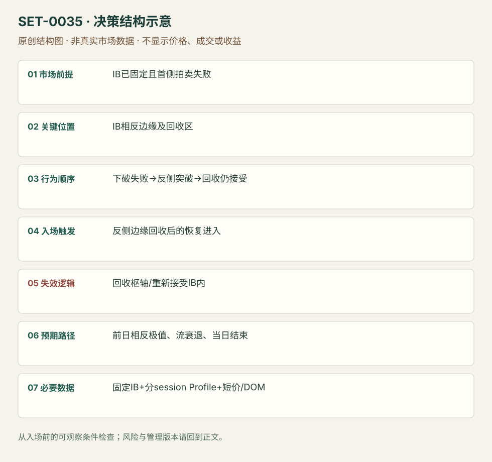

---
{
  "id": "SET-0035",
  "schema_version": "1.0.0",
  "name_zh": "IB 首侧失败后的反侧突破与回收",
  "name_en": "Failed-first-side IB Reversal and Acceptance",
  "aliases": [],
  "name_nature": "editor_descriptive_with_source_term",
  "status": "reviewed",
  "summary": "开盘先下破已固定的 IB 低却失败，随后横穿范围突破 IB 高，并在上沿回收时仍被接受。先前的错误拍卖方向是必需条件；只有普通上沿回测归0010。",
  "mechanism": "two_sided_opening_auction_failure",
  "tags": [
    "opening",
    "failed_breakout",
    "reversal",
    "auction"
  ],
  "pa_role": "core",
  "markets_observed": [
    "Eurostoxx期货"
  ],
  "markets_supported": [],
  "migration_hypotheses": [],
  "session": "来源图IB自7:00附近开始，cash open另标；原图时区未明确。本库要求保留该原始窗口与数据时区；迁移时另立版本、该session结束前平仓。",
  "session_tags": [
    "opening",
    "european_open"
  ],
  "context_timeframe": "日线/前一session + 当日执行图；因来源而异",
  "trigger_timeframe": null,
  "data_requirements": [
    "OHLC",
    "initial_balance",
    "session_profile",
    "DOM"
  ],
  "execution_mode": "discretionary",
  "source_ids": [
    "SRC-0074",
    "SRC-0072"
  ],
  "evidence_ids": [
    "EVD-000070",
    "EVD-000071"
  ],
  "visual_ids": [
    "VIS-000038",
    "VIS-000092"
  ],
  "rule_completeness": "前提/触发/失效/管理已记录；来源与编辑模块分开",
  "independent_corroboration": "limited_single_family",
  "profit_evidence": "not_established",
  "created": "2026-10-02",
  "updated": "2026-10-02",
  "reviewed_at": "2026-10-02",
  "known_gaps": [
    "未开展独立回测；实际订单成交与成本未知",
    "执行周期没有统一来源参数，使用前须锁定版本"
  ],
  "logic_fingerprint": [
    "IB已固定且首侧拍卖失败",
    "IB相反边缘及回收区",
    "下破失败→反侧突破→回收仍接受",
    "反侧边缘回收后的恢复进入",
    "回收枢轴/重新接受IB内",
    "前日相反极值、流衰退、当日结束",
    "固定IB+分session Profile+短价/DOM"
  ],
  "environment_tags": [
    "opening",
    "failed_auction"
  ],
  "structure_locations": [
    "initial_balance"
  ],
  "version": "1.0.0",
  "unknown_fields": {
    "trigger_timeframe": "来源未提供统一执行周期；正文记录已知图例，不能当成统一参数"
  },
  "review_scope": "规则记录、引用范围、日内边界、逻辑区别与已看静态画面；不含独立回测、动态逐笔或账户核验",
  "source_coverage": {
    "substantive_read_sources": 2,
    "families": [
      "axia"
    ],
    "core_support_source_ids": [
      "SRC-0074",
      "SRC-0072"
    ],
    "independence_note": "limited_single_family"
  },
  "method_families": [
    "opening_gap",
    "auction_profile"
  ],
  "market_types": [
    "futures"
  ]
}
---

# IB 首侧失败后的反侧突破与回收 · Failed-first-side IB Reversal and Acceptance

## 1. 名称与快速概览

开盘先下破已固定的 IB 低却失败，随后横穿范围突破 IB 高，并在上沿回收时仍被接受。先前的错误拍卖方向是必需条件；只有普通上沿回测归0010。

记录口径：PA core；必要数据 OHLC、initial_balance、session_profile、DOM。名称性质：编辑性描述名，英文保留来源术语以便检索。reviewed 只表示本条规则与证据记录审查通过，盈利状态为 not_established。

## 2. 本质与行为假说

下方没有得到持续接受、上方重新得到买方响应，提供方向重新选择的证据。作者对隐藏强买方的解释不能被当身份事实；判断由双侧先后行为和持价验证。

## 3. 适用市场与环境

源例2020-03-10 Eurostoxx大波动日、日线仍弱而当前开盘在前日价值上方。更大方向弱不是机械禁止多头，但只有首侧失败和反侧接受成立才操作。

**来源实用市场：**Eurostoxx期货。

**Session：**来源图IB自7:00附近开始，cash open另标；原图时区未明确。本库要求保留该原始窗口与数据时区；迁移时另立版本、该session结束前平仓。

跨市场：本版不主张已经验证的跨市场迁移；更换市场必须重定数据来源、流动性与session。

## 4. 出现前的观察清单

固定IB窗口及上下边界，记前日POC/VPOC和前日高；以数据商时区记录现金开盘。源图IB先于其标注cash open，不能擅自改成纽约09:30首小时。

## 5. 形成过程与状态转换

先形成IB → 下破IBL迅速否认 → 走到并越IBH → 回落到IB内未被接受 → 再恢复IBH上方 → 近上沿弱卖出转为上推。

## 6. Entry trigger 与执行方式

源例回收IBH后在3045–48区观察卖出轻而买入恢复执行。公开可复盘版等回收上沿后的局部恢复；完整顺序少首侧失败就不计本条。没有观看来源直播视频，未宣称原订单可核实。

## 7. Invalidation 与止损逻辑

原例不应有力重返3042及其下，附近3044弱卖出允许持有；这属于情境保护，非所有产品通用点数。编辑版硬保护为回收上沿后已知枢轴，价格被接受IB内即失效。

## 8. Exit、target 与 trade management

前日高为原方向目标；到位后衰弱减仓。源图后来回落，图上高点不是承诺成交目标；现金参考session结束前平仓。

## 9. 常见 variations

上下对称；当日先破低再破高与单纯改IB分钟数有不同状态序列。订单流精细入口是执行层，不能再计独立条。

## 10. 失败方式与不交易条件

下方其实持续被接受；上破后回落接受IB内；无首次错向尝试；前日目标空间不足；用最终日低定义首侧失败。

## 11. 与相近 setups 的区别

- [SET-0002](SET-0002.md)：0002 一侧首5分钟方向突破即可，本条必须先错侧失败再反侧接受，且IB窗口不同。
- [SET-0010](SET-0010.md)：0010 只要求一个既有边界的首次回测；本条额外必需双侧拍卖失败序列。

## 12. 图表与案例解读

已看完整1分钟日内图。午后回到范围内属于后续行情，不能倒填成入场前条件；白框不是已看过的视频片段。

- [VIS-000038] [Eurostoxx 50 1 Minute Chart](https://axiafutures.com/blog/wp-content/uploads/2020/07/image-2-1024x500.png)；定位：Eurostoxx 1 Minute Chart。图中IB2990–3043、cash open和前日高均标出；先破低再越高，白框对应原文执行区域。 验证：chart_viewed。

**本地原创示意（VIS-000092，非真实市场数据）：**

小屏阅读可[打开原尺寸示意图](../assets/diagrams/SET-0035.svg)并缩放。

此图用于对照识别顺序与风险定义；不计入真实案例覆盖率。

## 13. 证据、分歧与未知项

Axia同家族完整案例和限制案例，独立佐证有限。图表已看，正文订单叙事已读，但没有看视频/逐笔动态或账户回执。

- [EVD-000070] Dawid Janczy，《Eurostoxx Initial Balance High – Live Trading》，[SRC-0074](https://axiafutures.com/blog/eurostoxx-initial-balance-high-live-trading/)；定位：Initial Balance High Closer Look / execution at3045–48。支持：先下破IB低快速收回，再越IB高；上沿回落又被买回后进入，不能有力回到3042，目标前日高。
- [EVD-000071] Axia Futures，《Trading Initial Balance Break Using Market Profile》，[SRC-0072](https://axiafutures.com/blog/trading-initial-balance-break-using-market-profile/)；定位：IB structure and failed target example。支持：IB只提供位置，还需先验结构与明确失效；同家族案例限制“突破必到目标”的期待。

审查边界：来源份数与独立核心核验分开；当前类别为 limited_single_family。正文中的概念、官方事实、衍生解说或同族资料只按其支持范围使用。

## 14. 可用于复盘的检查表

- [ ] 下单前的前提可核对：IB已固定且首侧拍卖失败
- [ ] 事前标记位置：IB相反边缘及回收区
- [ ] 行为按顺序出现：下破失败→反侧突破→回收仍接受
- [ ] 实际触发符合选定版本：反侧边缘回收后的恢复进入
- [ ] 事先写明本次否定条件：回收枢轴/重新接受IB内
- [ ] 目标/路径只用当时已知信息：前日相反极值、流衰退、当日结束
- [ ] 数据满足 固定IB+分session Profile+短价/DOM；记录时间、点差、滑点、队列和未成交
- [ ] 记录截止平仓及规则偏离；正常亏损不事后改成“未成立”

## 15. 后续验证问题

首侧失败如何排除已经充分接受的趋势？定义IB在不同欧洲时区的敏感性？去掉首侧失败前提后的差别？
