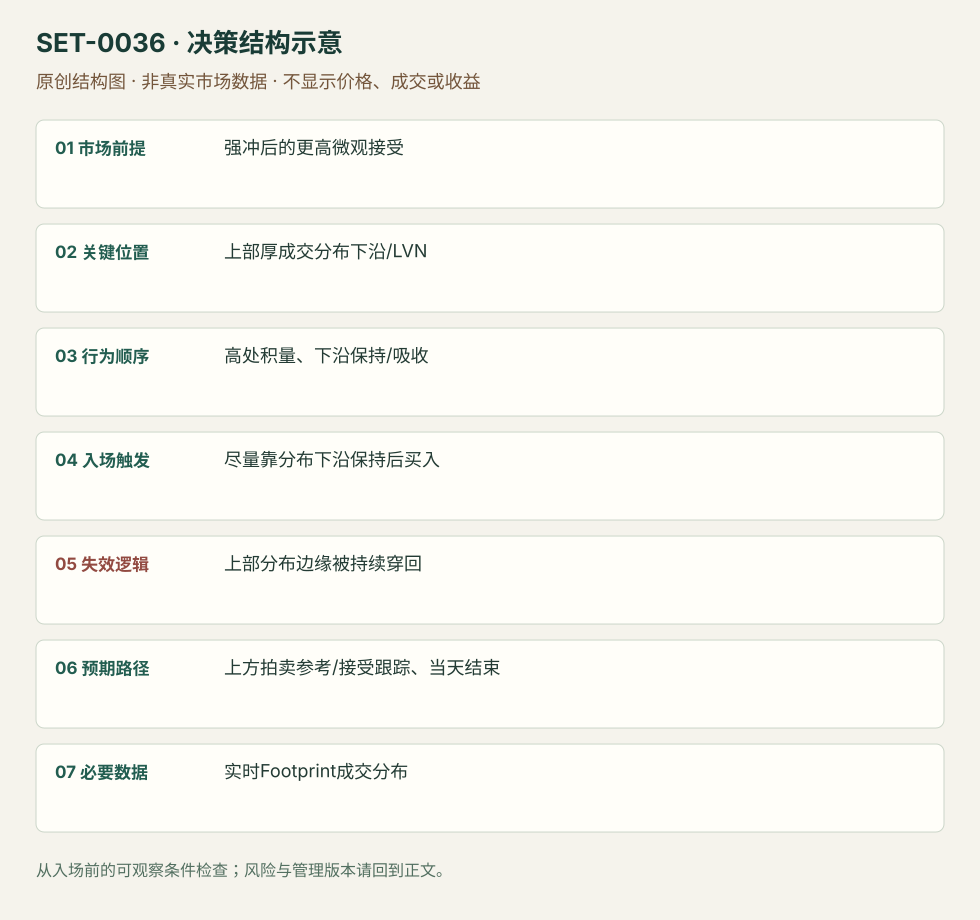

---
{
  "id": "SET-0036",
  "schema_version": "1.0.0",
  "name_zh": "Footprint P 形上分布边缘保持",
  "name_en": "Footprint Micro P-shape Distribution Hold",
  "aliases": [],
  "name_nature": "editor_descriptive_with_source_term",
  "status": "reviewed",
  "summary": "一次强冲后，Footprint 在高处形成厚成交块，下方保留薄量连接；在上部成交分布下沿被保持时顺强冲方向执行。P形只是开始观察的结构，不是看到字母轮廓就买。",
  "mechanism": "micro_value_acceptance",
  "tags": [
    "footprint",
    "volume_profile",
    "trend_continuation"
  ],
  "pa_role": "supporting",
  "markets_observed": [
    "期货（P形案例未核对具体合约）"
  ],
  "markets_supported": [],
  "migration_hypotheses": [],
  "session": "源图仅为微观片段，完整session未知。本库日内版本限定当次计划session内，结束前平；不把缺失时区默认为纽约。",
  "session_tags": [
    "intraday"
  ],
  "context_timeframe": "日线/前一session + 当日执行图；因来源而异",
  "trigger_timeframe": null,
  "data_requirements": [
    "footprint",
    "volume_at_price",
    "OHLC"
  ],
  "execution_mode": "discretionary",
  "source_ids": [
    "SRC-0012",
    "SRC-0065"
  ],
  "evidence_ids": [
    "EVD-000072",
    "EVD-000073"
  ],
  "visual_ids": [
    "VIS-000039",
    "VIS-000093"
  ],
  "rule_completeness": "前提/触发/失效/管理已记录；来源与编辑模块分开",
  "independent_corroboration": "independent_context_only",
  "profit_evidence": "not_established",
  "created": "2026-10-02",
  "updated": "2026-10-02",
  "reviewed_at": "2026-10-02",
  "known_gaps": [
    "未开展独立回测；实际订单成交与成本未知",
    "执行周期没有统一来源参数，使用前须锁定版本"
  ],
  "logic_fingerprint": [
    "强冲后的更高微观接受",
    "上部厚成交分布下沿/LVN",
    "高处积量、下沿保持/吸收",
    "尽量靠分布下沿保持后买入",
    "上部分布边缘被持续穿回",
    "上方拍卖参考/接受跟踪、当天结束",
    "实时Footprint成交分布"
  ],
  "environment_tags": [
    "micro_balance"
  ],
  "structure_locations": [
    "micro_distribution_edge"
  ],
  "version": "1.0.0",
  "unknown_fields": {
    "trigger_timeframe": "来源未提供统一执行周期；正文记录已知图例，不能当成统一参数"
  },
  "review_scope": "规则记录、引用范围、日内边界、逻辑区别与已看静态画面；不含独立回测、动态逐笔或账户核验",
  "source_coverage": {
    "substantive_read_sources": 2,
    "families": [
      "atas",
      "axia"
    ],
    "core_support_source_ids": [
      "SRC-0012"
    ],
    "independence_note": "independent_context_only"
  },
  "method_families": [
    "auction_profile",
    "footprint_delta"
  ],
  "market_types": [
    "futures"
  ]
}
---

# Footprint P 形上分布边缘保持 · Footprint Micro P-shape Distribution Hold

## 1. 名称与快速概览

一次强冲后，Footprint 在高处形成厚成交块，下方保留薄量连接；在上部成交分布下沿被保持时顺强冲方向执行。P形只是开始观察的结构，不是看到字母轮廓就买。

记录口径：PA supporting；必要数据 footprint、volume_at_price、OHLC。名称性质：编辑性描述名，英文保留来源术语以便检索。reviewed 只表示本条规则与证据记录审查通过，盈利状态为 not_established。

## 2. 本质与行为假说

假说是冲击后市场在更高区域接受价格，旧低区成为薄连接。上部厚量表示成交集中，不等于所有成交都是新多头；原文短空回补动机属于解释。

## 3. 适用市场与环境

来源为微观期货结构，必须有强冲与高处新成交块；若高处只是一根尖峰且没有接受，或不断向下填厚，则不成立。

**来源实用市场：**期货（P形案例未核对具体合约）。

**Session：**源图仅为微观片段，完整session未知。本库日内版本限定当次计划session内，结束前平；不把缺失时区默认为纽约。

跨市场：本版不主张已经验证的跨市场迁移；更换市场必须重定数据来源、流动性与session。

## 4. 出现前的观察清单

固定聚合规则和买卖方向，标高处分布下沿/LVN、主冲低点及较大Profile阻力。不能用整天累积后的P形回标早期交易。

## 5. 形成过程与状态转换

强冲 → 上方成交聚集 → 下方薄量边界形成 → 回靠上部下沿出现保持/吸收 → 买入恢复 → 高价接受或向下破坏。

## 6. Entry trigger 与执行方式

来源尽量靠上部分布底/LVN执行，观察量开始被吸收且价能保持。主动恢复或边缘限价分开记，未成交限价不能按理想边缘假设盈利。

## 7. Invalidation 与止损逻辑

上部厚量下沿外；低量连接被持续穿回并向下接受时假说撤销。不能把P形整条长柱最底做无限宽保护。缓冲依产品tick与样本测试。

## 8. Exit、target 与 trade management

上方已知拍卖参考，或新分布保持就跟踪；高处吸收不断但不推进需重新评估。退出规则部分为编辑结构模块，来源主要强调入口和止损而未统一利润点。

## 9. 常见 variations

下冲后的下部分布对称；Footprint时间/成交/反转棒是聚合版本。完整session P形与微观P形不同尺度，不能自动继承效果。

## 10. 失败方式与不交易条件

没有实际新接受；图形认字取代量的时间顺序；越界后把止损移至主冲低点；仅凭颜色认定机构买入；聚合窗口改变结果。

## 11. 与相近 setups 的区别

- [SET-0041](SET-0041.md)：0041 必须阶梯跳过薄量区且反向流少，本条先形成厚的新接受块并靠其边缘执行。
- [SET-0042](SET-0042.md)：0042 以连续对角失衡区为参考，本条只需要成交分布结构，不必须堆叠失衡。

## 12. 图表与案例解读

已看P形Footprint片段，能够辨认强冲、上部厚成交和下沿。具体合约、完整日期和聚合周期未清楚，不能以相邻Bonds段落替本图补品种。

- [VIS-000039] [Strategy 1: Footprint P Shape Fade Long With Highlighted P Shape](https://axiafutures.com/blog/wp-content/uploads/2022/03/Pshape-footprint-1-1024x959.png)；定位：Strategy1 P Shape Fade Long With Highlighted P Shape。作者红圈勾出高处成交块，绿色箭头示其下沿；原图模糊，不抄录不可辨认数量。 验证：chart_viewed。

**本地原创示意（VIS-000093，非真实市场数据）：**

小屏阅读可[打开原尺寸示意图](../assets/diagrams/SET-0036.svg)并缩放。

此图用于对照识别顺序与风险定义；不计入真实案例覆盖率。

## 13. 证据、分歧与未知项

完整微P操作主要由Axia给出，ATAS只独立澄清工具和局限，独立核心佐证有限。原图不清楚日期/品种，保留缺失字段。

- [EVD-000072] Axia Futures，《Footprint Strategies You Can Apply In Your Trading》，[SRC-0012](https://axiafutures.com/blog/footprint-strategies-you-can-apply-in-your-trading/)；定位：Strategy1 Micro Double Distribution / P Shape Fade Long。支持：强上冲后微观P形上部积累成交，靠上部成交块下沿/LVN买，止损置边缘下方。
- [EVD-000073] ATAS Team，《Everything you need to know about Volume profile types》，[SRC-0065](https://atas.net/blog/volume-profile-types/)；定位：TPO versus Volume Profile / balance-trend-balance。支持：独立数据工具解释澄清时间与成交分布不同，并明确Profile本身不是机械交易系统。

审查边界：来源份数与独立核心核验分开；当前类别为 independent_context_only。正文中的概念、官方事实、衍生解说或同族资料只按其支持范围使用。

## 14. 可用于复盘的检查表

- [ ] 下单前的前提可核对：强冲后的更高微观接受
- [ ] 事前标记位置：上部厚成交分布下沿/LVN
- [ ] 行为按顺序出现：高处积量、下沿保持/吸收
- [ ] 实际触发符合选定版本：尽量靠分布下沿保持后买入
- [ ] 事先写明本次否定条件：上部分布边缘被持续穿回
- [ ] 目标/路径只用当时已知信息：上方拍卖参考/接受跟踪、当天结束
- [ ] 数据满足 实时Footprint成交分布；记录时间、点差、滑点、队列和未成交
- [ ] 记录截止平仓及规则偏离；正常亏损不事后改成“未成立”

## 15. 后续验证问题

新分布至少需多少时间/成交才成立？限价未成交概率和队列成本？与普通旗形在同一价格图上的差异是否有边际信息？
