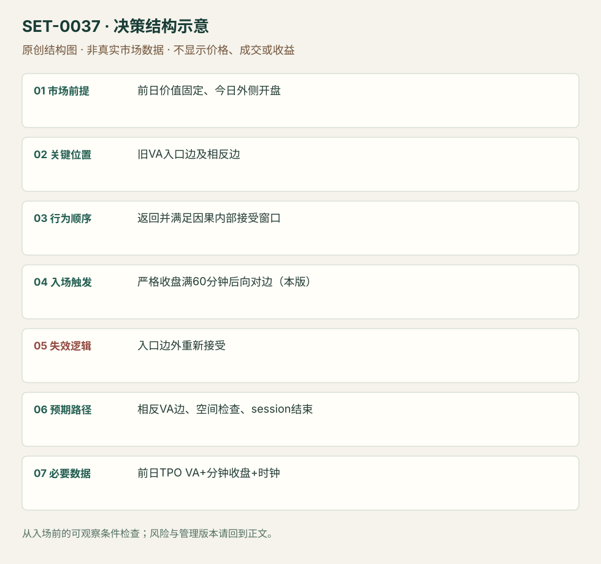

---
{
  "id": "SET-0037",
  "schema_version": "1.0.0",
  "name_zh": "旧价值区重新接受后的横穿",
  "name_en": "Prior Value-area Reacceptance Traverse / 80% Rule",
  "aliases": [],
  "name_nature": "established_or_source_term",
  "status": "reviewed",
  "summary": "在前日价值区之外开盘，回到其中并在内部获得持续接受后，交易到相反价值边界。采用哪种“接受”规则必须固定：本条主版为 LuxAlgo 的60分钟收盘条件，非任意两次触碰。",
  "mechanism": "auction_value_reacceptance",
  "tags": [
    "auction",
    "mean_reversion",
    "TPO",
    "value_area"
  ],
  "pa_role": "supporting",
  "markets_observed": [
    "指数期货（规则与ES研究）"
  ],
  "markets_supported": [],
  "migration_hypotheses": [],
  "session": "前日/当日TPO必须用相同交易段；期货现金与电子日分版本，不能混接。入口、60分钟等待和出场均在同一选定session中，结束前平。",
  "session_tags": [
    "intraday"
  ],
  "context_timeframe": "日线/前一session + 当日执行图；因来源而异",
  "trigger_timeframe": null,
  "data_requirements": [
    "prior_session_TPO",
    "OHLC",
    "session_clock"
  ],
  "execution_mode": "discretionary",
  "source_ids": [
    "SRC-0076",
    "SRC-0075"
  ],
  "evidence_ids": [
    "EVD-000074",
    "EVD-000075"
  ],
  "visual_ids": [
    "VIS-000094"
  ],
  "rule_completeness": "前提/触发/失效/管理已记录；来源与编辑模块分开",
  "independent_corroboration": "independent_counter_evidence_only",
  "profit_evidence": "not_established",
  "created": "2026-10-02",
  "updated": "2026-10-02",
  "reviewed_at": "2026-10-02",
  "known_gaps": [
    "规则版本间接受定义不同",
    "未取得独立复现结果",
    "缺少已核对的真实价格案例",
    "执行周期没有统一来源参数，使用前须锁定版本"
  ],
  "logic_fingerprint": [
    "前日价值固定、今日外侧开盘",
    "旧VA入口边及相反边",
    "返回并满足因果内部接受窗口",
    "严格收盘满60分钟后向对边（本版）",
    "入口边外重新接受",
    "相反VA边、空间检查、session结束",
    "前日TPO VA+分钟收盘+时钟"
  ],
  "environment_tags": [
    "session_boundary",
    "balance"
  ],
  "structure_locations": [
    "prior_value_area"
  ],
  "version": "1.0.0",
  "unknown_fields": {
    "trigger_timeframe": "来源未提供统一执行周期；正文记录已知图例，不能当成统一参数"
  },
  "review_scope": "规则记录、引用范围、日内边界、逻辑区别与已看静态画面；不含独立回测、动态逐笔或账户核验",
  "source_coverage": {
    "substantive_read_sources": 2,
    "families": [
      "amt-balance",
      "luxalgo"
    ],
    "core_support_source_ids": [
      "SRC-0076"
    ],
    "independence_note": "independent_counter_evidence_only"
  },
  "method_families": [
    "auction_profile"
  ],
  "market_types": [
    "futures"
  ]
}
---

# 旧价值区重新接受后的横穿 · Prior Value-area Reacceptance Traverse / 80% Rule

## 1. 名称与快速概览

在前日价值区之外开盘，回到其中并在内部获得持续接受后，交易到相反价值边界。采用哪种“接受”规则必须固定：本条主版为 LuxAlgo 的60分钟收盘条件，非任意两次触碰。

记录口径：PA supporting；必要数据 prior_session_TPO、OHLC、session_clock。名称性质：来源术语或研究术语。reviewed 只表示本条规则与证据记录审查通过，盈利状态为 not_established。

## 2. 本质与行为假说

旧价值区曾是双向接受中心，重新接受可能使价格遍历范围；不是物理定律。80%是历史名称，不能当胜率或盈利证明；中途回失入口侧和最后曾触另一侧是不同结果。

## 3. 适用市场与环境

明确前日TPO价值区、当日在外开盘、随后真正返回。若新消息使新价值建立，或来源采用volume VA而你用TPO，需另立版本。

**来源实用市场：**指数期货（规则与ES研究）。

**Session：**前日/当日TPO必须用相同交易段；期货现金与电子日分版本，不能混接。入口、60分钟等待和出场均在同一选定session中，结束前平。

跨市场：本版不主张已经验证的跨市场迁移；更换市场必须重定数据来源、流动性与session。

版本限定：LuxAlgo默认Volume权重、25行、70%价值区，也提供TPO(Time)选项；本条研究版选择TPO，须在复盘中明确，不能将默认Volume预览或AMT不同实现的统计直接套用。

## 4. 出现前的观察清单

冻结前日VAH/VAL、TPO周期与VA百分比算法，记录今日开盘内/外。按分钟收盘逐步检查接受，不提前使用未来60分钟数据。

## 5. 形成过程与状态转换

外侧开盘 → 穿回入口边 → 满足预定内部接受窗口 → 入口侧不再被接受在外 → 向相反边移动或重新退出旧价值。

## 6. Entry trigger 与执行方式

主版只在连续内部收盘满60分钟后，向相反边方向进入；原规则不同实现可能只需两个30分钟TPO各曾交易在内部，两者不能混算。等待后若已经接近目标，跳过而非追入。

## 7. Invalidation 与止损逻辑

返回入口边外并被接受时失效；硬止损可放入口侧已知枢轴外，但精确缓冲是编辑执行规则。等待60分钟过程内就触对边的样本不当未来入场盈利。

## 8. Exit、target 与 trade management

相反旧VA边界为目标，途中Profile阻力可管理；窗口越长剩余空间可能越少。未完成横穿也在本session结束前退出。

## 9. 常见 variations

上/下对称；TPO触及版、收盘保持版与Volume VA版分版本，仅计一个机制。不同价值百分比不是不同Setup。

## 10. 失败方式与不交易条件

等待接受时已先到目标；旧价值外重新建新平衡；把touch定义换成clean；把最宽规则的命中率套最严入口；忽略费用和失败路线。

## 11. 与相近 setups 的区别

- [SET-0020](SET-0020.md)：0020 次日近低量尾部极值可直接开盘入，目标入口价值边；本条等重新进入价值并接受后到另一边。
- [SET-0004](SET-0004.md)：0004 旧VPOC被方向性突破并形成外部新价值；本条在旧价值内得到接受。

## 12. 图表与案例解读

视觉缺口：规则页可打开预览，未核对其是否真实历史行情；反证页是研究摘要。没有把指标预览或概率表当作已看真实交易图。

**本地原创示意（VIS-000094，非真实市场数据）：**

小屏阅读可[打开原尺寸示意图](../assets/diagrams/SET-0037.svg)并缩放。

此图用于对照识别顺序与风险定义；不计入真实案例覆盖率。

## 13. 证据、分歧与未知项

LuxAlgo为规则实现；AMT Balance作者数据给反证，但本研究未复现。其长期ES样本1090次触发中，约62%曾触相反边、约33%为干净横穿，两口径均不能当本条成本后胜率。收益证据未建立。

- [EVD-000074] LuxAlgo，《80% Rule》，[SRC-0076](https://www.luxalgo.com/library/indicator/80-percent-rule/)；定位：80% Rule description: open outside /60-minute close acceptance / exit。支持：开在旧价值外，回价值内持续60分钟收盘确认，交易至相反价值边；不因名称自动有80%概率。
- [EVD-000075] AMT Balance，《The 80% Rule: Tested & Debunked》，[SRC-0075](https://amtbalance.com/va-80-rule)；定位：The 80% Rule Tested & Debunked: trigger and clean traverse distinction。支持：作者ES历史观察区分曾触及相反边和不中断完整横穿，报告不足80%；原始复现、成本与各版本可比性未核验。

审查边界：来源份数与独立核心核验分开；当前类别为 independent_counter_evidence_only。正文中的概念、官方事实、衍生解说或同族资料只按其支持范围使用。

反证样本上下文：AMT网页标2008–2026、4662个ES session、5分钟数据及1090触发；精确起止日、数据商、价值区实现和费用未完整披露，原始数据未取得。统计用于质疑80%口号，不是对本条TPO/严格收盘版的可比回测。

## 14. 可用于复盘的检查表

- [ ] 下单前的前提可核对：前日价值固定、今日外侧开盘
- [ ] 事前标记位置：旧VA入口边及相反边
- [ ] 行为按顺序出现：返回并满足因果内部接受窗口
- [ ] 实际触发符合选定版本：严格收盘满60分钟后向对边（本版）
- [ ] 事先写明本次否定条件：入口边外重新接受
- [ ] 目标/路径只用当时已知信息：相反VA边、空间检查、session结束
- [ ] 数据满足 前日TPO VA+分钟收盘+时钟；记录时间、点差、滑点、队列和未成交
- [ ] 记录截止平仓及规则偏离；正常亏损不事后改成“未成立”

## 15. 后续验证问题

touch与clean的定义如何严格复现？严接受条件后仍剩空间多少？同样规则在TPO和Volume VA的差别？
