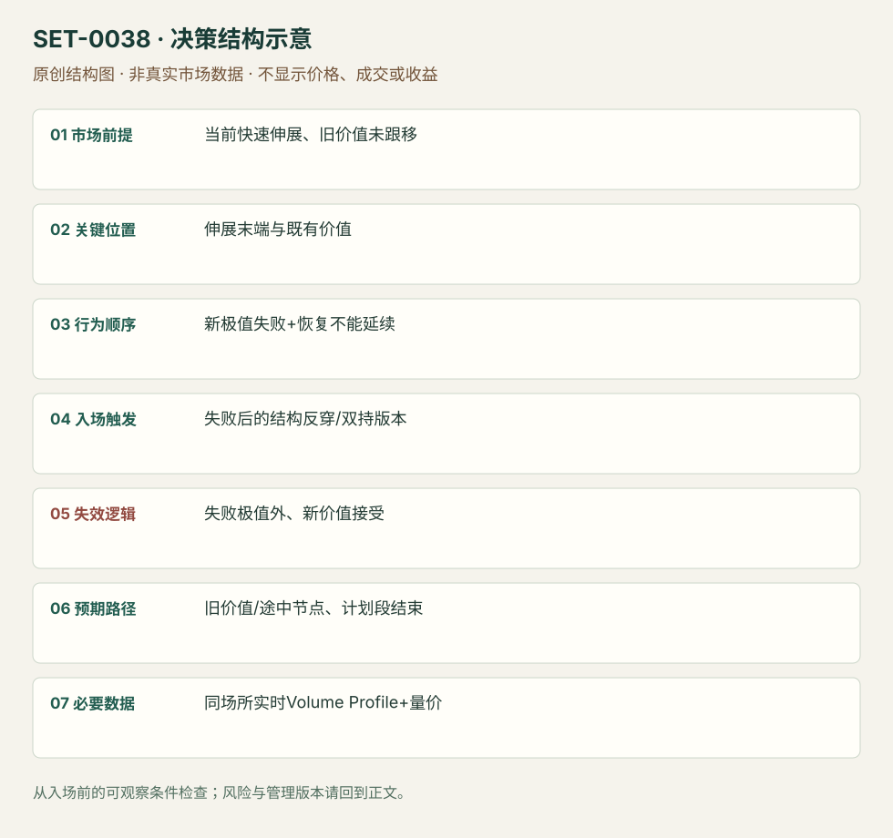

---
{
  "id": "SET-0038",
  "schema_version": "1.0.0",
  "name_zh": "当前低量伸展的失败反转回价值",
  "name_en": "Stretched Volume-profile Failure Reversion",
  "aliases": [],
  "name_nature": "editor_descriptive_with_source_term",
  "status": "reviewed",
  "summary": "同一执行session的快速伸展把价格带离既有价值，而新的接受不足；在伸展末端出现失败极值和恢复失败后反向。不是仅计算偏离距离，也不等待下一天开盘。",
  "mechanism": "stretched_value_reversion",
  "tags": [
    "auction",
    "volume_profile",
    "failed_breakout",
    "reversal"
  ],
  "pa_role": "supporting",
  "markets_observed": [
    "BTC（来源图表）",
    "Bund期货（文字情境）"
  ],
  "markets_supported": [],
  "migration_hypotheses": [],
  "session": "BTC为连续交易市场，原图约23:00跨段但时区未明；本库要求选择固定UTC日/交易段、只在该段内执行和平仓，迁移前另定场所。",
  "session_tags": [
    "intraday"
  ],
  "context_timeframe": "日线/前一session + 当日执行图；因来源而异",
  "trigger_timeframe": null,
  "data_requirements": [
    "OHLC",
    "volume_profile",
    "volume"
  ],
  "execution_mode": "discretionary",
  "source_ids": [
    "SRC-0028",
    "SRC-0032"
  ],
  "evidence_ids": [
    "EVD-000076",
    "EVD-000077"
  ],
  "visual_ids": [
    "VIS-000040",
    "VIS-000095"
  ],
  "rule_completeness": "前提/触发/失效/管理已记录；来源与编辑模块分开",
  "independent_corroboration": "limited_single_family",
  "profit_evidence": "not_established",
  "created": "2026-10-02",
  "updated": "2026-10-02",
  "reviewed_at": "2026-10-02",
  "known_gaps": [
    "未开展独立回测；实际订单成交与成本未知",
    "执行周期没有统一来源参数，使用前须锁定版本"
  ],
  "logic_fingerprint": [
    "当前快速伸展、旧价值未跟移",
    "伸展末端与既有价值",
    "新极值失败+恢复不能延续",
    "失败后的结构反穿/双持版本",
    "失败极值外、新价值接受",
    "旧价值/途中节点、计划段结束",
    "同场所实时Volume Profile+量价"
  ],
  "environment_tags": [
    "extended",
    "failed_auction"
  ],
  "structure_locations": [
    "current_profile_tail"
  ],
  "version": "1.0.0",
  "unknown_fields": {
    "trigger_timeframe": "来源未提供统一执行周期；正文记录已知图例，不能当成统一参数"
  },
  "review_scope": "规则记录、引用范围、日内边界、逻辑区别与已看静态画面；不含独立回测、动态逐笔或账户核验",
  "source_coverage": {
    "substantive_read_sources": 2,
    "families": [
      "axia"
    ],
    "core_support_source_ids": [
      "SRC-0028",
      "SRC-0032"
    ],
    "independence_note": "limited_single_family"
  },
  "method_families": [
    "auction_profile",
    "liquidity_inventory"
  ],
  "market_types": [
    "crypto",
    "futures"
  ]
}
---

# 当前低量伸展的失败反转回价值 · Stretched Volume-profile Failure Reversion

## 1. 名称与快速概览

同一执行session的快速伸展把价格带离既有价值，而新的接受不足；在伸展末端出现失败极值和恢复失败后反向。不是仅计算偏离距离，也不等待下一天开盘。

记录口径：PA supporting；必要数据 OHLC、volume_profile、volume。名称性质：编辑性描述名，英文保留来源术语以便检索。reviewed 只表示本条规则与证据记录审查通过，盈利状态为 not_established。

## 2. 本质与行为假说

假说是低量伸展的价格没得到广泛接受，末端失败会引出回归。必须分清旧价值是入场前已知还是最终累计；原作者的持仓动机仍是推断。

## 3. 适用市场与环境

源例BTC伸展后假突破，Bund文字例。连续24小时加密没有天然现金收盘，需预定UTC日或交易段；只依据来源图不主张所有交易所同一价值。

**来源实用市场：**BTC（来源图表）、Bund期货（文字情境）。

**Session：**BTC为连续交易市场，原图约23:00跨段但时区未明；本库要求选择固定UTC日/交易段、只在该段内执行和平仓，迁移前另定场所。

跨市场：本版不主张已经验证的跨市场迁移；更换市场必须重定数据来源、流动性与session。

## 4. 出现前的观察清单

标既有价值区、伸展区的成交稀疏与上方风险极值，观察是否开始形成新厚价值。定义Profile起止，检查真实成交场所。

## 5. 形成过程与状态转换

旧价值 → 快速远离/接受薄 → 新极值失败 → 双次保持原高之下或恢复趋势线破坏 → 反向回归旧价值。

## 6. Entry trigger 与执行方式

来源列假突破、double hold和趋势线破坏作为入口层；分别标早、中、晚版本。主复盘版用失败极值后恢复不成再破最近推进结构，入口不能直接填最高价。

## 7. Invalidation 与止损逻辑

失败高点外（下侧对称）；若高处形成新价值并持续越高，假说撤销。越界后不能把旧价值仍远当继续扛的理由。

## 8. Exit、target 与 trade management

旧价值边界、途中节点先处理；若反向流衰减而目标未到可退。进入前计算到首障碍的空间，来源未给统一固定R目标。预定交易段结束前平仓。

## 9. 常见 variations

不同失败入口保留版本；BTC交易所Profile与期货Profile不合并计算。值区偏离加VWAP是辅助，不新计。

## 10. 失败方式与不交易条件

高处已形成新的厚价值；用当日最终Profile回看；趋势线由结果拟合；首障碍太近；把24小时持仓多日算日内。

## 11. 与相近 setups 的区别

- [SET-0020](SET-0020.md)：0020 已结束前日尾段并可次日开盘入；本条等当前伸展末端的具体失败。
- [SET-0025](SET-0025.md)：0025 平均价平衡回归，本条参考成交分布并可处于强伸展，不能换成任意VWAP距离。

## 12. 图表与案例解读

已看BTC案例，三个红框在不同时间位置，不能把它们当同价入口。交易所、完整日期、周期和时区未核实；图支持顺序，未证明实际成交。

- [VIS-000040] [Price action showing a failure to accept higher prices](https://axiafutures.com/blog/wp-content/uploads/2021/09/2021-09-17-10_24_02-02-1024x694.png)；定位：Bitcoin: false breakout,double hold,trendline break。作者红框分别标早假突破、双持和趋势线破坏，入口顺序可核；后段回价值。 验证：chart_viewed。

**本地原创示意（VIS-000095，非真实市场数据）：**

小屏阅读可[打开原尺寸示意图](../assets/diagrams/SET-0038.svg)并缩放。

此图用于对照识别顺序与风险定义；不计入真实案例覆盖率。

## 13. 证据、分歧与未知项

规则与边界主要来自同Axia家族，独立佐证有限；不是研究验证的普遍均值回归规律。原始BTC图不是全交易所成交。

- [EVD-000076] Axia Futures，《Stretched Volume Profile Strategy In Crypto》，[SRC-0028](https://axiafutures.com/blog/stretched-volume-profile-strategy-in-crypto/)；定位：Stretched Volume Profile / false breakout,double hold,trendline break。支持：价格远离旧价值且新的成交接受薄，末端失败/双持/趋势线破坏提供反向入口，向旧价值回归。
- [EVD-000077] Axia Futures，《2 Ways To Scalp The Exhaustion Move》，[SRC-0032](https://axiafutures.com/blog/2-ways-to-scalp-the-exhaustion-move/)；定位：Bund stretched from value / absorption and continuation risk。支持：同家族讨论离价值很远时吸收反向机会，但持续接受新价格也可能不归。

审查边界：来源份数与独立核心核验分开；当前类别为 limited_single_family。正文中的概念、官方事实、衍生解说或同族资料只按其支持范围使用。

## 14. 可用于复盘的检查表

- [ ] 下单前的前提可核对：当前快速伸展、旧价值未跟移
- [ ] 事前标记位置：伸展末端与既有价值
- [ ] 行为按顺序出现：新极值失败+恢复不能延续
- [ ] 实际触发符合选定版本：失败后的结构反穿/双持版本
- [ ] 事先写明本次否定条件：失败极值外、新价值接受
- [ ] 目标/路径只用当时已知信息：旧价值/途中节点、计划段结束
- [ ] 数据满足 同场所实时Volume Profile+量价；记录时间、点差、滑点、队列和未成交
- [ ] 记录截止平仓及规则偏离；正常亏损不事后改成“未成立”

## 15. 后续验证问题

低量伸展按成交占比还是时间定义？第一失败与晚结构破坏的差别？交易所迁移对BTC价值判断影响？
