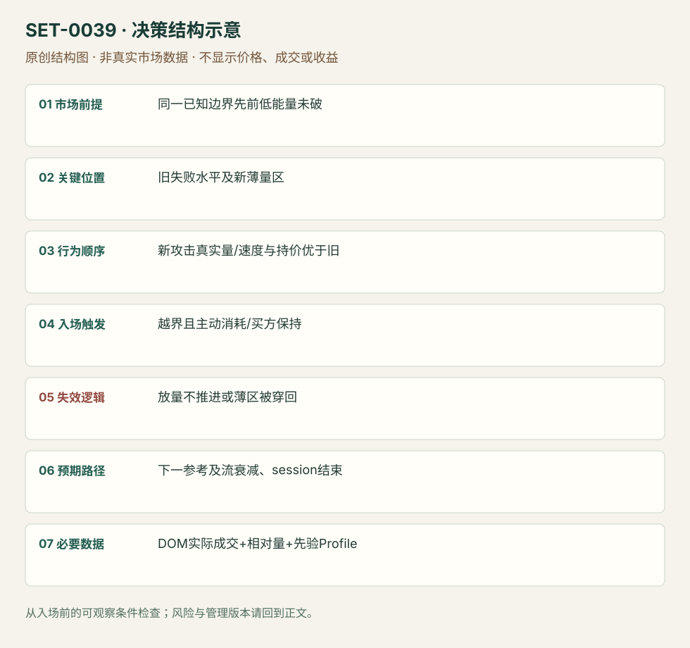

---
{
  "id": "SET-0039",
  "schema_version": "1.0.0",
  "name_zh": "同一水平前后成交能量改变的突破",
  "name_en": "Volume Energy-change Break",
  "aliases": [],
  "name_nature": "editor_descriptive_with_source_term",
  "status": "reviewed",
  "summary": "先前同一边界的尝试没有突破能力，后来攻击的真实成交强度、速度与持价都改变，交易强度差异支持的突破。不能只把最新一根量柱最大当理由。",
  "mechanism": "initiative_intensity_change",
  "tags": [
    "volume",
    "DOM",
    "breakout",
    "momentum"
  ],
  "pa_role": "supporting",
  "markets_observed": [
    "原油期货"
  ],
  "markets_supported": [],
  "migration_hypotheses": [],
  "session": "来源原油期货盘中，图时区/完整session未标；实际复盘要锁定产品电子交易日与现金活动段，并在计划段结束前平仓。",
  "session_tags": [
    "intraday"
  ],
  "context_timeframe": "日线/前一session + 当日执行图；因来源而异",
  "trigger_timeframe": null,
  "data_requirements": [
    "OHLC",
    "volume",
    "DOM",
    "volume_profile"
  ],
  "execution_mode": "discretionary",
  "source_ids": [
    "SRC-0029",
    "SRC-0002"
  ],
  "evidence_ids": [
    "EVD-000078",
    "EVD-000079"
  ],
  "visual_ids": [
    "VIS-000041",
    "VIS-000096"
  ],
  "rule_completeness": "前提/触发/失效/管理已记录；来源与编辑模块分开",
  "independent_corroboration": "independent_context_only",
  "profit_evidence": "not_established",
  "created": "2026-10-02",
  "updated": "2026-10-02",
  "reviewed_at": "2026-10-02",
  "known_gaps": [
    "未开展独立回测；实际订单成交与成本未知",
    "执行周期没有统一来源参数，使用前须锁定版本"
  ],
  "logic_fingerprint": [
    "同一已知边界先前低能量未破",
    "旧失败水平及新薄量区",
    "新攻击真实量/速度与持价优于旧",
    "越界且主动消耗/买方保持",
    "放量不推进或薄区被穿回",
    "下一参考及流衰减、session结束",
    "DOM实际成交+相对量+先验Profile"
  ],
  "environment_tags": [
    "directional",
    "intensity_change"
  ],
  "structure_locations": [
    "repeated_price_level"
  ],
  "version": "1.0.0",
  "unknown_fields": {
    "trigger_timeframe": "来源未提供统一执行周期；正文记录已知图例，不能当成统一参数"
  },
  "review_scope": "规则记录、引用范围、日内边界、逻辑区别与已看静态画面；不含独立回测、动态逐笔或账户核验",
  "source_coverage": {
    "substantive_read_sources": 2,
    "families": [
      "axia",
      "jigsaw"
    ],
    "core_support_source_ids": [
      "SRC-0029"
    ],
    "independence_note": "independent_context_only"
  },
  "method_families": [
    "tape_DOM"
  ],
  "market_types": [
    "futures"
  ]
}
---

# 同一水平前后成交能量改变的突破 · Volume Energy-change Break

## 1. 名称与快速概览

先前同一边界的尝试没有突破能力，后来攻击的真实成交强度、速度与持价都改变，交易强度差异支持的突破。不能只把最新一根量柱最大当理由。

记录口径：PA supporting；必要数据 OHLC、volume、DOM、volume_profile。名称性质：编辑性描述名，英文保留来源术语以便检索。reviewed 只表示本条规则与证据记录审查通过，盈利状态为 not_established。

## 2. 本质与行为假说

比较同位置两轮主动性，降低把常见触碰误认突破的机会。来源“能量”需拆成成交相对量、价格推进和反向能力，不能神秘化成不可量化感觉。

## 3. 适用市场与环境

源例原油40.35既有阻力，多次低能量测试后下一轮改变。需要产品自身历史节奏和同日基准，不能把某固定合约数量套不同深度产品。

**来源实用市场：**原油期货。

**Session：**来源原油期货盘中，图时区/完整session未标；实际复盘要锁定产品电子交易日与现金活动段，并在计划段结束前平仓。

跨市场：本版不主张已经验证的跨市场迁移；更换市场必须重定数据来源、流动性与session。

## 4. 出现前的观察清单

保存旧失败尝试时的量/速度，固定边界和上下节点；先列本次必须改变哪些观测。DOM挂单大小本身不作触发。

## 5. 形成过程与状态转换

旧尝试停顿 → 回撤 → 新一轮相对成交提高 → bid保持/offer被真实消耗 → 越界 → 留薄量区且回落不能穿回 → 延续。

## 6. Entry trigger 与执行方式

来源在新攻击力量显现且边界被拿时买入；破后薄区保持给持有/再次确认。早在破前买必须记为更早版，不能统一标40.35无滑点。

## 7. Invalidation 与止损逻辑

原例40.30下方、接近薄区破坏；迁移时换成该次破位枢轴/LVN下方。若放量无推进、重新回到旧范围，能量解释被否认。

## 8. Exit、target 与 trade management

原例40.80前参考，并观察回抽与主动买入衰退；目标只属该图。数据发布前留风险路线，session结束前退出。

## 9. 常见 variations

边界为区间高/低、阻力或其他先验参考是位置版本；添加Profile只是管理层。本条必需同位前后强度比较，不等价一般放量突破。

## 10. 失败方式与不交易条件

新成交仍无价格推进（可能吸收）；大报价撤走没有成交；时间段天然量变未标准化；破位后薄区被重新填厚。

## 11. 与相近 setups 的区别

- [SET-0047](SET-0047.md)：0047 不要求速度/主动量爆发，而以厚市场持续被动持价渐进执行。
- [SET-0041](SET-0041.md)：0041 的核心是阶梯跳过薄区后反向流少；本条要求同位旧尝试与新尝试强度变化。

## 12. 图表与案例解读

已看1/2/3对照图，能看相同水平前后价/量差异；速度与bid保持来自正文，未观看回放。

- [VIS-000041] [Execution zone and energy change measured by relative volume](https://axiafutures.com/blog/wp-content/uploads/2020/11/19-image2.png)；定位：First touches1–2 versus energy change3。蓝线40.35附近先前两次停顿，第三次量柱与推进不同；图不能直接测DOM动态。 验证：chart_viewed。

**本地原创示意（VIS-000096，非真实市场数据）：**

小屏阅读可[打开原尺寸示意图](../assets/diagrams/SET-0039.svg)并缩放。

此图用于对照识别顺序与风险定义；不计入真实案例覆盖率。

## 13. 证据、分歧与未知项

Axia具体案例与Jigsaw独立动量定义相容，但独立核心策略验证有限。文章引用的动量速度没有在本研究做动态测量。

- [EVD-000078] Axia Futures，《Breakout Energy Change Trade》，[SRC-0029](https://axiafutures.com/blog/breakout-energy-change-trade/)；定位：previous40.35 stall / relative volume / bids holding /40.80 target。支持：此前40.35附近缺能量，后次攻击量与速度提高且bid保持、offer被拿；破位后LVN守住，风险40.30下、目标40.80。
- [EVD-000079] Peter Davies，《Practical Application of Order Flow, Part 2》，[SRC-0002](https://www.jigsawtrading.com/wp-content/uploads/2014/03/PracticalApplicationOfOrderFlow-Pt2.pdf)；定位：PDF页序13 Momentum trading。支持：主动扫报价并继续移动与大量成交却不动不同；静态大订单不等于动量，独立概念限制。

审查边界：来源份数与独立核心核验分开；当前类别为 independent_context_only。正文中的概念、官方事实、衍生解说或同族资料只按其支持范围使用。

## 14. 可用于复盘的检查表

- [ ] 下单前的前提可核对：同一已知边界先前低能量未破
- [ ] 事前标记位置：旧失败水平及新薄量区
- [ ] 行为按顺序出现：新攻击真实量/速度与持价优于旧
- [ ] 实际触发符合选定版本：越界且主动消耗/买方保持
- [ ] 事先写明本次否定条件：放量不推进或薄区被穿回
- [ ] 目标/路径只用当时已知信息：下一参考及流衰减、session结束
- [ ] 数据满足 DOM实际成交+相对量+先验Profile；记录时间、点差、滑点、队列和未成交
- [ ] 记录截止平仓及规则偏离；正常亏损不事后改成“未成立”

## 15. 后续验证问题

同位置比较是否需按时段归一化？哪种能量指标最可复核？延迟等LVN保持能减少多少假突破？
