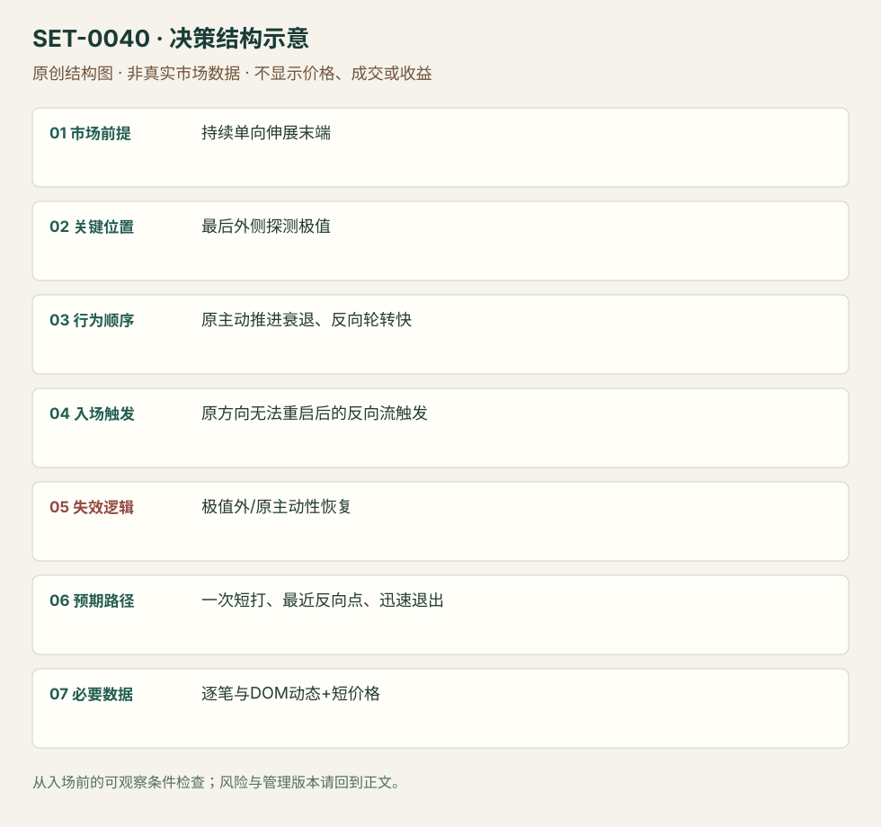

---
{
  "id": "SET-0040",
  "schema_version": "1.0.0",
  "name_zh": "单向伸展末端的主动流耗尽反向短打",
  "name_en": "Exhaustion-flow Fade Scalp",
  "aliases": [],
  "name_nature": "editor_descriptive_with_source_term",
  "status": "reviewed",
  "summary": "长段单向伸展末端，最后一次尝试后原主动方再不能推进、反向轮转变快；捕捉短促反向退出流。目标小、判断错立即撤，而不是预言全天顶部。",
  "mechanism": "aggressor_exhaustion",
  "tags": [
    "order_flow",
    "scalping",
    "reversal"
  ],
  "pa_role": "supporting",
  "markets_observed": [
    "GBP/USD（原场所/合约未确认）",
    "期货（Jigsaw教育规则）"
  ],
  "markets_supported": [],
  "migration_hypotheses": [],
  "session": "来源期货执行片段，具体时区未知；只在当前计划session短打，结束前平仓，不使用多日价值回归目标。",
  "session_tags": [
    "intraday"
  ],
  "context_timeframe": "日线/前一session + 当日执行图；因来源而异",
  "trigger_timeframe": null,
  "data_requirements": [
    "trade_prints",
    "DOM",
    "OHLC"
  ],
  "execution_mode": "discretionary",
  "source_ids": [
    "SRC-0032",
    "SRC-0002"
  ],
  "evidence_ids": [
    "EVD-000080",
    "EVD-000081"
  ],
  "visual_ids": [
    "VIS-000042",
    "VIS-000097"
  ],
  "rule_completeness": "前提/触发/失效/管理已记录；来源与编辑模块分开",
  "independent_corroboration": "multiple_families",
  "profit_evidence": "not_established",
  "created": "2026-10-02",
  "updated": "2026-10-02",
  "reviewed_at": "2026-10-02",
  "known_gaps": [
    "未开展独立回测；实际订单成交与成本未知",
    "执行周期没有统一来源参数，使用前须锁定版本"
  ],
  "logic_fingerprint": [
    "持续单向伸展末端",
    "最后外侧探测极值",
    "原主动推进衰退、反向轮转快",
    "原方向无法重启后的反向流触发",
    "极值外/原主动性恢复",
    "一次短打、最近反向点、迅速退出",
    "逐笔与DOM动态+短价格"
  ],
  "environment_tags": [
    "extended",
    "aggressor_fade"
  ],
  "structure_locations": [
    "extension_extreme"
  ],
  "version": "1.0.0",
  "unknown_fields": {
    "trigger_timeframe": "来源未提供统一执行周期；正文记录已知图例，不能当成统一参数"
  },
  "review_scope": "规则记录、引用范围、日内边界、逻辑区别与已看静态画面；不含独立回测、动态逐笔或账户核验",
  "source_coverage": {
    "substantive_read_sources": 2,
    "families": [
      "axia",
      "jigsaw"
    ],
    "core_support_source_ids": [
      "SRC-0032",
      "SRC-0002"
    ],
    "independence_note": "multiple_families"
  },
  "method_families": [
    "tape_DOM",
    "liquidity_inventory"
  ],
  "market_types": [
    "FX_venue_unconfirmed",
    "futures"
  ]
}
---

# 单向伸展末端的主动流耗尽反向短打 · Exhaustion-flow Fade Scalp

## 1. 名称与快速概览

长段单向伸展末端，最后一次尝试后原主动方再不能推进、反向轮转变快；捕捉短促反向退出流。目标小、判断错立即撤，而不是预言全天顶部。

记录口径：PA supporting；必要数据 trade_prints、DOM、OHLC。名称性质：编辑性描述名，英文保留来源术语以便检索。reviewed 只表示本条规则与证据记录审查通过，盈利状态为 not_established。

## 2. 本质与行为假说

耗尽看主动参与或推进能力衰退，吸收看有很多主动成交却价格不走。可同时出现，但两种证据不能用同一句“大单”混写。

## 3. 适用市场与环境

来源GBP/USD明显伸展末端；Jigsaw泛期货教育。产品厚薄、最小跳与成本决定短打是否可执行，新闻驱动持续趋势慎用。

**来源实用市场：**GBP/USD（原场所/合约未确认）、期货（Jigsaw教育规则）。

**Session：**来源期货执行片段，具体时区未知；只在当前计划session短打，结束前平仓，不使用多日价值回归目标。

跨市场：本版不主张已经验证的跨市场迁移；更换市场必须重定数据来源、流动性与session。

## 4. 出现前的观察清单

识别伸展和已知外侧位置，记录此前主动成交速度；定义最后尝试极值、反向确认和首目标。没有DOM/逐笔不能宣称已观察主动耗尽。

## 5. 形成过程与状态转换

持续单向 → 最后外侧探测 → 原主动买入/卖出不足以续推 → 反向轮转加速 → 原方向重启失败 → 一次短打。

## 6. Entry trigger 与执行方式

来源在上冲后快速下转、lift offer能力消失时空；价格棒确认是更晚代理，不能声称和原DOM入口同价。一个尝试只一次，不连续反向补仓。

## 7. Invalidation 与止损逻辑

最后探测极值外，或原方向即时恢复主动推进先撤；精确距离依产品。若短目标无法覆盖点差/滑点，不因图好看下单。

## 8. Exit、target 与 trade management

原文一clip、一次尝试、scalp；以最近反向拍卖点和速度衰退退出。本库不填通用2–3tick目标，Jigsaw的ES教育距离不是全市场常数。

## 9. 常见 variations

上下耗尽对称；Footprint相邻价成交骤减是观察版本。没有主动流支持的三推楔形仍是0007，不把图形名称当本条的数据证据。

## 10. 失败方式与不交易条件

只有停顿但原主动方很快回来；吸收不断后最终突破；目标太小成本大；看静态量就声称速度改变；把短打持成趋势逆向。

## 11. 与相近 setups 的区别

- [SET-0003](SET-0003.md)：0003 大量主动成交无法推进是吸收；本条原主动参与/推进衰退并快速反转。
- [SET-0045](SET-0045.md)：0045 必须先有冰山、卖压转换和弱冲洗的多段序列，本条只需末端耗尽短打。

## 12. 图表与案例解读

已看GBP伸展图，明确最后外侧尖峰和后续回落；流的速度/参与变化仅来自文字，没有视频核对，条目保留这一界限。

- [VIS-000042] [Trading Exhaustion Move In British Pound - on the left, H1 timeframe on the right, extended move. Move on the right is vertical, with first red candle signalling the top.](https://axiafutures.com/blog/wp-content/uploads/2022/11/18.11.2022-01-exhaustion-1024x668.png)；定位：GBP exhaustion chart。最后尖峰被作者圈出，下轮无法再上推；静态图仅给价格顺序，不能单独证明lift offer消失。 验证：chart_viewed。

**本地原创示意（VIS-000097，非真实市场数据）：**

小屏阅读可[打开原尺寸示意图](../assets/diagrams/SET-0040.svg)并缩放。

此图用于对照识别顺序与风险定义；不计入真实案例覆盖率。

## 13. 证据、分歧与未知项

Axia与Jigsaw解释来自不同家族，支持耗尽与吸收的区别和短打思路；没有独立同参数收益检验。

- [EVD-000080] Axia Futures，《2 Ways To Scalp The Exhaustion Move》，[SRC-0032](https://axiafutures.com/blog/2-ways-to-scalp-the-exhaustion-move/)；定位：GBP exhaustion: last flick / cannot lift offer / one clip。支持：单向延伸后最后上冲，转下很快且无法再lift offer，反向短打一次；不是等待广泛趋势反转。
- [EVD-000081] Peter Davies，《Practical Application of Order Flow, Part 2》，[SRC-0002](https://www.jigsawtrading.com/wp-content/uploads/2014/03/PracticalApplicationOfOrderFlow-Pt2.pdf)；定位：PDF页序9–11 reversal recap。支持：区分大量主动成交被吸收和主动参与者越来越少的耗尽；反向确认后只做很短距离。

## 14. 可用于复盘的检查表

- [ ] 下单前的前提可核对：持续单向伸展末端
- [ ] 事前标记位置：最后外侧探测极值
- [ ] 行为按顺序出现：原主动推进衰退、反向轮转快
- [ ] 实际触发符合选定版本：原方向无法重启后的反向流触发
- [ ] 事先写明本次否定条件：极值外/原主动性恢复
- [ ] 目标/路径只用当时已知信息：一次短打、最近反向点、迅速退出
- [ ] 数据满足 逐笔与DOM动态+短价格；记录时间、点差、滑点、队列和未成交
- [ ] 记录截止平仓及规则偏离；正常亏损不事后改成“未成立”

## 15. 后续验证问题

耗尽的交易数与成交量哪个更稳？静态Footprint代理损失多少时效？同品种不同深度条件下成本可否覆盖？
