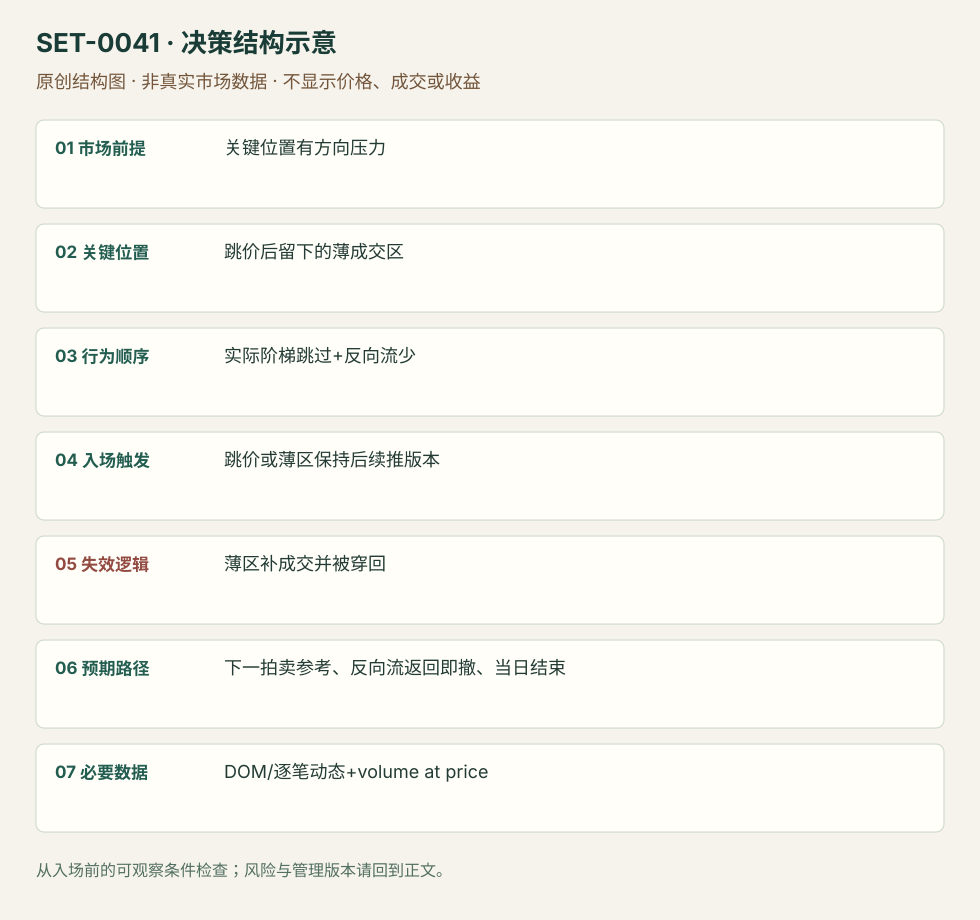

---
{
  "id": "SET-0041",
  "schema_version": "1.0.0",
  "name_zh": "阶梯跳价后低量区保持的延续",
  "name_en": "Jump-flow Low-volume-area Continuation",
  "aliases": [],
  "name_nature": "editor_descriptive_with_source_term",
  "status": "reviewed",
  "summary": "关键位置方向流把价格跳过数档，后方留下薄成交区；只要反向流少且薄区未被重新接受，就顺方向保持/进入。这里要求实际阶梯行为，不只一根长K线。",
  "mechanism": "liquidity_gap_continuation",
  "tags": [
    "order_flow",
    "DOM",
    "low_volume",
    "breakout"
  ],
  "pa_role": "supporting",
  "markets_observed": [
    "DAX期货",
    "S&P500期货"
  ],
  "markets_supported": [],
  "migration_hypotheses": [],
  "session": "原期货图完整时区/日段未明确；按产品自己的计划session，入场与退出均限该段，电子日和现金段分别标。",
  "session_tags": [
    "intraday"
  ],
  "context_timeframe": "日线/前一session + 当日执行图；因来源而异",
  "trigger_timeframe": null,
  "data_requirements": [
    "DOM",
    "trade_prints",
    "volume_at_price",
    "OHLC"
  ],
  "execution_mode": "discretionary",
  "source_ids": [
    "SRC-0039",
    "SRC-0063"
  ],
  "evidence_ids": [
    "EVD-000082",
    "EVD-000083"
  ],
  "visual_ids": [
    "VIS-000043",
    "VIS-000044",
    "VIS-000098"
  ],
  "rule_completeness": "前提/触发/失效/管理已记录；来源与编辑模块分开",
  "independent_corroboration": "limited_single_family",
  "profit_evidence": "not_established",
  "created": "2026-10-02",
  "updated": "2026-10-02",
  "reviewed_at": "2026-10-02",
  "known_gaps": [
    "未开展独立回测；实际订单成交与成本未知",
    "执行周期没有统一来源参数，使用前须锁定版本"
  ],
  "logic_fingerprint": [
    "关键位置有方向压力",
    "跳价后留下的薄成交区",
    "实际阶梯跳过+反向流少",
    "跳价或薄区保持后续推版本",
    "薄区补成交并被穿回",
    "下一拍卖参考、反向流返回即撤、当日结束",
    "DOM/逐笔动态+volume at price"
  ],
  "environment_tags": [
    "directional",
    "liquidity_gap"
  ],
  "structure_locations": [
    "jumped_low_volume_area"
  ],
  "version": "1.0.0",
  "unknown_fields": {
    "trigger_timeframe": "来源未提供统一执行周期；正文记录已知图例，不能当成统一参数"
  },
  "review_scope": "规则记录、引用范围、日内边界、逻辑区别与已看静态画面；不含独立回测、动态逐笔或账户核验",
  "source_coverage": {
    "substantive_read_sources": 2,
    "families": [
      "axia"
    ],
    "core_support_source_ids": [
      "SRC-0039",
      "SRC-0063"
    ],
    "independence_note": "limited_single_family"
  },
  "method_families": [
    "tape_DOM",
    "liquidity_inventory"
  ],
  "market_types": [
    "futures"
  ]
}
---

# 阶梯跳价后低量区保持的延续 · Jump-flow Low-volume-area Continuation

## 1. 名称与快速概览

关键位置方向流把价格跳过数档，后方留下薄成交区；只要反向流少且薄区未被重新接受，就顺方向保持/进入。这里要求实际阶梯行为，不只一根长K线。

记录口径：PA supporting；必要数据 DOM、trade_prints、volume_at_price、OHLC。名称性质：编辑性描述名，英文保留来源术语以便检索。reviewed 只表示本条规则与证据记录审查通过，盈利状态为 not_established。

## 2. 本质与行为假说

薄区提示该轮拍卖快速移动，反向补成交会改变原有单向性。不能从静态DOM空白就断言stop run或保证继续；实际成交与价格响应必须同时看。

## 3. 适用市场与环境

来源DAX下破与ES上推后失败，产品厚薄不同。关键区和先验路线已知，跳价后仍有可执行风险空间；过快追价导致巨大滑点则跳过。

**来源实用市场：**DAX期货、S&P500期货。

**Session：**原期货图完整时区/日段未明确；按产品自己的计划session，入场与退出均限该段，电子日和现金段分别标。

跨市场：本版不主张已经验证的跨市场迁移；更换市场必须重定数据来源、流动性与session。

## 4. 出现前的观察清单

画事前触发区、下一目标、跳过区上下缘；保留DOM回放/逐笔。检查反向成交有没有迅速进入薄区，不能只看最终稀疏图。

## 5. 形成过程与状态转换

压力至关键位 → 方向流阶梯跳价 → 薄量区形成 → 回抽反向流少/无法穿回 → 顺向续推；若反向量填入则撤销。

## 6. Entry trigger 与执行方式

来源可在跳价出现时主动执行或靠薄区边缘维持；编辑确认版等边缘保持再续推，必须标晚入口而非填跳价前价格。

## 7. Invalidation 与止损逻辑

薄区被持续补成交并穿回，或关键边缘重新被接受时失效；已知边缘外硬风险。大量打印不推进是警讯，不能把有量总视为支持。

## 8. Exit、target 与 trade management

下一已知拍卖点；反向流回来、价格在薄区附近反复交易时减仓/退出。ES反例强调没有保持便迅速撤，而非等原极值。日内结束。

## 9. 常见 variations

Open Drive 留LVN归同一持续薄区逻辑；价格阶梯宽度、产品和Footprint显示方式属于版本。不是把所有LVN回测单都算本条。

## 10. 失败方式与不交易条件

跳价很快填回；追入后无剩余目标空间；薄区认定使用整段事后成交；把报价撤销等同已成交；静态截图误称看过速度。

## 11. 与相近 setups 的区别

- [SET-0039](SET-0039.md)：0039 重点是同位新旧主动强度比较；本条要求跳价后薄区持续未被反向填。
- [SET-0036](SET-0036.md)：0036 上部厚量接受块下沿持价；本条依后方薄区未被接受。

## 12. 图表与案例解读

已看DAX与ES两图。DAX为支持例，ES为保持失败例；没有把同样成功叙事套两市场。动态跳价依据仅文字。

- [VIS-000043] [DAX breaking lower: left side market profile with P shape, middle a price ladder chart (no important info inside), right side a candlestick chart showing false balance break to the upside and reversing to the downside](https://axiafutures.com/blog/wp-content/uploads/2022/08/dax-jump-1024x629.png)；定位：DAX Jump Flow composite。作者将关键卖区、DOM薄量和IBH目标放同图，支持位置和管理参照，不能测动态速度。 验证：chart_viewed。
- [VIS-000044] [ES冲高后反向穿回，提供正常失败边界。](https://axiafutures.com/blog/wp-content/uploads/2022/08/emini-jump-1.png)；定位：ES failed low-volume hold。ES冲高后反向穿回，提供正常失败边界。 验证：chart_viewed。

**本地原创示意（VIS-000098，非真实市场数据）：**

小屏阅读可[打开原尺寸示意图](../assets/diagrams/SET-0041.svg)并缩放。

此图用于对照识别顺序与风险定义；不计入真实案例覆盖率。

## 13. 证据、分歧与未知项

两个Axia例含失败，但同家族独立佐证有限。文章中的4:16/18:03是作者指向的视频位置；本研究没有播放，因此不作已核对时间码。

- [EVD-000082] Axia Futures，《Use This Volume Pattern To Manage Your Trade》，[SRC-0039](https://axiafutures.com/blog/use-this-volume-pattern-to-manage-your-trade/)；定位：DAX jump flow / ES failed low-volume hold。支持：关键区压力后阶梯跳价，留下薄量区；少反向流可持有，薄区内大量换手/反向力量回来则退出，ES例失败。
- [EVD-000083] Axia Futures，《How Can Footprint Help Your Trade Execution》，[SRC-0063](https://axiafutures.com/blog/how-can-footprint-help-your-trade-execution/)；定位：Open Drive LVN in Footprint。支持：强开盘驱动留下低量区，可按其边缘进入/保护；仅有低量区不是独立setup。

审查边界：来源份数与独立核心核验分开；当前类别为 limited_single_family。正文中的概念、官方事实、衍生解说或同族资料只按其支持范围使用。

## 14. 可用于复盘的检查表

- [ ] 下单前的前提可核对：关键位置有方向压力
- [ ] 事前标记位置：跳价后留下的薄成交区
- [ ] 行为按顺序出现：实际阶梯跳过+反向流少
- [ ] 实际触发符合选定版本：跳价或薄区保持后续推版本
- [ ] 事先写明本次否定条件：薄区补成交并被穿回
- [ ] 目标/路径只用当时已知信息：下一拍卖参考、反向流返回即撤、当日结束
- [ ] 数据满足 DOM/逐笔动态+volume at price；记录时间、点差、滑点、队列和未成交
- [ ] 记录截止平仓及规则偏离；正常亏损不事后改成“未成立”

## 15. 后续验证问题

实际跳过档数与报价空洞怎样区分？薄区保持要等多少成交？主动追与晚确认的滑点/漏单差异？
