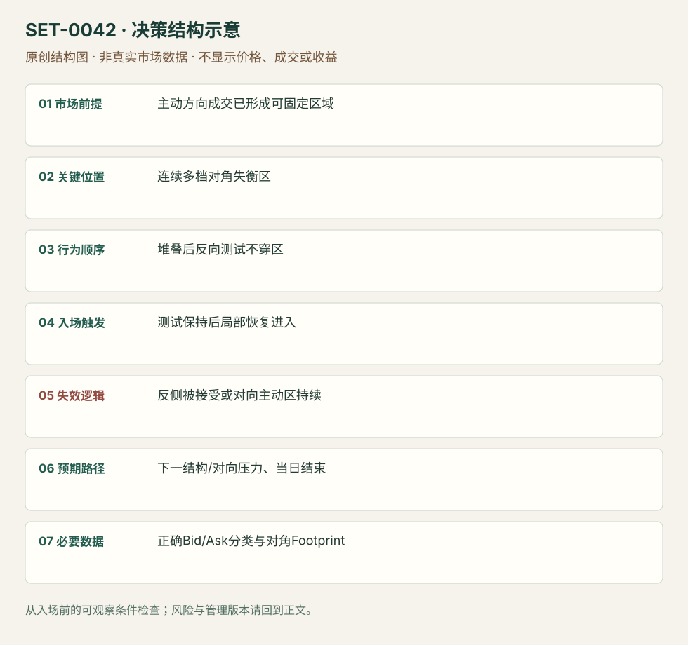

---
{
  "id": "SET-0042",
  "schema_version": "1.0.0",
  "name_zh": "堆叠对角失衡区的保持与再推进",
  "name_en": "Stacked Imbalance Zone Hold",
  "aliases": [],
  "name_nature": "editor_descriptive_with_source_term",
  "status": "reviewed",
  "summary": "一次主动方向成交在相邻多价位形成对角失衡区；后续测试不能压穿该区，重新向原方向推进时执行。失衡不是同价Bid/Ask比较，也不是看单个亮色格即入。",
  "mechanism": "initiative_zone_support",
  "tags": [
    "footprint",
    "imbalance",
    "trend_continuation"
  ],
  "pa_role": "non_primary",
  "markets_observed": [
    "RTS指数期货 RIH9"
  ],
  "markets_supported": [],
  "migration_hypotheses": [],
  "session": "RTS原session执行片段，时区未知；按交易所合约与数据商时区定义当日段并平仓，不能直接套美股日。",
  "session_tags": [
    "intraday"
  ],
  "context_timeframe": "日线/前一session + 当日执行图；因来源而异",
  "trigger_timeframe": null,
  "data_requirements": [
    "bid_ask_classified_trades",
    "diagonal_footprint"
  ],
  "execution_mode": "discretionary",
  "source_ids": [
    "SRC-0035",
    "SRC-0036"
  ],
  "evidence_ids": [
    "EVD-000084",
    "EVD-000085",
    "EVD-000104"
  ],
  "visual_ids": [
    "VIS-000045",
    "VIS-000099"
  ],
  "rule_completeness": "前提/触发/失效/管理已记录；来源与编辑模块分开",
  "independent_corroboration": "limited_single_family",
  "profit_evidence": "not_established",
  "created": "2026-10-02",
  "updated": "2026-10-02",
  "reviewed_at": "2026-10-02",
  "known_gaps": [
    "未开展独立回测；实际订单成交与成本未知",
    "执行周期没有统一来源参数，使用前须锁定版本"
  ],
  "logic_fingerprint": [
    "主动方向成交已形成可固定区域",
    "连续多档对角失衡区",
    "堆叠后反向测试不穿区",
    "测试保持后局部恢复进入",
    "反侧被接受或对向主动区持续",
    "下一结构/对向压力、当日结束",
    "正确Bid/Ask分类与对角Footprint"
  ],
  "environment_tags": [
    "directional",
    "pullback"
  ],
  "structure_locations": [
    "stacked_imbalance_zone"
  ],
  "version": "1.0.0",
  "markets_context_only": [
    "加密合约（仅概念补充）"
  ],
  "unknown_fields": {
    "trigger_timeframe": "来源未提供统一执行周期；正文记录已知图例，不能当成统一参数"
  },
  "review_scope": "规则记录、引用范围、日内边界、逻辑区别与已看静态画面；不含独立回测、动态逐笔或账户核验",
  "source_coverage": {
    "substantive_read_sources": 2,
    "families": [
      "atas"
    ],
    "core_support_source_ids": [
      "SRC-0035"
    ],
    "independence_note": "limited_single_family"
  },
  "method_families": [
    "footprint_delta"
  ],
  "market_types": [
    "futures"
  ]
}
---

# 堆叠对角失衡区的保持与再推进 · Stacked Imbalance Zone Hold

## 1. 名称与快速概览

一次主动方向成交在相邻多价位形成对角失衡区；后续测试不能压穿该区，重新向原方向推进时执行。失衡不是同价Bid/Ask比较，也不是看单个亮色格即入。

记录口径：PA non_primary；必要数据 bid_ask_classified_trades、diagonal_footprint。名称性质：编辑性描述名，英文保留来源术语以便检索。reviewed 只表示本条规则与证据记录审查通过，盈利状态为 not_established。

## 2. 本质与行为假说

已发生的主动成交区可能在后续成为防守位置是可检验假说。连续≥3档是本版编辑门槛，原例有3/5/6档；主动方是否仍持仓或是机构无法由颜色知道。

## 3. 适用市场与环境

源例RTS反转棒1/10聚合与300%对角比。平台默认150%不是统一标准；时间棒、反转棒和币安场所等各自的数据质量影响区。

**来源实用市场：**RTS指数期货 RIH9、加密合约（仅概念补充）。

**Session：**RTS原session执行片段，时区未知；按交易所合约与数据商时区定义当日段并平仓，不能直接套美股日。

跨市场：本版不主张已经验证的跨市场迁移；更换市场必须重定数据来源、流动性与session。

## 4. 出现前的观察清单

固定对角公式、比率、最小分母量/零值处理、连续档数、聚合与session。Bid通常是主动卖成交、Ask是主动买成交；数据商分类和图方向需要核对。

## 5. 形成过程与状态转换

主动方向堆叠出现 → 区域被固定 → 小反向测试不能穿底/顶 → 恢复越过近端测试高/低 → 原方向延续或反区被接受。

## 6. Entry trigger 与执行方式

来源在堆叠区之后观察测试保持和恢复；编辑执行版越过测试结构进入。提前在区内限价与恢复后主动单分开；区出现本身只进入观察。

## 7. Invalidation 与止损逻辑

堆叠区反侧外，或反向主动失衡持续并接受穿区。具体缓冲依最小跳/噪声测试，不能从任意亮格给精确安全距离。

## 8. Exit、target 与 trade management

下一已知结构与对向堆叠压力；原方向推进受阻或反向区得到接受时管理。源文没有完整统一盈亏计划，编辑结构目标须验证。当天计划结束前平仓。

## 9. 常见 variations

比率150%/300%、最小量与聚合周期为参数；不是多个Setup。没有堆叠区保持的单格失衡，只是工具信号。

## 10. 失败方式与不交易条件

小分母/零分母制造巨大百分比；成交归类错误；堆叠已被穿回仍坚持支持；按同价比误算；将所有绿色都称机构买入。

## 11. 与相近 setups 的区别

- [SET-0043](SET-0043.md)：0043 堆叠主动方本身失败，越回区后交易反方向；本条要求区保持而继续。
- [SET-0003](SET-0003.md)：0003 大量主动成交无推进作吸收反转，本条先已发生推进/主动区，后测试保持。

## 12. 图表与案例解读

已看RIH9对照脚印图，能核多档区域与测试/恢复。颜色阈值依据原文300%版本，完整日期/时区未核实，不填推测值。

- [VIS-000045] [imbalance analysis](https://atas.net/wp-content/uploads/2019/02/Ris1-3.jpg)；定位：Imbalance analysis paired charts。右图红绿对角着色和多档区，之后测试没有压破区并恢复；这是反转聚合图，不是时间分钟图。 验证：chart_viewed。

**本地原创示意（VIS-000099，非真实市场数据）：**

小屏阅读可[打开原尺寸示意图](../assets/diagrams/SET-0042.svg)并缩放。

此图用于对照识别顺序与风险定义；不计入真实案例覆盖率。

## 13. 证据、分歧与未知项

两文属ATAS家族，核心独立佐证有限。营销中的“必然上涨”“大资金身份”不作事实；同数据图可支持操作化和反例。

- [EVD-000084] Danil Solovyov，《Imbalance – what is it? How to trade imbalance.》，[SRC-0035](https://atas.net/blog/how-to-find-and-trade-imbalance/)；定位：Imbalance analysis: 300% /5 and3 contiguous levels / retest。支持：对角比较Bid和高一档Ask，300%示例连续多档形成区；之后两棒不穿区，恢复方向。默认150%与示例300%不同。
- [EVD-000085] ATAS Team，《An imbalance. Did you know that size matters?》，[SRC-0036](https://atas.net/blog/imbalance-why-the-size-matters/)；定位：Example where imbalances help / support-resistance zones。支持：同ATAS家族讨论连续主动成交区和后续测试，不意味着机构身份可见。

审查边界：来源份数与独立核心核验分开；当前类别为 limited_single_family。正文中的概念、官方事实、衍生解说或同族资料只按其支持范围使用。

- [EVD-000104] **编辑操作化，未测试：**至少三个连续档位作为本库堆叠候选，另设最小量和零分母规则；阈值待测。 原文边界：原文300%示例分别有3/5/6档并讨论默认150%，不能推出统一三档标准。

## 14. 可用于复盘的检查表

- [ ] 下单前的前提可核对：主动方向成交已形成可固定区域
- [ ] 事前标记位置：连续多档对角失衡区
- [ ] 行为按顺序出现：堆叠后反向测试不穿区
- [ ] 实际触发符合选定版本：测试保持后局部恢复进入
- [ ] 事先写明本次否定条件：反侧被接受或对向主动区持续
- [ ] 目标/路径只用当时已知信息：下一结构/对向压力、当日结束
- [ ] 数据满足 正确Bid/Ask分类与对角Footprint；记录时间、点差、滑点、队列和未成交
- [ ] 记录截止平仓及规则偏离；正常亏损不事后改成“未成立”

## 15. 后续验证问题

最小分母/成交门槛怎么设？堆叠相对单格的新增信息？聚合改变是否改变同一机会的观察结论？
