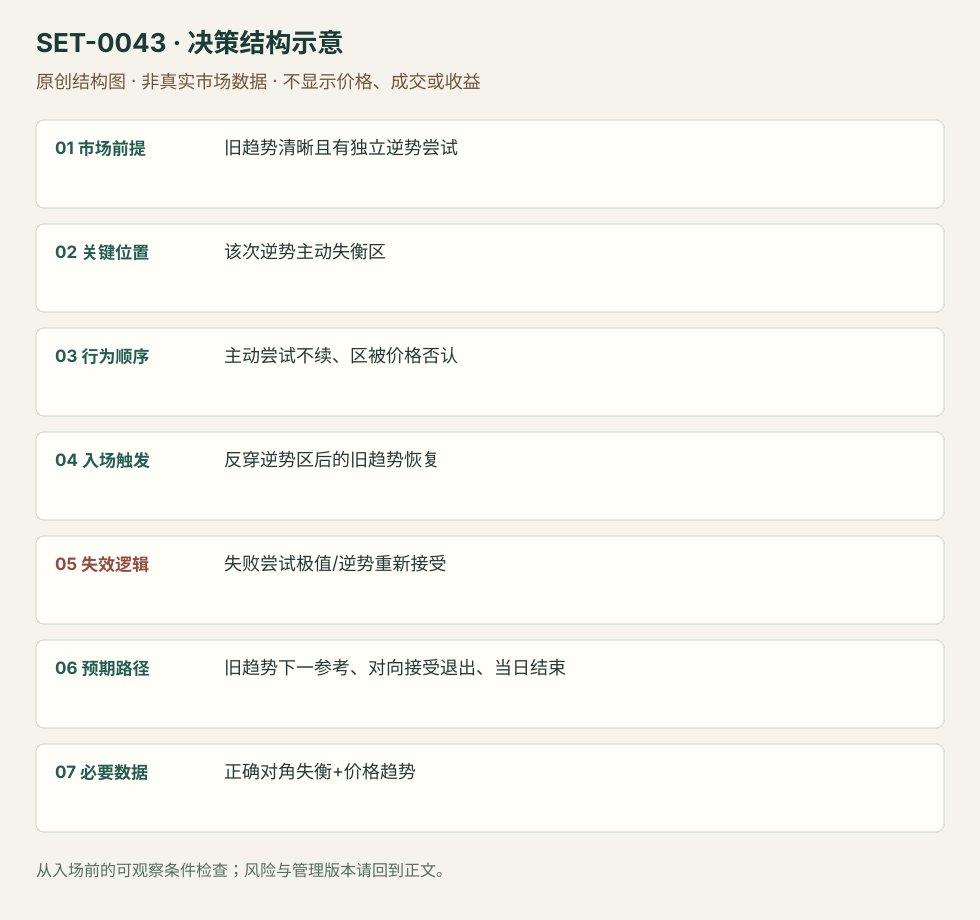

---
{
  "id": "SET-0043",
  "schema_version": "1.0.0",
  "name_zh": "逆势主动失衡失败后的顺势回归",
  "name_en": "Failed Countertrend Imbalance Trap",
  "aliases": [],
  "name_nature": "editor_descriptive_with_source_term",
  "status": "reviewed",
  "summary": "旧趋势中的逆势恢复出现明显主动失衡，却无法推进；价格反穿该次逆势失衡区后，交易旧趋势恢复。不是失衡区保持的0042，也不以所有大量成交无推进都算本条。",
  "mechanism": "countertrend_initiative_failure",
  "tags": [
    "footprint",
    "imbalance",
    "trapped_traders",
    "trend_continuation"
  ],
  "pa_role": "non_primary",
  "markets_observed": [
    "RTS指数期货 RIH9"
  ],
  "markets_supported": [],
  "migration_hypotheses": [],
  "session": "RTS源图盘中，时区/完整日段未知；实际复盘按当地合约session定义，结束前平仓。",
  "session_tags": [
    "intraday"
  ],
  "context_timeframe": "日线/前一session + 当日执行图；因来源而异",
  "trigger_timeframe": null,
  "data_requirements": [
    "diagonal_footprint",
    "bid_ask_classified_trades",
    "OHLC"
  ],
  "execution_mode": "discretionary",
  "source_ids": [
    "SRC-0035",
    "SRC-0036"
  ],
  "evidence_ids": [
    "EVD-000086",
    "EVD-000087"
  ],
  "visual_ids": [
    "VIS-000046",
    "VIS-000100"
  ],
  "rule_completeness": "前提/触发/失效/管理已记录；来源与编辑模块分开",
  "independent_corroboration": "limited_single_family",
  "profit_evidence": "not_established",
  "created": "2026-10-02",
  "updated": "2026-10-02",
  "reviewed_at": "2026-10-02",
  "known_gaps": [
    "未开展独立回测；实际订单成交与成本未知",
    "执行周期没有统一来源参数，使用前须锁定版本"
  ],
  "logic_fingerprint": [
    "旧趋势清晰且有独立逆势尝试",
    "该次逆势主动失衡区",
    "主动尝试不续、区被价格否认",
    "反穿逆势区后的旧趋势恢复",
    "失败尝试极值/逆势重新接受",
    "旧趋势下一参考、对向接受退出、当日结束",
    "正确对角失衡+价格趋势"
  ],
  "environment_tags": [
    "directional",
    "failed_auction"
  ],
  "structure_locations": [
    "failed_imbalance_zone"
  ],
  "version": "1.0.0",
  "markets_context_only": [
    "加密合约（辅助讨论）"
  ],
  "unknown_fields": {
    "trigger_timeframe": "来源未提供统一执行周期；正文记录已知图例，不能当成统一参数"
  },
  "review_scope": "规则记录、引用范围、日内边界、逻辑区别与已看静态画面；不含独立回测、动态逐笔或账户核验",
  "source_coverage": {
    "substantive_read_sources": 2,
    "families": [
      "atas"
    ],
    "core_support_source_ids": [
      "SRC-0035"
    ],
    "independence_note": "limited_single_family"
  },
  "method_families": [
    "footprint_delta"
  ],
  "market_types": [
    "futures"
  ]
}
---

# 逆势主动失衡失败后的顺势回归 · Failed Countertrend Imbalance Trap

## 1. 名称与快速概览

旧趋势中的逆势恢复出现明显主动失衡，却无法推进；价格反穿该次逆势失衡区后，交易旧趋势恢复。不是失衡区保持的0042，也不以所有大量成交无推进都算本条。

记录口径：PA non_primary；必要数据 diagonal_footprint、bid_ask_classified_trades、OHLC。名称性质：编辑性描述名，英文保留来源术语以便检索。reviewed 只表示本条规则与证据记录审查通过，盈利状态为 not_established。

## 2. 本质与行为假说

逆势主动参与在错误位置失败可能随后退出是行为假说；必需先有旧趋势、一个可识别的逆势主动尝试与其区域被否认。参与者是否仍持仓不能直接看到。

## 3. 适用市场与环境

来源RIH9下降中的绿色主动买入失败/上升中的卖入失败。没有既有方向、只是范围中颜色交替，不能强行定义逆势陷阱。

**来源实用市场：**RTS指数期货 RIH9、加密合约（辅助讨论）。

**Session：**RTS源图盘中，时区/完整日段未知；实际复盘按当地合约session定义，结束前平仓。

跨市场：本版不主张已经验证的跨市场迁移；更换市场必须重定数据来源、流动性与session。

## 4. 出现前的观察清单

固定旧趋势结构、逆势恢复端、对角失衡设置和区域上下缘；保存首次主动尝试时的图。不能根据随后下降把任何绿色格追认“被困”。

## 5. 形成过程与状态转换

旧趋势 → 逆势恢复主动失衡 → 价格不能继续恢复 → 返回并反穿主动区 → 原趋势方向成交/价格恢复 → 趋势延续或新逆势接受。

## 6. Entry trigger 与执行方式

来源把失败区作参考，编辑触发为反穿该区并越过近端原趋势恢复点。逆势失衡刚出现时只观察，不能在当时无失败证据提前宣称trap。

## 7. Invalidation 与止损逻辑

失败尝试极值外，或价格重新进入并接受逆势区域；持续新的逆势失衡推进意味着原趋势可能改变。初始缓冲由产品数据确定。

## 8. Exit、target 与 trade management

原趋势下一个先验枢轴/拍卖参考；反向主动区持续并得到价格确认则减仓。价格恢复但速度不续时防止把它当必到新低/新高。计划session结束前平仓。

## 9. 常见 variations

stuck long/short对称一个主记录；红绿换色与比率修改不新增。纯价格逆势趋势棒失败0017不要求失衡区，此处额外数据是核心证据。

## 10. 失败方式与不交易条件

无旧趋势；逆势主动量正在持续推动新接受；只看delta正负不看位置；零分母的巨大失衡；同场所价量不一致；损失后改说它是吸收。

## 11. 与相近 setups 的区别

- [SET-0042](SET-0042.md)：0042 区保持则同方向；本条区失败且需旧趋势中的逆势尝试。
- [SET-0003](SET-0003.md)：0003 从大量成交无推进看反转；本条必须特定逆势区被反穿并恢复旧趋势。

## 12. 图表与案例解读

已看RIH9图，能核旧方向、两个逆势绿区和随后回落；最后绿色量仍存在，故不能删除潜在反向信号。图日期字段模糊，未补猜。

- [VIS-000046] [Imbalance and loss-making traders](https://atas.net/wp-content/uploads/2019/02/Ris10-4.jpg)；定位：How to identify stuck traders。下降背景中的绿色逆势主动区域被返回，黑线为失败参考；末端再次绿量也提示不能无条件持空。 验证：chart_viewed。

**本地原创示意（VIS-000100，非真实市场数据）：**

小屏阅读可[打开原尺寸示意图](../assets/diagrams/SET-0043.svg)并缩放。

此图用于对照识别顺序与风险定义；不计入真实案例覆盖率。

## 13. 证据、分歧与未知项

ATAS同家族，独立佐证有限；作者声称识别大资金只属推论。未核对交易者持仓、未复现收益。

- [EVD-000086] Danil Solovyov，《Imbalance – what is it? How to trade imbalance.》，[SRC-0035](https://atas.net/blog/how-to-find-and-trade-imbalance/)；定位：How to identify stuck traders: trend correction examples。支持：既有趋势的逆向回调中主动买/卖失衡未能延续，返回失衡区后原趋势恢复；对向失衡持续则警惕趋势变化。
- [EVD-000087] ATAS Team，《An imbalance. Did you know that size matters?》，[SRC-0036](https://atas.net/blog/imbalance-why-the-size-matters/)；定位：aggressive buyers can be trapped / imbalance context。支持：同家族强调主动量与价格响应必须结合，颜色不能自动决定趋势。

审查边界：来源份数与独立核心核验分开；当前类别为 limited_single_family。正文中的概念、官方事实、衍生解说或同族资料只按其支持范围使用。

## 14. 可用于复盘的检查表

- [ ] 下单前的前提可核对：旧趋势清晰且有独立逆势尝试
- [ ] 事前标记位置：该次逆势主动失衡区
- [ ] 行为按顺序出现：主动尝试不续、区被价格否认
- [ ] 实际触发符合选定版本：反穿逆势区后的旧趋势恢复
- [ ] 事先写明本次否定条件：失败尝试极值/逆势重新接受
- [ ] 目标/路径只用当时已知信息：旧趋势下一参考、对向接受退出、当日结束
- [ ] 数据满足 正确对角失衡+价格趋势；记录时间、点差、滑点、队列和未成交
- [ ] 记录截止平仓及规则偏离；正常亏损不事后改成“未成立”

## 15. 后续验证问题

失败区反穿相对仅看价格恢复有新增信息吗？旧趋势定义怎样前瞻固定？极端逆势delta何时反而是趋势改变？
