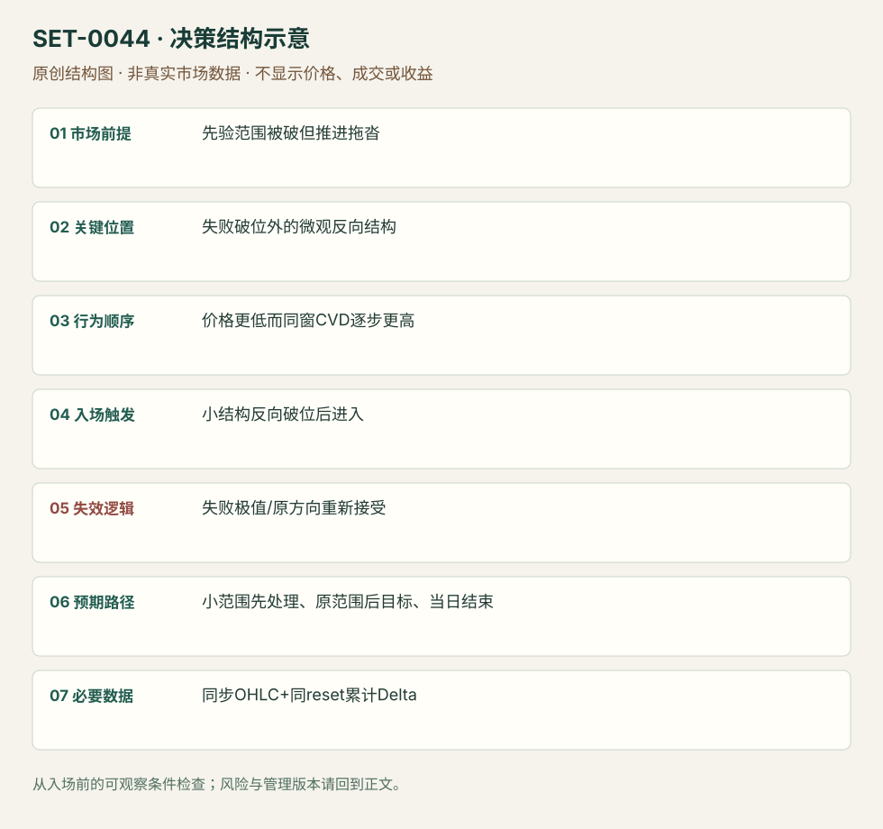

---
{
  "id": "SET-0044",
  "schema_version": "1.0.0",
  "name_zh": "价格破位而累计 Delta 背离的反转",
  "name_en": "Cumulative-delta Divergence Failed-break Reversal",
  "aliases": [],
  "name_nature": "editor_descriptive_with_source_term",
  "status": "reviewed",
  "summary": "价格突破下方范围但累计主动成交差额没有同向变弱，反而逐步抬高；等待价格小结构反向破位，交易失败的卖出方向。背离只提高警觉，不能提前当反转入口。",
  "mechanism": "aggression_price_divergence",
  "tags": [
    "order_flow",
    "delta",
    "failed_breakout",
    "reversal"
  ],
  "pa_role": "supporting",
  "markets_observed": [
    "DAX期货"
  ],
  "markets_supported": [],
  "migration_hypotheses": [],
  "session": "来源DAX日内，CVD reset时点和图时区未明；复盘必须补参数且在计划session末平仓。",
  "session_tags": [
    "intraday"
  ],
  "context_timeframe": "日线/前一session + 当日执行图；因来源而异",
  "trigger_timeframe": null,
  "data_requirements": [
    "OHLC",
    "cumulative_delta",
    "trade_classification"
  ],
  "execution_mode": "discretionary",
  "source_ids": [
    "SRC-0031",
    "SRC-0035"
  ],
  "evidence_ids": [
    "EVD-000088",
    "EVD-000089"
  ],
  "visual_ids": [
    "VIS-000047",
    "VIS-000101"
  ],
  "rule_completeness": "前提/触发/失效/管理已记录；来源与编辑模块分开",
  "independent_corroboration": "independent_context_only",
  "profit_evidence": "not_established",
  "created": "2026-10-02",
  "updated": "2026-10-02",
  "reviewed_at": "2026-10-02",
  "known_gaps": [
    "未开展独立回测；实际订单成交与成本未知",
    "执行周期没有统一来源参数，使用前须锁定版本"
  ],
  "logic_fingerprint": [
    "先验范围被破但推进拖沓",
    "失败破位外的微观反向结构",
    "价格更低而同窗CVD逐步更高",
    "小结构反向破位后进入",
    "失败极值/原方向重新接受",
    "小范围先处理、原范围后目标、当日结束",
    "同步OHLC+同reset累计Delta"
  ],
  "environment_tags": [
    "failed_auction",
    "divergence"
  ],
  "structure_locations": [
    "failed_range_edge"
  ],
  "version": "1.0.0",
  "unknown_fields": {
    "trigger_timeframe": "来源未提供统一执行周期；正文记录已知图例，不能当成统一参数"
  },
  "review_scope": "规则记录、引用范围、日内边界、逻辑区别与已看静态画面；不含独立回测、动态逐笔或账户核验",
  "source_coverage": {
    "substantive_read_sources": 2,
    "families": [
      "atas",
      "axia"
    ],
    "core_support_source_ids": [
      "SRC-0031"
    ],
    "independence_note": "independent_context_only"
  },
  "method_families": [
    "footprint_delta"
  ],
  "market_types": [
    "futures"
  ]
}
---

# 价格破位而累计 Delta 背离的反转 · Cumulative-delta Divergence Failed-break Reversal

## 1. 名称与快速概览

价格突破下方范围但累计主动成交差额没有同向变弱，反而逐步抬高；等待价格小结构反向破位，交易失败的卖出方向。背离只提高警觉，不能提前当反转入口。

记录口径：PA supporting；必要数据 OHLC、cumulative_delta、trade_classification。名称性质：编辑性描述名，英文保留来源术语以便检索。reviewed 只表示本条规则与证据记录审查通过，盈利状态为 not_established。

## 2. 本质与行为假说

主动买卖差额与价格响应不一致说明单看价格下破可能不足。CVD不会直接揭示持仓净增减；累计重置、成交归类和场所覆盖都影响背离。

## 3. 适用市场与环境

来源DAX看似明确下破但拖沓，CVD上行；适合先验范围和可辨认背离。强新闻趋势里CVD可长期背离，不能逆向硬顶。

**来源实用市场：**DAX期货。

**Session：**来源DAX日内，CVD reset时点和图时区未明；复盘必须补参数且在计划session末平仓。

跨市场：本版不主张已经验证的跨市场迁移；更换市场必须重定数据来源、流动性与session。

## 4. 出现前的观察清单

保存既有范围边、下破触发及CVD重置定义，比较背离是否跨相同时窗；标反向小结构、失败极值和首目标。

## 5. 形成过程与状态转换

旧范围下破 → 期待卖出持续但实际拖沓 → CVD上行/抬高低点 → 价格压缩成小下降楔形 → 上破恢复 → 空方可能退出。

## 6. Entry trigger 与执行方式

原例在楔形向上破进入，而非第一次Delta变正。采用价格确认后才触发；如需棒收盘或越高缓冲，标编辑版本。

## 7. Invalidation 与止损逻辑

反向结构形成后的低点外；再被接受在失败低点下或价格/CVD恢复同向卖出则否认。CVD继续涨不能豁免价格止损。

## 8. Exit、target 与 trade management

先处理局部1分钟范围，后看原大范围相反边；过程买入衰弱则退出。本库不把整日最终高当必达目标。session结束平。

## 9. 常见 variations

上破而CVD走弱对称；单棒Delta反转是另一个测度，不能自动等效累计背离；没有背离的价格楔形归0007。

## 10. 失败方式与不交易条件

背离来自不同reset/漏交易；过早反向；趋势继续时不断买；用全日最后CVD重建早期方向；技术范围事后确定。

## 11. 与相近 setups 的区别

- [SET-0003](SET-0003.md)：0003 看局部大量卖成交不再压价，本条须累计流与价格的多段方向背离。
- [SET-0007](SET-0007.md)：0007 价格三推就可构成，本条楔形仅触发层，累计背离不可删除。

## 12. 图表与案例解读

已看DAX价格/CVD同屏，清楚区分背离期与后来的向上触发。静态图不能核查数据商分类和每笔速度。

- [VIS-000047] [Cumulative Volume Delta DAX Trade - Step 2 - false break to the downside with a squeeze to the upside](https://axiafutures.com/blog/wp-content/uploads/2022/10/02-6.10.2022-1024x624.png)；定位：DAX delta rising / entry on wedge break。上部价格走低与下方CVD蓝箭头上行同屏；楔形上破后才是作者入口。 验证：chart_viewed。

**本地原创示意（VIS-000101，非真实市场数据）：**

小屏阅读可[打开原尺寸示意图](../assets/diagrams/SET-0044.svg)并缩放。

此图用于对照识别顺序与风险定义；不计入真实案例覆盖率。

## 13. 证据、分歧与未知项

完整CVD交易由Axia单家族，ATAS只说明工具差异，核心独立佐证有限。原文个别段落把吸收者角色写混；本条只保留可读价格与主动成交关系。

- [EVD-000088] Axia Futures，《Volume Delta Reversal Trade Strategy》，[SRC-0031](https://axiafutures.com/blog/volume-delta-reversal-trade-strategy/)；定位：DAX low break / delta rising / wedge break entry。支持：技术向下破位看似合理，但累计Delta逐步升高/低点抬高；等楔形向上破入，先看小范围和原范围边。
- [EVD-000089] Danil Solovyov，《Imbalance – what is it? How to trade imbalance.》，[SRC-0035](https://atas.net/blog/how-to-find-and-trade-imbalance/)；定位：Delta versus imbalance context。支持：单棒Delta和对角失衡可与价格不同，分类与背景重要；不独立验证累计背离精确规则。

审查边界：来源份数与独立核心核验分开；当前类别为 independent_context_only。正文中的概念、官方事实、衍生解说或同族资料只按其支持范围使用。

## 14. 可用于复盘的检查表

- [ ] 下单前的前提可核对：先验范围被破但推进拖沓
- [ ] 事前标记位置：失败破位外的微观反向结构
- [ ] 行为按顺序出现：价格更低而同窗CVD逐步更高
- [ ] 实际触发符合选定版本：小结构反向破位后进入
- [ ] 事先写明本次否定条件：失败极值/原方向重新接受
- [ ] 目标/路径只用当时已知信息：小范围先处理、原范围后目标、当日结束
- [ ] 数据满足 同步OHLC+同reset累计Delta；记录时间、点差、滑点、队列和未成交
- [ ] 记录截止平仓及规则偏离；正常亏损不事后改成“未成立”

## 15. 后续验证问题

跨交易所/供应商CVD是否给同结论？价格确认过滤贡献多少？背离强度与延迟怎样权衡？
