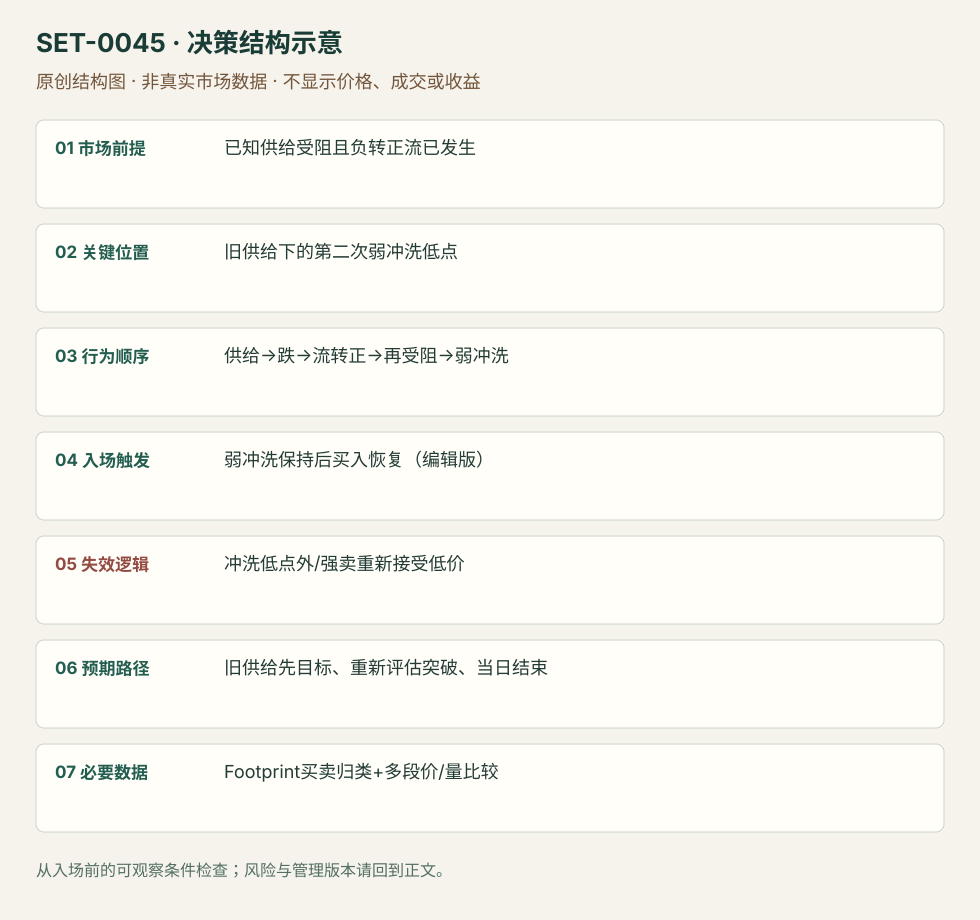

---
{
  "id": "SET-0045",
  "schema_version": "1.0.0",
  "name_zh": "冰山受阻、流转向与弱冲洗后的再拍卖",
  "name_en": "Iceberg Reauction after Weak Flush",
  "aliases": [],
  "name_nature": "editor_descriptive_with_source_term",
  "status": "reviewed",
  "summary": "已有强买受阻的上方供给，跌后出现主动流转向；回测该供给仍未解决，随后一轮快速但弱卖出的冲洗失败，再做多攻击旧供给。多段序列都须成立。",
  "mechanism": "failed_liquidation_reauction",
  "tags": [
    "footprint",
    "iceberg",
    "delta",
    "reversal"
  ],
  "pa_role": "non_primary",
  "markets_observed": [
    "S&P500期货"
  ],
  "markets_supported": [],
  "migration_hypotheses": [],
  "session": "源图ES日内11:51–12:44附近，时区未注明；只计本执行session机会，结束前平仓。",
  "session_tags": [
    "intraday"
  ],
  "context_timeframe": "日线/前一session + 当日执行图；因来源而异",
  "trigger_timeframe": null,
  "data_requirements": [
    "footprint",
    "classified_trades",
    "OHLC"
  ],
  "execution_mode": "discretionary",
  "source_ids": [
    "SRC-0063",
    "SRC-0069"
  ],
  "evidence_ids": [
    "EVD-000090",
    "EVD-000091",
    "EVD-000105"
  ],
  "visual_ids": [
    "VIS-000048",
    "VIS-000102"
  ],
  "rule_completeness": "前提/触发/失效/管理已记录；来源与编辑模块分开",
  "independent_corroboration": "independent_context_only",
  "profit_evidence": "not_established",
  "created": "2026-10-02",
  "updated": "2026-10-02",
  "reviewed_at": "2026-10-02",
  "known_gaps": [
    "未开展独立回测；实际订单成交与成本未知",
    "执行周期没有统一来源参数，使用前须锁定版本"
  ],
  "logic_fingerprint": [
    "已知供给受阻且负转正流已发生",
    "旧供给下的第二次弱冲洗低点",
    "供给→跌→流转正→再受阻→弱冲洗",
    "弱冲洗保持后买入恢复（编辑版）",
    "冲洗低点外/强卖重新接受低价",
    "旧供给先目标、重新评估突破、当日结束",
    "Footprint买卖归类+多段价/量比较"
  ],
  "environment_tags": [
    "balance",
    "liquidation"
  ],
  "structure_locations": [
    "iceberg_ceiling",
    "flush_low"
  ],
  "version": "1.0.0",
  "unknown_fields": {
    "trigger_timeframe": "来源未提供统一执行周期；正文记录已知图例，不能当成统一参数"
  },
  "review_scope": "规则记录、引用范围、日内边界、逻辑区别与已看静态画面；不含独立回测、动态逐笔或账户核验",
  "source_coverage": {
    "substantive_read_sources": 2,
    "families": [
      "axia",
      "bookmap"
    ],
    "core_support_source_ids": [
      "SRC-0063"
    ],
    "independence_note": "independent_context_only"
  },
  "method_families": [
    "tape_DOM",
    "footprint_delta",
    "liquidity_inventory"
  ],
  "market_types": [
    "futures"
  ]
}
---

# 冰山受阻、流转向与弱冲洗后的再拍卖 · Iceberg Reauction after Weak Flush

## 1. 名称与快速概览

已有强买受阻的上方供给，跌后出现主动流转向；回测该供给仍未解决，随后一轮快速但弱卖出的冲洗失败，再做多攻击旧供给。多段序列都须成立。

记录口径：PA non_primary；必要数据 footprint、classified_trades、OHLC。名称性质：编辑性描述名，英文保留来源术语以便检索。reviewed 只表示本条规则与证据记录审查通过，盈利状态为 not_established。

## 2. 本质与行为假说

旧供给可能是冰山，但普通Footprint大成交并不能单独证明隐藏订单；本库将其写为“疑似冰山/持续供给”。弱下冲不是强新卖出，是可观察比较，而非确定清仓身份。

## 3. 适用市场与环境

源例ES 2022-06-30。适合上方已知供给与明确负转正Delta、多段回测；首跌尚未结束或强卖持续压低则不接。

**来源实用市场：**S&P500期货。

**Session：**源图ES日内11:51–12:44附近，时区未注明；只计本执行session机会，结束前平仓。

跨市场：本版不主张已经验证的跨市场迁移；更换市场必须重定数据来源、流动性与session。

## 4. 出现前的观察清单

记录原受阻价、当时主动量和实际价格响应；比较前跌与后冲洗的量/价、聚合规则和Delta定义，保留局部风险低点。

## 5. 形成过程与状态转换

强买受阻 → 深跌 → 强负Delta转更强正 → 回旧供给仍受阻 → 快下冲但卖量轻 → 恢复买入 → 再拍卖旧供给。

## 6. Entry trigger 与执行方式

原文在后段弱冲洗后干量/恢复处买。编辑可复盘版等该弱冲洗低点被守且重新向上恢复，避免只有快跌就认定清仓。此入口不是第一次吸收处逆向。

## 7. Invalidation 与止损逻辑

该次弱冲洗低点外；若大卖出持续并接受更低价格，则弱冲洗假说失效。来源未给统一价格止损，本库结构保护为编辑模块。

## 8. Exit、target 与 trade management

旧供给为第一目标，是否继续越过须再看接受/主动性；无法解决便减仓。不能因标签poor high而保证穿过，当前session末平仓。

## 9. 常见 variations

上方供给换成其他被动区需另研究；低量Open Drive回测是0041版本，并非本条全部序列。

## 10. 失败方式与不交易条件

冰山身份未经证明；强负转正只有单棒噪声；第二次冲洗其实强主动卖出；原供给始终无法越过；只看颜色遗漏价格响应。

## 11. 与相近 setups 的区别

- [SET-0003](SET-0003.md)：0003 局部吸收即可反向，本条须整个先供给、深跌、流转向、再受阻、弱冲洗序列。
- [SET-0040](SET-0040.md)：0040 单向末端耗尽一次短打；本条目标是再拍卖既有供给。

## 12. 图表与案例解读

已看完整Footprint序列，日期可读。图能核相对量和阶段，不能证明隐藏订单真实身份；错误清仓标签不被静默当事实。

- [VIS-000048] [EMINI S&P500 Iceberg Trading With Footprint: absorbtion-selling-absobption-bid-liquidation-breakout of the iceberg.](https://axiafutures.com/blog/wp-content/uploads/2022/08/01footprint-1024x564.png)；定位：EMINI S&P500 Iceberg Footprint。原图标2022-06-30，四个区域展示受阻、卖出、买方恢复与后冲洗；short liquidation标签与正文冲突。 验证：chart_viewed。

**本地原创示意（VIS-000102，非真实市场数据）：**

小屏阅读可[打开原尺寸示意图](../assets/diagrams/SET-0045.svg)并缩放。

此图用于对照识别顺序与风险定义；不计入真实案例覆盖率。

## 13. 证据、分歧与未知项

完整序列主要Axia；Bookmap是独立概念背景，核心佐证有限。原图把被困买方后的冲洗写成short liquidation，正文写longs，这一术语冲突保留；本条按实际弱下冲描述，不推测账户。

- [EVD-000090] Axia Futures，《How Can Footprint Help Your Trade Execution》，[SRC-0063](https://axiafutures.com/blog/how-can-footprint-help-your-trade-execution/)；定位：Using Footprint To Trade Around Iceberg: June30 2022。支持：先强买撞供给，跌后Delta由强负转更强正；回原供给再受阻，快速下冲却无大卖出时买，准备再拍卖旧天花板。
- [EVD-000091] Bookmap editorial team，《How to Spot Long Liquidations Before They Break》，[SRC-0069](https://bookmap.com/blog/how-to-spot-long-liquidations-before-they-break)；定位：Wait for rebuild after flush / delta flip。支持：独立工具商讨论冲洗后等待真实恢复；其ES案例以假设引入，不是此冰山序列的真实佐证。

审查边界：来源份数与独立核心核验分开；当前类别为 independent_context_only。正文中的概念、官方事实、衍生解说或同族资料只按其支持范围使用。

- [EVD-000105] **编辑操作化，未测试：**弱冲洗保持后用局部恢复买入、冲洗低点外风险；完整机械时限与buffer待测。 原文边界：原文给冰山、Delta翻转和弱冲洗叙事，未给统一数值下单参数。

## 14. 可用于复盘的检查表

- [ ] 下单前的前提可核对：已知供给受阻且负转正流已发生
- [ ] 事前标记位置：旧供给下的第二次弱冲洗低点
- [ ] 行为按顺序出现：供给→跌→流转正→再受阻→弱冲洗
- [ ] 实际触发符合选定版本：弱冲洗保持后买入恢复（编辑版）
- [ ] 事先写明本次否定条件：冲洗低点外/强卖重新接受低价
- [ ] 目标/路径只用当时已知信息：旧供给先目标、重新评估突破、当日结束
- [ ] 数据满足 Footprint买卖归类+多段价/量比较；记录时间、点差、滑点、队列和未成交
- [ ] 记录截止平仓及规则偏离；正常亏损不事后改成“未成立”

## 15. 后续验证问题

供应商能否直接验证冰山而非大成交？弱冲洗按什么归一化比较？去掉Delta转向前提后的效果？
