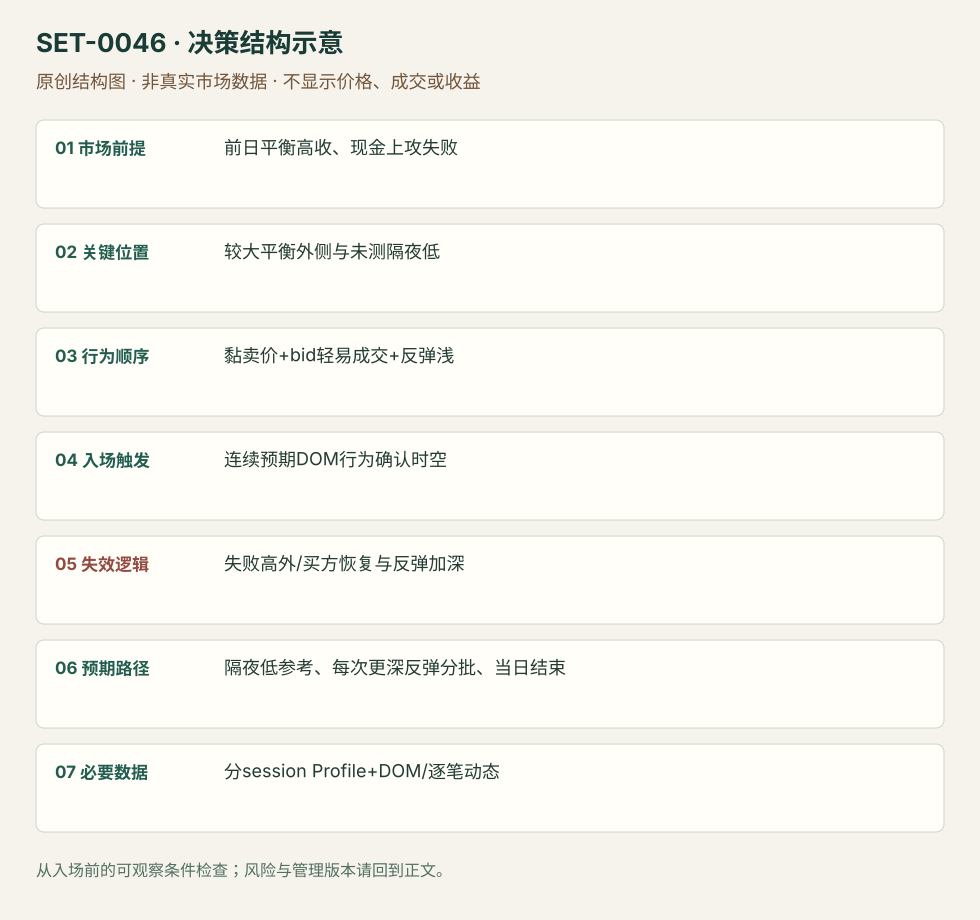

---
{
  "id": "SET-0046",
  "schema_version": "1.0.0",
  "name_zh": "弱多头背景下黏住卖价的向下清仓",
  "name_en": "Sticky-offer Long-liquidation Continuation",
  "aliases": [],
  "name_nature": "editor_descriptive_with_source_term",
  "status": "reviewed",
  "summary": "前日平衡但收在高位，下一现金开盘继续上冲失败；当卖价持续压住、买价轻易被拿且反弹浅时，交易向未测试隔夜低的下冲。",
  "mechanism": "vulnerable_long_inventory_unwind",
  "tags": [
    "DOM",
    "liquidation",
    "opening",
    "momentum"
  ],
  "pa_role": "non_primary",
  "markets_observed": [
    "S&P500期货"
  ],
  "markets_supported": [],
  "migration_hypotheses": [],
  "session": "来源ES前日现金/隔夜/欧洲/当前现金分开；本库09:30–16:00 America/New_York执行参考，收盘前平，其他段只提供背景。",
  "session_tags": [
    "opening"
  ],
  "context_timeframe": "日线/前一session + 当日执行图；因来源而异",
  "trigger_timeframe": null,
  "data_requirements": [
    "session_profile",
    "DOM",
    "trade_prints",
    "OHLC"
  ],
  "execution_mode": "discretionary",
  "source_ids": [
    "SRC-0041",
    "SRC-0069"
  ],
  "evidence_ids": [
    "EVD-000092",
    "EVD-000093"
  ],
  "visual_ids": [
    "VIS-000049",
    "VIS-000103"
  ],
  "rule_completeness": "前提/触发/失效/管理已记录；来源与编辑模块分开",
  "independent_corroboration": "independent_context_only",
  "profit_evidence": "not_established",
  "created": "2026-10-02",
  "updated": "2026-10-02",
  "reviewed_at": "2026-10-02",
  "known_gaps": [
    "未开展独立回测；实际订单成交与成本未知",
    "执行周期没有统一来源参数，使用前须锁定版本"
  ],
  "logic_fingerprint": [
    "前日平衡高收、现金上攻失败",
    "较大平衡外侧与未测隔夜低",
    "黏卖价+bid轻易成交+反弹浅",
    "连续预期DOM行为确认时空",
    "失败高外/买方恢复与反弹加深",
    "隔夜低参考、每次更深反弹分批、当日结束",
    "分session Profile+DOM/逐笔动态"
  ],
  "environment_tags": [
    "vulnerable_inventory",
    "liquidation"
  ],
  "structure_locations": [
    "cash_high",
    "overnight_low"
  ],
  "version": "1.0.0",
  "unknown_fields": {
    "trigger_timeframe": "来源未提供统一执行周期；正文记录已知图例，不能当成统一参数"
  },
  "review_scope": "规则记录、引用范围、日内边界、逻辑区别与已看静态画面；不含独立回测、动态逐笔或账户核验",
  "source_coverage": {
    "substantive_read_sources": 2,
    "families": [
      "axia",
      "bookmap"
    ],
    "core_support_source_ids": [
      "SRC-0041"
    ],
    "independence_note": "independent_context_only"
  },
  "method_families": [
    "tape_DOM",
    "liquidity_inventory"
  ],
  "market_types": [
    "futures"
  ]
}
---

# 弱多头背景下黏住卖价的向下清仓 · Sticky-offer Long-liquidation Continuation

## 1. 名称与快速概览

前日平衡但收在高位，下一现金开盘继续上冲失败；当卖价持续压住、买价轻易被拿且反弹浅时，交易向未测试隔夜低的下冲。

记录口径：PA non_primary；必要数据 session_profile、DOM、trade_prints、OHLC。名称性质：编辑性描述名，英文保留来源术语以便检索。reviewed 只表示本条规则与证据记录审查通过，盈利状态为 not_established。

## 2. 本质与行为假说

旧多头可能需要退出是作者库存解释；真正触发为连续sticky offer/taken bids，而非仅认为高收盘多头多。需要时序与真实成交，不能从一张深度快照识别。

## 3. 适用市场与环境

源例ES多周平衡外侧，较大方向弱、前日高收与当天失败。若现金开盘能持续接受更高价格，原清仓预期撤销。

**来源实用市场：**S&P500期货。

**Session：**来源ES前日现金/隔夜/欧洲/当前现金分开；本库09:30–16:00 America/New_York执行参考，收盘前平，其他段只提供背景。

跨市场：本版不主张已经验证的跨市场迁移；更换市场必须重定数据来源、流动性与session。

## 4. 出现前的观察清单

分别存前日现金、隔夜和欧洲段Profile，确认隔夜低未被测；画原上冲失败点。DOM定义反弹浅和offer保持的观测窗口，而不是凭口头形容。

## 5. 形成过程与状态转换

前日高收 → 隔夜窄范围 → 现金开盘向上失败 → sticky offer且bid被连续拿 → 下冲 → 反弹深度扩大/单向性消失。

## 6. Entry trigger 与执行方式

来源看到预期DOM人格就空，并在继续下行时加；本库保留单次初始进入为核心，加仓须独立记总风险。仅见挂单厚并未成交不触发。

## 7. Invalidation 与止损逻辑

失败上冲局部高外为编辑硬边界；offer不能保持、买方主动恢复、反弹变深是提前减仓/退出信息。不能用源例大仓位替实际风险定义。

## 8. Exit、target 与 trade management

未测隔夜低及下方结构为参照；来源每当反弹深于预期便分批退，浅反弹才持有。即使未拿满后续下跌，也不能回改出场为全天低点。session结束平。

## 9. 常见 variations

Footprint完成/未完成拍卖作为持有辅助，不另计setup；上下清仓需新素材再判断支持范围。

## 10. 失败方式与不交易条件

高价重新接受；隔夜低早已测过；报价拉走而非成交；反弹越来越深仍持空；把同一FOMC背景当即时消息单。

## 11. 与相近 setups 的区别

- [SET-0034](SET-0034.md)：0034 台阶久攻失败后破相反范围，本条须高收/现金失败和黏卖价持续。
- [SET-0047](SET-0047.md)：0047 原理在厚产品的被动买方慢推，触发不依快速bid被拿和反弹浅。

## 12. 图表与案例解读

已看现金Profile受阻图，支持高位背景。DOM执行阶段只读文字，因此真实图表覆盖是背景图，完整入口的动态视觉证据仍缺。

- [VIS-000049] [Trapped longs that gave us conviction to enter short for the long liquidation break](https://axiafutures.com/blog/wp-content/uploads/2021/02/29-04-profile.png)；定位：Trapped longs cash profile。高位受阻位置和现金profile被标出；此图核背景，不能单凭它核sticky offer动态。 验证：chart_viewed。

**本地原创示意（VIS-000103，非真实市场数据）：**

小屏阅读可[打开原尺寸示意图](../assets/diagrams/SET-0046.svg)并缩放。

此图用于对照识别顺序与风险定义；不计入真实案例覆盖率。

## 13. 证据、分歧与未知项

Axia具体执行叙事，Bookmap仅独立解释机制，核心佐证有限。原文22:08是视频定位，本研究未播放；仓位与获利为作者陈述，未审计。

- [EVD-000092] Axia Futures，《Trading Long Liquidation Break In US Equities》，[SRC-0041](https://axiafutures.com/blog/trading-long-liquidation-break-in-us-equities/)；定位：context / sticky offer,taken bids / rotation management。支持：前日平衡收近高、次日高开失败和未测隔夜低；卖价黏住、买价被轻易成交时空，反弹加深分批退出。
- [EVD-000093] Bookmap editorial team，《How to Spot Long Liquidations Before They Break》，[SRC-0069](https://bookmap.com/blog/how-to-spot-long-liquidations-before-they-break)；定位：Pre-break buildup / absorption / liquidity shift。支持：独立说明多头脆弱与买方流动性变弱可能产生下冲；其执行主张反弹等待，不与本条空头入口混用。

审查边界：来源份数与独立核心核验分开；当前类别为 independent_context_only。正文中的概念、官方事实、衍生解说或同族资料只按其支持范围使用。

## 14. 可用于复盘的检查表

- [ ] 下单前的前提可核对：前日平衡高收、现金上攻失败
- [ ] 事前标记位置：较大平衡外侧与未测隔夜低
- [ ] 行为按顺序出现：黏卖价+bid轻易成交+反弹浅
- [ ] 实际触发符合选定版本：连续预期DOM行为确认时空
- [ ] 事先写明本次否定条件：失败高外/买方恢复与反弹加深
- [ ] 目标/路径只用当时已知信息：隔夜低参考、每次更深反弹分批、当日结束
- [ ] 数据满足 分session Profile+DOM/逐笔动态；记录时间、点差、滑点、队列和未成交
- [ ] 记录截止平仓及规则偏离；正常亏损不事后改成“未成立”

## 15. 后续验证问题

反弹深度按ticks或成交量归一化？删库存背景后DOM模式还有边际信息吗？清仓与新增主动卖出能否区分？
