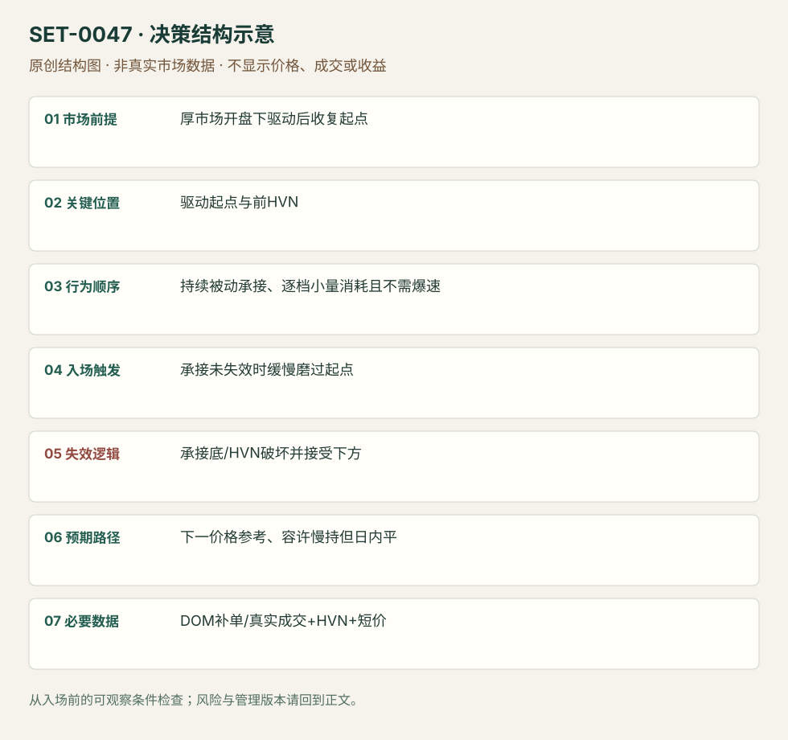

---
{
  "id": "SET-0047",
  "schema_version": "1.0.0",
  "name_zh": "厚市场被动承接的缓慢磨过",
  "name_en": "Steady Absorption-driven Drift Break",
  "aliases": [],
  "name_nature": "editor_descriptive_with_source_term",
  "status": "reviewed",
  "summary": "厚订单簿产品回到开盘驱动的起点，持续被动买方不让价格跌回，卖价逐档被小量消耗；即使没有速度爆发，也可交易缓慢磨过。慢并非自动有效，必须有持续持价。",
  "mechanism": "passive_support_grind",
  "tags": [
    "DOM",
    "absorption",
    "breakout",
    "trend_continuation"
  ],
  "pa_role": "non_primary",
  "markets_observed": [
    "德国Bund期货"
  ],
  "markets_supported": [],
  "migration_hypotheses": [],
  "session": "Bund来源早欧时段，时区未明；按Europe/Berlin产品时段另定session，入场与退出限该日计划段。",
  "session_tags": [
    "intraday"
  ],
  "context_timeframe": "日线/前一session + 当日执行图；因来源而异",
  "trigger_timeframe": null,
  "data_requirements": [
    "DOM",
    "trade_prints",
    "volume_profile",
    "OHLC"
  ],
  "execution_mode": "discretionary",
  "source_ids": [
    "SRC-0030",
    "SRC-0002"
  ],
  "evidence_ids": [
    "EVD-000094",
    "EVD-000095"
  ],
  "visual_ids": [
    "VIS-000050",
    "VIS-000051",
    "VIS-000104"
  ],
  "rule_completeness": "前提/触发/失效/管理已记录；来源与编辑模块分开",
  "independent_corroboration": "independent_context_only",
  "profit_evidence": "not_established",
  "created": "2026-10-02",
  "updated": "2026-10-02",
  "reviewed_at": "2026-10-02",
  "known_gaps": [
    "未开展独立回测；实际订单成交与成本未知",
    "执行周期没有统一来源参数，使用前须锁定版本"
  ],
  "logic_fingerprint": [
    "厚市场开盘下驱动后收复起点",
    "驱动起点与前HVN",
    "持续被动承接、逐档小量消耗且不需爆速",
    "承接未失效时缓慢磨过起点",
    "承接底/HVN破坏并接受下方",
    "下一价格参考、容许慢持但日内平",
    "DOM补单/真实成交+HVN+短价"
  ],
  "environment_tags": [
    "directional",
    "passive_support"
  ],
  "structure_locations": [
    "drive_origin",
    "HVN"
  ],
  "version": "1.0.0",
  "unknown_fields": {
    "trigger_timeframe": "来源未提供统一执行周期；正文记录已知图例，不能当成统一参数"
  },
  "review_scope": "规则记录、引用范围、日内边界、逻辑区别与已看静态画面；不含独立回测、动态逐笔或账户核验",
  "source_coverage": {
    "substantive_read_sources": 2,
    "families": [
      "axia",
      "jigsaw"
    ],
    "core_support_source_ids": [
      "SRC-0030"
    ],
    "independence_note": "independent_context_only"
  },
  "method_families": [
    "tape_DOM"
  ],
  "market_types": [
    "futures"
  ]
}
---

# 厚市场被动承接的缓慢磨过 · Steady Absorption-driven Drift Break

## 1. 名称与快速概览

厚订单簿产品回到开盘驱动的起点，持续被动买方不让价格跌回，卖价逐档被小量消耗；即使没有速度爆发，也可交易缓慢磨过。慢并非自动有效，必须有持续持价。

记录口径：PA non_primary；必要数据 DOM、trade_prints、volume_profile、OHLC。名称性质：编辑性描述名，英文保留来源术语以便检索。reviewed 只表示本条规则与证据记录审查通过，盈利状态为 not_established。

## 2. 本质与行为假说

被动承接与渐进报价消耗不同于主动扫单。来源明确提醒Bund与Gold的典型深度不同；“没有爆量”不能作为一切产品的持仓理由。

## 3. 适用市场与环境

源例Bund先下Open Drive再收复起点，较厚市场。没有被动持价、薄产品新闻冲击或上方强吸收始终不解决时不能套。

**来源实用市场：**德国Bund期货。

**Session：**Bund来源早欧时段，时区未明；按Europe/Berlin产品时段另定session，入场与退出限该日计划段。

跨市场：本版不主张已经验证的跨市场迁移；更换市场必须重定数据来源、流动性与session。

## 4. 出现前的观察清单

标最初驱动起点、前HVN和下一价格参考；记DOM补单/成交而非仅显示数量。写清预期慢节奏及何种持价破坏会退出。

## 5. 形成过程与状态转换

开盘向下驱动 → 回到起点 → 卖出被持续承接 → 各档offer逐步被消耗 → 慢越起点 → 保持至目标或承接失效。

## 6. Entry trigger 与执行方式

源例173.63附近磨过时买，重点持续承接和逐档消耗。前提已经成立才进入；不能等后来一个小时涨完才称之前所有横盘是承接。

## 7. Invalidation 与止损逻辑

原例前HVN附近173.53；迁移版用入场前HVN/承接底外。若买方持续性消失并被接受在下方，立即否认，不因预期慢而扛损。

## 8. Exit、target 与 trade management

原例173.80区，花超过一小时；只要承接和结构未失效可给时间，目标/慢磨能力变差则处理。计划session结束强制退出。

## 9. 常见 variations

不同厚度产品需要独立证据；可用Footprint辅助观察真实成交。没有量速度爆发是区别0039的重要条件，不仅替同一突破换名称。

## 10. 失败方式与不交易条件

慢横盘其实供给压住且买方不持；将取消offer误认为全成交；不愿承认前HVN被破；按Gold速度预期错误地管理Bund或反之。

## 11. 与相近 setups 的区别

- [SET-0039](SET-0039.md)：0039 新尝试的量/速度明显增强，本条允许不爆速但必需持续被动承接。
- [SET-0003](SET-0003.md)：0003 用受阻成交反转，本条被动买方沿突破路径持续承接来支持延续。

## 12. 图表与案例解读

已看价图与阶梯图，原作者入口/保护/目标可追溯；正文说一小时以上，未观看动态记录。

- [VIS-000050] [Chart of a Bund Continuation Breakout Drift Trade](https://axiafutures.com/blog/wp-content/uploads/2020/10/18-image1-1.png)；定位：Bund Continuation Breakout Drift。开盘跌后回原起点，红ENTRY线附近再上行，支持背景与位置。 验证：chart_viewed。
- [VIS-000051] [Price Ladder During The Bund Trade with Entry, Stop and Target](https://axiafutures.com/blog/wp-content/uploads/2020/10/18-image2.png)；定位：Price ladder during Bund trade。静态阶梯标173.63入口、173.53保护及173.81目标；只核价位，不当成DOM回放。 验证：chart_viewed。

**本地原创示意（VIS-000104，非真实市场数据）：**

小屏阅读可[打开原尺寸示意图](../assets/diagrams/SET-0047.svg)并缩放。

此图用于对照识别顺序与风险定义；不计入真实案例覆盖率。

## 13. 证据、分歧与未知项

具体完整入口、保护、目标与持有期待来自Axia富信息单例；Jigsaw只概念澄清，核心独立佐证有限。静态图不核对600/400与实际275成交的动态序列。

- [EVD-000094] Axia Futures，《Steady Continuation Drift Breakout Trade》，[SRC-0030](https://axiafutures.com/blog/steady-continuation-drift-breakout-trade/)；定位：Context / Price Ladder at63 / target80 stopHVN。支持：开盘下驱动后回起点，买方持续被动承接、offer逐档被小量消耗，速度不明显增加；慢磨过，风险前HVN、目标80区。
- [EVD-000095] Peter Davies，《Practical Application of Order Flow, Part 2》，[SRC-0002](https://www.jigsawtrading.com/wp-content/uploads/2014/03/PracticalApplicationOfOrderFlow-Pt2.pdf)；定位：PDF页序9 reversal types /13 momentum。支持：吸收与主动动量需要不同观测；概念帮助避免用大量成交或速度作为所有突破必要条件。

审查边界：来源份数与独立核心核验分开；当前类别为 independent_context_only。正文中的概念、官方事实、衍生解说或同族资料只按其支持范围使用。

## 14. 可用于复盘的检查表

- [ ] 下单前的前提可核对：厚市场开盘下驱动后收复起点
- [ ] 事前标记位置：驱动起点与前HVN
- [ ] 行为按顺序出现：持续被动承接、逐档小量消耗且不需爆速
- [ ] 实际触发符合选定版本：承接未失效时缓慢磨过起点
- [ ] 事先写明本次否定条件：承接底/HVN破坏并接受下方
- [ ] 目标/路径只用当时已知信息：下一价格参考、容许慢持但日内平
- [ ] 数据满足 DOM补单/真实成交+HVN+短价；记录时间、点差、滑点、队列和未成交
- [ ] 记录截止平仓及规则偏离；正常亏损不事后改成“未成立”

## 15. 后续验证问题

怎样区分吸收买方与只取消卖价？慢磨的最大等待怎样按产品测？与主动强度突破0039的分类是否一致？
