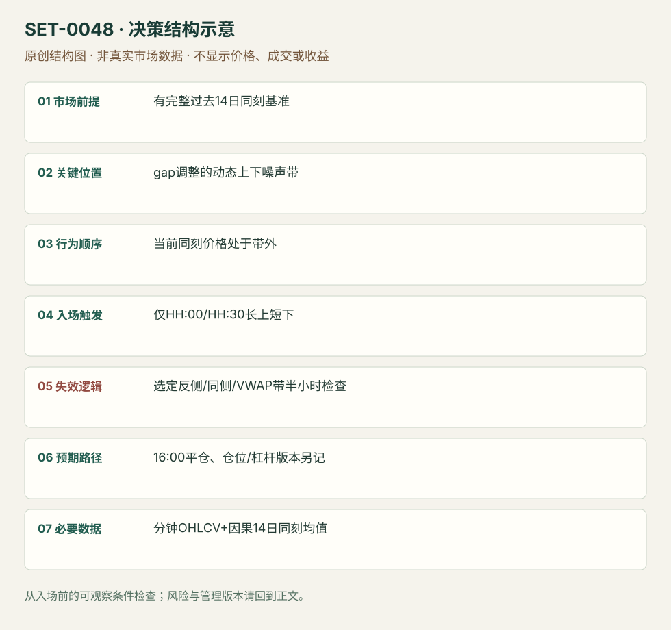

---
{
  "id": "SET-0048",
  "schema_version": "1.0.0",
  "name_zh": "按同一时刻历史波动定义的日内噪声带动量",
  "name_en": "Time-of-day Noise-band Intraday Momentum",
  "aliases": [],
  "name_nature": "research_term",
  "status": "reviewed",
  "summary": "用过去14日相同时间从09:30开盘的绝对移动均值，定义今天随时间变化的噪声带；在固定半小时时点价格位于带外才建立对应方向，现金收盘结束。不是固定ATR或固定首5分钟范围。",
  "mechanism": "time_normalized_volatility_breakout",
  "tags": [
    "quantitative",
    "momentum",
    "ETF",
    "time_of_day"
  ],
  "pa_role": "non_primary",
  "markets_observed": [
    "SPY ETF"
  ],
  "markets_supported": [],
  "migration_hypotheses": [],
  "session": "09:30–16:00 America/New_York，纽约夏令时随交易日转换；原版所有持仓日终平。",
  "session_tags": [
    "intraday",
    "scheduled_check"
  ],
  "context_timeframe": "过去14个完整交易日同一现金时刻、今日开盘与昨收",
  "trigger_timeframe": "1分钟数据、整点与半点判断",
  "data_requirements": [
    "minute_OHLCV",
    "previous_close",
    "session_clock",
    "VWAP_optional"
  ],
  "execution_mode": "systematic_source_version",
  "source_ids": [
    "SRC-0037"
  ],
  "evidence_ids": [
    "EVD-000096"
  ],
  "visual_ids": [
    "VIS-000052",
    "VIS-000053",
    "VIS-000105"
  ],
  "rule_completeness": "前提/触发/失效/管理已记录；来源与编辑模块分开",
  "independent_corroboration": "limited_single_family",
  "profit_evidence": "author_backtest_not_reproduced",
  "created": "2026-10-02",
  "updated": "2026-10-02",
  "reviewed_at": "2026-10-02",
  "known_gaps": [
    "未独立复现回测",
    "成本实验仅作者自述",
    "更晚样本、半日和数据处理需核验"
  ],
  "logic_fingerprint": [
    "有完整过去14日同刻基准",
    "gap调整的动态上下噪声带",
    "当前同刻价格处于带外",
    "仅HH:00/HH:30长上短下",
    "选定反侧/同侧/VWAP带半小时检查",
    "16:00平仓、仓位/杠杆版本另记",
    "分钟OHLCV+因果14日同刻均值"
  ],
  "environment_tags": [
    "time_normalized",
    "directional"
  ],
  "structure_locations": [
    "same_time_noise_band"
  ],
  "version": "1.0.0",
  "unknown_fields": {},
  "review_scope": "规则记录、引用范围、日内边界、逻辑区别与已看静态画面；不含独立回测、动态逐笔或账户核验",
  "source_coverage": {
    "substantive_read_sources": 1,
    "families": [
      "concretum-bbt"
    ],
    "core_support_source_ids": [
      "SRC-0037"
    ],
    "independence_note": "limited_single_family"
  },
  "method_families": [
    "quantitative_time"
  ],
  "market_types": [
    "ETF"
  ]
}
---

# 按同一时刻历史波动定义的日内噪声带动量 · Time-of-day Noise-band Intraday Momentum

## 1. 名称与快速概览

用过去14日相同时间从09:30开盘的绝对移动均值，定义今天随时间变化的噪声带；在固定半小时时点价格位于带外才建立对应方向，现金收盘结束。不是固定ATR或固定首5分钟范围。

记录口径：PA non_primary；必要数据 minute_OHLCV、previous_close、session_clock、VWAP_optional。名称性质：来源术语或研究术语。reviewed 只表示本条规则与证据记录审查通过，盈利状态为 author_backtest_not_reproduced。

## 2. 本质与行为假说

作者假说是超过同一时刻常见幅度的价格偏离可能代表持续供需不平衡。这个均值不是标准差，符号σ也不能被误读为正态置信带。

## 3. 适用市场与环境

来源SPY 1分钟IQFeed数据，2007-05至2024-04作者回测；研究适用范围不等于对所有ETF/期货验证。必须有完整现金session与至少14个过去交易日。

**来源实用市场：**SPY ETF。

**Session：**09:30–16:00 America/New_York，纽约夏令时随交易日转换；原版所有持仓日终平。

跨市场：本版不主张已经验证的跨市场迁移；更换市场必须重定数据来源、流动性与session。

## 4. 出现前的观察清单

只取t−1至t−14同一纽约现金时刻，a(i,h)=abs(C(i,h)/O(i,09:30)−1)，σ(h)=过去14日a的平均。固定复权、分红、缺棒和半日处理；半日样本不能机械照16:00。

## 5. 形成过程与状态转换

过去数据定同刻幅度 → 今日开盘/昨收定带 → 每个HH:00/HH:30看当时价格 → 上带外长、下带外短 → 选定止损版检查 →16:00结束。

## 6. Entry trigger 与执行方式

上带=max(今日开盘,昨16:00收盘)×(1+σ)；下带=min(今日开盘,昨收)×(1−σ)。只在整点/半点根据已知价判断；源例先越带而10:30才执行。不得在任意分钟提前追入后仍称原模型。

## 7. Invalidation 与止损逻辑

base版到反侧带才撤/翻，且止损也仅半小时检查。改进版多头用max(上带,VWAP)、空头用min(下带,VWAP)作为更紧追踪；两版分开，不将连续硬止损收益继承为原研究。

## 8. Exit、target 与 trade management

16:00现金收盘全部平；盘中按所选带/VWAP风险路线退出或翻转。仓位缩放与杠杆是单独版本，不以4倍或波动目标拆新Setup。

## 9. 常见 variations

base反侧带、同侧带、同侧带结合VWAP三版本计一个机制；14日回看参数、仓位波动目标和杠杆不增加条目数。

## 10. 失败方式与不交易条件

全天反转仍到反侧带才退出；早盘缺棒污染带；错用标准差；用今日最终数据估带；按分钟信号/连续止损但拿半小时原模型结果；成本与杠杆假设低估。

## 11. 与相近 setups 的区别

- [SET-0002](SET-0002.md)：0002 参考当日首5分钟实价区间；本条用过去14日同一时刻动态幅度，触发与风险检查时钟不同。
- [SET-0049](SET-0049.md)：0049 固定15:30按早期收益符号定方向，本条可在多个半小时时点触发噪声带突破。

## 12. 图表与案例解读

已看第9、12、13页历史价格图及模拟箭头；第12页是base版明显亏损，第13页展示改进止损的不同结果。没有把它们当真实成交流水。

- [VIS-000052] [来源PDF第9页图表](https://concretumgroup.com/wp-content/uploads/2026/02/Beat-the-Market.pdf#page=9)；定位：PDF页序 9。2022-01-31长/2022-04-29短历史SPY路径上的模型交易箭头，是模拟叠加不是实际订单。 验证：chart_viewed_pdf_page。
- [VIS-000053] [来源PDF第12页图表](https://concretumgroup.com/wp-content/uploads/2026/02/Beat-the-Market.pdf#page=12)；定位：PDF页序 12。2022-01-20原base版反转亏损，反侧带保护很迟；研究展示失败而非只选趋势日。 验证：chart_viewed_pdf_page。

**本地原创示意（VIS-000105，非真实市场数据）：**

小屏阅读可[打开原尺寸示意图](../assets/diagrams/SET-0048.svg)并缩放。

此图用于对照识别顺序与风险定义；不计入真实案例覆盖率。

## 13. 证据、分歧与未知项

富信息研究单一作者家族，独立复现有限。作者报告历史回测并讨论每股佣金0.0035美元与滑点0.001美元假设，千余随机方向实盘成本实验也是作者自述，不是独立账户审计。本研究没有执行回测。

- [EVD-000096] Carlo Zarattini / Andrew Aziz，《Beat the Market: An Effective Intraday Momentum Strategy for S&P500 ETF (SPY)》，[SRC-0037](https://concretumgroup.com/wp-content/uploads/2026/02/Beat-the-Market.pdf)；定位：PDF页序6–10: Noise Area equations and half-hour decision /12–13 stops /25 costs。支持：用过去14日同一时刻从开盘绝对移动平均定上下带，并按开盘与昨收修正gap；整点/半点判断，16:00平仓，止损版本与成本分开。

审查例外：此条只有一份富信息原始资料，足以还原本条规则；独立佐证有限，未用背景页冒充第二份核验。后续优先寻找独立规则/失败案例。

## 14. 可用于复盘的检查表

- [ ] 下单前的前提可核对：有完整过去14日同刻基准
- [ ] 事前标记位置：gap调整的动态上下噪声带
- [ ] 行为按顺序出现：当前同刻价格处于带外
- [ ] 实际触发符合选定版本：仅HH:00/HH:30长上短下
- [ ] 事先写明本次否定条件：选定反侧/同侧/VWAP带半小时检查
- [ ] 目标/路径只用当时已知信息：16:00平仓、仓位/杠杆版本另记
- [ ] 数据满足 分钟OHLCV+因果14日同刻均值；记录时间、点差、滑点、队列和未成交
- [ ] 记录截止平仓及规则偏离；正常亏损不事后改成“未成立”

## 15. 后续验证问题

2024后新样本成本后是否仍有效？半日/分红/极端波动处理？连续保护改变与作者半小时模型的差异？
